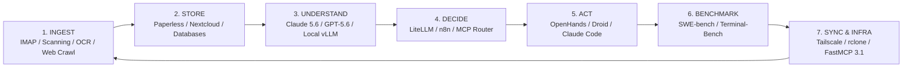

# Component Map

## What it is
The **Component Map** is the architectural blueprint of the repository's technology stack. It categorizes every tool, service, and protocol into a functional lifecycle: Ingest, Store, Understand, Decide, Act, Benchmark, and Sync. In **January 2027**, this map fully integrates the **Model Context Protocol (FastMCP 3.1)** and **MCP 3.1 Task Protocol** ecosystems.



### Functional Categories

#### 1. Ingest
*Tools responsible for receiving or capturing raw information.*
- **Email (IMAP)**: [Paperless-ngx](../services/paperless-ngx.md), [n8n](../services/n8n.md)
- **Scanning**: [OCRmyPDF](../tools/process_understanding/ocrmypdf.md), [Docling MCP](../tools/process_understanding/docling-mcp.md)
- **Manual Input**: [Obsidian](../tools/ai_knowledge/obsidian.md), [Logseq](../tools/ai_knowledge/logseq.md)
- **Inventory**: [Homebox](../services/homebox.md), [Grocy](../services/grocy.md)
- **Bookmarks/Tasks**: [Linkwarden](../services/linkwarden.md), [Habitica](../services/habitica.md)
- **Downloads**: [qBittorrent](../services/qbittorrent.md), [Jackett](../services/jackett.md)
- **Web Crawling**: [Crawl4AI](../tools/process_understanding/crawl4ai.md), [Firecrawl](../tools/process_understanding/firecrawl.md)

#### 2. Store
*Tools where information resides in a persistent state.*
- **Document Archive**: [Paperless-ngx](../services/paperless-ngx.md)
- **File Sync/Cloud**: [Nextcloud](../services/nextcloud.md), [Syncthing](../services/syncthing.md)
- **Calendars/Contacts**: [Radicale](../services/radicale.md), [Google Calendar](../tools/calendar_tasks/google_calendar.md)
- **Media/Projects**: [Jellyfin](../services/jellyfin.md), [Focalboard](../services/focalboard.md)
- **Distributed**: [Storj Node](../services/storj.md)
- **Fine-tuning**: [OpenPipe](../tools/infrastructure/openpipe.md)

#### 3. Understand (Reasoning Engines)
*The brains of the stack that process and reason over information.*
- **Proprietary APIs**: [OpenAI](../tools/ai_knowledge/openai.md), [Anthropic](../tools/providers/anthropic.md), [Mistral AI](../tools/providers/mistral.md), [DeepSeek](../tools/providers/deepseek.md), [Gemini](../tools/ai_knowledge/gemini.md) (Claude 5.1/5.6, GPT-5.5/5.6, Gemini 4.0 Pro/Ultra, DeepSeek-V4, Qwen 3.8)
- **Local Models**: [Ollama](../services/ollama.md), [Local LLMs (Gemma 3, Llama 4)](../tools/ai_knowledge/local_llms.md), [vLLM](../tools/infrastructure/vllm.md), [TGI](../tools/infrastructure/tgi.md), [SGLang](../tools/infrastructure/sglang.md), [ExLlamaV2](../tools/infrastructure/exllamav2.md), [Aphrodite Engine](../tools/infrastructure/aphrodite-engine.md), [MLX](../tools/infrastructure/mlx.md), [ansigpt](../tools/ai_knowledge/ansigpt.md), [ZSE](../tools/infrastructure/zse.md)
- **Aggregators**: [OpenRouter](../tools/ai_knowledge/openrouter.md), [Perplexity](../tools/providers/perplexity.md), [Valyu](../tools/ai_knowledge/valyu.md)
- **Semantic Search**: [Paperless-AI](../services/paperless-ai.md), [RAGFlow](../tools/process_understanding/ragflow.md), [PageIndex](../tools/process_understanding/pageindex.md)

#### 4. Decide (Orchestrate & Route)
*Tools that determine which actions to take and how to route requests.*
- **Routing Layers**: [LiteLLM](../services/litellm.md), [OpenRouter](../tools/ai_knowledge/openrouter.md), [MCP Registry](../tools/automation_orchestration/mcp-registry.md)
- **Workflow Engines**: [n8n](../services/n8n.md), [Home Assistant](../services/home-assistant.md), [Mycelium](../tools/frameworks/mycelium.md), [Haystack](../tools/frameworks/haystack.md), [Semantic Kernel](../tools/frameworks/semantic-kernel.md), [DSPy](../tools/frameworks/dspy.md)
- **Cloud Connectors**: [Zapier](../tools/automation_orchestration/zapier.md), [Make](../tools/automation_orchestration/make.md)
- **Identity**: [Authentik](../services/authentik.md)

#### 5. Act (Agents & Execution)
*Tools that perform modifications to the environment.*
- **Autonomous Agents**: [Mistral AI](../tools/providers/mistral.md), [OpenHands](../tools/development_ops/openhands.md), [Droid](../tools/development_ops/droid.md), [TeamOut](../tools/ai_knowledge/teamout.md), [OpenSwarm](../tools/development_ops/openswarm.md), [OpenClaw](../tools/development_ops/openclaw.md), [CrewAI](../tools/frameworks/crewai.md), [AutoGen](../tools/frameworks/autogen.md), [Smolagents](../tools/frameworks/smolagents.md), [LangGraph](../tools/frameworks/langgraph.md), [Agency Swarm](../tools/agents/agency-swarm.md), [Composio](../tools/agents/composio.md), [Phidata](../tools/agents/phidata.md), [Bee Agent Framework](../tools/agents/bee-agent-framework.md), [Agno](../tools/agents/agno.md)
- **Browser Agents**: [Browser Use](../tools/automation_orchestration/browser-use.md), [Skyvern](../tools/automation_orchestration/skyvern.md)
- **Coding Assistants**: [Aider](../tools/development_ops/aider.md), [Cursor](../tools/development_ops/cursor.md), [Zed](../tools/development_ops/zed.md), [VS Code](../tools/development_ops/vscode.md), [Claude Code](../tools/development_ops/claude-code.md)
- **Custom Orchestration**: [Custom Agents (SSH + LLM Loop)](../tools/development_ops/custom_agents.md)
- **Execution Plane**: [SSH Execution Patterns](ssh_execution_patterns.md)
- **Home Control**: [Home Assistant](../services/home-assistant.md)

#### 6. Sync & Infrastructure
*Tools that ensure consistency and secure connectivity.*
- **Network Access**: [Tailscale](../services/tailscale.md)
- **Protocols**: [CalDAV](../tools/intake_storage/caldav.md)
- **Data Transfer**: [rclone Automation](../services/rclone-automation.md)

#### 7. Benchmark
*Tools for evaluating model performance and reasoning.*
- **Reasoning**: [Humanity's Last Exam (HLE)](../tools/benchmarking/humanitys-last-exam.md), [LangSmith](../tools/benchmarking/langsmith.md), [LM Evaluation Harness](../tools/benchmarking/lm-evaluation-harness.md), [DREAM Benchmark](../tools/benchmarking/dream.md)
- **Agentic**: [Terminal-Bench](../tools/benchmarking/terminal-bench.md), [SWE-bench](../tools/benchmarking/swe-bench.md), [LongCLI-Bench](../tools/benchmarking/longcli-bench.md), [PA-bench](../tools/benchmarking/pa-bench.md)
- **Local Performance**: [Ollama Benchmark CLI](../tools/benchmarking/ollama-benchmark-cli.md), [LLMPerf](../tools/benchmarking/llmperf.md)

## What problem it solves
In a rapidly expanding ecosystem of AI agents and self-hosted services, it is easy to lose track of how individual components interact. This map provides a high-level view of the pipeline, helping users and automated agents identify gaps, avoid duplicates, and understand the flow of information from raw data to autonomous action.

```
+-----------------------------------------------------------------------------------+
|                            COMPONENT LIFECYCLE PIPELINE                           |
|  [INGEST] ---> [STORE] ---> [UNDERSTAND] ---> [DECIDE] ---> [ACT] ---> [BENCH]   |
+-----------------------------------------------------------------------------------+
```

## Where it fits in the stack
It is a **Core Architectural Document** that serves as the foundation for documentation taxonomy. It guides where new tools should be placed in `mkdocs.yml` and how they should be linked in the KnowledgeOps graph. It is fully updated for the **January 2027** context, incorporating **FastMCP 3.1** and **Gemma 3 / Llama 4** reasoning patterns.

## Architectural Topology & Lifecycle Matrix

```
+----------------------------------------------------------------------------------------------------+
|                               COMPONENT LIFECYCLE TOPOLOGY MATRIX                                  |
+-------------------+-----------------------------------+--------------------------------------------+
| Lifecycle Stage   | Operational Stack Layer           | Key Protocols & Engines                    |
+-------------------+-----------------------------------+--------------------------------------------+
| Ingest            | Data Intake & Capture             | IMAP, WebSockets, Crawl4AI, Docling        |
| Store             | Persistence & Archival            | PostgreSQL, S3, Paperless-ngx, Nextcloud   |
| Understand        | Inference & Multimodal Reasoning  | Claude 5.6, vLLM, DeepSeek-V4, TGI         |
| Decide            | Orchestration & Routing           | LiteLLM, n8n, FastMCP 3.1 Task Protocol    |
| Act               | Execution & Environment Mod       | Claude Code, OpenHands, Droid, Custom SSH  |
| Benchmark         | Quality & Performance Evaluation  | SWE-bench, Terminal-Bench, LLMPerf         |
| Sync              | Network & Security Mesh           | Tailscale WireGuard, Headscale, rclone     |
+-------------------+-----------------------------------+--------------------------------------------+
```

## Typical use cases
- **Onboarding**: Helping new contributors understand the relationship between different parts of the stack.
- **Audit Tool**: Identifying categories that are over-saturated or under-represented (e.g., "Decide" vs "Act").
- **Integration Planning**: Determining which tools should be connected via [n8n](../services/n8n.md) or [MCP](../knowledge_base/patterns/tool-calling-and-mcp.md) based on their functional roles.
- **Automated Catalog Validation**: Programmatically auditing markdown catalog entries against `data/all_tools.json`.

## Strengths
- **Functional Clarity**: Groups tools by "What they do" rather than "Who made them".
- **Pipeline-Oriented**: Reflects the real-world flow of data in an automated home-office.
- **Dynamic**: Updated regularly to include the latest frontier models and agent frameworks.
- **FastMCP 3.1 Native**: Seamlessly maps agent tools to the standardized MCP communication plane.

## Limitations
- **Oversimplification**: Some tools (like [Nextcloud](../services/nextcloud.md)) span multiple categories and must be placed in a "primary" category.
- **Maintenance Overhead**: Requires manual updates as new canonical pages are added to the repository.

## When to use it
- When planning a new automation workflow and selecting the best tool for each stage (Ingest, Understand, Act).
- When auditing the repository to ensure balanced coverage of the AI and automation landscape.

## When not to use it
- For granular technical configuration or installation steps (refer to individual tool pages instead).
- As a real-time system monitor (it is a conceptual map, not a status dashboard).

## Getting started
To use the Component Map effectively:
1. Start by identifying the **functional stage** of your automation (e.g., "Act" for an agent, "Store" for data).
2. Locate the corresponding section under `What it is` > `Functional Categories`.
3. Follow the links to the canonical documentation for specific tools in that category.
4. Use the map to identify upstream ("Ingest") and downstream ("Decide") dependencies.

## CLI examples
The Component Map's consistency with the filesystem is maintained via the following CLI tools:

```bash
# Verify that all tools in the map have canonical pages
python3 scripts/check_catalog_consistency.py

# Run a documentation quality audit across the architecture section
python3 scripts/audit_docs_quality.py | grep "docs/architecture"

# Validate the KnowledgeOps contract for this document
python3 scripts/check_docs_contract.py docs/architecture/component_map.md
```

## API examples

### FastMCP 3.1 Tool Catalog Server

This FastMCP 3.1 server allows agents to inspect and search tools across the Component Map lifecycle stages:

```python
"""
FastMCP 3.1 Server for Component Map Catalog Ingestion & Inspection.
Provides standardized MCP tools to query components by lifecycle stage.
"""

import json
from typing import List, Optional, Dict, Any
from pydantic import BaseModel, Field
from mcp.server.fastmcp import FastMCP

mcp = FastMCP("component-map-catalog", version="3.1.0")

class ComponentQueryRequest(BaseModel):
    category: str = Field(..., description="Target category (Ingest, Store, Understand, Decide, Act, Benchmark, Sync)")
    catalog_path: str = Field(default="data/all_tools.json", description="Path to canonical catalog JSON")

class ComponentQueryResponse(BaseModel):
    category: str
    tool_count: int
    tools: List[str]
    details: List[Dict[str, Any]]

@mcp.tool(
    name="query_component_map",
    description="Queries the repository Component Map catalog for tools matching a specific functional category."
)
def query_component_map(request: ComponentQueryRequest) -> ComponentQueryResponse:
    """Loads and returns tools matching the requested lifecycle stage."""
    try:
        with open(request.catalog_path, "r", encoding="utf-8") as f:
            data = json.load(f)

        matched_tools = []
        tool_names = []

        for item in data.get("tools", []):
            if item.get("category", "").lower() == request.category.lower():
                tool_names.append(item.get("name"))
                matched_tools.append(item)

        return ComponentQueryResponse(
            category=request.category,
            tool_count=len(tool_names),
            tools=tool_names,
            details=matched_tools
        )
    except Exception as err:
        return ComponentQueryResponse(
            category=request.category,
            tool_count=0,
            tools=[],
            details=[{"error": str(err)}]
        )

if __name__ == "__main__":
    mcp.run()
```

### Pydantic v2 Catalog Inspection Model

```python
import json
from typing import List, Dict, Optional
from pydantic import BaseModel, Field

class ToolItem(BaseModel):
    """Pydantic v2 schema for a tool in the catalog."""
    name: str = Field(description="Name of the tool")
    category: str = Field(description="Architectural category (e.g., Ingest, Store, Understand, Decide, Act, Sync)")
    description: Optional[str] = Field(default=None, description="Short description of tool purpose")
    url: Optional[str] = Field(default=None, description="Path to documentation or repository")

class ToolCatalog(BaseModel):
    """Pydantic v2 schema for the full tools catalog."""
    tools: List[ToolItem] = Field(default_factory=list, description="List of registered tools")

def query_tools_by_category(catalog_path: str, target_category: str) -> List[str]:
    """Loads and validates the tool catalog, returning names of tools in the target category."""
    try:
        with open(catalog_path, "r") as f:
            raw_data = json.load(f)

        catalog = ToolCatalog.model_validate(raw_data)

        return [
            tool.name for tool in catalog.tools
            if tool.category.lower() == target_category.lower()
        ]
    except Exception as e:
        print(f"Validation failed: {e}")
        return []

if __name__ == "__main__":
    tools_in_act = query_tools_by_category("data/all_tools.json", "Act")
    print(f"Validated 'Act' tools: {', '.join(tools_in_act)}")
```

## Diagnostic & Troubleshooting Guide

```
+----------------------------------------------------------------------------------------------------+
|                       COMPONENT MAP CATALOG DIAGNOSTIC MATRIX                                      |
+-----------------------+----------------------------------+-----------------------------------------+
| Error Condition       | Root Cause                       | Remediation Action                      |
+-----------------------+----------------------------------+-----------------------------------------+
| Catalog Mismatch      | New page added without json item | Update `data/all_tools.json`            |
| Broken Relative Link  | Markdown file moved or renamed   | Fix link path or update catalog entry   |
| Pydantic Schema Fail  | Invalid JSON structure in data   | Run schema validation test on catalog   |
| Uncategorized Tool    | Tool lacks primary category tag  | Assign lifecycle stage (e.g. Ingest)    |
+-----------------------+----------------------------------+-----------------------------------------+
```

## Operational Guardrails & Safety Protocols

1. **Canonical Path Synchronization**: Whenever a tool page is renamed or added, `data/all_tools.json` and `mkdocs.yml` must be updated concurrently.
2. **Quality Contract Gate**: Execute `scripts/check_catalog_consistency.py` and `scripts/check_docs_contract.py docs/architecture/component_map.md` prior to finalizing PRs.
3. **Pydantic v2 Schema Enforcement**: Any automated additions to the catalog must pass `ToolCatalog` schema validation.

## Related tools / concepts
- [Automated Contribution System](automated_contributions.md)
- [Multi-Agent KnowledgeOps Governance](multi_agent_knowledgeops.md)
- [Infrastructure Overview](infrastructure.md)
- [Flows and Data Movement](flows.md)
- [Jules Agent](../tools/ai_knowledge/jules.md)
- [KnowledgeOps Standards](../standards.md)
- [Model Context Protocol](../knowledge_base/patterns/tool-calling-and-mcp.md)
- [Data Copilot Architecture](data-copilot-text-to-sql.md)

## Sources / references
- [Stack Overview](http://ai.riera.co.uk)
- [Component Map Source Data](https://github.com/joanmarcriera/Home-office-automations/blob/main/data/all_tools.json)
- [MCP 3.1 Protocol](https://modelcontextprotocol.io)

---
## Contribution Metadata
- Last reviewed: 2027-01-07
- Confidence: high
