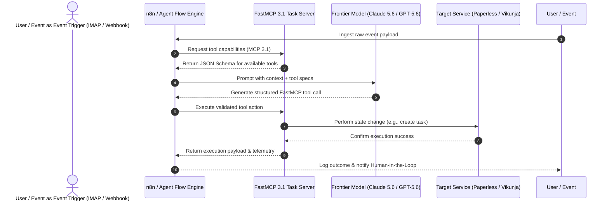

# Automation Flows & Agentic Orchestration

## What it is
Automation Flows represent the orchestration logic, state management strategies, and sequential pipelines that connect disparate services in the Home-Office AI Hub. As of **January 2027**, these have matured into **AI-Native Agentic Flows**, where autonomous agents (e.g., [Gemma 3](../tools/ai_knowledge/local_llms.md), Claude 5.1/5.6, GPT-5.5/5.6, Gemini 4.0 Pro/Ultra, DeepSeek-V4, Qwen 3.8, and Llama 4) use the **Model Context Protocol (MCP 3.1) Task Protocol** to dynamically select tools, manage long-running state, and execute complex sequences with standardized benchmarking. These flows utilize **FastMCP 3.1** for ultra-low latency tool discovery, definition, and execution.

## What problem it solves
In a complex ecosystem with 500+ documented tools, hardcoded "if-this-then-that" rules become unmaintainable. Agentic flows solve this by replacing brittle logic with "intent-based" orchestration. They bridge the gap between ingestion (scanners, webhooks) and action (calendar updates, task creation), ensuring that data is not just moved, but understood and acted upon with human-like reasoning. **AI-native visual reasoning** allows agents to interpret and interact with workflow diagrams, system status dashboards, and visual state representations directly.

## End-to-End Agentic Execution Lifecycle



## Where it fits in the stack
**Orchestration Layer** — Flows sit above individual services (like [Paperless-ngx](../services/paperless-ngx.md) or [Ollama](../services/ollama.md)) and are primarily managed by [n8n](../services/n8n.md) (visual workflows) or [Home Assistant](../services/home-assistant.md) (event-driven). They utilize the **MCP 3.1 Inference Plane** and **FastMCP 3.1** to delegate complex reasoning to frontier models while maintaining high performance.

## Typical use cases

### 1. Agentic School Activity Extraction
- **Trigger**: New email received via IMAP.
- **Reasoning**: [Claude 5.6](../tools/ai_knowledge/claude.md) analyzes the email body and PDF attachments for events using visual reasoning for layout understanding.
- **Tool Use**: Agent uses `mcp-google-calendar` via **FastMCP 3.1** to check for conflicts and `mcp-paperless` to store the notice.
- **Action**: Event is created only if no "Family" conflict exists; otherwise, it flags for human review in [Vikunja](../services/vikunja.md).

### 2. Autonomous Physical Mail Pipeline
- **Ingest**: Document scanned to a [Syncthing](../services/syncthing.md) folder.
- **Process**: [OCRmyPDF](../tools/process_understanding/ocrmypdf.md) creates a searchable layer.
- **Understand**: [Paperless-AI](../services/paperless-ai.md) extracts "Bill Amount" and "Due Date".
- **Flow**: [n8n](../services/n8n.md) triggers a payment agent that checks [Actual Budget](../services/actual-budget.md) and schedules a reminder, utilizing **MCP 3.1 Task Protocol** for execution verification.

### 3. KnowledgeOps Ralph-loop
- **Trigger**: [find_oldest_issues.py](../../find_oldest_issues.py) identifies a stale doc.
- **Action**: Jules agent (Action A) performs a freshness audit.
- **Gate**: [check_docs_contract.py](../../scripts/check_docs_contract.py) validates the PR.
- **Merge**: Autonomous merge via GitHub Actions once all KnowledgeOps gates pass.

## Orchestration Engine Matrix

| Feature | n8n | Home Assistant | Custom Python / FastMCP | Temporal | Apache Airflow |
| :--- | :--- | :--- | :--- | :--- | :--- |
| **Execution Trigger** | Webhook / Schedule | Event Bus / Sensor | Event / Script | Code / Task Queue | Cron / DAG |
| **Visual Reasoning** | Native Node Graph | Dashboard Views | External Diagram | Custom Dashboard | DAG View |
| **MCP 3.1 Native** | Native Node Plugin | Integration Blueprint| Built-in FastMCP | SDK Adapter | Python Operator |
| **Pydantic v2 Schema**| Schema Validation | YAML Schema | Native Type Hints | Native Data Classes| Pydantic Operators |
| **Human-in-the-Loop**| Native Wait Nodes | Mobile Notifications| Interactive Prompt | Workflow Signals | Manual Approvals |

## Event Payload Validation Schema (Pydantic v2)

| Field Name | Type | Description | Validation Rule |
| :--- | :--- | :--- | :--- |
| `task_id` | `str` | Unique tracking identifier for execution. | Must follow `task-YYYY-MM-DD-XXXX` pattern |
| `event_source` | `str` | Source channel originating the workflow. | Enums: `imap`, `webhook`, `cron`, `sensor` |
| `priority` | `int` | Execution queue preference rating. | Range: `1` (low) to `5` (critical) |
| `payload_data` | `dict` | Contextual event key-value mapping. | Schema validated per event type |
| `mcp_protocol_version`| `str` | Active MCP version string. | Default: `3.1` |

## Strengths
- **Resilience**: Agentic flows can "self-heal" by retrying with different prompts or tools if a step fails.
- **Scalability**: New services can be added to the hub and immediately used by agents via **FastMCP 3.1** discovery.
- **State Awareness**: Modern flows utilize "Long-Term Memory" (Vector DBs) to maintain context across multi-day tasks.
- **Intent-Based**: Users define the *outcome*, and the flow determines the *path*.
- **Visual Reasoning**: Agents can now reason about the structure of visual workflows, enabling better self-optimization of n8n graphs.

## Limitations
- **Latency**: Agentic reasoning steps add seconds or minutes compared to sub-second hardcoded triggers, though **FastMCP 3.1** mitigates this for tool calls.
- **Non-Deterministic**: The same input may occasionally result in different flow paths due to LLM variance.
- **Cost**: Frequent calls to frontier models (Claude 5.6, GPT-5.6, Gemini 4.0 Ultra) can incur significant API costs if not optimized.

## When to use it
- When tasks require "judgment" (e.g., determining if a document is "urgent").
- For multi-step processes involving more than three disparate services.
- When you want to build a "Self-Improving" system (like the Ralph-loop).
- When leveraging **Gemma 3** or **Llama 4** for local, privacy-preserving orchestration.

## When not to use it
- For simple, time-critical triggers (e.g., "turn on light when motion is detected").
- For one-off tasks that take less than 2 minutes to perform manually.
- When the data is extremely sensitive and local-only processing ([Gemma 3](../tools/ai_knowledge/local_llms.md)) is unavailable.

## Getting started

### 1. Choose Your Engine
- **n8n**: Best for complex, multi-service API orchestration and long-running state.
- **Home Assistant**: Best for real-time, event-driven automation of physical hardware.
- **Custom Scripts**: Best for specialized maintenance tasks (see `scripts/`).

### 2. Connect via MCP 3.1 & FastMCP 3.1
Ensure your workflow engine can speak to the hub's **FastMCP** servers. This allows your flows to use repository tools natively with ultra-low latency. Implement the **MCP 3.1 Task Protocol** for standardized task execution.

### 3. Implement "Human-in-the-Loop"
Always include a "Wait for Approval" or "Review" step for high-stakes actions (like financial payments or deleting files).

## CLI examples
Trigger and monitor flows using the hub's utility scripts:

```bash
# Trigger the Ralph-loop maintenance flow manually
python3 find_oldest_issues.py --trigger-jules

# Check the status of the daily digest flow
python3 scripts/n8n_log_aggregator.py --flow daily-digest

# Validate the output of a document extraction flow using Task Protocol
python3 scripts/validate_new_sources.py --last-24h --use-task-protocol
```

## API examples
Orchestrate flows programmatically using Python and the n8n API with Task Protocol headers and Pydantic v2 validation:

```python
import requests
from typing import Dict, Any, Optional
from pydantic import BaseModel, Field, HttpUrl

class FlowConfig(BaseModel):
    """Configuration for triggering an Agentic Flow under MCP 3.1."""
    task_id: str = Field(description="Unique task identifier")
    protocol_version: str = Field(default="3.1", description="MCP protocol version")
    webhook_url: HttpUrl = Field(description="The n8n webhook endpoint to trigger")
    payload: Dict[str, Any] = Field(default_factory=dict, description="Metadata payload for execution")

class FlowResult(BaseModel):
    """Result schema for validated flow execution."""
    task_id: str
    status: str
    workflow_id: Optional[str] = None
    error_message: Optional[str] = None

def trigger_agentic_flow(config: FlowConfig) -> FlowResult:
    """Triggers an n8n workflow with a specific payload and MCP 3.1 headers."""
    headers = {
        "X-MCP-Task-ID": config.task_id,
        "X-MCP-Task-Protocol": config.protocol_version,
        "Content-Type": "application/json"
    }

    try:
        response = requests.post(
            str(config.webhook_url),
            json=config.payload,
            headers=headers,
            timeout=10
        )
        if response.status_code == 200:
            res_data = response.json()
            return FlowResult(
                task_id=config.task_id,
                status="success",
                workflow_id=res_data.get("workflow_id")
            )
        else:
            return FlowResult(
                task_id=config.task_id,
                status="failed",
                error_message=f"HTTP {response.status_code}: {response.text}"
            )
    except Exception as e:
        return FlowResult(
            task_id=config.task_id,
            status="error",
            error_message=str(e)
        )

# Example usage:
if __name__ == "__main__":
    config_obj = FlowConfig(
        task_id="task-2027-01-07",
        webhook_url="http://n8n:5678/webhook/school-extraction",
        payload={"source": "imap", "subject": "School Calendar Update"}
    )
    result = trigger_agentic_flow(config_obj)
    print(result.model_dump_json(indent=2))
```

### Self-Healing Retry Flow Implementation with FastMCP 3.1
This FastMCP 3.1 tool server demonstrates self-healing flow execution where agents automatically re-prompt or fallback if downstream tasks fail:

```python
import json
import time
from pydantic import BaseModel, Field
from mcp.server.fastmcp import FastMCP

mcp = FastMCP("SelfHealingFlowServer", version="3.1")

class WorkflowExecutionRequest(BaseModel):
    workflow_id: str = Field(..., description="Target n8n or Python workflow ID")
    max_retries: int = Field(default=3, ge=1, le=5)
    parameters: dict = Field(default_factory=dict)

@mcp.tool(name="execute_self_healing_workflow", description="Executes workflow with automatic retry self-healing via FastMCP 3.1.")
def execute_self_healing_workflow(request_json: str) -> str:
    try:
        data = json.loads(request_json)
        req = WorkflowExecutionRequest.model_validate(data)

        for attempt in range(1, req.max_retries + 1):
            # Simulated flow step attempt
            if attempt < req.max_retries:
                # Simulate intermittent error on early attempts
                time.sleep(0.5)
                continue
            return json.dumps({
                "status": "success",
                "workflow_id": req.workflow_id,
                "attempts_taken": attempt,
                "healed": True if attempt > 1 else False
            })
        return json.dumps({"status": "failed", "error": "Exceeded max retries"})
    except Exception as e:
        return json.dumps({"status": "error", "message": str(e)})

if __name__ == "__main__":
    mcp.run()
```

## Operational Safety & Self-Healing Guidelines
- **Circuit Breakers**: Implement request rate limits and retry caps on automated loops to prevent continuous API token drain during tool outage events.
- **Dead-Letter Task Sinks**: Route unresolvable workflow exceptions to human approval queues in Vikunja or Home Assistant dashboards.
- **Audit Logging**: Persist full FastMCP 3.1 tool execution histories to a local SQLite/PostgreSQL store for compliance and auditing.

## Troubleshooting & Failure Recovery
- **Non-Deterministic Branching**: If agent decisions fluctuate across runs, enforce strict Pydantic v2 enum outputs and set model temperature lower ($\le 0.1$).
- **Webhook Timeouts**: For processes exceeding 30 seconds, transition synchronous HTTP triggers to async queue processing with callback status updates.

## Related tools / concepts
- [n8n](../services/n8n.md) — The primary workflow orchestration engine.
- [Home Assistant](../services/home-assistant.md) — Event-driven automation hub.
- [Paperless-ngx](../services/paperless-ngx.md) — Document storage and metadata sink.
- [Model Context Protocol](../tools/automation_orchestration/mcp.md) — The communication standard for agentic tools.
- [Gemma 3](../tools/ai_knowledge/local_llms.md) — Privacy-first local model for agentic orchestration.
- [Jules Agent](../tools/ai_knowledge/jules.md) — The primary executor of maintenance flows.
- [Multi-Agent KnowledgeOps](./multi_agent_knowledgeops.md) — Governance for parallel agent flows.
- [Automated Contributions](./automated_contributions.md) — The Ralph-loop flow implementation.
- [Vikunja](../services/vikunja.md) — Task management sink for agentic actions.

## Sources / References
- [n8n: Agentic Workflows Guide](https://n8n.io/blog/agentic-workflows/)
- [Anthropic: Agentic Design Patterns](https://www.anthropic.com/research/building-effective-agents)
- [MCP 3.1 Specification](https://modelcontextprotocol.io/)
- [FastMCP 3.1: High-Performance Tool Hosting](https://modelcontextprotocol.io/fastmcp)
- [Home Assistant: Automation Blueprinting](https://www.home-assistant.io/docs/automation/blueprints/)

---
## Contribution Metadata
- Last reviewed: 2027-01-07
- Confidence: high
