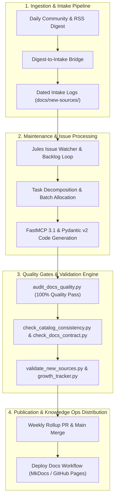

---
hide:
  - navigation
  - toc
---

# Home-Office Automation & AI Hub

> Operational documentation for AI-enabled home-office automation, maintained by humans and agents with explicit quality gates. Updated for early January 2027 SOTA standards (incorporating FastMCP 3.1, Claude 5.1/5.6, GPT-5.5/5.6, Gemini 4.0 Pro/Ultra, Llama 4, and Pydantic v2 validation).

## Start by Goal

-   **Implement a workflow**

    ---

    Go to [Playbooks](playbooks/index.md) for step-by-step execution guides.

-   **Evaluate or compare tools**

    ---

    Start in the [Tool Catalogue](tools/README.md), then use the [AI Tooling Landscape](knowledge_base/ai_tooling_landscape.md) for context.

-   **Build a website or app quickly**

    ---

    Start in the [AI Builder Index](knowledge_base/ai_builder_index.md), then use the [Free AI Website Playbook](knowledge_base/free_ai_website_playbook.md).

-   **Choose the right model**

    ---

    Start with the [Model Routing Guide](knowledge_base/model_routing_guide.md).

-   **Understand architecture and system design**

    ---

    Use [Architecture](architecture/README.md) for component maps, flows, and governance.

-   **Contribute safely (human or agent)**

    ---

    Follow [Contributing](CONTRIBUTING.md), [Standards](standards.md), and the [Agent Rules](https://github.com/joanmarcriera/Home-office-automations/blob/main/AGENTS.md).

---

## Section Guide & Knowledge Directory

| Section | Description & Scope | Entry Point |
| :--- | :--- | :--- |
| **New Sources** | Intake queue process and dated discovery logs used by automation workflows for tracking emerging tools and ecosystem shifts. | [new-sources.md](new-sources.md) |
| **Playbooks** | Reusable, step-by-step execution guides for recurring operational workflows, home-lab services, and agent deployments. | [playbooks/index.md](playbooks/index.md) |
| **Services** | Self-hosted service documentation, including deployment contexts, systemd unit files, Docker Compose configs, and use cases. | [services/README.md](services/README.md) |
| **Tool Catalogue** | Canonical documentation pages for AI tools, frameworks, LLM providers, autonomous agents, infrastructure, and benchmarking. | [tools/README.md](tools/README.md) |
| **Knowledge Base** | Foundational concepts, protocols (FastMCP 3.1), multi-modal RAG patterns, agent routing, security, and landscape benchmarks. | [knowledge_base/README.md](knowledge_base/README.md) |
| **Architecture** | System design diagrams, component maps, data flows, infrastructure decisions, and multi-agent knowledge ops governance. | [architecture/README.md](architecture/README.md) |
| **Reference Implementations** | Concrete prompt templates, Pydantic v2 schemas, mapping rules, n8n workflow exports, and runnable scripts. | [reference-implementations/index.md](reference-implementations/index.md) |
| **Reports** | Automated batch decomposition reports, audit logs, growth tracking metrics, and backlog health reports. | [reports/index.md](reports/index.md) |
| **Roadmap** | Planned platform capabilities, architectural shifts, and upcoming integrations. | [roadmap](../roadmap.md) |
| **Standards** | Canonical taxonomy, quality audit rules, metadata schemas, dedup policies, and agent contribution contracts. | [standards.md](standards.md) |

---

## Architectural Topography & KnowledgeOps Control Loop

### System Component Mapping

- **Daily Digest**: `.github/workflows/daily-digest.yml`
- **Digest-to-Intake Bridge**: `.github/workflows/digest-to-intake.yml`
- **Jules Maintenance Issues**: `.github/workflows/daily-jules-maintenance.yml`
- **Jules PRs / Weekly Rollup PR**: Jules bot PRs plus `automation/weekly-rollup`
- **Quality Gates**: Document standards, catalog consistency, intake validation, link checking, and schema compliance
- **Weekly Backlog & Deepening Loops**: `.github/workflows/process-jules-backlog.yml`, `.github/workflows/daily-jules-knowledge.yml`, `.github/workflows/weekly-planner.yml`, `.github/workflows/weekly-automation-rollup-merge.yml`
- **Scheduled Pipeline**: `.github/workflows/odd-day-pipeline.yml` is the single scheduled entry point (00:30 UTC, odd days of the month only); it executes the pipeline lanes as a unified chain.
- **Hygiene & Maintenance**: Automated PR hygiene, issue tracking, and branch cleanup ensuring repository health.
- **Publishing Pipeline**: `deploy-docs.yml` renders and deploys the documentation suite to GitHub Pages upon validated merges.
- **Watchdog Agent**: `automation-health.yml` monitors pipeline health and alerts maintainers to potential regressions.

---

## Agentic Routing & Model Selection Reference

To ensure optimal resource utilization across automated operations, agents follow strict model routing rules:

| Task Domain | Primary Model Target | Protocol / Standard | Failover Strategy |
| :--- | :--- | :--- | :--- |
| **Complex Code Generation & Refactoring** | Claude 5.6 Sonnet / GPT-5.6 | FastMCP 3.1 Task Protocol | DeepSeek-V4 / Llama 4 Maverick |
| **High-Throughput Intake & Categorization** | Gemini 4.0 Flash / Claude 3.5 Haiku | Pydantic v2 Schema JSON | Gemma 4 Local |
| **Privacy-Preserving Local Execution** | Gemma 4 27B / Llama 4 70B | Local Ollama / vLLM | Local CPU/GPU Fallback |
| **Multi-Modal Document Layout Analysis** | Gemini 4.0 Pro / GPT-5.5 Vision | Visual Bounding Box / hOCR | Tesseract v5.5 Local |

---

## Maintenance Entry Points

- Human Maintainers: [CONTRIBUTING.md](CONTRIBUTING.md)
- Autonomous Agents: [AGENTS.md](https://github.com/joanmarcriera/Home-office-automations/blob/main/AGENTS.md) (repo-root configuration on GitHub)
- Agent Skill Definitions: [skills.md](https://github.com/joanmarcriera/Home-office-automations/blob/main/skills.md) (repo-root capabilities matrix on GitHub)

<small>Use this index as the primary navigation hub. Consult individual section overview pages for specific taxonomy and deployment guides.</small>

---

## Sources / References
- [Automated Contributions Architecture](architecture/automated_contributions.md)
- [Multi-Agent KnowledgeOps Governance](architecture/multi_agent_knowledgeops.md)
- [Contributing Standards & Guidelines](CONTRIBUTING.md)
- [FastMCP 3.1 Specification](https://modelcontextprotocol.org)

---

## Contribution Metadata
- Last reviewed: 2026-10-28
- Confidence: high
