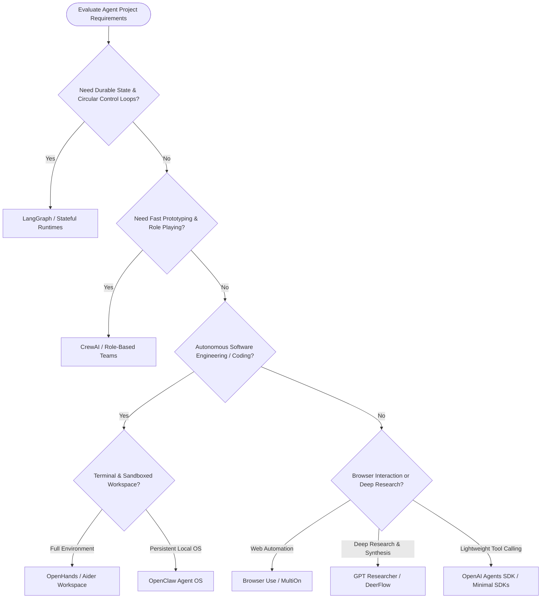

# Agent Framework Learning Map

## What it is

The Agent Framework Learning Map is a structured guide designed to help developers and architects navigate the rapidly evolving ecosystem of AI agent frameworks. It categorizes tools into stateful runtimes, lightweight SDKs, role-based frameworks, and specialized components to provide a clear path from conceptual learning to production deployment in late December 2026 / early January 2027.

## What problem it solves

The explosion of agentic tools has created a "choice overload" problem where every framework is marketed as a general-purpose solution. This map solves that by differentiating between tools optimized for research, rapid prototyping, autonomous coding, or high-reliability production orchestration. It prevents "framework fatigue" by recommending a specific learning order based on the desired outcome and current industry capabilities, utilizing state-of-the-art standards like FastMCP 3.1.

## Where it fits in the stack

**Category**: Knowledge Base / Learning Path. It sits in the **architectural decision layer**, serving as a meta-framework that informs the selection of specific tools like [LangGraph](../tools/frameworks/langgraph.md), [CrewAI](../tools/frameworks/crewai.md), or [AutoGen](../tools/frameworks/autogen.md).

## Architectural Decision Flowchart

The following flowchart guides system architects in selecting the optimal agent framework based on state persistence, sub-agent spawning requirements, sandboxed code execution, and web browser automation:



## Typical use cases

- **Architectural Triage**: Deciding whether a project requires a stateful graph (LangGraph) or a conversational multi-agent system (AutoGen).
- **Skill Upgrading**: Following a curated path to move from basic prompt chains to complex, long-horizon autonomous agents using Claude 5.6, GPT-5.6, or Gemini 4.0 Ultra.
- **Homelab Automation**: Selecting the right "personal OS" (OpenClaw) and routing layer (LiteLLM) for local-first agent workflows.
- **Enterprise Prototyping**: Quickly identifying role-based frameworks (CrewAI) for demonstrating multi-agent collaboration to stakeholders.

## Framework Taxonomy & Feature Matrix (Late 2026 / Early 2027)

| Tool | Framework Category | State Durability | Sub-Agent Spawning | FastMCP 3.1 Support | Human-In-Loop Mechanism | Production Readiness |
| :--- | :--- | :---: | :---: | :---: | :---: | :--- |
| [LangGraph](../tools/frameworks/langgraph.md) | Stateful Graph Runtime | Persistent Checkpoints | Native | Native | First-Class Interrupts | Excellent |
| [OpenAI Agents SDK](../tools/frameworks/openai-agents-sdk.md) | Minimalist Agent SDK | Session Memory | Handoff Tokens | Native | Callbacks / Guardrails | Strong |
| [CrewAI](../tools/frameworks/crewai.md) | Role-Based Multi-Agent | Memory Threads | Delegated Tasks | Native | Manager Interruption | Moderate |
| [AutoGen](../tools/frameworks/autogen.md) | Conversation Engine | Ephemeral / Logs | Dynamic Group Chat | Community | User Proxy Agent | Mixed |
| [OpenHands](../tools/development_ops/openhands.md) | Autonomous Coding Agent | Git / Workspace Snapshot | Sub-Agents | Native | Interactive Terminal | Emerging |
| [OpenClaw](../tools/development_ops/openclaw.md) | Personal Agent OS | Persistent SQLite DB | Skill Workers | Native | Mobile / Chat Prompts | Experimental |
| [Browser Use](../tools/automation_orchestration/browser-use.md) | Web Browser Automation | Cookie / Session State | Concurrent Browsers | Native | Visual Debug Overlay | Strong |
| [GPT Researcher](../tools/agents/gpt-researcher.md) | Autonomous Research | File Reports | Sub-Researchers | Native | Report Approval | Niche SOTA |
| [Letta](../tools/agents/letta.md) | Memory-First Architecture | Core / Archival Memory | Memory Workers | Native | Context Editing UI | Emerging |
| [DeerFlow](../tools/agents/deerflow.md) | Research & Coding Harness | Multi-Tenant Sandbox | Sub-Harness Spawning | Native | Step Approvals | Emerging |

## Strengths

- **Outcome-Oriented**: Focuses on what the tool is *best for*, not just what it can do.
- **Classification Clarity**: Separates libraries (SDKs) from environments (Operating Systems) and specialized modules.
- **Local-First Friendly**: Prioritizes stacks that work well with local models and privacy-conscious architectures.
- **Model Agnostic**: Explicitly supports routing between Claude 5.6 (reasoning), GPT-5.6 (speed), Gemini 4.0 Ultra, DeepSeek-V4, Gemma 4, Qwen 3.6 VL, and Llama 4 (local).
- **MCP Native**: Emphasizes frameworks that natively support the Model Context Protocol (FastMCP 3.1) for universal tool access.

## Limitations

- **Fast-Moving Field**: New frameworks emerge weekly, requiring frequent updates to maintain relevance.
- **Subjective "Defaults"**: Recommendations for "production-ready" tools reflect current repository standards and may vary by specific use case.
- **Depth vs Breadth**: Provides a high-level map rather than deep technical tutorials for every individual framework.

## When to use it

- When you are starting a new agentic project and need to choose an architecture.
- When you are overwhelmed by the number of GitHub repos claiming to be "the best" agent framework.
- When you want to understand the difference between an Agent SDK and an Agent Operating System.

## When not to use it

- If you have already standardized on a specific stack and only need deep API documentation.
- If you are building a simple, stateless chatbot that does not require agentic reasoning or tool use.

## Getting started

To adopt agent frameworks systematically:

1. **The Hello World of Agents**: Start by reading the [OpenAI Agents SDK](../tools/frameworks/openai-agents-sdk.md) documentation. It provides the simplest abstraction for tool calling and handoffs.
2. **Master the State**: Move to [LangGraph](../tools/frameworks/langgraph.md). Build a simple circular workflow (e.g., a "Correction Loop" where one agent writes and another audits).
3. **Explore Multi-Agent Dynamics**: Deploy a [CrewAI](../tools/frameworks/crewai.md) team of three agents (Researcher, Writer, Editor) to see how role-playing affects output quality.
4. **Autonomous Execution**: Install [Aider](../tools/development_ops/aider.md) or explore the [OpenHands](../tools/development_ops/openhands.md) codebase to see how agents interact with a real terminal and file system.

### Recommended Learning Order (Late 2026 / Early 2027 Update)

#### Fundamentals
1. [LangGraph](../tools/frameworks/langgraph.md) (paired with Claude 5.6 or GPT-5.6 for advanced reasoning and routing)
2. [OpenAI Agents SDK](../tools/frameworks/openai-agents-sdk.md) (using GPT-5.6 or Gemini 4.0 Ultra)
3. [CrewAI](../tools/frameworks/crewai.md)
4. [AutoGen](../tools/frameworks/autogen.md)

#### Coding Agents
1. [OpenHands](../tools/development_ops/openhands.md) (with Claude 5.6 / DeepSeek-V4 / Aider)
2. [OpenClaw](../tools/development_ops/openclaw.md)

#### Specialized Patterns
1. [Browser Use](../tools/automation_orchestration/browser-use.md)
2. [GPT Researcher](../tools/agents/gpt-researcher.md)
3. [Letta](../tools/agents/letta.md)
4. [DeerFlow](../tools/agents/deerflow.md)

## CLI examples

### Initializing a LangGraph project
Developers often start with a template to ensure state management is correctly configured.
```bash
# Clone the LangGraph starter template
git clone https://github.com/langchain-ai/langgraph-starter.git
cd langgraph-starter
pip install -r requirements.txt
```

### Running an OpenHands session
For autonomous coding tasks, OpenHands provides a CLI to launch the environment.
```bash
# Run OpenHands via Docker for a sandboxed coding environment
docker run -it \
    -e SANDBOX_USER_ID=$(id -u) \
    -e WORKSPACE_BASE=$PWD/workspace \
    -v /var/run/docker.sock:/var/run/docker.sock \
    -v $PWD/workspace:/opt/workspace \
    ghcr.io/all-hands-ai/openhands:0.15
```

## API examples

### Simple Agent Handoff (OpenAI Agents SDK)
A minimal example showing how to hand off a task between two specialized agents using GPT-5.6 or Claude 5.6.
```python
from openai_agents import Agent, Runner

def get_weather(location: str):
    return f"The weather in {location} is 72°F and sunny."

weather_agent = Agent(
    name="Weather Agent",
    instructions="You are a weather specialist.",
    tools=[get_weather]
)

triage_agent = Agent(
    name="Triage Agent",
    instructions="Determine if the user needs weather info and hand off if so.",
)

# Handing off task from triage to weather
runner = Runner()
response = runner.run(triage_agent, "What is the weather in San Francisco?")
print(response.final_text)
```

### Stateful Graph Logic with Pydantic v2 State Validation (LangGraph)
Defining a stateful graph where an auditor agent reviews and validates content produced by a generator agent:

```python
from typing import Dict, Any, List, Optional
from pydantic import BaseModel, Field, ValidationError
from langgraph.graph import StateGraph, END

class AgentStateSchema(BaseModel):
    task_id: str = Field(..., description="Unique task tracker ID")
    content: str = Field(default="", description="Drafted content payload")
    review_status: str = Field(default="pending", description="Status: pending, approved, or rewrite")
    iteration_count: int = Field(default=0, ge=0, le=5)

def writer_node(state: dict) -> dict:
    current = AgentStateSchema.model_validate(state)
    new_text = f"Draft v{current.iteration_count + 1}: High quality autonomous agent architecture document."
    return {
        "task_id": current.task_id,
        "content": new_text,
        "review_status": "pending",
        "iteration_count": current.iteration_count + 1
    }

def auditor_node(state: dict) -> dict:
    current = AgentStateSchema.model_validate(state)
    status = "approved" if "High quality" in current.content else "rewrite"
    return {
        "task_id": current.task_id,
        "content": current.content,
        "review_status": status,
        "iteration_count": current.iteration_count
    }

workflow = StateGraph(dict)
workflow.add_node("writer", writer_node)
workflow.add_node("auditor", auditor_node)

workflow.set_entry_point("writer")
workflow.add_edge("writer", "auditor")
workflow.add_conditional_edges(
    "auditor",
    lambda x: x["review_status"],
    {"rewrite": "writer", "approved": END}
)

app = workflow.compile()
print("LangGraph workflow compiled with Pydantic v2 state validation.")
```

### FastMCP 3.1 Agent Task Dispatch Server
Standardized FastMCP 3.1 server exposing framework routing and agent task execution tools:

```python
from typing import Dict, Any
from pydantic import BaseModel, Field, ValidationError
from mcp.server.fastmcp import FastMCP

mcp = FastMCP("agent-framework-router")

class TaskDispatchPayload(BaseModel):
    framework: str = Field(..., description="Target framework: langgraph, crewai, openhands, or multion")
    goal: str = Field(..., min_length=5, description="High-level task goal description")
    max_steps: int = Field(default=10, ge=1, le=50)

@mcp.tool()
def dispatch_agent_task(payload_dict: Dict[str, Any]) -> Dict[str, Any]:
    """Validates and dispatches a task to the selected agent framework runtime."""
    try:
        task = TaskDispatchPayload.model_validate(payload_dict)
        return {
            "status": "dispatched",
            "framework": task.framework,
            "goal": task.goal,
            "session_id": f"sess-{task.framework}-99812",
            "protocol_version": "FastMCP 3.1"
        }
    except ValidationError as e:
        return {"status": "error", "message": e.errors()}

if __name__ == "__main__":
    mcp.run()
```

## Production Guardrails & Operational Security Guidelines

1. **Sandboxed Code Execution**:
   - Software engineering agents (OpenHands, DeerFlow, Aider) must always run inside non-root Docker containers or gVisor microVMs with restricted network egress to avoid accidental code injection or credential leakage.

2. **Recursion & Step Limits**:
   - Enforce hard execution step limits (`max_steps=20` or `recursion_limit=25`) in stateful graph engines (LangGraph) to prevent runaway LLM loops during recursive tool calls.

3. **Human-in-the-Loop Interruption**:
   - Require explicit human confirmation (`interrupt_before=["tool_execution"]`) prior to issuing destructive actions like database writes, monetary transactions, or outbound email dispatches.

## Troubleshooting & Framework Diagnostic Guide

| Diagnostic Symptom | Probable Cause | Diagnostic Command / Tool | Remediation Action |
| :--- | :--- | :--- | :--- |
| **Infinite Re-planning Loop** | Sub-agent state not updating completion flag correctly | Checkpoint inspector (`langgraph.get_state()`) | Ensure state node returns explicit status state key updates |
| **Deadlocked Group Chat** | Speaker selection logic unable to resolve next speaker in AutoGen | `autogen.GroupChatManager.debug_log` | Set explicit `speaker_selection_method="round_robin"` or custom selector |
| **Out-of-Context Memory Leak** | Agent appending full uncompressed scratchpads to every turn | FastMCP context window monitor | Integrate [Letta](../tools/agents/letta.md) core memory pruning or chunk summarization |
| **Tool Calling Schema Error** | MCP schema format mismatch between agent and server | `python -m mcp.cli validate` | Re-generate tool definitions using FastMCP 3.1 Pydantic v2 models |

## Related tools / concepts

- [AI Tooling Landscape](ai_tooling_landscape.md)
- [AI Builder Index](ai_builder_index.md)
- [Agent Protocols](agent_protocols.md)
- [Agentic Workflows](patterns/agentic-workflows.md)
- [OpenClaw Workflow Prompts](patterns/openclaw-workflow-prompts.md)
- [Data Copilot Text-to-SQL Architecture](../architecture/data-copilot-text-to-sql.md)
- [Multi-Agent KnowledgeOps](../architecture/multi_agent_knowledgeops.md)
- [Flows](../architecture/flows.md)
- [Infrastructure](../architecture/infrastructure.md)
- [LiteLLM](../services/litellm.md)

## Sources / References

- [LangGraph documentation](https://langchain-ai.github.io/langgraph/)
- [OpenAI Agents SDK documentation](https://openai.github.io/openai-agents-python/)
- [CrewAI documentation](https://docs.crewai.com/)
- [AutoGen documentation](https://microsoft.github.io/autogen/)
- [OpenHands documentation](https://docs.openhands.dev/)
- [OpenClaw documentation](https://docs.openclaw.ai/)
- [Browser Use documentation](https://docs.browser-use.ai/)
- [GPT Researcher GitHub](https://github.com/assafelovic/gpt-researcher)
- [Letta documentation](https://docs.letta.com/)
- [DeerFlow GitHub](https://github.com/bytedance/deer-flow)
- [Model Context Protocol Specification v3.1](https://modelcontextprotocol.org/spec)

## Contribution Metadata

- Last reviewed: 2027-01-07
- Confidence: high
