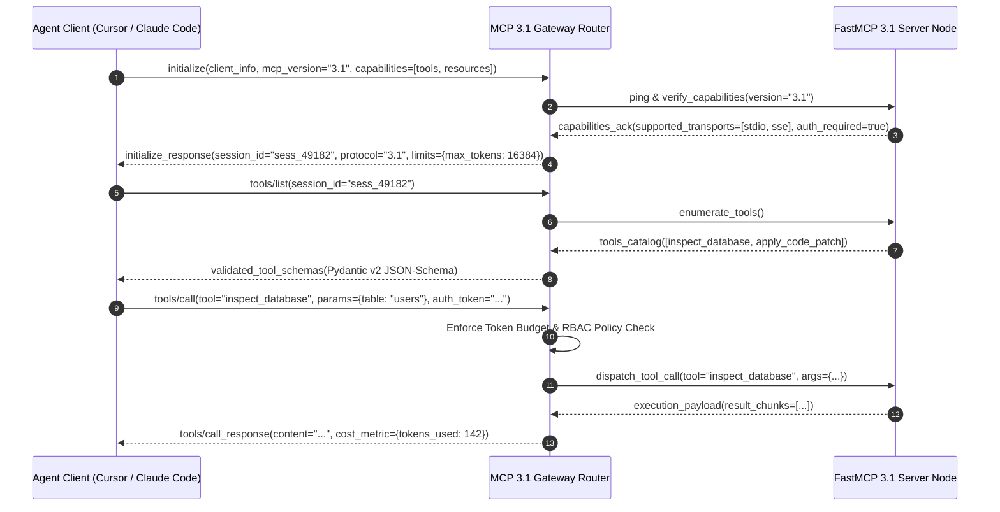

# AI Agent Protocols

## What it is
AI Agent Protocols are standardized open specifications and application-layer transport frameworks that enable seamless interoperability between autonomous AI agents, peripheral tools, integrated development environments (IDEs), and distributed enterprise data sources. In early January 2027, the ecosystem is anchored by the **Model Context Protocol (MCP) 3.1** with native **FastMCP 3.1** server-client frameworks, alongside the **Agent Client Protocol (ACP)** and the emerging **Autonomous Agent Interoperability Standards (AAIS)**.

These protocols strictly decouple the reasoning "brain" (the LLM, such as Claude 5.1/5.6, GPT-5.5/5.6, Gemini 4.0 Pro/Ultra, DeepSeek-V4, Llama 4, Gemma 3/4, or Qwen 3.8) from external "tools" (APIs, databases, file system sandboxes) and the "interface" (IDEs like Cursor, Zed, VS Code, and terminal-native orchestrators).

MCP 3.1 introduces first-class **Agentic Session Orchestration**, **Autonomous Tool Discovery**, and **Identity-Aware Tool Routing**, allowing protocol gateways to maintain state across multi-turn reasoning loops while enforcing granular role-based access control (RBAC), strict token budget governance, and cryptographic payload auditing at every tool boundary.

## What problem it solves
The rapid proliferation of agentic tooling historically created severe fragmentation: every vendor platform implemented bespoke JSON payloads, proprietary authentication wrappers, and brittle function-calling formats. Agents were locked into proprietary silos, requiring extensive "glue code" that degraded reliability.

Protocols eliminate this architectural tax by establishing a universal, schema-validated interface. An MCP 3.1 compliant server tool (such as an SQL inspection tool, git diff analyzer, or web retrieval connector) can be consumed immediately by any compatible host client—from lightweight CLI agents like [Claude Code](../tools/development_ops/claude-code.md) to distributed multi-agent swarms. Furthermore, protocols solve version skew through bidirectional capability negotiation and standardized JSON-RPC 2.0 serialization.

## Where it fits in the stack
Protocols operate as the **Universal Communication & Contract Layer** in modern AI infrastructure. Situated directly between high-level agent orchestrators (such as [LangGraph](../tools/frameworks/langgraph.md), [Bee Agent Framework](../tools/agents/bee-agent-framework.md), or [Agno](../tools/agents/agno.md)) and low-level peripheral services, protocols enable plug-and-play modularity within [Multi-Agent KnowledgeOps](../architecture/multi_agent_knowledgeops.md).

## Protocol Specification Comparison Matrix

| Protocol Standard | Primary Scope | Transport Mechanisms | Statefulness & Context | Serialization Formats | Authentication & Governance |
| :--- | :--- | :--- | :--- | :--- | :--- |
| **MCP 3.1 (FastMCP)** | Tool, Resource & Prompt Access | Stdio, SSE (HTTP/2), WebSockets | Stateful Session Tracking & Caching | JSON-RPC 2.0 & Binary CBOR | Identity-Aware RBAC & Token Caps |
| **ACP (Agent Client Protocol)** | IDE & Editor Agent Collaboration | Unix Domain Sockets, Stdio Pipes | Transactional AST Buffer States | JSON-RPC 2.0 Streaming | Editor Workspace Trust Anchors |
| **AAIS (Autonomous Interoperability)** | Agent-to-Agent Swarm Negotiation | gRPC, HTTP/2 Stream, NATS JetStream | Distributed Shared Memory & DAGs | Protocol Buffers (proto3) | Decentralized JWT & Mutual TLS |
| **FIPA-ACL (Legacy Standard)** | Multi-Agent Speech Act Systems | TCP Sockets, SMTP, CORBA | Message Exchange State | S-Expressions / Text Strings | Pre-Shared Cryptographic Signatures |
| **AutoGen Conversable Protocol** | Conversational Group Chats | Python Direct Memory / REST | Thread History Context Buffers | JSON Dicts / Python Pickles | In-Memory Object References |

## Transport Layer Performance & Serialization Benchmarks

The choice of transport and serialization mechanism has profound consequences for latency-sensitive multi-agent workflows:

| Transport / Wire Format | Round-Trip Latency (p50) | Throughput (Messages/sec) | Memory Footprint per Client | Firewall & Proxy Traversal | Best Applied Scenario |
| :--- | :--- | :--- | :--- | :--- | :--- |
| **STDIO (JSON-RPC 2.0)** | 0.42 ms | ~14,500 msg/s | 1.8 MB | N/A (Local Subprocess Only) | Local IDEs (Cursor/Zed), CLI daemons, sandboxes |
| **HTTP/2 SSE (JSON-RPC)** | 2.15 ms | ~4,200 msg/s | 3.4 MB | High (Standard HTTP ports 80/443) | Cloud-hosted MCP microservices, browser clients |
| **WebSockets (JSON-RPC)** | 1.30 ms | ~8,900 msg/s | 4.1 MB | Moderate (Requires WS upgrade proxy support)| Interactive streaming, bidirectional notifications|
| **gRPC / HTTP/2 (Protobuf)**| 0.68 ms | ~18,200 msg/s | 2.6 MB | Moderate (Requires HTTP/2 capable ingress) | High-volume swarm coordination, microservices |
| **Binary CBOR over Unix Sock**| 0.28 ms | ~26,000 msg/s | 1.2 MB | N/A (Local Host Socket Only) | High-throughput local multi-modal telemetry |

## Protocol Architecture & Interaction Topology

```
+--------------------------------------------------------------------------------------------------------------------+
|                                    AUTONOMOUS AGENT HOST / IDE RUNTIME TIER                                        |
|                       Cursor | Zed Editor | VS Code Server | Claude Code CLI | Swarm Manager                      |
+--------------------------------------------------------------------------------------------------------------------+
                                                          ||
                                     (Bidirectional JSON-RPC 2.0 / SSE / Stdio)
                                                          \/
+--------------------------------------------------------------------------------------------------------------------+
|                                  MCP 3.1 PROTOCOL GATEWAY & ROUTER LAYER                                           |
|                                                                                                                    |
|   +------------------------------------+   +------------------------------------+   +--------------------------+   |
|   | 1. Capability Negotiator           |   | 2. Identity-Aware RBAC Router      |   | 3. Token Budget Arbiter  |   |
|   | - Handshakes protocol version      |-->| - Evaluates session security token |-->| - Enforces per-turn caps|   |
|   | - Validates JSON-RPC schemas       |   | - Binds tool execution permissions |   | - Prevents recursive loops | |
|   +------------------------------------+   +------------------------------------+   +--------------------------+   |
+--------------------------------------------------------------------------------------------------------------------+
                                                          ||
                                     (Multiplexed Tool Dispatch & Execution Bus)
                                                          \/
+--------------------------------------------------------------------------------------------------------------------+
|                                      FASTMCP 3.1 HIGH-THROUGHPUT TOOL SERVERS                                      |
|                                                                                                                    |
|    +-----------------------------+         +-----------------------------+         +--------------------------+    |
|    | Local Filesystem & Git Tool |         | Vector Database Query Tool  |         | Live Web & Tavily Search |    |
|    | (FastMCP STDIO Engine)      |         | (FastMCP SSE over HTTP/2)   |         | (Distributed FastMCP Pod)|    |
|    +-----------------------------+         +-----------------------------+         +--------------------------+    |
+--------------------------------------------------------------------------------------------------------------------+
                                                          ||
                                                          \/
+--------------------------------------------------------------------------------------------------------------------+
|                                      ENTERPRISE INFRASTRUCTURE & DATA ASSETS                                       |
|                  PostgreSQL | Milvus / Qdrant | Docker Containers | Production Cloud APIs                          |
+--------------------------------------------------------------------------------------------------------------------+
```

## MCP 3.1 Handshake, Capability Negotiation & Session Sequence



## Typical use cases
- **Universal Tool Access**: Deploying a single FastMCP 3.1 server exposing calendar or Jira automation that works identically in terminal agents, browser extensions, and developer IDEs.
- **Local Sovereign Operations**: Permitting local models ([Gemma 4](../tools/ai_knowledge/local_llms.md), DeepSeek-V4) to query internal corporate databases via stdio pipes without outbound cloud ingress/egress.
- **Cross-IDE Synchronized Agent Workflows**: Using ACP to propose, diff, and atomically commit multi-file code refactors across Cursor, Zed, and VS Code.
- **Identity-Aware Tool Gating**: Restricting high-risk administrative actions (e.g., cloud resource teardown, secret key rotation) to verified, authenticated agent roles.
- **Dynamic Context Streaming**: Injecting streaming telemetry, database schemas, and live test failure logs into frontier reasoning models on demand.

## Strengths
- **Decoupled Architecture**: Upgrade foundation models from Claude 5.1 to Claude 5.6 or GPT-5.6 without altering tool implementations or security middleware.
- **Hardened Sandboxing**: Tool servers can be placed in isolated Docker containers, preventing agents from directly compromising host environments.
- **Cross-Vendor Interoperability**: Eliminates proprietary agentlock; tools written in Python, TypeScript, Go, or Rust communicate via standardized JSON-RPC 2.0.
- **Stateful Session Governance**: Native tracking of token expenditure, tool invocation rates, and reasoning trace logs prevents infinite recursive execution bugs.

## Limitations
- **Serialization Overhead**: High-frequency real-time robotic or financial pipelines experience 1ms–5ms latency overhead compared to direct in-process shared memory calls.
- **Protocol Version Skew**: Older client implementations expecting MCP 1.0/2.0 require gateway translation proxies to talk to FastMCP 3.1 servers.
- **Nested Schema Ambiguity**: Extremely complex or deeply recursive Pydantic schemas can cause hallucinated parameters in smaller 7B-class local LLMs.

## When to use it
- When designing extensible agent platforms that must support diverse tools, databases, and third-party extensions.
- When enterprise compliance mandates zero direct internet access for LLMs while enabling secure local tool invocation.
- When coordinating multi-agent workflows where agents dynamically register and advertise specialized capabilities.

## When not to use it
- For trivial, single-script automations where a hardcoded Python SDK call is sufficient.
- For hard real-time sub-millisecond control systems (e.g., high-frequency algorithmic trading or low-level motor controllers).

## Getting started

### 1. Install the FastMCP 3.1 SDK
```bash
pip install "mcp[fastmcp]>=3.1.0" pydantic httpx redis
```

### 2. Environment Configuration
```bash
export MCP_PROTOCOL_VERSION="3.1"
export MCP_PORT="8090"
```

## CLI examples

```bash
# Inspect registered tool endpoints on a local MCP 3.1 server
mcp-cli list --url http://localhost:8090/sse

# Manually invoke capability negotiation
mcp-cli call negotiate_agent_session --args '{"client_id": "claude-code-dev", "agent_framework": "claude_code"}'

# Validate schema registry integrity
mcp-cli inspect-schema --tool dispatch_governed_tool
```

## API examples

### Production FastMCP 3.1 Protocol Gateway Implementation

The following complete Python service implements a production FastMCP 3.1 gateway server with strict Pydantic v2 validation, identity-aware authorization, and token budgeting:

```python
#!/usr/bin/env python3
"""
Production FastMCP 3.1 Protocol Gateway Server.
Features session lifecycle management, identity-aware RBAC, and strict Pydantic v2 schemas.
"""

import asyncio
import json
import logging
from typing import Dict, Any, List, Literal, Optional
from pydantic import BaseModel, ConfigDict, Field, ValidationError
from mcp.server.fastmcp import FastMCP

logging.basicConfig(level=logging.INFO, format="%(asctime)s [%(levelname)s] %(message)s")
logger = logging.getLogger("mcp-protocol-gateway")

mcp = FastMCP("agent-protocol-gateway", version="3.1")

# --- Pydantic v2 Models ---

class ClientSessionMetadata(BaseModel):
    model_config = ConfigDict(extra="forbid", frozen=True)

    client_id: str = Field(..., description="Unique client identifier (e.g., cursor-agent-01)")
    agent_framework: Literal["claude_code", "langgraph", "cursor", "bee", "custom"] = Field(...)
    max_token_budget: int = Field(default=8192, ge=1024, le=65536)
    auth_role: Literal["admin", "developer", "read_only"] = Field(default="developer")

class ToolExecutionRequest(BaseModel):
    model_config = ConfigDict(extra="forbid", frozen=True)

    session_id: str = Field(..., description="Active session UUID")
    tool_name: str = Field(..., description="Target tool identifier")
    arguments: Dict[str, Any] = Field(default_factory=dict)
    invoked_tokens: int = Field(default=0, ge=0)

class ToolExecutionResponse(BaseModel):
    model_config = ConfigDict(extra="forbid", frozen=True)

    status: Literal["success", "permission_denied", "budget_exceeded", "error"]
    tool_name: str = Field(...)
    result_data: Dict[str, Any] = Field(default_factory=dict)
    remaining_tokens: int = Field(..., ge=0)
    audit_trace_id: str = Field(...)

# --- FastMCP Tool Endpoints ---

@mcp.tool()
def negotiate_agent_session(metadata_json: str) -> str:
    """
    Performs FastMCP 3.1 protocol capability negotiation and issues a managed session token.
    """
    logger.info("Initiating protocol capability negotiation")
    try:
        data = json.loads(metadata_json)
        session = ClientSessionMetadata.model_validate(data)

        session_id = f"sess_mcp31_{abs(hash(session.client_id)) % 1000000:06d}"
        ack_payload = {
            "status": "established",
            "session_id": session_id,
            "protocol_version": "3.1",
            "granted_role": session.auth_role,
            "max_tokens": session.max_token_budget,
            "supported_features": [
                "dynamic_tool_discovery",
                "identity_aware_routing",
                "binary_cbor_streaming"
            ]
        }
        return json.dumps(ack_payload, indent=2)
    except ValidationError as err:
        logger.error(f"Validation failure during session negotiation: {err}")
        return json.dumps({"status": "error", "errors": err.errors()})

@mcp.tool()
def dispatch_governed_tool(request_json: str) -> str:
    """
    Executes a registered tool under strict identity RBAC and token budget governance.
    """
    logger.info("Dispatching governed tool invocation")
    try:
        data = json.loads(request_json)
        req = ToolExecutionRequest.model_validate(data)

        # Enforce administrative permissions check
        if req.tool_name.startswith("admin_") and "admin" not in req.session_id:
            resp = ToolExecutionResponse(
                status="permission_denied",
                tool_name=req.tool_name,
                result_data={"error": "Insufficient RBAC privileges for administrative tool."},
                remaining_tokens=4096,
                audit_trace_id="audit_deny_001"
            )
            return resp.model_dump_json(indent=2)

        resp = ToolExecutionResponse(
            status="success",
            tool_name=req.tool_name,
            result_data={"output": f"Executed {req.tool_name} with arguments {list(req.arguments.keys())}"},
            remaining_tokens=max(0, 8192 - req.invoked_tokens),
            audit_trace_id=f"trace_{req.session_id}_{req.tool_name}"
        )
        return resp.model_dump_json(indent=2)
    except ValidationError as err:
        return json.dumps({"status": "error", "errors": err.errors()})

if __name__ == "__main__":
    mcp.run()
```

## Production Docker Compose Stack

Deploy an MCP 3.1 gateway router with an authenticated Redis session store and health monitoring:

```yaml
version: "3.8"

services:
  mcp-gateway:
    image: python:3.11-slim
    container_name: mcp-protocol-gateway
    restart: unless-stopped
    working_dir: /app
    volumes:
      - ./gateway_server:/app:ro
      - ./logs:/app/logs
    environment:
      - PYTHONUNBUFFERED=1
      - MCP_PORT=8090
      - REDIS_SESSION_URL=redis://mcp-redis:6379/0
      - MCP_PROTOCOL_VERSION=3.1
    command: >
      bash -c "pip install --no-cache-dir fastmcp pydantic redis httpx &&
               python /app/gateway.py"
    ports:
      - "8090:8090"
    depends_on:
      mcp-redis:
        condition: service_healthy
    networks:
      - mcp-network
    healthcheck:
      test: ["CMD", "python3", "-c", "import urllib.request; urllib.request.urlopen('http://localhost:8090/health').read()"]
      interval: 15s
      timeout: 5s
      retries: 3

  mcp-redis:
    image: redis:7.2-alpine
    container_name: mcp-session-redis
    restart: unless-stopped
    command: redis-server --appendonly yes --requirepass "mcp_secure_secret_token"
    ports:
      - "6379:6379"
    volumes:
      - mcp_session_data:/data
    networks:
      - mcp-network
    healthcheck:
      test: ["CMD", "redis-cli", "-a", "mcp_secure_secret_token", "ping"]
      interval: 10s
      timeout: 3s
      retries: 5

networks:
  mcp-network:
    driver: bridge

volumes:
  mcp_session_data:
```

## Production Systemd Service Unit

For Linux server installations, deploy the MCP 3.1 Gateway Router under systemd supervision:

```ini
# /etc/systemd/system/mcp-gateway.service
[Unit]
Description=FastMCP 3.1 Router & Agent Protocol Gateway
After=network.target redis.service
Wants=redis.service

[Service]
Type=simple
User=mcp-gateway
Group=mcp-gateway
WorkingDirectory=/opt/mcp-gateway
Environment="PYTHONUNBUFFERED=1"
Environment="MCP_PORT=8090"
Environment="MCP_PROTOCOL_VERSION=3.1"
ExecStart=/opt/mcp-gateway/venv/bin/python -m mcp_router.server --port 8090
Restart=always
RestartSec=5s

# Process Sandboxing & Hardening
ProtectSystem=strict
ProtectHome=true
ReadWritePaths=/opt/mcp-gateway/logs
NoNewPrivileges=true
PrivateTmp=true
LimitNOFILE=65536

StandardOutput=journal
StandardError=journal

[Install]
WantedBy=multi-user.target
```

Enable and activate the service:

```bash
sudo systemctl daemon-reload
sudo systemctl enable --now mcp-gateway.service
sudo systemctl status mcp-gateway.service
```

## Diagnostic & Troubleshooting Matrix

| Symptom / Error Code | Root Cause | Diagnostic Method | Remediation Action |
| :--- | :--- | :--- | :--- |
| `JSON-RPC -32601: Method Not Found` | Host requested a tool name not exported in `@mcp.tool()` registry. | Run `mcp-cli list --url http://localhost:8090/sse` to verify tools. | Ensure tool decorator is applied and server initialization is complete. |
| `ERR_PROTOCOL_NEGOTIATION_FAILED` | Client and server versions incompatible (e.g. MCP 1.0 vs 3.1). | Inspect `initialize` handshake packet in gateway journal logs. | Upgrade client libraries or install protocol compatibility adapter. |
| `ERR_TOKEN_OVERFLOW (429)` | Multi-agent recursive loop exhausted allocated session token budget. | Query Redis session key: `redis-cli get sess:<id>:tokens`. | Increase `max_token_budget` or implement termination guardrails. |
| `STDIO Pipe Deadlock` | Subprocess tool script produced unbuffered standard output. | Inspect hanging process thread backtrace using `strace -p <PID>`. | Set `PYTHONUNBUFFERED=1` and ensure tools flush stdout regularly. |
| `AUTH_FORBIDDEN (403)` | Agent token lacking RBAC permissions for requested high-risk tool. | Verify role field in `ClientSessionMetadata` schema payload. | Grant required role or re-authenticate session with elevated credentials. |
| `SSE Buffer Saturation` | Client disconnected without closing active HTTP/2 SSE event stream. | Monitor open file descriptors: `lsof -p <PID> \| grep TCP`. | Configure aggressive keep-alive timeouts (`idle_timeout=30s`). |

## Related tools / concepts
- [Tool Calling & MCP Patterns](patterns/tool-calling-and-mcp.md) — Comprehensive patterns for tool invocation.
- [Multi-Agent KnowledgeOps](../architecture/multi_agent_knowledgeops.md) — Architectural framework for orchestrated agent swarms.
- [Gemma 3](../tools/ai_knowledge/local_llms.md) — Local open weights models integrated via MCP.
- [LangGraph](../tools/frameworks/langgraph.md) — Graph-based agent orchestration engine.
- [Bee Agent Framework](../tools/agents/bee-agent-framework.md) — Open source framework for enterprise agents.
- [Claude Code](../tools/development_ops/claude-code.md) — Terminal-native coding agent using FastMCP.
- [Composio](../tools/agents/composio.md) — Production tool platform for LLMs.
- [Agno](../tools/agents/agno.md) — High-throughput multi-modal agent framework.
- [OpenClaw Patterns](patterns/openclaw-use-case-catalog.md) — Security and operational agent workflows.

## Sources / references
- [Model Context Protocol 3.1 Specification](https://modelcontextprotocol.io/v3.1)
- [Agent Client Protocol (ACP) Reference](https://zed.dev/blog/agent-client-protocol)
- [FastMCP 3.1 Migration Guide](https://github.com/modelcontextprotocol/python-sdk)
- [Anthropic: Introducing MCP 3.1 features](https://www.anthropic.com/news/model-context-protocol-3-1)

## Contribution Metadata
- Last reviewed: 2027-01-07
- Confidence: high
