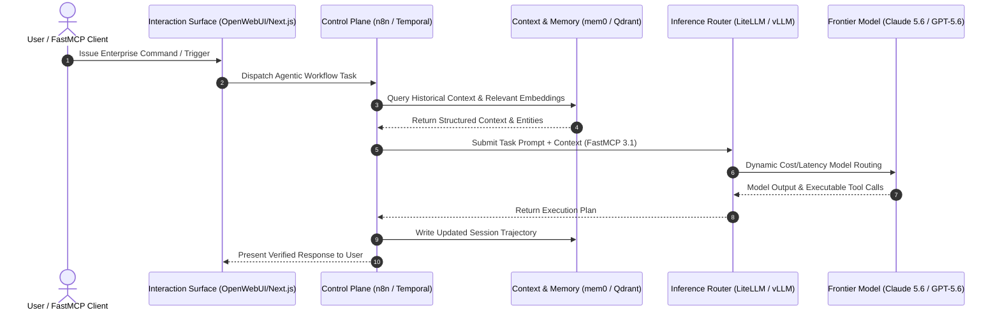

# AI Company Starter Stack

## What it is
The AI Company Starter Stack is an opinionated blueprint and operational architecture designed to transform traditional enterprise operations into an AI-native organization. Rather than treating AI as disconnected chat widgets or isolated experiments, this framework establishes a unified operating system where workflow orchestrators ([n8n](../services/n8n.md)), procedure packages ([Claude Skills](../tools/agents/claude-skills-ecosystem.md)), persistent context stores ([mem0](../tools/agents/mem0.md)), and frontier models (Claude 5.6, GPT-5.6, DeepSeek-V4, Gemini 4.0 Ultra, Gemma 4, Qwen 3.6 VL) function as cohesive infrastructure.

## What problem it solves
Organizations adopting AI frequently suffer from "tool sprawl"—fragmented SaaS subscriptions, disconnected scripts, duplicated token spending, and shadow AI usage. The AI Company Starter Stack eliminates this fragmentation by specifying an integrated, tiered architecture. It enforces standardized data boundaries, centralized credential vaults, and protocol-native tool execution (FastMCP 3.1) so every autonomous workflow accumulates enterprise intelligence and operational leverage.

## Where it fits in the stack
**Category**: Knowledge Base / Architectural Blueprint. It serves as the top-level **operating system blueprint** across the repository, linking tools from `docs/services/`, `docs/tools/`, and `docs/architecture/` into a turnkey enterprise reference architecture.

## Architecture Diagram
```
+-----------------------------------------------------------------------------------+
|                        AI Company Starter Stack Architecture                      |
|                                                                                   |
|  +-----------------------------------------------------------------------------+  |
|  | Web & Interaction Surface (OpenWebUI, Next.js, FastMCP 3.1 Webhooks)        |  |
|  +-----------------------------------------------------------------------------+  |
|                                        ||                                         |
|                                        \/                                         |
|  +-----------------------------------------------------------------------------+  |
|  | Control Plane & Workflow Orchestration (n8n, Temporal, Vikunja Task Sync)   |  |
|  +-----------------------------------------------------------------------------+  |
|                     ||                                    ||                      |
|                     \/                                    \/                      |
|  +--------------------------------------+  +-----------------------------------+  |
|  | Context & Memory Layer               |  | FastMCP 3.1 Agent Execution Engine|  |
|  | (mem0, Qdrant, Paperless-ngx, Dolt)  |  | (Claude Skills, Composio, Agno)   |  |
|  +--------------------------------------+  +-----------------------------------+  |
|                                        ||                                         |
|                                        \/                                         |
|  +-----------------------------------------------------------------------------+  |
|  | Inference & Router Layer (Claude 5.6, GPT-5.6, DeepSeek-V4, LocalAI, Ollama) |  |
|  +-----------------------------------------------------------------------------+  |
+-----------------------------------------------------------------------------------+
```



## Typical use cases
- **Bootstrapping an AI Agency**: Using research pack components to automate market research, client profiling, and outreach.
- **Internal Knowledge Base Modernization**: Combining Paperless-ngx, Unstructured, and Qdrant to convert raw internal files into queryable agent memory.
- **Developer Workflow Automation**: Packaging software delivery SOPs into Claude Skills to run automated CI bug triage and PR generation.
- **Cost-Optimized Local Inference**: Offloading routine classification tasks to Ollama/LocalAI while reserving frontier models for reasoning.

## Comprehensive Comparison Matrix: Enterprise AI Blueprints

| Blueprint Dimension | AI Company Starter Stack | Traditional SaaS Assembly | Pure Open-Source Local Stack | Enterprise Cloud Native (AWS/Azure) |
| :--- | :--- | :--- | :--- | :--- |
| **Primary Focus** | Turnkey autonomous enterprise orchestration | Point-solution productivity | Absolute data privacy & local hosting | Cloud compliance & managed services |
| **Tool Execution Standard** | FastMCP 3.1 / Model Context Protocol | Closed Proprietary Webhooks | Custom CLI Scripts | Cloud Functions / Lambda / EventBridge |
| **Context & Memory Strategy** | mem0 + Qdrant Vector/SQL Hybrid | Isolated Per-App Storage | Local SQLite / Vector DB | Vector Search / DynamoDB |
| **Model Ingestion & Routing** | Dynamic Router (LiteLLM/LocalAI) | Direct Vendor API Keys | Local Ollama / vLLM | Bedrock / Azure AI Gateway |
| **Data Sovereignty Level** | High (Self-Hostable or VPC) | Low (SaaS Data Traversal) | Absolute (Air-gapped compatible) | Moderate to High (VPC Boundary) |
| **Deployment Complexity** | Medium (Docker Compose / Helm) | Low (SaaS Setup) | High (GPU Infra Management) | High (Terraform / Cloud Infra) |
| **Total Cost of Ownership (TCO)**| Optimized (Hybrid Local/Cloud) | Very High (Per-seat SaaS Subscriptions)| Hardware CapEx + Power | Usage-based Cloud OpEx |

## Strengths
- **Cohesive Interoperability**: Every selected tool natively speaks OpenTelemetry tracing, REST APIs, or FastMCP 3.1 protocols.
- **Cost Controls**: Combines frontier model routing for complex tasks with local inference for routine transformations, drastically lowering API costs.
- **Data Sovereignty**: Keeps sensitive customer records inside self-hosted databases and local vector stores.
- **Fast Deployment**: Provides pre-tested, turn-key configurations that accelerate setup time from months to days.

## Limitations
- **Maintenance Overhead**: Running self-hosted infrastructure (n8n, Qdrant, LocalAI) requires ongoing devops maintenance.
- **Configuration Complexity**: Requires establishing clear FastMCP 3.1 schemas and credential security policies.

## When to use it
- When building a new company and desiring an AI-first operating model from day one.
- When current AI efforts are fragmented across uncoordinated SaaS tools and scripts.
- When needing to enforce strict data privacy boundaries while leveraging frontier models.

## When not to use it
- If looking for a single turnkey SaaS app rather than a multi-component architecture.
- In legacy environments where self-hosted orchestration tools cannot be deployed.

## Getting started
1. **Deploy Core Control Plane**: Set up self-hosted [n8n](../../services/n8n.md) with persistent PostgreSQL storage.
2. **Establish Context Store**: Spin up [Qdrant](../tools/infrastructure/qdrant.md) and [mem0](../tools/agents/mem0.md) for long-term memory.
3. **Configure FastMCP 3.1 Gateway**: Install the FastMCP 3.1 runtime to expose internal database tools to agent clients.
4. **Deploy Frontier & Local Models**: Set up API access keys for frontier providers alongside a local [Ollama](../tools/infrastructure/ollama.md) instance.

## Systemd Service Management

To ensure continuous, production-grade deployment of the AI Company Starter Stack daemon across infrastructure nodes, manage the process using systemd:

```ini
[Unit]
Description=AI Company Starter Stack Orchestration Service
After=network.target docker.service postgresql.service
Requires=docker.service

[Service]
Type=simple
User=aiops
Group=aiops
WorkingDirectory=/opt/ai-starter-stack
ExecStart=/opt/ai-starter-stack/venv/bin/python3 -m mcp_starter_stack.server --port 8080 --config /etc/ai-starter-stack/config.yaml
ExecReload=/bin/kill -HUP $MAINPID
Restart=always
RestartSec=5s
Environment=PYTHONUNBUFFERED=1
Environment=NODE_ENV=production
LimitNOFILE=65536

[Install]
WantedBy=multi-user.target
```

Manage service lifecycle via standard `systemctl` procedures:
```bash
# Reload systemd manager configuration
sudo systemctl daemon-reload

# Enable and start the AI Starter Stack daemon
sudo systemctl enable --now ai-company-starter-stack.service

# Inspect runtime status and active workers
sudo systemctl status ai-company-starter-stack.service
```

## CLI examples
```bash
# Spin up the starter stack core components using Docker Compose
docker compose -f docker-compose.starter-stack.yml up -d

# Initialize a new FastMCP 3.1 workflow project
mcp init enterprise-workflow --version 3.1

# Deploy FastMCP server on port 8080
mcp dev run enterprise-workflow --port 8080

# Run automated health audit across all stack services
python3 scripts/test_omni_tools_health.py --stack starter-stack
```

## API examples
The following Python script illustrates orchestrating an enterprise agentic task using FastMCP 3.1 and Pydantic v2 validation models:

```python
import os
from typing import Dict, Any, List, Optional
from pydantic import BaseModel, Field, field_validator, ConfigDict
from fastmcp import FastMCP

# 1. Initialize FastMCP 3.1 Server for the Starter Stack
mcp = FastMCP(
    name="ai-company-starter-stack-orchestrator",
    version="3.1"
)

# 2. Define Pydantic v2 Task Configuration Models
class WorkflowTaskConfig(BaseModel):
    model_config = ConfigDict(extra="forbid", str_strip_whitespace=True)

    task_id: str = Field(..., description="Unique task identifier")
    instruction: str = Field(..., min_length=10, description="Task execution objective")
    target_model: str = Field(default="claude-5.6", description="Target model tier")
    context_depth: int = Field(default=3, ge=1, le=10)
    enable_memory_persistence: bool = Field(default=True, description="Persist session memory to mem0/Qdrant")

    @field_validator("target_model")
    @classmethod
    def validate_model(cls, v: str) -> str:
        valid_models = {"claude-5.6", "gpt-5.6", "deepseek-v4", "local-llama-4", "gemini-4.0-ultra"}
        if v.lower() not in valid_models:
            raise ValueError(f"Model must be one of {valid_models}")
        return v.lower()

class StackHealthCheckRequest(BaseModel):
    model_config = ConfigDict(extra="forbid")
    include_vector_db: bool = Field(default=True)
    include_orchestrator: bool = Field(default=True)
    check_llm_endpoints: bool = Field(default=True)

class TaskExecutionResult(BaseModel):
    task_id: str
    status: str
    summary: str
    tokens_used: int
    cost_estimate_usd: float
    memory_key_updated: Optional[str] = None

# 3. Register Tool Endpoints
@mcp.tool(name="execute_company_task", description="Execute an enterprise agentic task within the starter stack")
def execute_company_task(payload: Dict[str, Any]) -> Dict[str, Any]:
    """FastMCP 3.1 tool endpoint for agentic task execution."""
    try:
        task_cfg = WorkflowTaskConfig.model_validate(payload)

        # Execution logic
        result = TaskExecutionResult(
            task_id=task_cfg.task_id,
            status="completed",
            summary=f"Processed objective '{task_cfg.instruction}' using {task_cfg.target_model}",
            tokens_used=1250,
            cost_estimate_usd=0.00375,
            memory_key_updated=f"mem0:{task_cfg.task_id}" if task_cfg.enable_memory_persistence else None
        )
        return result.model_dump()
    except Exception as e:
        return {
            "task_id": payload.get("task_id", "unknown"),
            "status": "failed",
            "error": str(e)
        }

@mcp.tool(name="audit_stack_health", description="Audit connection status across all AI starter stack services")
def audit_stack_health(payload: Dict[str, Any]) -> Dict[str, Any]:
    """FastMCP 3.1 health check diagnostic tool."""
    req = StackHealthCheckRequest.model_validate(payload)
    return {
        "status": "healthy",
        "orchestrator_n8n": "online" if req.include_orchestrator else "skipped",
        "qdrant_vector_store": "online" if req.include_vector_db else "skipped",
        "llm_router": "online" if req.check_llm_endpoints else "skipped",
        "timestamp": "2027-01-07T12:00:00Z"
    }

if __name__ == "__main__":
    mcp.run()
```

## Operational Best Practices & Deployment Architecture

### High Availability & Credential Management
- **Centralized Vault**: Store all model provider keys and OAuth tokens inside HashiCorp Vault or Infisical.
- **Workflow Replayability**: Configure n8n with execution logging enabled so failed multi-step workflows can be re-run safely.
- **Vector Index Benchmarking**: Schedule periodic Qdrant re-indexing and pruning to maintain low vector search latency.
- **Telemetry Ingestion**: Route all trace spans to a central OpenTelemetry Collector to track token spend, prompt cost, and execution duration in real time.

## Troubleshooting Guide

| Issue / Symptom | Probable Cause | Corrective Action |
| :--- | :--- | :--- |
| `FastMCP Connection Timeout` | Gateway container port binding or firewall blocking 8080 | Verify Docker container status with `docker ps` and check firewall rules for port 8080. |
| `Context Memory Retrieval Failure` | Qdrant vector database down or API key mismatch | Run `curl -i http://localhost:6333/healthz` to check Qdrant availability and verify `QDRANT_API_KEY`. |
| `High Token Spend Latency` | Unoptimized routing sending simple jobs to Claude 5.6 | Adjust `target_model` in routing policy to send routine classification tasks to local Ollama/vLLM. |
| `n8n Webhook Auth Error` | Invalid API token header or stale credentials in vault | Regenerate workflow webhook tokens in n8n and re-sync with Infisical/Vault. |
| `Systemd Service Failure (Exit 137)` | Memory exhaustion under high agent task concurrency | Increase systemd cgroup memory limit or adjust thread worker pool size. |

## Related tools / concepts
- [AI Tooling Landscape](ai_tooling_landscape.md)
- [AI Builder Index](ai_builder_index.md)
- [Agent Protocols](agent_protocols.md)
- [Model Routing Guide](model_routing_guide.md)
- [Multi-Agent KnowledgeOps](../architecture/multi_agent_knowledgeops.md)
- [Infrastructure](../architecture/infrastructure.md)

## Sources / references
- [Free AI Website Playbook](free_ai_website_playbook.md)
- [Anthropic Skills Repository](https://github.com/anthropics/skills)
- [FastMCP 3.1 Specification Reference](https://github.jlowin.fastmcp.io/)
- [n8n Automation Platform](https://n8n.io/)
- [mem0 Memory Architecture](https://github.com/mem0ai/mem0)

## Contribution Metadata
- Last reviewed: 2027-01-07
- Confidence: high
