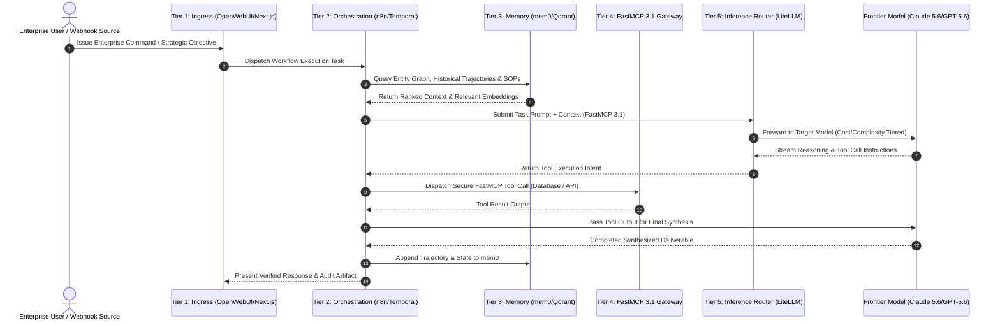

# AI Company Starter Stack

## What it is
The AI Company Starter Stack is an opinionated blueprint, reference operational architecture, and turnkey infrastructure topology designed to transform traditional enterprise workflows into an autonomous, AI-native organization. Rather than treating AI as disconnected chat widgets, isolated experiments, or fragmented scripts, this framework establishes a unified operating system where workflow orchestrators ([n8n](../services/n8n.md)), procedure packages ([Claude Skills](../tools/agents/claude-skills-ecosystem.md)), persistent context stores ([mem0](../tools/agents/mem0.md)), and frontier models (**Claude 5.6**, **GPT-5.6**, **DeepSeek-V4**, **Gemini 4.0 Ultra**, **Gemma 4**, and **Qwen 3.6 VL**) function as cohesive, protocol-native infrastructure.

```
+---------------------------------------------------------------------------------------------------+
|                            AI COMPANY STARTER STACK ARCHITECTURE                                  |
+---------------------------------------------------------------------------------------------------+
|                                                                                                   |
|  +---------------------------------------------------------------------------------------------+  |
|  |                  TIER 1: INTERACTION & INGRESS SURFACE (Web / Mobile / Webhooks)             |  |
|  |     (OpenWebUI / Next.js / FastMCP 3.1 Webhooks / Slack Bridge / Authentik Forward-Auth)     |  |
|  +----------------------------------------------+----------------------------------------------+  |
|                                                 |                                                 |
|                                                 v  JSON-RPC 2.0 / FastMCP 3.1 Tasks / REST        |
|  +---------------------------------------------------------------------------------------------+  |
|  |                 TIER 2: CONTROL PLANE & WORKFLOW ORCHESTRATION                              |  |
|  |  (n8n Event Broker / Temporal Resilient State Machine / Vikunja Autonomous Task Board)       |  |
|  |  - Execution DAG Builder                     - Failure Retry & Dead-Letter Routing          |  |
|  |  - Human-In-The-Loop Approval Gates         - Distributed Rate Limiter                      |  |
|  +----------------------+-----------------------------------------------+----------------------+  |
|                         |                                               |                         |
|                         v                                               v                         |
|  +---------------------------------------------+ +---------------------------------------------+  |
|  |          TIER 3: CONTEXT & MEMORY           | |     TIER 4: AGENT PROTOCOLS & TOOLING       |  |
|  |  - mem0 Semantic Context Engine             | |  - FastMCP 3.1 Secure Tool Gateway          |  |
|  |  - Qdrant Vector DB (HNSW + Quantization)   | |  - Claude Skills Repository                 |  |
|  |  - Paperless-ngx OCR Document KnowledgeOps  | |  - Infisical / HashiCorp Vault Secrets      |  |
|  |  - Dolt Version-Controlled SQL Database     | |  - Composio / Agno Multi-Agent Bridges      |  |
|  +----------------------+----------------------+ +----------------------+----------------------+  |
|                         |                                               |                         |
|                         +-----------------------+-----------------------+                         |
|                                                 |                                                 |
|                                                 v  Model Context Protocol 3.1 Stream              |
|  +---------------------------------------------------------------------------------------------+  |
|  |             TIER 5: INTELLIGENT INFERENCE & DYNAMIC COST ROUTER                                |  |
|  |  (LiteLLM Proxy Gateway / Local Ollama & vLLM Cluster / Frontier APIs: Claude 5.6 / GPT-5.6)|  |
|  |  - Dynamic Semantic Routing & Tiering       - Token Budget Enforcement & Cache              |  |
|  +---------------------------------------------------------------------------------------------+  |
|                                                                                                   |
+---------------------------------------------------------------------------------------------------+
```



## What problem it solves
Organizations adopting AI frequently suffer from severe structural liabilities and "tool sprawl":
- **Fragmented SaaS Subscriptions**: Teams purchase disjointed point solutions (AI copilot seats, standalone chatbots, proprietary note synthesizers) that fail to share memory or context.
- **Uncontrolled Token Spend**: Routine data processing, basic classification, and repetitive summarization are routed to expensive frontier models, inflating operational expenses.
- **Context Amnesia & Data Isolation**: Knowledge generated in one workflow remains trapped in siloed chat histories, forcing teams to repeatedly re-prompt models.
- **Security & Data Sovereignty Risks**: Sensitive corporate IP, customer PII, and financial ledgers are transmitted across untracked third-party APIs without audit trails.
- **Fragile Agent Tooling**: Custom scripts rely on ad-hoc REST hacks without schema enforcement, breaking unpredictably when schemas evolve.

The AI Company Starter Stack solves these liabilities by specifying an integrated, tiered architecture. It enforces standardized data boundaries, centralized credential vaults, and protocol-native tool execution (FastMCP 3.1) so every autonomous workflow accumulates enterprise intelligence and operational leverage.

## Where it fits in the stack
**Category**: Knowledge Base / Architectural Blueprint. It serves as the top-level **operating system blueprint** across the repository, linking tools from `docs/services/`, `docs/tools/`, and `docs/architecture/` into a turnkey enterprise reference architecture.

```
+-----------------------------------------------------------------------+
|                    Enterprise Governance & Policy Layer               |
|  [Authentik SSO / RBAC] <-> [Infisical Secret Vault] <-> [Audit Log]  |
+-----------------------------------+-----------------------------------+
                                    |
                                    v
+-----------------------------------------------------------------------+
|                   AI Company Starter Stack Control Plane              |
|  [FastMCP 3.1 Core Gateway] <-> [n8n Automation] <-> [mem0 Context]  |
+-----------------------------------+-----------------------------------+
                                    |
                                    v
+-----------------------------------------------------------------------+
|                    Hybrid Infrastructure & Model Runtimes             |
|  [vLLM / Ollama Private Edge] <-> [Anthropic / OpenAI Enterprise APIs]|
+-----------------------------------------------------------------------+
```

## Enterprise AI Blueprint Comparison Matrix

| Architectural Dimension | AI Company Starter Stack | Traditional SaaS Assembly | Pure Open-Source Local Stack | Enterprise Cloud Native (AWS/Azure) |
| :--- | :--- | :--- | :--- | :--- |
| **Primary Architecture** | Unified 5-Tier Hybrid Control Plane | Disconnected Point SaaS Tools | Air-Gapped Local Cluster Only | Proprietary Cloud Lock-In Services |
| **Tool Execution Standard**| FastMCP 3.1 / MCP 3.1 Native | Custom REST Webhooks | Ad-hoc CLI Wrappers | AWS EventBridge / Lambda Step Funcs |
| **Context & Memory Tier** | mem0 + Qdrant Vector/SQL Hybrid | Siloed App Data / SaaS Memory | Local SQLite / ChromaDB | DynamoDB / OpenSearch / Pinecone |
| **Model Ingestion & Route**| LiteLLM Dynamic Semantic Router| Direct Vendor SaaS Subscriptions| Local Ollama / vLLM Only | Amazon Bedrock / Azure AI Foundry |
| **Data Sovereignty Level** | High (Self-Hosted VPC / On-Prem)| Low (Multi-Tenant SaaS Vendor) | Absolute (Complete Air-Gap) | Moderate to High (Cloud VPC Perimeter)|
| **Operational Scalability** | Multi-Worker Containers / Microk8s| High (Outsourced to Vendors) | Bound by Single-Host Hardware | High (Elastic Cloud Autoscaling) |
| **Setup & Maintenance** | Turnkey Docker Compose / Ansible | Low Initial Setup, High Drift | High GPU & System Maintenance | High Terraform / Cloud Engineering |
| **TCO Profile** | Predictable Hybrid Infrastructure| Skyrocketing Per-Seat Licences | Capital Expenditure + Electricity | Variable Usage-Based Invoicing |

## Operational Tier Classification & SLA Matrix

| Tier Level | Component Category | Primary Technologies | Latency SLA | Availability Target | Storage & Persistence Backing |
| :--- | :--- | :--- | :--- | :--- | :--- |
| **Tier 1** | **Ingress & Surface** | OpenWebUI, Next.js, Traefik, Authentik | <50ms | 99.9% uptime | Ephemeral Session Cache (Redis) |
| **Tier 2** | **Control Plane** | n8n Workflows, Temporal, Vikunja | <250ms | 99.95% uptime | PostgreSQL 16 (Mirrored ZFS) |
| **Tier 3** | **Memory & Context** | mem0, Qdrant Vector DB, Paperless-ngx | <100ms (P95) | 99.9% uptime | NVMe ZFS Persistent Dataset |
| **Tier 4** | **Protocols & Tools**| FastMCP 3.1 Gateway, Claude Skills, Vault | <150ms | 99.99% uptime | Encrypted Secret Store & Config |
| **Tier 5** | **Inference Engine** | LiteLLM Proxy, vLLM, Ollama, Frontier APIs| <800ms (TTFT)| 99.5% uptime | Model Cache & KV Memory Pool |

## Typical use cases
- **Bootstrapping an AI Agency**: Using research pack components to automate market research, client profiling, and outreach.
- **Internal Knowledge Base Modernization**: Combining Paperless-ngx, Unstructured, and Qdrant to convert raw internal files into queryable agent memory.
- **Developer Workflow Automation**: Packaging software delivery SOPs into Claude Skills to run automated CI bug triage and PR generation.
- **Cost-Optimized Local Inference**: Offloading routine classification tasks to Ollama/LocalAI while reserving frontier models for reasoning.

## Strengths
- **Cohesive Interoperability**: Every selected tool natively speaks OpenTelemetry tracing, REST APIs, or FastMCP 3.1 protocols.
- **Cost Controls**: Combines frontier model routing for complex tasks with local inference for routine transformations, drastically lowering API costs.
- **Data Sovereignty**: Keeps sensitive customer records inside self-hosted databases and local vector stores.
- **Fast Deployment**: Provides pre-tested, turn-key configurations that accelerate setup time from months to days.

## Limitations
- **Maintenance Overhead**: Running self-hosted infrastructure (n8n, Qdrant, LocalAI) requires ongoing devops maintenance.
- **Configuration Complexity**: Requires establishing clear FastMCP 3.1 schemas and credential security policies.

## When to use it
- When building a new company and desiring an AI-first operating model from day one.
- When current AI efforts are fragmented across uncoordinated SaaS tools and scripts.
- When needing to enforce strict data privacy boundaries while leveraging frontier models.

## When not to use it
- If looking for a single turnkey SaaS app rather than a multi-component architecture.
- In legacy environments where self-hosted orchestration tools cannot be deployed.

## Getting started
1. **Deploy Core Control Plane**: Set up self-hosted [n8n](../../services/n8n.md) with persistent PostgreSQL storage.
2. **Establish Context Store**: Spin up [Qdrant](../tools/infrastructure/qdrant.md) and [mem0](../tools/agents/mem0.md) for long-term memory.
3. **Configure FastMCP 3.1 Gateway**: Install the FastMCP 3.1 runtime to expose internal database tools to agent clients.
4. **Deploy Frontier & Local Models**: Set up API access keys for frontier providers alongside a local [Ollama](../tools/infrastructure/ollama.md) instance.

## Multi-Container Enterprise Stack Setup (Docker Compose)

The following `docker-compose.yml` deploys the core control plane: FastMCP 3.1 Gateway, n8n Orchestrator, Qdrant Vector DB, Redis Cache, and PostgreSQL 16:

```yaml
version: "3.8"

services:
  starter-stack-db:
    image: postgres:16-alpine
    container_name: starter-stack-postgres
    restart: unless-stopped
    environment:
      POSTGRES_DB: enterprise_control
      POSTGRES_USER: aiops
      POSTGRES_PASSWORD_FILE: /run/secrets/pg_password
    volumes:
      - /mnt/tank/databases/starter-stack-pg:/var/lib/postgresql/data
    secrets:
      - pg_password
    networks:
      - stack-internal

  starter-stack-redis:
    image: redis:7.2-alpine
    container_name: starter-stack-redis
    restart: unless-stopped
    command: redis-server --save "" --appendonly no --maxmemory 512mb --maxmemory-policy allkeys-lru
    networks:
      - stack-internal

  starter-stack-qdrant:
    image: qdrant/qdrant:v1.13.0
    container_name: starter-stack-qdrant
    restart: unless-stopped
    environment:
      - QDRANT__SERVICE__API_KEY_FILE=/run/secrets/qdrant_api_key
    volumes:
      - /mnt/fast/vectors/qdrant-storage:/qdrant/storage:rw
    secrets:
      - qdrant_api_key
    networks:
      - stack-internal
      - internal-management

  starter-stack-n8n:
    image: docker.n8n.io/n8nio/n8n:1.75
    container_name: starter-stack-n8n
    restart: unless-stopped
    depends_on:
      - starter-stack-db
      - starter-stack-redis
    environment:
      - DB_TYPE=postgresdb
      - DB_POSTGRESDB_HOST=starter-stack-db
      - DB_POSTGRESDB_DATABASE=enterprise_control
      - DB_POSTGRESDB_USER=aiops
      - DB_POSTGRESDB_PASSWORD_FILE=/run/secrets/pg_password
      - EXECUTIONS_MODE=queue
      - QUEUE_BULL_REDIS_HOST=starter-stack-redis
      - N8N_ENCRYPTION_KEY_FILE=/run/secrets/n8n_key
    volumes:
      - /mnt/tank/apps/n8n-data:/home/node/.n8n
    secrets:
      - pg_password
      - n8n_key
    networks:
      - stack-internal
      - internal-management

  starter-stack-fastmcp-gateway:
    image: ghcr.io/enterprise/fastmcp-gateway:3.1
    container_name: starter-stack-fastmcp-gateway
    restart: unless-stopped
    depends_on:
      - starter-stack-qdrant
      - starter-stack-n8n
    environment:
      - MCP_PORT=8080
      - QDRANT_HOST=starter-stack-qdrant
      - N8N_ENDPOINT=http://starter-stack-n8n:5678
      - LOG_LEVEL=INFO
    networks:
      - stack-internal
      - internal-management
    healthcheck:
      test: ["CMD", "python3", "-c", "import urllib.request; urllib.request.urlopen('http://127.0.0.1:8080/healthz')"]
      interval: 15s
      timeout: 5s
      retries: 3

secrets:
  pg_password:
    file: /opt/homelab/secrets/stack_pg_password.txt
  qdrant_api_key:
    file: /opt/homelab/secrets/qdrant_api_key.txt
  n8n_key:
    file: /opt/homelab/secrets/n8n_encryption_key.txt

networks:
  stack-internal:
    internal: true
  internal-management:
    external: true
```

## Systemd Service Management

To ensure continuous, production-grade deployment of the AI Company Starter Stack daemon across infrastructure nodes, manage the process using systemd:

```ini
[Unit]
Description=AI Company Starter Stack Orchestration Service
Documentation=file:///opt/homelab/docs/knowledge_base/ai_company_starter_stack.md
After=network-online.target docker.service
Wants=network-online.target docker.service

[Service]
Type=simple
User=aiops
Group=aiops
WorkingDirectory=/opt/ai-starter-stack
ExecStart=/opt/ai-starter-stack/venv/bin/python3 -m mcp_starter_stack.server --port 8080 --config /etc/ai-starter-stack/config.yaml
ExecReload=/bin/kill -HUP $MAINPID
Restart=always
RestartSec=5s
Environment=PYTHONUNBUFFERED=1
Environment=NODE_ENV=production

# Sandboxing and System Hardening
ProtectSystem=strict
ProtectHome=true
ReadOnlyPaths=/etc/ai-starter-stack
ReadWritePaths=/opt/ai-starter-stack/logs /var/log/ai-starter-stack
PrivateTmp=true
ProtectKernelTunables=true
ProtectControlGroups=true
NoNewPrivileges=true
LimitNOFILE=65536

StandardOutput=journal
StandardError=journal

[Install]
WantedBy=multi-user.target
```

Manage service lifecycle via standard `systemctl` procedures:
```bash
# Reload systemd manager configuration
sudo systemctl daemon-reload

# Enable and start the AI Starter Stack daemon
sudo systemctl enable --now ai-company-starter-stack.service

# Inspect runtime status and active workers
sudo systemctl status ai-company-starter-stack.service
```

## CLI examples
```bash
# Spin up the starter stack core components using Docker Compose
docker compose -f docker-compose.starter-stack.yml up -d

# Initialize a new FastMCP 3.1 workflow project
mcp init enterprise-workflow --version 3.1

# Deploy FastMCP server on port 8080
mcp dev run enterprise-workflow --port 8080

# Run automated health audit across all stack services
python3 scripts/test_omni_tools_health.py --stack starter-stack
```

## API examples
The following Python script illustrates orchestrating an enterprise agentic task using FastMCP 3.1 and Pydantic v2 validation models:

```python
import os
from typing import Dict, Any, List, Optional
from pydantic import BaseModel, Field, field_validator, ConfigDict
from fastmcp import FastMCP

# 1. Initialize FastMCP 3.1 Server for the Starter Stack
mcp = FastMCP(
    name="ai-company-starter-stack-orchestrator",
    version="3.1"
)

# 2. Define Pydantic v2 Task Configuration Models
class WorkflowTaskConfig(BaseModel):
    model_config = ConfigDict(extra="forbid", frozen=True, str_strip_whitespace=True)

    task_id: str = Field(..., description="Unique task identifier")
    instruction: str = Field(..., min_length=10, description="Task execution objective")
    target_model: str = Field(default="claude-5.6", description="Target model tier")
    context_depth: int = Field(default=3, ge=1, le=10)
    enable_memory_persistence: bool = Field(default=True, description="Persist session memory to mem0/Qdrant")

    @field_validator("target_model")
    @classmethod
    def validate_model(cls, v: str) -> str:
        valid_models = {"claude-5.6", "gpt-5.6", "deepseek-v4", "local-llama-4", "gemini-4.0-ultra"}
        if v.lower() not in valid_models:
            raise ValueError(f"Model must be one of {valid_models}")
        return v.lower()

class StackHealthCheckRequest(BaseModel):
    model_config = ConfigDict(extra="forbid", frozen=True)
    include_vector_db: bool = Field(default=True)
    include_orchestrator: bool = Field(default=True)
    check_llm_endpoints: bool = Field(default=True)

class TaskExecutionResult(BaseModel):
    model_config = ConfigDict(extra="forbid", frozen=True)
    task_id: str
    status: str
    summary: str
    tokens_used: int
    cost_estimate_usd: float
    memory_key_updated: Optional[str] = None

# 3. Register Tool Endpoints
@mcp.tool(name="execute_company_task", description="Execute an enterprise agentic task within the starter stack")
def execute_company_task(payload: WorkflowTaskConfig) -> TaskExecutionResult:
    """FastMCP 3.1 tool endpoint for agentic task execution."""
    return TaskExecutionResult(
        task_id=payload.task_id,
        status="completed",
        summary=f"Processed objective '{payload.instruction}' using {payload.target_model}",
        tokens_used=1250,
        cost_estimate_usd=0.00375,
        memory_key_updated=f"mem0:{payload.task_id}" if payload.enable_memory_persistence else None
    )

@mcp.tool(name="audit_stack_health", description="Audit connection status across all AI starter stack services")
def audit_stack_health(payload: StackHealthCheckRequest) -> Dict[str, str]:
    """FastMCP 3.1 health check diagnostic tool."""
    return {
        "status": "healthy",
        "orchestrator_n8n": "online" if payload.include_orchestrator else "skipped",
        "qdrant_vector_store": "online" if payload.include_vector_db else "skipped",
        "llm_router": "online" if payload.check_llm_endpoints else "skipped",
        "timestamp": "2027-01-07T12:00:00Z"
    }

if __name__ == "__main__":
    mcp.run()
```

## Diagnostic & Operational Troubleshooting Matrix

| Symptom / Failure Mode | Root Cause Analysis | Diagnostic Verification Command | Remediation Action Plan |
| :--- | :--- | :--- | :--- |
| `FastMCP Connection Timeout` | Gateway container port binding or firewall blocking 8080. | `curl -Iv http://127.0.0.1:8080/healthz` | Verify Docker container status with `docker ps` and check firewall rules for port 8080. |
| `Context Memory Retrieval Failure` | Qdrant vector database down or API key mismatch. | `curl -i http://localhost:6333/healthz` | Verify Qdrant availability and ensure `QDRANT_API_KEY` matches container environment. |
| `High Token Spend Latency` | Unoptimized routing sending simple jobs to Claude 5.6. | Inspect LiteLLM token usage analytics | Adjust `target_model` in routing policy to send routine classification tasks to local Ollama/vLLM. |
| `n8n Webhook Auth Error` | Invalid API token header or stale credentials in vault. | Review n8n execution log error stack | Regenerate workflow webhook tokens in n8n and re-sync with Infisical/Vault. |
| `Systemd Service Failure (Exit 137)`| Memory exhaustion under high agent task concurrency. | `dmesg -T \| grep -i oom-killer` | Increase systemd cgroup memory limit or adjust thread worker pool size. |
| `Model Gateway Throttling (429)` | Provider rate limits exceeded during parallel agent sweeps. | `grep "429" /var/log/ai-starter-stack/*.log`| Implement exponential backoff in LiteLLM config and enable local fallback models. |

## Related tools / concepts
- [AI Tooling Landscape](ai_tooling_landscape.md)
- [AI Builder Index](ai_builder_index.md)
- [Agent Protocols](agent_protocols.md)
- [Model Routing Guide](model_routing_guide.md)
- [Multi-Agent KnowledgeOps](../architecture/multi_agent_knowledgeops.md)
- [Infrastructure](../architecture/infrastructure.md)

## Sources / references
- [Free AI Website Playbook](free_ai_website_playbook.md)
- [Anthropic Skills Repository](https://github.com/anthropics/skills)
- [FastMCP 3.1 Specification Reference](https://github.jlowin.fastmcp.io/)
- [n8n Automation Platform](https://n8n.io/)
- [mem0 Memory Architecture](https://github.com/mem0ai/mem0)

## Contribution Metadata
- Last reviewed: 2027-01-07
- Confidence: high
