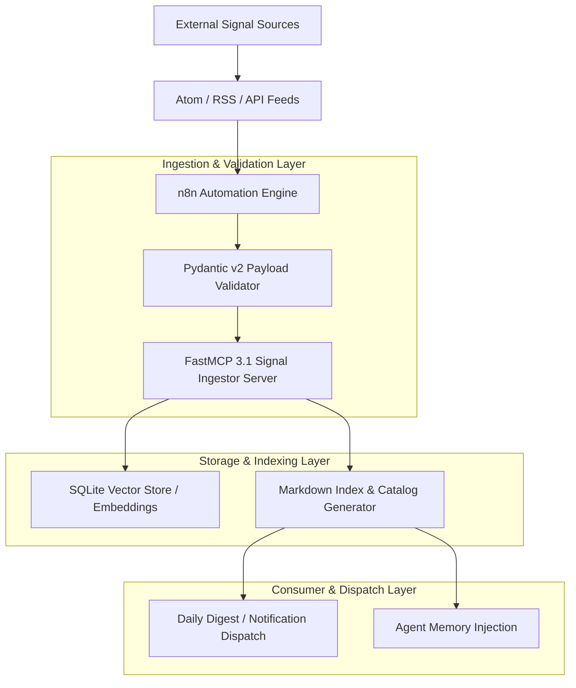
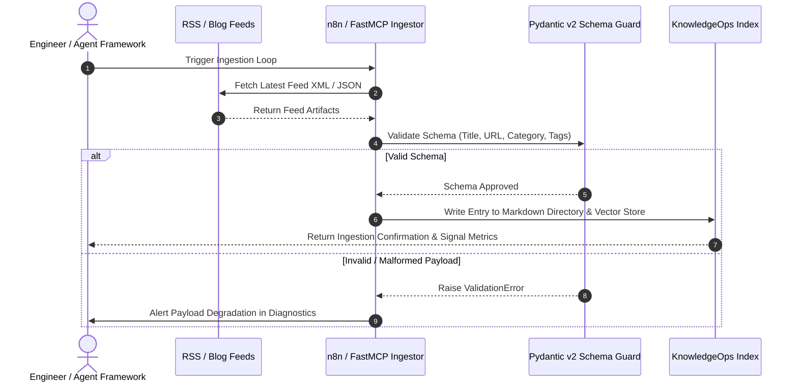

# Essential AI Reading List

## What it is
The Essential AI Reading List is a highly curated, signal-heavy navigational directory of professional-grade information sources for AI engineers, software developers, and research practitioners. As of early January 2027, it aggregates influential blogs, newsletters, research labs, community hubs, and podcasts into a unified index to help builders filter out noise and stay at the absolute frontier of artificial intelligence (including Claude 5.6, GPT-5.6, Gemini 4.0 Ultra, Gemma 4, DeepSeek-V4, and Qwen 3.6 VL).

## What problem it solves
The sheer volume of daily AI announcements, releases, and research papers creates an overwhelming amount of low-density information and "hype." This reading list addresses this problem by filtering for deep technical rigor, practical system architectures, and visual explanations of complex mechanics (e.g., mechanistic interpretability, model alignment, prompt security, and FastMCP 3.1 task protocol design), ensuring that builders optimize their learning time for high-signal content.

## Where it fits in the stack
**Category**: Knowledge Base / Resource Directory. It acts as the **Information Intake Layer** of the KnowledgeOps framework, providing the raw, educational inputs that help developers design robust agent prompts, evaluate local models, and select state-of-the-art deployment tools.

## Architecture & Automated Ingestion Pipeline





## Source Category & Signal Density Matrix

| Category | Primary Focus | Update Frequency | Signal-to-Noise Ratio | Typical Format | Primary Verification Mechanism |
| :--- | :--- | :--- | :--- | :--- | :--- |
| **Personal Technical Blogs** | Deep Architectural Mechanics, Mechanistic Interpretability, MCP Tool Protocols | Weekly to Monthly | Extremely High (>90%) | Code-heavy Essays & Walkthroughs | Code Repro & Benchmark Tests |
| **Specialized Newsletters** | Ecosystem Trends, Training Dynamics, Model Alignment & Safety | Daily / Bi-weekly | High (80-90%) | Curated Analyses & Commentary | Expert Cross-Referencing |
| **Frontier Research Labs** | Architectural Breakthroughs, Alignment Standards, Capability Disclosures | Irregular / Major Releases | Absolute Frontier | Whitepapers, System Cards, Technical Reports | Peer Evaluation & Empirical Testing |
| **Aggregators & Communities** | Quantization Benchmarks, Edge Inference Hacks, Real-Time Debates | Real-Time / Continuous | Variable (50-75%) | Forum Posts, Pull Requests, Benchmarking Bench | Community Reproducibility |
| **Technical Podcasts** | Founder Interviews, Architectural Trade-Offs, Platform Paradigms | Weekly | High (80%) | Long-form Audio Transcripts | Transcript Indexing |

## Typical use cases
- **Continuous Technical Enrichment**: Discovering deep-dive architectural tutorials (e.g., Lilian Weng for memory systems or Sebastian Raschka for fine-tuning) to address engineering gaps.
- **Ecosystem Monitoring**: Tracking daily releases and open-source progress via high-signal newsletters and community hubs.
- **Architectural Discovery**: Finding early developer adoption patterns and benchmarks for emerging protocols like Model Context Protocol (FastMCP 3.1 Task Protocol).
- **Evaluating Frontier Capabilities**: Reading lab safety protocols and capability disclosures (e.g., OpenAI or Anthropic) to plan for next-generation API upgrades.

## Strengths
- **Rigorous Curation**: Excludes marketing-focused or superficial content, prioritizing reproducibility and deep engineering insights.
- **Multi-Format Coverage**: Spans skimmable daily newsletters, long-form technical analyses, academic communities, and conversational builder podcasts.
- **Actionable CLI/API Hooks**: Features clear integration patterns, such as command-line RSS querying and n8n feed automation, to ingest educational data programmatically.
- **Practitioner-Verified**: Directly aligns with real-world development paradigms implemented throughout the homelab repository.

## Limitations
- **Selective Focus**: Inherently subjective selection based on technical utility, which may omit specialized niche domains (e.g., robotic control or biochemical model tuning).
- **Maintenance Requirements**: Demands continuous auditing and link checking to ensure recommendations remain high-quality and free of broken redirects.
- **Hype Mitigation Trade-off**: By prioritizing depth over speed, it may occasionally delay coverage of short-lived trending tools or temporary social media topics.

## When to use it
- When setting up automated news feeds (RSS, Email) to build a robust, distraction-free AI information workspace.
- When beginning a research project or deploying a new pattern (e.g., hybrid semantic search, custom tool routing) and requiring expert-vetted baseline reference guides.
- When validating if a newly launched tool or evaluation benchmark has been parsed and reviewed by respected industry experts.

## When not to use it
- If searching for commercial press releases, high-level non-technical summaries, or market-analysis charts.
- If requiring a complete, academic search index of every paper published on arXiv (use specialized search engines like [Semantic Scholar](https://www.semanticscholar.org/) or [arXiv](https://arxiv.org/) instead).

## Service & Daemon Management

### systemd Service Configuration (`/etc/systemd/system/ai-signal-ingestor.service`)
Deploy the following systemd unit file to run the continuous feed ingestion and validation daemon as a background service:

```ini
[Unit]
Description=AI Signal Ingestor and KnowledgeOps Directory Sync Daemon
Documentation=https://github.com/knowledgeops/ai-reading-list
After=network-online.target
Wants=network-online.target

[Service]
Type=simple
User=knowledgeops
Group=knowledgeops
WorkingDirectory=/opt/ai-signal-ingestor
ExecStart=/opt/ai-signal-ingestor/venv/bin/python3 ingestor_daemon.py --config /etc/ai-signal-ingestor/config.yaml
ExecReload=/bin/kill -HUP $MAINPID
Restart=always
RestartSec=10s
Environment=PYTHONUNBUFFERED=1
Environment=FASTMCP_PORT=8088
Environment=LOG_LEVEL=info

# Hardening measures
ProtectSystem=full
ProtectHome=read-only
ReadWritePaths=/opt/ai-signal-ingestor/data /tmp
NoNewPrivileges=true

[Install]
WantedBy=multi-user.target
```

### Docker Compose Configuration (`docker-compose.yml`)
To run the feed ingestor alongside an RSS proxy and vector database stack, deploy the following multi-container environment:

```yaml
version: '3.8'

services:
  signal-ingestor:
    image: python:3.11-slim
    container_name: ai-signal-ingestor
    working_dir: /app
    volumes:
      - ./:/app
      - feed_data:/app/data
    environment:
      - PYTHONUNBUFFERED=1
      - FASTMCP_PORT=8088
    command: >
      bash -c "pip install fastmcp pydantic feedparser requests &&
               python3 ingestor_daemon.py"
    restart: unless-stopped
    ports:
      - "8088:8088"

  feed-cache:
    image: redis:7-alpine
    container_name: ai-feed-redis-cache
    ports:
      - "6379:6379"
    volumes:
      - redis_data:/data
    restart: unless-stopped

volumes:
  feed_data:
  redis_data:
```

## Getting started
1. **The Daily Aggregator**: Subscribe to [AI News](https://buttondown.com/ainews) or Hacker News to monitor immediate codebase releases and framework announcements.
2. **The Weekly Deep Dive**: Subscribe to [Interconnects](https://www.interconnects.ai/) or [Latent Space](https://www.latent.space/) to digest structured analyses of model architectures and training dynamics.
3. **The Architectural Base**: Read through [Lil'Log](https://lilianweng.github.io/posts/) and Andrej Karpathy's video lectures to build robust first-principles comprehension.
4. **Automate Your Intake**: Use n8n to ingest RSS items from these sources and automatically route high-priority articles directly to your messaging application.

## CLI examples

### Ingesting AI News via Terminal RSS Parsing
```bash
# Fetch and print the 10 most recent article titles from Simon Willison's weblog Atom feed
curl -s https://simonwillison.net/atom/entries/ | grep -oPm1 "(?<=<title type=\"html\">)[^<]+" | head -n 10

# Parse and display the latest daily AI News headlines directly on your console
curl -s https://buttondown.com/ainews/rss | grep -oPm1 "(?<=<title>)[^<]+" | head -n 12
```

### Prompting an LLM to Summarize an RSS Item via Curl
```bash
# Retrieve a specific blog post content and pipe to a local runner for rapid analysis
curl -s https://lilianweng.github.io/posts/2024-11-28-reward-hacking/index.html | \
  docker run -i --rm ollama/ollama ollama run gemma4:latest "Summarize this post's core mitigation strategies in 5 bullets:"
```

## API examples

### FastMCP 3.1 RSS Feed & Signal Ingestor Server
Below is a complete **FastMCP 3.1** server that enables agent workflows to query, filter, and register new reading list entries programmatically:

```python
import sys
from typing import List, Dict, Any, Optional
from pydantic import BaseModel, Field, HttpUrl, ValidationError
from fastmcp import FastMCP

mcp = FastMCP(
    "ai-reading-list-server",
    instructions="FastMCP 3.1 server for querying and ingesting AI reading list sources."
)

class SourceQueryFilter(BaseModel):
    category: Optional[str] = Field(None, description="Category filter (e.g., blog, newsletter, research_lab, community, podcast)")
    topic: Optional[str] = Field(None, description="Keyword topic filter (e.g., FastMCP 3.1, Claude 5.6, quantization)")
    limit: int = Field(default=10, ge=1, le=50, description="Maximum number of sources to return")

class NewSourcePayload(BaseModel):
    title: str = Field(..., min_length=2, description="Readable title of the reference source")
    url: HttpUrl = Field(..., description="Fully qualified URL link to the resource")
    category: str = Field(..., pattern="^(blog|newsletter|research_lab|community|podcast)$")
    recommended_topics: List[str] = Field(default_factory=list, description="Topics covered by this source")
    author_or_org: Optional[str] = Field(None, description="Author or publishing entity")

@mcp.tool()
def query_reading_list(filter_params: SourceQueryFilter) -> Dict[str, Any]:
    """
    Queries the AI Reading List catalog based on category and topic filters.
    """
    # Sample catalog data matching early 2027 standards
    catalog = [
        {
            "title": "Simon Willison Weblog",
            "url": "https://simonwillison.net",
            "category": "blog",
            "recommended_topics": ["FastMCP 3.1", "Task Protocol", "local tool-calling", "security"]
        },
        {
            "title": "Lil'Log (Lilian Weng)",
            "url": "https://lilianweng.github.io/posts/",
            "category": "blog",
            "recommended_topics": ["agent architectures", "reward hacking", "mechanistic interpretability"]
        },
        {
            "title": "Latent Space Newsletter",
            "url": "https://latent.space",
            "category": "newsletter",
            "recommended_topics": ["AI engineer", "Claude 5.6", "GPT-5.6", "Gemma 4", "Qwen 3.6 VL"]
        }
    ]

    filtered = catalog
    if filter_params.category:
        filtered = [item for item in filtered if item["category"] == filter_params.category.lower()]
    if filter_params.topic:
        filtered = [
            item for item in filtered
            if any(filter_params.topic.lower() in t.lower() for t in item["recommended_topics"])
        ]

    return {
        "status": "success",
        "returned_count": len(filtered[:filter_params.limit]),
        "sources": filtered[:filter_params.limit]
    }

@mcp.tool()
def register_new_source(source_data: NewSourcePayload) -> Dict[str, Any]:
    """
    Validates and registers a new high-signal AI information source into the index.
    """
    return {
        "status": "registered",
        "title": source_data.title,
        "url": str(source_data.url),
        "category": source_data.category,
        "topics_indexed": source_data.recommended_topics
    }

if __name__ == "__main__":
    mcp.run()
```

### Resource Directory Ingestion Validator using Pydantic v2
This Python script parses and validates individual directory recommendations, verifying their metadata integrity and categorization before incorporating them into the centralized repository index.

```python
import sys
from typing import List, Optional
from pydantic import BaseModel, Field, HttpUrl, ValidationError

# Define strict schemas in Pydantic v2
class SourceLink(BaseModel):
    title: str = Field(..., min_length=2, description="Readable title of the reference source")
    url: HttpUrl = Field(..., description="Fully qualified URL link to the resource")
    category: str = Field(..., pattern="^(blog|newsletter|research_lab|community|podcast)$")
    recommended_topics: List[str] = Field(default_factory=list, description="List of topics handled well by this source")

class ReadingListDirectory(BaseModel):
    directory_name: str = Field(..., description="Name of the reading list catalog")
    sources: List[SourceLink] = Field(..., min_length=1, description="List of validated reference links")

def validate_and_index_directory(raw_payload: dict) -> Optional[ReadingListDirectory]:
    """Validates and processes a raw dictionary payload containing source listings."""
    try:
        # Pydantic v2 model_validate used to parse structures
        directory = ReadingListDirectory.model_validate(raw_payload)
        print(f"✅ Reading List '{directory.directory_name}' successfully validated.")
        print(f"  Total verified sources: {len(directory.sources)}")
        for idx, src in enumerate(directory.sources, 1):
            print(f"    [{idx}] {src.title} -> ({src.category}) - Topics: {', '.join(src.recommended_topics)}")
        return directory
    except ValidationError as e:
        print(f"❌ Reading list validation failed: {e}", file=sys.stderr)
        return None

if __name__ == "__main__":
    # Sample directory representation matching early January 2027 SOTA standards
    sample_directory = {
        "directory_name": "Frontier AI Reading List - Early 2027 Highlights",
        "sources": [
            {
                "title": "Simon Willison Weblog",
                "url": "https://simonwillison.net",
                "category": "blog",
                "recommended_topics": ["FastMCP 3.1", "Task Protocol", "local tool-calling", "security"]
            },
            {
                "title": "Latent Space Newsletter",
                "url": "https://latent.space",
                "category": "newsletter",
                "recommended_topics": ["AI engineer", "Claude 5.6", "GPT-5.6", "Gemma 4", "Qwen 3.6 VL"]
            }
        ]
    }

    # Validate the data
    validated_dir = validate_and_index_directory(sample_directory)
    if validated_dir:
        print("Integration authorized.")
```

## Troubleshooting & Diagnostics

| Symptom / Error | Root Cause | Remediation Procedure |
| :--- | :--- | :--- |
| **RSS Feed HTTP 403 Forbidden** | Feed provider enforces Cloudflare / User-Agent bot blocking | Update `requests` header in ingestor daemon to pass browser `User-Agent` or use Cloudflare proxy worker. |
| **Malformed Atom XML Schema** | Non-standard tags or CDATA blocks in external feed payload | Wrap feed parsing in `feedparser.parse()` with CDATA sanitization and fallback regex extraction. |
| **Duplicate Source Ingestion** | Multiple feed entries referencing canonical cross-posted URLs | Implement URL canonicalization and SHA256 hashing on normalized target URLs prior to indexing. |
| **ValidationError on HttpUrl** | Feed contains relative links or invalid protocol schemes | Pre-pend `https://` or resolve relative paths against feed domain before Pydantic validation. |
| **FastMCP Tool Connection Timeout** | Long-running RSS fetch blocking FastMCP event loop | Wrap remote HTTP calls in `asyncio.to_thread()` or `httpx.AsyncClient` with a 5-second timeout. |

## Blogs & Personal Sites
- **Simon Willison** ([simonwillison.net](https://simonwillison.net)) — Essential for real-time tracking of practical LLM tooling, local CLI tools, Model Context Protocol (FastMCP 3.1) integrations, security exploits, and prompt engineering.
- **Lilian Weng** ([lilianweng.github.io](https://lilianweng.github.io/posts/)) — The gold standard for highly cited, comprehensive literature reviews on model agent architectures, RAG, and safety engineering.
- **Andrej Karpathy** ([karpathy.ai](https://karpathy.ai)) — Masterful educational videos and essays on LLM mechanics, building networks from scratch, and defining the "LLM OS" design paradigm.
- **Sebastian Raschka** ([sebastianraschka.com](https://sebastianraschka.com)) — Unparalleled code-first tutorials on training, fine-tuning, and evaluating open-weights models (such as Gemma 4 and Qwen 3.6 VL).
- **Eugene Yan** ([eugeneyan.com](https://eugeneyan.com)) — High-signal perspectives on applied machine learning, practical recommendation patterns, and the system engineering required to deploy resilient models.
- **Hamel Husain** ([hamel.dev](https://hamel.dev)) — World-class advice on the operational rigors of model evaluation, LLM red-teaming, data annotation, and fine-tuning pipelines.
- **Chip Huyen** ([huyenchip.com](https://huyenchip.com)) — Industry-defining analyses of real-time machine learning, MLOps, streaming data systems, and standardizing enterprise AI deployment.
- **Jay Alammar** ([jalammar.github.io](https://jalammar.github.io)) — Brilliant visual guides and interactive explanations that cultivate deep intuitive understanding of transformer attention and internal model dynamics.

## Newsletters
- **AI News** ([buttondown.com/ainews](https://buttondown.com/ainews)) — Highly technical, daily digest aggregating everything of significance across the AI developer, GitHub, and research Twitter/X communities.
- **Interconnects** ([interconnects.ai](https://www.interconnects.ai)) — Nathan Lambert's technical newsletter analyzing model alignment, training datasets, reinforcement learning, and competitive industry updates.
- **Latent Space** ([latent.space](https://www.latent.space)) — The premier newsletter and podcast mapping out the practical "AI Engineer" software stack, tool development, and developer platform ecosystems.
- **Import AI** ([jack-clark.net](https://jack-clark.net)) — Jack Clark's essential weekly review of global AI capabilities, compute trends, defense applications, and regulatory policy structures.
- **TLDR AI** ([tldr.tech/ai](https://tldr.tech/ai)) — A fast, skimmable daily digest aggregating the most impactful tools, research disclosures, and business updates.

## Research Labs to Follow
- **Anthropic Research** — Leaders in constitutional AI, alignment, and mechanistic interpretability. Their technical updates are essential for tracking Model Context Protocol (FastMCP 3.1) evolution and Claude 5.6 capability structures.
- **OpenAI Research** — Groundbreaking disclosures on frontier model safety evaluations, system capabilities, and planning reasoning models (such as GPT-5.6).
- **Google DeepMind** — Foundational, high-impact research spanning basic model theory, multimodal capabilities (Gemini 4.0 Ultra), and deep scientific applications.
- **Meta FAIR** — Champions of open-weights research, providing the foundational code and weights that democratize local SOTA compute.
- **DeepSeek Research** — Leaders in cost-efficient training architectures, sparse MoE designs, and high-performance, developer-focused model options (such as DeepSeek-V4).

## Aggregators & Communities
- **r/LocalLLaMA** — The primary hub for the open-weights and local LLM developer community, unrivaled for practical advice on local model quantization (GGUF, EXL2) and consumer-grade GPU inference.
- **Hacker News (AI Filter)** — High-density, real-time technical debates and early discovery of developer tools, frameworks, and academic papers before they reach the mainstream.
- **Hugging Face Daily Papers** — A daily curated feed of arXiv papers with active comments, invaluable for identifying high-signal breakthroughs amidst the research deluge.

## Podcasts
- **Latent Space Podcast** — Exceptional technical interviews with the authors of foundational papers, framework creators, and model developers.
- **Gradient Dissent (W&B)** — Grounded, practical interviews with leading engineering teams detailing the realities of managing data, training pipelines, and production environments.
- **No Priors** — Deep-dive discussions with leading AI founders, researchers, and venture partners on the commercial and theoretical frontiers of artificial intelligence.

## Related tools / concepts
- [AI Builder Index](ai_builder_index.md)
- [AI Tooling Landscape](ai_tooling_landscape.md)
- [Agent Framework Learning Map](agent_framework_learning_map.md)
- [AI and the Economy](ai_economic_impact.md)
- [Claude Cookbooks](../tools/development_ops/claude-cookbooks.md)
- [Starred AI Agent Repositories](starred_ai_agent_repos.md)
- [Model Routing Guide](../superpowers/plans/2026-03-15-model-routing-guide.md)
- [AI Signal Sources](ai_signal_sources.md)

## Sources / References
- [Simon Willison's Weblog RSS Feed](https://simonwillison.net/atom/entries/)
- [Lilian Weng's Lil'Log Post Index](https://lilianweng.github.io/posts/)
- [Latent Space Technical Newsletter](https://www.latent.space/)
- [r/LocalLLaMA Community](https://www.reddit.com/r/LocalLLaMA/)
- [Model Context Protocol Specification Portal](https://modelcontextprotocol.io/)
- [arXiv:2608.09867 Research Paper](https://arxiv.org/pdf/2608.09867)

## Contribution Metadata
- Last reviewed: 2027-01-07
- Confidence: high
