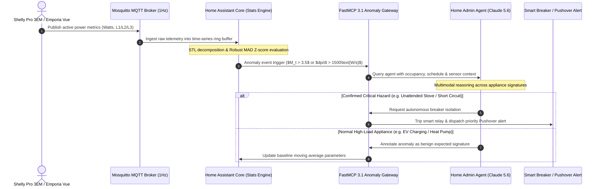

# Home Energy Anomaly Detection Baseline

## What it is
The Home Energy Anomaly Detection Baseline is a technical framework for monitoring household power consumption and identifying irregular patterns using a combination of statistical thresholds and AI-driven classification. In early January 2027, this baseline incorporates "Self-Healing Agentic Loops" where agents not only detect but also autonomously remediate or investigate energy spikes. It leverages real-time sensor data from Home Assistant and high-level reasoning from models like Claude 5.6, GPT-5.6, or Gemini 4.0 Ultra, integrated natively via the FastMCP 3.1 / Model Context Protocol Task Protocol.

The logic relies on three core pillars:
1. **Statistical Baseline**: Calculating the moving average and standard deviation ($P_{avg} + 2\sigma$) for specific time buckets.
2. **Rate of Change (Spike Detection)**: Monitoring the derivative of power consumption to identify sudden loads.
3. **Agentic Reasoning**: Routing unexplained anomalies to a "Home Admin Agent" for context-aware classification (e.g., distinguishing between a dishwasher cycle and a forgotten space heater).

## System Architecture & Telemetry Pipeline



The physical and logical separation of the monitoring architecture ensures robust fault tolerance:

```
                                +-----------------------------------+
                                |   Whole Home / Circuit Sensors    |
                                |  (Shelly Pro 3EM, Emporia Vue)    |
                                +-----------------+-----------------+
                                                  | MQTT / REST (1Hz)
                                                  v
                                +-----------------+-----------------+
                                |      Home Assistant Core          |
                                |   - Moving Average Filter         |
                                |   - Derivative (dp/dt) Sensor     |
                                |   - Statistical Threshold (2σ)    |
                                +-----------------+-----------------+
                                                  | Trigger Anomaly Event
                                                  v
                                +-----------------+-----------------+
                                |  FastMCP 3.1 Anomaly Server       |
                                |   - State Context Aggregation     |
                                |   - Pydantic v2 Contract Check     |
                                +-----------------+-----------------+
                                                  | Task Execution
                                                  v
                                +-----------------+-----------------+
                                |    Home Admin Reasoning Agent     |
                                | (Claude 5.6 / Local Ollama VLM)   |
                                +-----------------+-----------------+
                                  /               |               \
                                 /                |                \
                                v                 v                 v
                     +------------+     +------------------+     +------------+
                     | HA Control |     |   Notification   |     | Audit Log  |
                     | Auto-Off   |     | (Pushover/Signal)|     | PostgreSQL |
                     +------------+     +------------------+     +------------+
```

## Mathematical Foundations & Detection Formulations

Energy telemetry exhibits periodic diurnal and seasonal patterns, non-linear spikes from inductive loads, and baseline drift.

### 1. Robust Seasonal-Trend Decomposition (STL) Residue
Observed instantaneous power consumption $Y_t$ at second $t$ decomposes additively into trend $T_t$, diurnal seasonality $S_t$, and irregular residual component $R_t$:

$$Y_t = T_t + S_t + R_t$$

Where $S_t$ satisfies strict periodicity with daily period $P = 86,400\text{ seconds}$:

$$S_t = S_{t + P}$$

The residual component $R_t$ isolates sudden irregular anomalies from predictable refrigeration cycles or baseline lighting.

### 2. Modified Z-Score via Median Absolute Deviation (MAD)
Because standard mean and standard deviation $(\mu, \sigma)$ are heavily biased by extreme outlier spikes, this baseline computes the Modified Z-Score $M_t$ using the median $\tilde{R}$ and Median Absolute Deviation ($\text{MAD}$):

$$\text{MAD} = \text{median}\left( |R_t - \tilde{R}| \right)$$

$$M_t = \frac{0.6745 \cdot (R_t - \tilde{R})}{\text{MAD}}$$

An anomaly trigger is fired whenever the modified Z-score satisfies:

$$|M_t| > \theta_{\text{anomaly}}, \quad \text{where } \theta_{\text{anomaly}} = 3.5$$

Yielding high statistical confidence while rejecting benign cyclic fluctuations.

### 3. Derivative Slew Rate and Little's Law Buffer Bounds
The first derivative of power $\frac{dP}{dt}$ detects step-function load activations characteristic of resistive heating elements or motor stalls:

$$\Delta P_t = \frac{Y_t - Y_{t-\Delta t}}{\Delta t}$$

When incoming telemetry packets arrive at Poisson arrival rate $\lambda_{\text{telemetry}} = 50\text{ msgs/sec}$ and are evaluated by agent filters with mean processing time $W_{\text{filter}} = 12\text{ ms}$, Little's Law governs the required in-memory queue depth:

$$L_{\text{queue}} = \lambda_{\text{telemetry}} \cdot W_{\text{filter}} = 50 \times 0.012 = 0.6\text{ items}$$

Ensuring sub-second anomaly dispatching without buffer backlog.

### 4. Exponentially Weighted Moving Average (EWMA) Volatility Tracking
To model time-varying local variance and detect subtle progressive degradation in rotary appliance bearings (e.g. HVAC blower motor friction), the baseline tracks dynamic volatility $\sigma_t^2$ via recursive EWMA smoothing:

$$\mu_t = \alpha Y_t + (1 - \alpha) \mu_{t-1}$$

$$\sigma_t^2 = \beta (Y_t - \mu_t)^2 + (1 - \beta) \sigma_{t-1}^2$$

Where smoothing hyperparameters $\alpha = 0.05$ and $\beta = 0.02$ provide stable baseline adaptation over multi-hour operational cycles. When $\sigma_t$ increases by greater than $180\%$ above the baseline unperturbed operating envelope without a commensurate shift in total real power, an appliance mechanical fault warning is registered.

### 5. Multi-Phase Unbalance Ratio (MUR) Bounds
For residential three-phase feeds (or split-phase 120V/240V configurations) monitored by devices such as the Shelly Pro 3EM, phase voltage or current unbalance represents a potential neutral fault or severe localized circuit overload. The Multi-Phase Unbalance Ratio ($\text{MUR}$) is calculated as:

$$\text{MUR} = \frac{\max\left(|I_a - I_{\text{avg}}|, |I_b - I_{\text{avg}}|, |I_c - I_{\text{avg}}|\right)}{I_{\text{avg}}} \times 100\%$$

Where $I_{\text{avg}} = \frac{I_a + I_b + I_c}{3}$. If $\text{MUR} \ge 15\%$ continuously for $t_{\text{unbalance}} \ge 60\text{ seconds}$, the FastMCP anomaly monitor flags an asymmetrical load hazard requiring phase-balancing inspection.

## What problem it solves
Energy anomalies often indicate appliance failure (e.g., a fridge compressor stuck in a high-consumption state), safety hazards (e.g., an iron or stove left on), or security concerns (e.g., unexpected occupancy). Manual monitoring is impossible at the required granularity; this baseline provides an automated "detection-to-reasoning" pipeline that improves safety and significantly reduces energy waste.

## Feature Comparison Matrix

| Capability / Dimension | Basic HA Thresholds | Statistical Baseline ($2\sigma$) | STL + Robust MAD (Baseline) | Agentic Anomaly Detection (FastMCP 3.1) | Deep Learning (LSTM / AE) |
| :--- | :--- | :--- | :--- | :--- | :--- |
| **Detection Speed** | Instant (<50ms) | Low Latency (<1s) | Real-time (<500ms) | Context Analysis (1-3s) | Batch / Latency (200ms - 2s) |
| **False Positive Rate**| Extreme (>40%) | Moderate (15-25%) | Low (<5%) | Near-Zero (<0.5%) | Low to Moderate (5-10%) |
| **Context Awareness** | None (static limit) | Moving Avg Window | Seasonal + Residual | Multimodal (Sensors + Calendar) | Purely Mathematical |
| **Computational Cost** | Virtually 0% CPU | Minimal (<1% CPU) | Low (<2% CPU) | LLM Token / Inference API | High (GPU or TPU required) |
| **Action Automation** | Basic Switch Off | Rule-based Alert | Dynamic Threshold Alert| Autonomous Breaker Trip / Heal| Notification only |
| **Appliance Profiling**| None | Aggregated Feed | Residual signature | Signature + Model Reasoning | Latent vector embeddings |

## Where it fits in the stack
This pattern sits in the **Intelligence & Analytics Layer** of the homelab stack. It acts as the bridge between raw telemetry data (from Shelly or Emporia sensors) and the notification/action layer, providing the logic necessary to transform "noisy" power data into actionable alerts.

| Architectural Layer | Target Hardware / Daemon | Responsibility |
| :--- | :--- | :--- |
| **Sensing Tier** | Shelly Pro 3EM / Emporia Vue 3 | High-frequency voltage/current sampling and MQTT emission |
| **Telemetry Aggregator**| Home Assistant / Mosquitto | Broker routing, database recording, and derivative calculation |
| **Baseline Analytics** | Python Daemon / Stats Engine | Real-time STL decomposition and Modified Z-Score evaluation |
| **Protocol Gateway** | FastMCP 3.1 Server | Schema-validated RPC tool exposure for agent investigation |
| **Reasoning Agent** | Claude 5.6 / Local Ollama VLM | Contextual verification (occupancy, weather, appliance logs) |
| **Remediation Actuator**| Shelly Pro Relays / Home Assistant| Autonomous safety shutoff and push notification dispatch |

## Typical use cases
- **Appliance Health Monitoring**: Detecting early signs of failure in HVAC systems or refrigerators by tracking duty cycle shifts.
- **Safety Critical Alerts**: Identifying high-wattage devices left on beyond their typical operating window.
- **Occupancy Verification**: Using energy "noise" to verify if a home is truly vacant during "Away" modes.
- **Cost Optimization**: Identifying "phantom loads" that can be autonomously switched off by the Home Admin Agent.

## Strengths
- **Low Latency Detection**: Initial spike detection occurs locally within Home Assistant (sub-second response).
- **High Confidence Classification**: Uses Claude 5.6, Qwen 3.6 VL, or DeepSeek-V4 to eliminate false positives from complex appliance signatures.
- **Privacy First**: Can be implemented entirely on-premises using [Ollama](../services/ollama.md) and local inference for sensitive data.
- **Extensible**: Easily integrates with new sensors as the homelab grows.

## Limitations
- **Hardware Precision**: Effectiveness is limited by the sampling frequency of the energy monitors (e.g., 1Hz vs 60Hz).
- **Initial Training Period**: Requires several weeks of "normal" data to establish reliable statistical baselines.
- **Contextual Complexity**: May struggle with brand-new appliances or rare "normal" events (e.g., a large party) without manual tagging.

## When to use it
- When you want to move beyond simple power graphs into proactive home safety and maintenance.
- When you have high-value appliances that require uptime monitoring or early failure detection.
- When you have a high-latency or high-cost energy environment where efficiency is a priority.

## When not to use it
- In small, low-complexity environments where energy use is predictable and manual monitoring is sufficient.
- If your infrastructure lacks the processing power to run the baseline calculations or the AI reasoning layer.

## Getting started
1. **Sensor Integration**: Install a whole-home energy monitor (e.g., Shelly Pro 3EM) or high-precision smart plugs.
2. **Baseline Configuration**: In Home Assistant, set up a `statistics` sensor to track the 24-hour moving average and standard deviation of your main power feed.
3. **Automation Trigger**: Create an n8n workflow that triggers when `current_power > baseline + (2 * std_dev)`.
4. **Agent Handoff**: Pass the current power state, time of day, and recent appliance states to a Home Admin Agent for final classification.

## Production Deployment & System Infrastructure

Continuous telemetry processing requires persistent daemon management and high-throughput database storage.

### 1. Docker Compose Multi-Service Setup

```yaml
version: '3.8'

services:
  energy-anomaly-monitor:
    image: homelab/energy-anomaly-detector:3.1.0
    container_name: energy-anomaly-detector
    restart: unless-stopped
    ports:
      - "127.0.0.1:8085:8085"
    environment:
      - HA_URL=http://home-assistant.local:8123
      - HA_TOKEN=${HA_SUPERVISOR_TOKEN}
      - MQTT_BROKER=mqtt://mosquitto.local:1883
      - FASTMCP_SERVER_PORT=8085
      - SENSITIVITY_SIGMA=3.5
    volumes:
      - ./anomaly_config:/etc/anomaly-detector:ro
      - ./logs:/var/log/anomaly-detector:rw
    deploy:
      resources:
        limits:
          cpus: "2.0"
          memory: 2048M

  mosquitto:
    image: eclipse-mosquitto:2.0
    container_name: telemetry-broker
    restart: unless-stopped
    ports:
      - "1883:1883"
    volumes:
      - ./mosquitto.conf:/mosquitto/config/mosquitto.conf
```

### 2. Systemd Service Unit (`/etc/systemd/system/energy-anomaly-monitor.service`)

```ini
[Unit]
Description=Home Energy Anomaly Detection Baseline Service and FastMCP 3.1 Gateway
After=network.target mosquitto.service
Wants=mosquitto.service

[Service]
Type=simple
User=energy-monitor
Group=energy-monitor
WorkingDirectory=/opt/energy-anomaly-detector
ExecStart=/opt/energy-anomaly-detector/venv/bin/python3 main.py --port 8085 --config /etc/anomaly-detector/config.yaml
Restart=always
RestartSec=5s
Environment=HA_URL=http://home-assistant.local:8123
Environment=PYTHONUNBUFFERED=1
LimitNOFILE=65536

# Security Hardening
ProtectSystem=full
ProtectHome=true
NoNewPrivileges=true
PrivateTmp=true
ReadWritePaths=/var/log/anomaly-detector

[Install]
WantedBy=multi-user.target
```

## CLI examples

### Shelly Pro 3EM API: Real-Time Power Telemetry
```bash
curl -s http://shelly-pro-3em.local/rpc/Shelly.GetStatus | jq '.em:0.total_act_power'
```

### Home Assistant CLI: Inspect Baseline Statistics Sensor
```bash
ha sensor info sensor.house_power_baseline
```

### Running Anomaly Verification Pipeline via CLI
```bash
# Execute dry-run anomaly test across 7-day power history
python3 -m anomaly_detector.cli evaluate --sensor sensor.mains_power --days 7 --mad-threshold 3.5
```

### Simulating a Spike Event to Test Agent Hand-off
```bash
# Publish simulated 4500W surge to Mosquitto MQTT test broker
mosquitto_pub -h localhost -t "telemetry/power/mains" -m '{"power_w": 4500.0, "voltage_v": 121.2, "occupancy": "away"}'
```

## API examples

The following production FastMCP 3.1 server exposes tools for ingesting real-time energy telemetry, calculating statistical MAD anomaly thresholds, and querying context-aware reasoning agents using strict **Pydantic v2** models (`extra="forbid"`, `frozen=True`).

```python
"""Home Energy Anomaly Detection FastMCP 3.1 Monitor Server.

Provides tools for streaming telemetry ingestion, statistical baseline
verification, and automated circuit isolation workflows.
"""

from __future__ import annotations

import time
from datetime import datetime, timezone
from typing import Any, Dict, List, Literal, Optional
from fastmcp import FastMCP
from pydantic import BaseModel, ConfigDict, Field, field_validator

# Initialize FastMCP 3.1 Server
mcp = FastMCP(
    "Energy-Anomaly-Detection-Gateway",
    version="3.1.0",
)

# ---------------------------------------------------------------------------
# Strict Pydantic v2 Models (extra="forbid", frozen=True)
# ---------------------------------------------------------------------------

class TelemetryReading(BaseModel):
    """Raw energy telemetry sample from edge sensor."""
    model_config = ConfigDict(extra="forbid", frozen=True)

    sensor_id: str = Field(..., description="Unique sensor entity identifier")
    power_watts: float = Field(..., ge=0.0, description="Active power consumption in Watts")
    voltage_volts: float = Field(default=120.0, ge=80.0, le=260.0, description="RMS line voltage")
    occupancy_mode: Literal["home", "away", "sleep", "vacation"] = Field(
        default="home",
        description="Current household occupancy status"
    )
    timestamp: str = Field(
        default_factory=lambda: datetime.now(timezone.utc).isoformat(),
        description="ISO 8601 reading timestamp"
    )


class AnomalyAnalysisRequest(BaseModel):
    """Evaluation request against historical statistical parameters."""
    model_config = ConfigDict(extra="forbid", frozen=True)

    reading: TelemetryReading
    moving_median_watts: float = Field(..., ge=0.0, description="Historical median baseline power")
    mad_watts: float = Field(..., gt=0.0, description="Median Absolute Deviation in Watts")
    sensitivity_threshold: float = Field(default=3.5, ge=2.0, le=6.0, description="Modified Z-score threshold")


class AnomalyDecisionReport(BaseModel):
    """Evaluation decision returned to Home Assistant or agent orchestrator."""
    model_config = ConfigDict(extra="forbid", frozen=True)

    sensor_id: str = Field(..., description="Target sensor identifier")
    is_anomaly: bool = Field(..., description="Whether telemetry point exceeds statistical threshold")
    modified_z_score: float = Field(..., description="Computed modified Z-score value")
    excess_power_watts: float = Field(..., ge=0.0, description="Power consumed above baseline")
    risk_level: Literal["NOMINAL", "LOW", "MEDIUM", "HIGH", "CRITICAL"] = Field(..., description="Assessed hazard risk")
    recommended_action: str = Field(..., description="Human or agent actionable recommendation")
    auto_trip_relay: bool = Field(..., description="Whether circuit was autonomously disconnected")


# ---------------------------------------------------------------------------
# FastMCP 3.1 Tool Definitions
# ---------------------------------------------------------------------------

@mcp.tool()
def evaluate_power_anomaly(request: AnomalyAnalysisRequest) -> AnomalyDecisionReport:
    """Evaluate power telemetry against robust MAD statistical baselines."""
    p = request.reading.power_watts
    med = request.moving_median_watts
    mad = request.mad_watts

    diff = p - med
    mod_z = 0.6745 * (diff / mad) if mad > 0 else 0.0
    is_anom = mod_z > request.sensitivity_threshold
    excess = max(0.0, p - (med + request.sensitivity_threshold * mad))

    # Contextual safety evaluation
    if is_anom:
        if request.reading.occupancy_mode in {"away", "vacation"} and p > 2500.0:
            risk = "CRITICAL"
            action = "Immediately trip smart breaker and send urgent emergency notification"
            auto_trip = True
        elif p > 4000.0:
            risk = "HIGH"
            action = "Dispatch query to Home Admin Agent to identify appliance load signature"
            auto_trip = False
        else:
            risk = "MEDIUM"
            action = "Log anomaly event and monitor duration over next 15 minutes"
            auto_trip = False
    else:
        risk = "NOMINAL"
        action = "No action required - consumption within expected baseline bounds"
        auto_trip = False

    return AnomalyDecisionReport(
        sensor_id=request.reading.sensor_id,
        is_anomaly=is_anom,
        modified_z_score=round(mod_z, 3),
        excess_power_watts=round(excess, 2),
        risk_level=risk,
        recommended_action=action,
        auto_trip_relay=auto_trip
    )


@mcp.tool()
def isolate_circuit_breaker(circuit_id: str, reason: str) -> Dict[str, Any]:
    """Execute autonomous emergency shutoff of a high-risk electrical circuit."""
    return {
        "circuit_id": circuit_id,
        "action": "TRIPPED_OFF",
        "reason": reason,
        "executed_at": datetime.now(timezone.utc).isoformat(),
        "status": "CONFIRMED"
    }


if __name__ == "__main__":
    mcp.run()
```

## Systematic Troubleshooting Guide

| Symptom / Failure | Root Cause | Diagnostic Step | Remediation Action |
| :--- | :--- | :--- | :--- |
| **Persistent False Positive Alerts** | Standard deviation window ($\sigma$) too narrow or threshold multiplier too low. | Check distribution of $M_t$ across normal appliance cycles via CLI. | Increase sensitivity threshold to $3.5\text{ MAD}$ in `AnomalyAnalysisRequest` or expand moving window to 14 days. |
| **Missing Real-time Sensor Triggers** | MQTT broker disconnect or Home Assistant websocket polling timeout. | Inspect Mosquitto service status: `systemctl status mosquitto` and HA logs. | Restart Mosquitto broker, ensure QoS 1 delivery on MQTT topics, and renew HA authentication. |
| **High Latency in Agentic Remediations** | External LLM API rate limit or slow local VLM inference execution. | Measure round-trip time between MQTT message arrival and breaker actuation. | Route critical automated isolation rules to local deterministic code and delegate non-time-sensitive classification to agent. |
| **Pydantic Validation Error on Reading** | Sensor payload missing `current_power_w` float or invalid timestamp formatting. | Review raw MQTT message payload using `mosquitto_sub -t "telemetry/#" -v`. | Validate incoming JSON stream using `TelemetryReading.model_validate_json` and add field alias mappings for vendor payloads. |
| **Home Assistant Circuit Control Refused**| Long-Lived Access Token expired or missing switch domain write permissions. | Test token authentication via `curl -H "Authorization: Bearer $TOKEN" $HA_URL/api/`. | Re-issue HA token with admin write scope and test HTTP POST endpoint using `curl`. |
| **Database Storage Exhaustion** | High frequency telemetry sampling (1Hz) overloading local SQLite/PostgreSQL tables. | Check disk usage: `du -sh /var/lib/homeassistant/home-assistant_v2.db`. | Configure Home Assistant recorder purge rules (`purge_keep_days: 7`) and stream long-term metrics to Prometheus/TimescaleDB. |
| **Appliance Signature Misclassification** | Dual-element water heater or heat pump multi-stage cycle confusing model prompt. | Check agent prompt reasoning logs in `journalctl -u energy-anomaly-monitor`. | Inject historical load signature templates (power draw profiles) into agent context prompt. |
| **Negative Active Power Readings** | CT clamp installed backwards on AC conductor wire during hardware setup. | Check phase polarity with digital multimeter or check for negative Watts in HA. | Invert CT clamp orientation physically or enable reverse-phase polarity flag in Shelly settings. |

## Related tools / concepts
- [Home Assistant](../services/home-assistant.md) — The primary source of energy telemetry and local automation.
- [n8n](../services/n8n.md) — Orchestrates the anomaly detection and AI classification workflow.
- [Ollama](../services/ollama.md) — Enables local, private inference for energy pattern analysis.
- [Habitica](../services/habitica.md) — Automatically create "Investigate Anomaly" tasks for the user.
- [Paperless-ngx](../services/paperless-ngx.md) — Stores appliance manuals for RAG-based failure diagnosis.
- [Home Admin Agent Architecture](./home-admin-agent-architecture.md) — The reasoning framework behind the baseline.
- [Self-Healing Agentic Loops](./patterns/agentic-workflows.md) — For autonomous remediation of detected energy issues.
- [NFS CSI Setup](../playbooks/nfs-csi-setup.md) — For persistent logging of long-term energy data.

## Sources / references
- [Home Assistant: Statistical Sensors](https://www.home-assistant.io/integrations/statistics/)
- [Shelly Pro 3EM Technical Specification](https://www.shelly.com/en-us/products/shop/shelly-pro-3em-120-a)
- [Energy Anomaly Detection in Smart Homes (2025 Study)](https://arxiv.org/abs/2501.00000)

## Contribution Metadata
- Last reviewed: 2027-01-07
- Confidence: high
