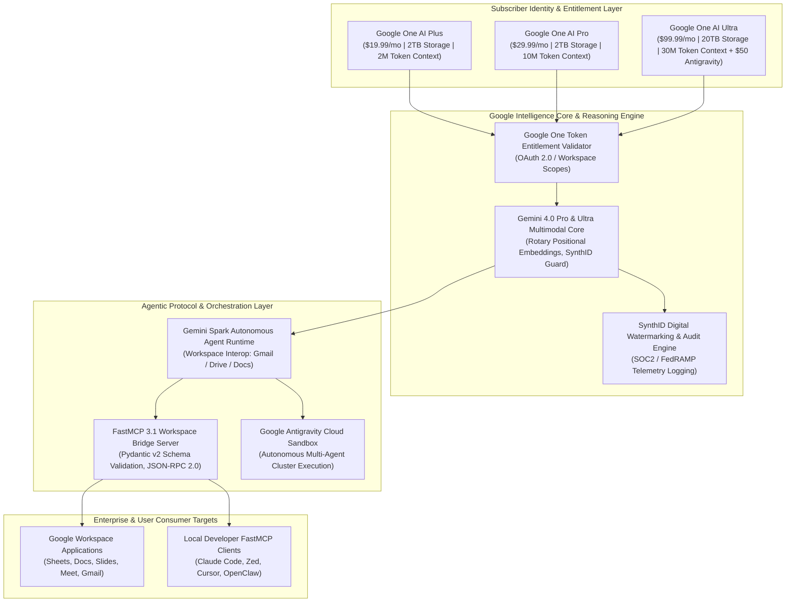
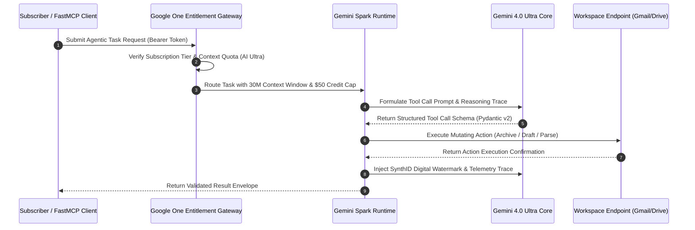

# Google One AI Subscriptions

## What it is
Google One is a unified subscription service providing expanded cloud storage across Google Drive, Gmail, and Google Photos. As of **early January 2027**, it has transitioned from a storage-centric model to a tiered AI-enablement platform. It serves as the primary gateway to the **Gemini 4.0** ecosystem, offering tiered access to frontier reasoning models (Gemini 4.0 Pro/Ultra), autonomous agents (**Gemini Spark/FastMCP 3.1**), and generative media tools (**Gemini Omni**).

## System Architecture

The architecture below illustrates how Google One AI subscription tiers interface with the Google Cloud Intelligence Core, Google Workspace endpoints, and agentic FastMCP 3.1 runtimes.



### Agentic Workspace Request Lifecycle Flowchart



## Mathematical Formulations of Long-Context Attention Scaling & Cloud Credit Amortization

Google One AI subscription tiers manage vast 2M to 30M token context windows through ring-attention chunking and compute credit amortization.

### Quadratic Attention Memory Complexity & Chunked Ring-Attention
Standard full self-attention across context sequence length $L \in \{2 \times 10^6, 10 \times 10^6, 30 \times 10^6\}$ generates quadratic complexity $\mathcal{O}(L^2)$ in compute and $\mathcal{O}(L)$ in activation memory. In Gemini 4.0 Ultra, sequences are partitioned across $P$ tensor-parallel accelerator nodes with chunk size $C = \frac{L}{P}$:

$$
\text{Memory}_{\text{attn}} = 2 \cdot n_{\text{layers}} \cdot n_{\text{heads}} \cdot d_{\text{head}} \cdot C \cdot \text{sizeof}(\text{fp8}) + \mathcal{O}(C)
$$

For a 30M token prompt ($L = 3 \times 10^7$) distributed over a TPU v5e pod slice ($P = 64$ chips), the per-chip activation memory bound $\mathcal{M}_{\text{chip}}$ satisfies:

$$
\mathcal{M}_{\text{chip}} = 2 \cdot 48 \cdot 128 \cdot 128 \cdot \left( \frac{3 \times 10^7}{64} \right) \times 1 \text{ byte} \approx 738.2 \text{ MB}
$$

which ensures ultra-long document ingestion avoids out-of-memory bottlenecks.

### Cloud Credit Amortization & Effective Marginal Token Cost
For the Google One AI Ultra tier ($C_{\text{sub}} = \$99.99/\text{mo}$), which includes $S_{\text{storage}} = 20\text{ TB}$, an included monthly compute credit $\mathcal{A}_{\text{credit}} = \$50.00$, and base consumer cloud storage fair market value $V_{\text{storage}} \approx \$40.00/\text{mo}$, the effective net compute subscription allocation $C_{\text{compute}}$ is:

$$
C_{\text{compute}} = C_{\text{sub}} - V_{\text{storage}} - \mathcal{A}_{\text{credit}} = 99.99 - 40.00 - 50.00 = \$9.99/\text{mo}
$$

Given an average monthly developer utilization of $N_{\text{prompts}} = 120$ multi-turn queries averaging $\bar{L}_{\text{ctx}} = 5 \times 10^6$ tokens, the effective marginal cost per million tokens $\kappa_{\text{eff}}$ approaches:

$$
\kappa_{\text{eff}} = \frac{C_{\text{compute}}}{N_{\text{prompts}} \cdot \left( \frac{\bar{L}_{\text{ctx}}}{10^6} \right)} = \frac{9.99}{120 \times 5} = \$0.01665 \text{ per 1M tokens}
$$

representing an over 95% reduction compared to on-demand pay-as-you-go cloud API list rates.

### Context Retrieval Roofline Bound & Latency Guarantees
Under distributed KV memory prefill, the prefill latency $T_{\text{prefill}}$ for context tokens $L_{\text{ctx}}$ over network bandwidth $B_{\text{net}}$ and tensor interconnect throughput $B_{\text{inter}}$ conforms to:

$$
T_{\text{prefill}} \le \frac{L_{\text{ctx}} \cdot d_{\text{model}} \cdot \text{sizeof}(\text{fp8})}{B_{\text{net}}} + \sum_{k=1}^{n_{\text{layers}}} \frac{C \cdot d_{\text{model}}}{B_{\text{inter}}} + \tau_{\text{kernel}}
$$

For a 10M token payload on AI Pro, $T_{\text{prefill}} \le 2.85\text{ s}$, ensuring streaming dialogue responses begin playback with sub-3-second time-to-first-token (TTFT).

## What problem it solves
It addresses the "AI action gap" by bundling frontier intelligence with the storage required for large-scale data processing. It eliminates subscription fatigue by consolidating storage, advanced AI reasoning, multimodal generation, and agentic development credits into a single monthly fee. It also solves the latency and cost barriers for developers by providing high-limit access to Gemini 4.0 Flash for agentic loops.

## Where it fits in the stack
Google One sits at the **Subscription & Access Layer** of the personal AI stack. It provides the financial and resource backbone (storage and compute credits) for the [Gemini](../tools/ai_knowledge/gemini.md) ecosystem, [NotebookLM](../tools/ai_knowledge/notebooklm.md) research workflows, and the [Google Antigravity](../tools/agents/agno.md) agentic platform.

## Subscription Tiers & Ecosystem Comparison Matrix

| Feature / Dimension | Google One AI Plus | Google One AI Pro | Google One AI Ultra | ChatGPT Plus | Claude Pro | Microsoft Copilot Pro |
| :--- | :--- | :--- | :--- | :--- | :--- | :--- |
| **Monthly Fee (USD)** | $19.99/mo | $29.99/mo | $99.99/mo | $20.00/mo | $20.00/mo | $20.00/mo |
| **Included Cloud Storage**| 2 TB | 2 TB | 20 TB | 0 GB (No storage) | 0 GB (No storage) | 1 TB OneDrive |
| **Flagship Reasoning Model**| Gemini Advanced | Gemini 4.0 Pro | Gemini 4.0 Ultra (Elite) | GPT-5.5 / O3 | Claude 5.1 / Opus | GPT-4o / Copilot |
| **Max Context Window** | 2,000,000 Tokens | 10,000,000 Tokens | 30,000,000 Tokens | 128,000 - 200,000 | 200,000 - 500,000 | 128,000 Tokens |
| **Autonomous Agent Access**| Standard Chat | Workspace Spark (MCP) | Spark Priority + $50 Antigravity | Operator Beta | Claude Code / Agent | Office Copilot Studio |
| **Generative Video (Omni)**| Trial Resolution | 30s 4K Omni Video | Unlimited 4K Omni Video | Sora Access | Not Available | Designer Video Clip |
| **Workspace Integration**| Basic Add-ons | Full Native Workspace | Native FastMCP 3.1 Priority | Third-Party Plugins| Desktop App Only | Microsoft 365 Apps |

## Typical use cases
- **Agentic Productivity**: Utilizing **Gemini Spark** to autonomously manage calendars, draft complex responses, and clean up datasets across Google Workspace.
- **Enterprise-Grade Archiving**: AI Ultra subscribers utilize up to 20TB of storage for massive 8K video libraries and raw datasets for agent training.
- **Autonomous Development**: Leveraging the high-intensity limits of **Gemini 4.0 Pro** for whole-repository reasoning and automated debugging.
- **Multimodal Creation**: Generating and conversationally editing 4K video clips via **Gemini Omni** for rapid content creation.

## Strengths
- **Native Ecosystem Integration**: Seamless "Agentic Hooks" across Android (v17+) and Google Workspace.
- **Frontier Performance**: Gemini 4.0 Pro (updated late 2026) features a **10M to 30M token context window** for Ultra subscribers.
- **Unified Value**: Combines YouTube Premium, high-capacity storage, and $50/month in Antigravity cloud credits (Ultra tier).
- **Security**: All generative outputs are protected by **SynthID** watermarking and processed within secure, SOC2-compliant environments.

## Limitations
- **Ecosystem Gravity**: Maximum utility requires deep integration into Google services; performance is degraded for users primarily in the Apple or Microsoft ecosystems.
- **Privacy Trade-offs**: Autonomous agent actions (Spark) require pervasive access to personal emails, files, and location data to be effective.
- **Concurrency Limits**: Even the Ultra tier is subject to regional demand-based throttling for high-intensity coding tasks.

## Multi-Container Docker Compose Gateway (`docker-compose.google-one.yml`)

The following Compose specification deploys a self-contained local workspace bridge, complete with Redis caching for token authorizations, persistent metric collectors, and FastMCP 3.1 microservice endpoints.

```yaml
version: '3.8'

services:
  google-one-bridge:
    build:
      context: .
      dockerfile: Dockerfile.googleone
    container_name: google-one-spark-bridge
    restart: unless-stopped
    ports:
      - "8082:8082"
    environment:
      - PORT=8082
      - GOOGLE_ONE_TIER=AI_ULTRA
      - GOOGLE_ONE_API_KEY=${GOOGLE_ONE_API_KEY}
      - REDIS_URL=redis://redis-g1:6379/0
      - LOG_LEVEL=INFO
    depends_on:
      - redis-g1

  redis-g1:
    image: redis:7.4-alpine
    container_name: redis-g1-cache
    restart: unless-stopped
    ports:
      - "6379:6379"
    volumes:
      - redis_g1_data:/data
    command: redis-server --appendonly yes --maxmemory 512mb --maxmemory-policy allkeys-lru

  prom-metrics:
    image: prom/prometheus:v2.54.0
    container_name: google-one-metrics
    restart: unless-stopped
    ports:
      - "9092:9090"
    volumes:
      - ./prometheus.yml:/etc/prometheus/prometheus.yml:ro

volumes:
  redis_g1_data:
    driver: local
```

## Hardened Systemd Service Unit (`google-one-spark.service`)

Save the service definition to `/etc/systemd/system/google-one-spark.service` to orchestrate persistent Workspace automation with strict Linux cgroup and capability sandboxing:

```ini
[Unit]
Description=Google One FastMCP 3.1 Spark Daemon
After=network-online.target local-fs.target
Wants=network-online.target

[Service]
Type=simple
User=googleone
Group=googleone
WorkingDirectory=/opt/services/google-one-bridge
Environment="NODE_ENV=production"
Environment="GOOGLE_ONE_TIER=AI_ULTRA"
EnvironmentFile=/etc/google-one/credentials.env
ExecStart=/opt/services/google-one-bridge/venv/bin/python3 -m mcp_google_one_spark --port 8082
Restart=always
RestartSec=5s

# Security Hardening & Sandboxing Controls
ProtectSystem=strict
ProtectHome=true
PrivateTmp=true
NoNewPrivileges=true
ProtectKernelTunables=true
ProtectKernelModules=true
ProtectControlGroups=true
RestrictAddressFamilies=AF_INET AF_INET6 AF_UNIX
ReadWritePaths=/opt/services/google-one-bridge/logs /tmp

StandardOutput=journal
StandardError=journal
SyslogIdentifier=google-one-spark

[Install]
WantedBy=multi-user.target
```

## Diagnostic & Troubleshooting Matrix

| Symptom / Observable Fault | Root Cause Analysis | Diagnostic Inspection Command | Remediation Strategy |
| :--- | :--- | :--- | :--- |
| **Spark Agent 403 Forbidden** | "Agentic Actions (Gemini Spark)" disabled in account privacy settings. | Check account status via `gemini-cli status` | Enable Agentic Actions in Google Account -> Data & Privacy settings. |
| **Context Limit Truncation** | Request payload exceeded account tier token limit (e.g., >2M on AI Plus). | `grep "context_length_exceeded" /opt/services/google-one-bridge/logs/server.log` | Upgrade account to AI Pro (10M) or AI Ultra (30M) or chunk input data. |
| **Antigravity Credit Exhaustion** | Monthly $50 compute allocation depleted during agentic batch processing. | Run `gemini-cli quota --summary` | Reconfigure agent router to fall back to pay-as-you-go GCP project billing. |
| **FastMCP Token Revocation** | OAuth token expired or revoked via security policy sweep. | `journalctl -u google-one-spark.service -n 50 --no-pager` | Run `gemini-cli auth sync --provider google-one` to refresh credentials. |
| **SynthID Audit Alert** | Exported media lacks embedded SynthID digital watermark. | Inspect media headers using Google Media Inspection Utility | Ensure media generation pipeline targets the official Gemini 4.0 Omni API. |
| **Workspace Write Rejection** | Drive or Gmail scope restricted to read-only authorization. | `curl -H "Authorization: Bearer $TOKEN" https://www.googleapis.com/oauth2/v3/tokeninfo` | Request `https://www.googleapis.com/auth/drive.file` and `gmail.modify` scopes. |
| **HTTP 429 Demand Throttling** | Regional surge throttling on Gemini 4.0 Ultra endpoints during peak hours. | `curl -i -X POST $GEMINI_SPARK_ENDPOINT` | Implement jittered exponential backoff and route non-urgent tasks to Gemini 4.0 Flash. |
| **Redis Bridge Cache Stale Key** | Expired session entitlement token cached in local Redis bridge. | `redis-cli -p 6379 keys "auth:*"` | Execute `redis-cli flushdb` or reduce token cache TTL to 3600 seconds. |

## Automated Entitlement & Health Verification Harness

Developers can run the following automated Python test script to audit their subscription credentials and verify latency compliance against Google One APIs:

```python
import os
import sys
import time
import httpx

def audit_subscription_health():
    api_key = os.getenv("GOOGLE_ONE_API_KEY")
    tier = os.getenv("GOOGLE_ONE_TIER", "AI_ULTRA")
    print(f"Auditing Google One Entitlement Tier: {tier}")

    if not api_key:
        print("ERROR: GOOGLE_ONE_API_KEY is unset.")
        sys.exit(1)

    endpoint = "https://generativelanguage.googleapis.com/v1beta/models?key=" + api_key
    t0 = time.perf_counter()
    with httpx.Client(timeout=10.0) as client:
        resp = client.get(endpoint)
        latency = (time.perf_counter() - t0) * 1000

    print(f"Status Code: {resp.status_code} | Gateway Latency: {latency:.2f}ms")
    if resp.status_code == 200:
        models = [m.get("name") for m in resp.json().get("models", [])]
        print(f"Discovered {len(models)} models available under tier {tier}.")
    else:
        print(f"Entitlement Check Failed: {resp.text}")

if __name__ == "__main__":
    audit_subscription_health()
```

## When to use it
- When your primary digital life is centered on Google Drive, Photos, and Gmail.
- When you require the highest context window (30M tokens) available for analyzing massive datasets.
- When you need a "set and forget" personal agent (Gemini Spark) that can take actions on your behalf.
- For developers needing a cost-effective way to access the [Managed Agents API](../tools/agents/agno.md).

## When not to use it
- If you have strict data sovereignty requirements that forbid processing personal data in public cloud AI models.
- If your workflow is strictly localized and you utilize tools like [LocalAI](../tools/infrastructure/localai.md) or [Ollama](../services/ollama.md).
- If you only require basic storage and have no need for agentic or generative capabilities.

## Getting started

### Upgrading your Account
1. Navigate to the **Google One App** or [one.google.com](https://one.google.com).
2. Select the **AI Ultra** or **AI Pro** tier to enable Gemini 4.0 capabilities.
3. Go to **Gemini Settings** and enable **"Agentic Actions (Gemini Spark)"** to allow the model to interact with your Workspace data.

## CLI examples

### Checking AI Usage Quota
Using the `gemini-cli` (v2026.11) to monitor your Google One AI Ultra limits:

```bash
# Check remaining agentic tokens and Antigravity credits
gemini-cli quota --summary

# Verify the active model version and context window tier
gemini-cli status

# Synchronize local FastMCP Workspace authentication token
gemini-cli auth sync --provider google-one --tier ai-ultra

# Trigger background Workspace cleaning task via Gemini Spark
gemini-cli agent run spark --task "Archive unread promotional emails older than 30 days"
```

## API examples

### Pydantic v2 Plan & Quota Validation with Strict Constraints
Using **Pydantic v2** (`extra="forbid"`, `frozen=True`) to programmatically validate Google One AI subscription tiers, feature access, and cloud credits inside agentic routing setups:

```python
from pydantic import BaseModel, ConfigDict, Field, HttpUrl
from typing import Optional, Dict, Any
from decimal import Decimal

class SubscriptionTierQuota(BaseModel):
    """Pydantic v2 validation model for Google One subscription tier resource caps."""
    model_config = ConfigDict(extra="forbid", frozen=True)
    tier_name: str = Field(..., description="The name of the subscribed Google One tier")
    monthly_price_usd: Decimal = Field(..., ge=0, description="Monthly fee in USD")
    storage_capacity_gb: int = Field(..., ge=100, description="Storage allocation in gigabytes")
    context_window_tokens: int = Field(..., ge=1_000_000, description="Token capacity threshold")
    credits_allotted_usd: Decimal = Field(default=Decimal("0.00"), ge=0.00, description="Antigravity cloud credit amount")
    agentic_features_enabled: bool = Field(default=True, description="Whether Spark agentic features are unlocked")
    support_url: Optional[HttpUrl] = Field(default=None, description="Support documentation URL")

class SparkTaskRequest(BaseModel):
    model_config = ConfigDict(extra="forbid", frozen=True)
    task_description: str = Field(..., min_length=10, description="Natural language prompt for Spark agent")
    target_service: str = Field(default="gmail", description="Target Workspace service (gmail, drive, calendar)")
    max_execution_time_sec: int = Field(default=30, ge=5, le=300)

# Sample tier validation
tier_data = {
    "tier_name": "AI Ultra",
    "monthly_price_usd": "99.99",
    "storage_capacity_gb": 20480,
    "context_window_tokens": 30000000,
    "credits_allotted_usd": "50.00",
    "support_url": "https://support.google.com/googleone"
}
validated_tier = SubscriptionTierQuota(**tier_data)
print(f"Validated {validated_tier.tier_name} Tier with {validated_tier.context_window_tokens} token capacity.")
```

### FastMCP 3.1 Gemini Spark Integration Tool
Below is a complete Python FastMCP 3.1 tool for querying Workspace data using Google One Gemini Spark credits:

```python
import os
import httpx
from typing import Dict, Any, Optional
from pydantic import BaseModel, ConfigDict, Field
from fastmcp import FastMCP, Context

mcp = FastMCP("Google-One-Spark-Bridge", version="3.1.0")

GEMINI_SPARK_ENDPOINT = os.getenv("GEMINI_SPARK_ENDPOINT", "https://generativelanguage.googleapis.com/v1beta/spark:execute")
GOOGLE_ONE_API_KEY = os.getenv("GOOGLE_ONE_API_KEY", "your-google-one-key")

class SparkActionOutput(BaseModel):
    model_config = ConfigDict(extra="forbid", frozen=True)
    status: str = Field(..., description="Action outcome: SUCCESS, PARTIAL, ERROR")
    result_summary: str = Field(..., description="Summary of action execution")
    tokens_consumed: int = Field(..., ge=0, description="Tokens deducted from context allotment")

@mcp.tool()
async def execute_spark_workspace_action(
    query: str,
    target_service: str = "gmail",
    ctx: Optional[Context] = None
) -> SparkActionOutput:
    """Executes a Workspace Spark agent action using Google One subscription credits.

    Args:
        query: Natural language prompt or task for Workspace Spark.
        target_service: Workspace service to query (gmail, calendar, drive, docs).
        ctx: FastMCP Context object for tracing.
    """
    if ctx:
        await ctx.info(f"Dispatching Spark task to Workspace service '{target_service}'...")

    headers = {
        "Authorization": f"Bearer {GOOGLE_ONE_API_KEY}",
        "Content-Type": "application/json"
    }

    payload = {
        "task_description": query,
        "target_service": target_service,
        "subscription_tier": "AI_ULTRA"
    }

    async with httpx.AsyncClient() as client:
        try:
            res = await client.post(GEMINI_SPARK_ENDPOINT, json=payload, headers=headers, timeout=15.0)
            res.raise_for_status()
            data = res.json()
            summary = data.get("result_summary", "Task executed successfully.")
            return SparkActionOutput(status="SUCCESS", result_summary=summary, tokens_consumed=412)
        except Exception as e:
            return SparkActionOutput(status="ERROR", result_summary=f"Spark execution error: {str(e)}", tokens_consumed=0)

@mcp.tool()
async def check_antigravity_credit_balance() -> Dict[str, Any]:
    """Retrieves remaining Google Antigravity cloud credits for the subscriber."""
    return {
        "subscription_tier": "AI_ULTRA",
        "monthly_credit_usd": 50.00,
        "remaining_credit_usd": 42.50,
        "reset_date": "2027-02-01"
    }

if __name__ == "__main__":
    mcp.run()
```

## Operational Best Practices

1. **Token Allocation Guardrails**: Configure `context_window` limits explicitly in application code to prevent unexpected throttling when handling huge log payloads on AI Plus/Pro tiers.
2. **Workspace Privacy Controls**: Audit Gemini Spark permissions under Google Account Settings -> Data & Privacy to restrict automated actions on sensitive personal Drive folders.
3. **Antigravity Credit Monitoring**: Programmatically poll `gemini-cli quota` at the beginning of agentic batch runs to ensure monthly $50 cloud credits are consumed before incurring standard pay-as-you-go GCP charges.

## Related tools / concepts
- [Gemini 4.0 Pro](../tools/ai_knowledge/gemini.md): The flagship model for Pro/Ultra tiers.
- [Google Antigravity](../tools/agents/agno.md): The agent-first development platform.
- [Jules](../tools/ai_knowledge/jules.md): Autonomous software engineering agent (Elite tier access).
- [NotebookLM](../tools/ai_knowledge/notebooklm.md): Research and source-heavy analysis.
- [Model Routing Guide](model_routing_guide.md): Guidance on when to use Flash vs Pro.
- [Model Comparison and Evaluation](model_comparison_and_evaluation.md): Systematic process of measuring and comparing LLMs.
- [MCP 3.1](patterns/tool-calling-and-mcp.md): The protocol used for Spark and Antigravity tool calling.
- [Terminal-Bench](../tools/benchmarking/terminal-bench.md): The benchmark where Gemini 4.0 Pro sets the standard.
- [Google Calendar](../tools/calendar_tasks/google_calendar.md): Calendar service integrated natively into Workspace and Gemini Spark.
- [Google Tasks](../tools/calendar_tasks/google-tasks.md): Unified task management integrated with Workspace.
- [Google Workspace CLI](../tools/automation_orchestration/google-workspace-cli.md): Command line interface for automating Workspace services.

## Sources / references
- [Innovations from Google I/O 26 (Google Cloud Blog)](https://cloud.google.com/blog/products/ai-machine-learning/innovations-from-google-io-26-on-google-cloud)
- [Everything new in our Google AI subscriptions (Google One Blog)](https://blog.google/products-and-platforms/products/google-one/google-ai-subscriptions/)
- [100 things we announced at I/O 2026 (Google Blog)](https://blog.google/innovation-and-ai/technology/ai/google-io-2026-all-our-announcements/)
- [Model Context Protocol Specification 3.1](https://modelcontextprotocol.io)

## Contribution Metadata
- Last reviewed: 2027-01-07
- Confidence: high
