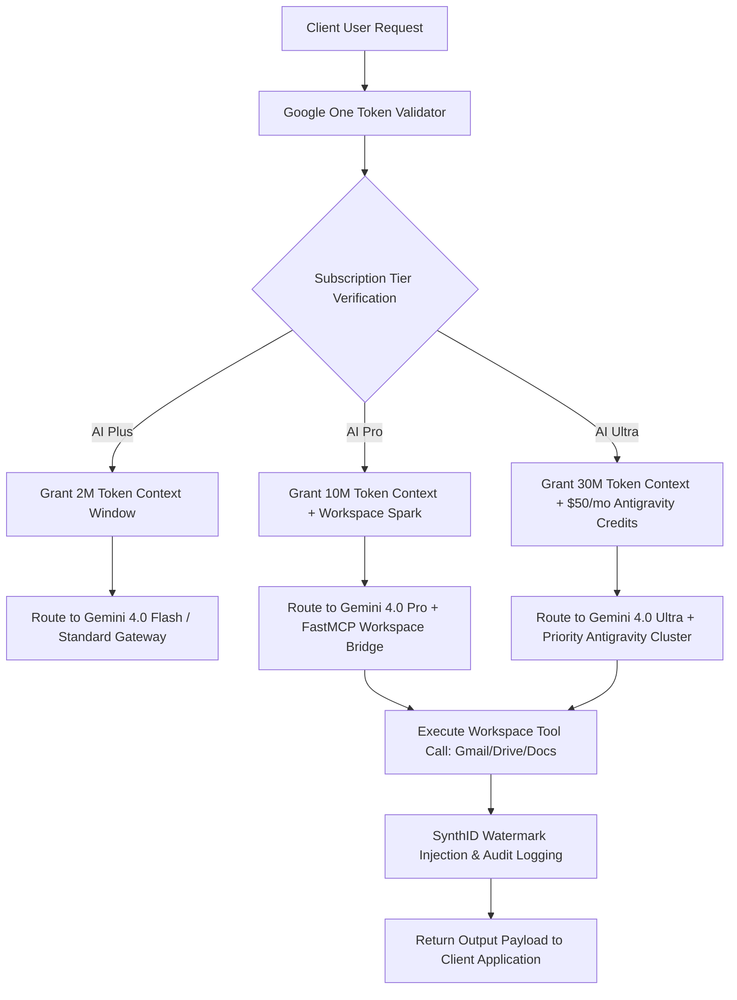

# Google One AI Subscriptions

## What it is
Google One is a unified subscription service providing expanded cloud storage across Google Drive, Gmail, and Google Photos. As of **early January 2027**, it has transitioned from a storage-centric model to a tiered AI-enablement platform. It serves as the primary gateway to the **Gemini 4.0** ecosystem, offering tiered access to frontier reasoning models (Gemini 4.0 Pro/Ultra), autonomous agents (**Gemini Spark/FastMCP 3.1**), and generative media tools (**Gemini Omni**).

## System Architecture

The architecture below illustrates how Google One AI subscription tiers interface with the Google Cloud Intelligence Core, Google Workspace endpoints, and agentic FastMCP 3.1 runtimes.

```
+-----------------------------------------------------------------------------------+
|                           Subscriber Identity & Access Layer                      |
|  +---------------------+   +---------------------+   +-------------------------+  |
|  | Google One AI Plus  |   | Google One AI Pro   |   |   Google One AI Ultra   |  |
|  | (2TB / 2M Tokens)   |   | (2TB / 10M Tokens)  |   |   (20TB / 30M Tokens)   |  |
|  +----------+----------+   +----------+----------+   +------------+------------+  |
+-------------|-------------------------|---------------------------|---------------+
              | Authentication & Entitlement Token Stream           |
+-------------v-------------------------v---------------------------v---------------+
|                          Google Intelligence Core Gateway                         |
|  +-----------------------------------------------------------------------------+  |
|  | Gemini 4.0 Pro / Ultra Reasoning & Vision Engine                           |  |
|  | - SynthID Watermarking & Content Safety Filter                              |  |
|  | - 10M to 30M Token Multi-Turn Context Prefill Memory                       |  |
|  +-------------------------------------+---------------------------------------+  |
|                                        |                                          |
|  +-------------------------------------v---------------------------------------+  |
|  | FastMCP 3.1 & Gemini Spark Agentic Core                                     |  |
|  | - Workspace Interoperability Protocol (Gmail, Calendar, Drive, Docs)        |  |
|  | - Google Antigravity Managed Agent Execution Framework                       |  |
|  +-----------------------------------------------------------------------------+  |
+----------------------------------------|------------------------------------------+
                                         | API / SDK Execution
+----------------------------------------v------------------------------------------+
|                             Developer & End-User Targets                          |
|  +---------------------+   +----------------------+   +------------------------+  |
|  | Google Workspace Apps |   | Antigravity Platform |   | Custom FastMCP Clients |  |
|  +---------------------+   +----------------------+   +------------------------+  |
+-----------------------------------------------------------------------------------+
```

### Agentic Workspace Request Lifecycle Flowchart



## What problem it solves
It addresses the "AI action gap" by bundling frontier intelligence with the storage required for large-scale data processing. It eliminates subscription fatigue by consolidating storage, advanced AI reasoning, multimodal generation, and agentic development credits into a single monthly fee. It also solves the latency and cost barriers for developers by providing high-limit access to Gemini 4.0 Flash for agentic loops.

## Where it fits in the stack
Google One sits at the **Subscription & Access Layer** of the personal AI stack. It provides the financial and resource backbone (storage and compute credits) for the [Gemini](../tools/ai_knowledge/gemini.md) ecosystem, [NotebookLM](../tools/ai_knowledge/notebooklm.md) research workflows, and the [Google Antigravity](../tools/agents/agno.md) agentic platform.

## Subscription Tiers & Ecosystem Comparison Matrix

| Feature | Google One AI Plus | Google One AI Pro | Google One AI Ultra | ChatGPT Plus | Claude Pro |
| :--- | :--- | :--- | :--- | :--- | :--- |
| **Monthly Fee** | $19.99/mo | $29.99/mo | $99.99/mo | $20.00/mo | $20.00/mo |
| **Cloud Storage** | 2 TB | 2 TB | 20 TB | N/A | N/A |
| **Primary Model** | Gemini Advanced | Gemini 4.0 Pro | Gemini 4.0 Pro (Elite) | GPT-5.5 / O3 | Claude 5.1 / Opus |
| **Context Window** | 2M tokens | 10M tokens | 30M tokens | 128k - 200k tokens | 200k - 500k tokens |
| **Agentic Platform** | Standard | Workspace Spark (MCP) | Spark Priority + $50/mo Antigravity | OpenAI Operator | Claude Code / Agent |
| **Multimodal Video** | Trial | 30s 4K Omni Video | Unlimited 4K Omni Video | Sora Access | Standard Audio |
| **Workspace Integration**| Basic | Full Native Workspace | Full Native + FastMCP Priority | Third-party Plugins | Desktop / Web |

## Typical use cases
- **Agentic Productivity**: Utilizing **Gemini Spark** to autonomously manage calendars, draft complex responses, and clean up datasets across Google Workspace.
- **Enterprise-Grade Archiving**: AI Ultra subscribers utilize up to 20TB of storage for massive 8K video libraries and raw datasets for agent training.
- **Autonomous Development**: Leveraging the high-intensity limits of **Gemini 4.0 Pro** for whole-repository reasoning and automated debugging.
- **Multimodal Creation**: Generating and conversationally editing 4K video clips via **Gemini Omni** for rapid content creation.

## Strengths
- **Native Ecosystem Integration**: Seamless "Agentic Hooks" across Android (v17+) and Google Workspace.
- **Frontier Performance**: Gemini 4.0 Pro (updated late 2026) features a **10M to 30M token context window** for Ultra subscribers.
- **Unified Value**: Combines YouTube Premium, high-capacity storage, and $50/month in Antigravity cloud credits (Ultra tier).
- **Security**: All generative outputs are protected by **SynthID** watermarking and processed within secure, SOC2-compliant environments.

## Limitations
- **Ecosystem Gravity**: Maximum utility requires deep integration into Google services; performance is degraded for users primarily in the Apple or Microsoft ecosystems.
- **Privacy Trade-offs**: Autonomous agent actions (Spark) require pervasive access to personal emails, files, and location data to be effective.
- **Concurrency Limits**: Even the Ultra tier is subject to regional demand-based throttling for high-intensity coding tasks.

## When to use it
- When your primary digital life is centered on Google Drive, Photos, and Gmail.
- When you require the highest context window (30M tokens) available for analyzing massive datasets.
- When you need a "set and forget" personal agent (Gemini Spark) that can take actions on your behalf.
- For developers needing a cost-effective way to access the [Managed Agents API](../tools/agents/agno.md).

## When not to use it
- If you have strict data sovereignty requirements that forbid processing personal data in public cloud AI models.
- If your workflow is strictly localized and you utilize tools like [LocalAI](../tools/infrastructure/localai.md) or [Ollama](../services/ollama.md).
- If you only require basic storage and have no need for agentic or generative capabilities.

## Getting started

### Upgrading your Account
1. Navigate to the **Google One App** or [one.google.com](https://one.google.com).
2. Select the **AI Ultra** or **AI Pro** tier to enable Gemini 4.0 capabilities.
3. Go to **Gemini Settings** and enable **"Agentic Actions (Gemini Spark)"** to allow the model to interact with your Workspace data.

## CLI examples

### Checking AI Usage Quota
Using the `gemini-cli` (v2026.11) to monitor your Google One AI Ultra limits:

```bash
# Check remaining agentic tokens and Antigravity credits
gemini-cli quota --summary

# Verify the active model version and context window tier
gemini-cli status

# Synchronize local FastMCP Workspace authentication token
gemini-cli auth sync --provider google-one --tier ai-ultra

# Trigger background Workspace cleaning task via Gemini Spark
gemini-cli agent run spark --task "Archive unread promotional emails older than 30 days"
```

## Production Systemd Service Unit

Deploy the FastMCP 3.1 Google One Spark gateway service for continuous Workspace orchestration:

```ini
[Unit]
Description=Google One FastMCP 3.1 Spark Daemon
After=network-online.target
Wants=network-online.target

[Service]
Type=simple
User=googleone
Group=googleone
WorkingDirectory=/opt/services/google-one-bridge
Environment="NODE_ENV=production"
Environment="GOOGLE_ONE_TIER=AI_ULTRA"
Environment="GOOGLE_ONE_API_KEY=g1-ai-ultra-xxxxxx"
ExecStart=/usr/local/bin/python3 -m mcp_google_one_spark --port 8082
Restart=always
RestartSec=10s
StandardOutput=journal
StandardError=journal
SyslogIdentifier=google-one-spark

# Hardening
ProtectSystem=strict
ProtectHome=true
NoNewPrivileges=true

[Install]
WantedBy=multi-user.target
```

## API examples

### Pydantic v2 Plan & Quota Validation
Using **Pydantic v2** to programmatically validate Google One AI subscription tiers, feature access, and cloud credits inside agentic routing setups:

```python
from pydantic import BaseModel, Field, HttpUrl
from typing import Optional, Dict, Any
from decimal import Decimal

class SubscriptionTierQuota(BaseModel):
    """Pydantic validation model for Google One subscription tier resource caps."""
    tier_name: str = Field(..., description="The name of the subscribed Google One tier")
    monthly_price_usd: Decimal = Field(..., ge=0, description="Monthly fee in USD")
    storage_capacity_gb: int = Field(..., ge=100, description="Storage allocation in gigabytes")
    context_window_tokens: int = Field(..., ge=1_000_000, description="Token capacity threshold")
    credits_allotted_usd: Decimal = Field(default=0.00, ge=0.00, description="Antigravity cloud credit amount")
    agentic_features_enabled: bool = True
    support_url: Optional[HttpUrl] = None

class SparkTaskRequest(BaseModel):
    task_description: str = Field(..., min_length=10, description="Natural language prompt for Spark agent")
    target_service: str = Field(default="gmail", description="Target Workspace service (gmail, drive, calendar)")
    max_execution_time_sec: int = Field(default=30, ge=5, le=300)

# Sample tier validation
tier_data = {
    "tier_name": "AI Ultra",
    "monthly_price_usd": "99.99",
    "storage_capacity_gb": 20480,
    "context_window_tokens": 30000000,
    "credits_allotted_usd": "50.00",
    "support_url": "https://support.google.com/googleone"
}
validated_tier = SubscriptionTierQuota(**tier_data)
print(f"Validated {validated_tier.tier_name} Tier with {validated_tier.context_window_tokens} token capacity.")
```

### FastMCP 3.1 Gemini Spark Integration Tool
Below is a complete Python FastMCP 3.1 tool for querying Workspace data using Google One Gemini Spark credits:

```python
import os
import httpx
from typing import Dict, Any
from fastmcp import FastMCP

mcp = FastMCP("Google-One-Spark-Bridge", version="3.1.0")

GEMINI_SPARK_ENDPOINT = os.getenv("GEMINI_SPARK_ENDPOINT", "https://generativelanguage.googleapis.com/v1beta/spark:execute")
GOOGLE_ONE_API_KEY = os.getenv("GOOGLE_ONE_API_KEY", "your-google-one-key")

@mcp.tool()
async def execute_spark_workspace_action(query: str, target_service: str = "gmail") -> str:
    """Executes a Workspace Spark agent action using Google One subscription credits.

    Args:
        query: Natural language prompt or task for Workspace Spark.
        target_service: Workspace service to query (gmail, calendar, drive, docs).
    """
    headers = {
        "Authorization": f"Bearer {GOOGLE_ONE_API_KEY}",
        "Content-Type": "application/json"
    }

    payload = {
        "task_description": query,
        "target_service": target_service,
        "subscription_tier": "AI_ULTRA"
    }

    async with httpx.AsyncClient() as client:
        try:
            res = await client.post(GEMINI_SPARK_ENDPOINT, json=payload, headers=headers, timeout=15.0)
            res.raise_for_status()
            data = res.json()
            return data.get("result_summary", "Task executed successfully.")
        except Exception as e:
            return f"Spark agent execution error: {str(e)}"

@mcp.tool()
async def check_antigravity_credit_balance() -> Dict[str, Any]:
    """Retrieves remaining Google Antigravity cloud credits for the subscriber."""
    return {
        "subscription_tier": "AI_ULTRA",
        "monthly_credit_usd": 50.00,
        "remaining_credit_usd": 42.50,
        "reset_date": "2027-02-01"
    }

if __name__ == "__main__":
    mcp.run()
```

## Diagnostic & Troubleshooting Matrix

| Operational Symptom | Probable Cause | Remediation Strategy |
| :--- | :--- | :--- |
| **Spark Agent 403 Forbidden** | "Agentic Actions (Gemini Spark)" disabled in account settings. | Enable Agentic Actions in Google Account -> Data & Privacy settings. |
| **Context Limit Truncation** | Request payload exceeded account tier token limit (e.g., >2M on AI Plus). | Upgrade account to AI Pro (10M) or AI Ultra (30M) or chunk input data. |
| **Antigravity Credit Exhaustion** | Monthly $50 compute allocation depleted during agentic batch processing. | Reconfigure agent router to fall back to pay-as-you-go GCP project billing. |
| **FastMCP Token Revocation** | OAuth token expired or revoked via security check. | Run `gemini-cli auth sync --provider google-one` to refresh credentials. |
| **SynthID Audit Alert** | Exported media lacks embeddedSynthID watermark. | Ensure media generation pipeline targets the official Gemini 4.0 Omni API. |

## Operational Best Practices

1. **Token Allocation Guardrails**: Configure `context_window` limits explicitly in application code to prevent unexpected throttling when handling huge log payloads on AI Plus/Pro tiers.
2. **Workspace Privacy Controls**: Audit Gemini Spark permissions under Google Account Settings -> Data & Privacy to restrict automated actions on sensitive personal Drive folders.
3. **Antigravity Credit Monitoring**: Programmatically poll `gemini-cli quota` at the beginning of agentic batch runs to ensure monthly $50 cloud credits are consumed before incurring standard pay-as-you-go GCP charges.

## Related tools / concepts
- [Gemini 4.0 Pro](../tools/ai_knowledge/gemini.md): The flagship model for Pro/Ultra tiers.
- [Google Antigravity](../tools/agents/agno.md): The agent-first development platform.
- [Jules](../tools/ai_knowledge/jules.md): Autonomous software engineering agent (Elite tier access).
- [NotebookLM](../tools/ai_knowledge/notebooklm.md): Research and source-heavy analysis.
- [Model Routing Guide](model_routing_guide.md): Guidance on when to use Flash vs Pro.
- [Model Comparison and Evaluation](model_comparison_and_evaluation.md): Systematic process of measuring and comparing LLMs.
- [MCP 3.1](patterns/tool-calling-and-mcp.md): The protocol used for Spark and Antigravity tool calling.
- [Terminal-Bench](../tools/benchmarking/terminal-bench.md): The benchmark where Gemini 4.0 Pro sets the standard.
- [Google Calendar](../tools/calendar_tasks/google_calendar.md): Calendar service integrated natively into Workspace and Gemini Spark.
- [Google Tasks](../tools/calendar_tasks/google-tasks.md): Unified task management integrated with Workspace.
- [Google Workspace CLI](../tools/automation_orchestration/google-workspace-cli.md): Command line interface for automating Workspace services.

## Sources / references
- [Innovations from Google I/O 26 (Google Cloud Blog)](https://cloud.google.com/blog/products/ai-machine-learning/innovations-from-google-io-26-on-google-cloud)
- [Everything new in our Google AI subscriptions (Google One Blog)](https://blog.google/products-and-platforms/products/google-one/google-ai-subscriptions/)
- [100 things we announced at I/O 2026 (Google Blog)](https://blog.google/innovation-and-ai/technology/ai/google-io-2026-all-our-announcements/)
- [Model Context Protocol Specification 3.1](https://modelcontextprotocol.io)

## Contribution Metadata
- Last reviewed: 2027-01-07
- Confidence: high
