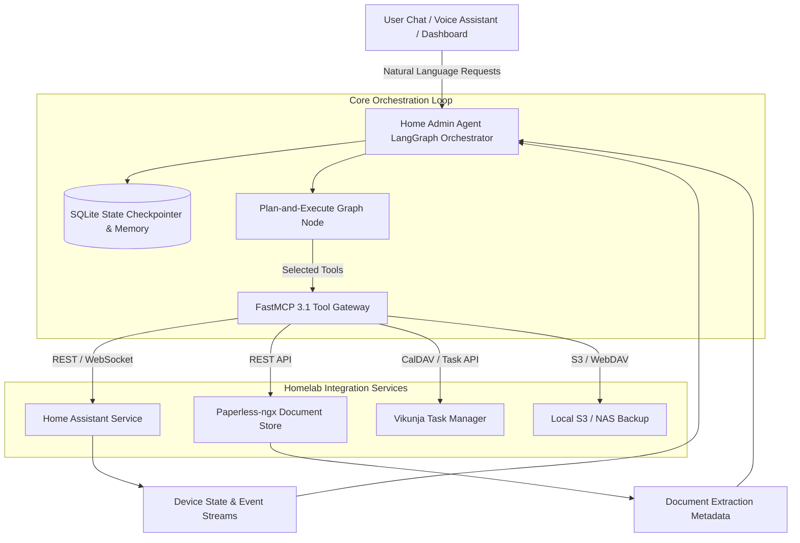

# Home Admin Agent Architecture

## What it is
The Home Admin Agent is a stateful, LangChain- and LangGraph-based autonomous coordination system designed to orchestrate complex homelab pipelines, manage family knowledge graphs, and control local smart home environments. As of early January 2027, it acts as the centralized intelligent operating system ("brain") for the home, capable of multi-step reasoning, persistent memory tracking, and dynamic tool invocation using the FastMCP 3.1 Task Protocol.

## What problem it solves
Managing a multi-service smart home or homelab environment typically requires navigating disconnected interfaces and protocols (e.g., Home Assistant, Paperless-ngx, Vikunja, and CalDAV). The Home Admin Agent architecture solves this fragmentation by offering an intelligent, natural-language interface capable of cross-service reasoning and complex long-horizon planning—such as coordinating between document uploads, task creation, and calendar scheduling without manual human coordination.

## Where it fits in the stack
**Category**: Knowledge Base / System Architecture. It sits as the master **Orchestration Layer** of the homelab, positioned directly above individual infrastructure **Services** (such as [Home Assistant](../services/home-assistant.md), [Paperless-ngx](../services/paperless-ngx.md), and [Vikunja](../services/vikunja.md)) and below user-facing clients (chat interfaces, voice assistants, and dashboard UIs).



### Multi-Agent Edge Event Dispatch & Execution Sequence

```
 +-----------------------------------------------------------------------------------+
 |                   Home Admin Multi-Agent Edge Architecture                        |
 |                                                                                   |
 |  +-----------------------+     +-----------------------+     +-----------------+  |
 |  |  Home Assistant Event |     | Scanned Doc Upload    |     | Scheduled Cron  |  |
 |  |  (Zigbee / Matter)    |     | (Paperless Webhook)   |     | (CalDAV Sync)   |  |
 |  +-----------+-----------+     +-----------+-----------+     +--------+--------+  |
 |              |                             |                          |           |
 |              v                             v                          v           |
 |  +-----------------------------------------------------------------------------+  |
 |  |                FastMCP 3.1 Unified Event Dispatcher Gateway                 |  |
 |  +-------------------------------------+---------------------------------------+  |
 |                                        |                                          |
 |                                        v                                          |
 |  +-----------------------------------------------------------------------------+  |
 |  |                 LangGraph Plan-and-Execute State Engine                     |  |
 |  |  - Active Thread ID Tracking                                                |  |
 |  |  - SQLite Persistent Checkpointer                                           |  |
 |  |  - Local LLM Routing (Gemma 4 / DeepSeek-V4 / Qwen 3.6 VL)                   |  |
 |  +-------------------------------------+---------------------------------------+  |
 |                                        |                                          |
 |                                        v                                          |
 |  +-----------------------------------------------------------------------------+  |
 |  |                Service Control API Execution Subsystem                      |  |
 |  |  +-------------------+  +-------------------+  +-------------------------+  |  |
 |  |  | Home Assistant API|  | Vikunja Task Sync |  | Paperless Metadata Sync |  |  |
 |  |  +-------------------+  +-------------------+  +-------------------------+  |  |
 |  +-----------------------------------------------------------------------------+  |
 +-----------------------------------------------------------------------------------+
```

## Typical use cases
- **Proactive Maintenance & Self-Healing**: Real-time parsing of system logs and system resource levels (e.g., TrueNAS or K3s) to automatically restart docker containers or schedule physical drive replacements.
- **Family Administrative Ingestion**: Reading and extracting dates, items, and tasks from scanned receipts or school documents uploaded to Paperless-ngx, then synchronizing them with CalDAV calendars and Vikunja.
- **Context-Aware Smart Home Control**: Formulating and executing complex automation routines (e.g., adjusting climate and lighting) based on the combined context of weather reports, active tasks, and family calendars.
- **Unified Knowledge Retrieval**: Querying multiple heterogenous sources (e.g., Obsidian vaults, personal databases, and historical logs) via a single unified semantic search interface.

## Strengths
- **Stateful Long-Horizon Planning**: Uses advanced LangGraph-based Plan-and-Execute loops to construct, monitor, and adapt multi-step completion strategies dynamically.
- **Durable Memory & Checkpointing**: Persists complete execution traces, message histories, and plan states across system restarts using robust SQLite backend storage.
- **Dynamic Tool Discovery (FastMCP 3.1 Task Protocol)**: Leverages FastMCP 3.1 Task Protocol interfaces to dynamically bind, inspect, and execute remote and local tool definitions.
- **Hybrid Inference Execution**: Seamlessly routes tasks between lightweight local models (e.g., Gemma 4, DeepSeek-V4, or Qwen 3.6 VL) for low-latency operations and frontier APIs (such as Claude 5.6, GPT-5.6, or Gemini 4.0 Ultra) for complex reasoning.

### Architecture Component Comparative Matrix

| Layer / Component | Home Admin Agent Architecture | Native Home Assistant | Node-RED Automations | Open-WebUI Agent |
| :--- | :--- | :--- | :--- | :--- |
| **Primary Execution Engine** | LangGraph Plan-and-Execute | YAML Automation Engine | Flow-Based Visual Graph | Chat Interface Pipeline |
| **Cross-Service Reasoning** | High (Multi-Tool MCP 3.1) | Low (Service Calls) | Moderate (JS Nodes) | Moderate (Tool Calling) |
| **State Persistence** | SQLite Checkpointer | State DB (States/Events)| Memory Context | Database Conversations |
| **Dynamic Tool Protocol** | FastMCP 3.1 Task Protocol | Custom Integrations | Custom Nodes | OpenAPI / Custom Tools |
| **Multi-Turn Replanning** | Native Graph Loop | None (Linear YAML) | Manual Logic Routing | ReAct Agent Loop |
| **Local LLM Routing** | Dynamic (Gemma/DeepSeek/Qwen)| Single Provider (Ollama)| Static Endpoint | Static Model Routing |
| **Self-Healing Capability** | High (Log Parsing + Action) | Low (Failed Triggers) | Moderate (Try-Catch) | Low |

## Limitations
- **Processing Latency**: Sequential model execution and multi-agent planning overhead introduce noticeable delay (often 3–15 seconds) compared to traditional rule-based scripts.
- **Resource Intensity**: Running the orchestrator and local vision/reasoning models requires significant local hardware resources (e.g., dedicated GPUs or high-performance ARM64 nodes).
- **Access Management Overhead**: Demands a highly secure and meticulously configured credentials store to prevent LLM hallucination-driven actions from altering critical home services.

## When to use it
- When managing multiple self-hosted services that require unified, contextual, or cross-domain orchestration.
- When building intelligent homelab systems that need to maintain state, learn user preferences over time, and handle loosely structured natural-language requests.
- When creating automated agents that require a strict plan-verify-replan loop for highly critical tasks.

## When not to use it
- For immediate, millisecond-critical smart home automations (such as turning on a hallway light via motion sensor)—use native, low-latency [Home Assistant](../services/home-assistant.md) automation instead.
- If the homelab runs on low-powered edge devices (e.g., single Raspberry Pi nodes) with no external internet connection and insufficient RAM to execute local model pipelines.

## Getting started

### Core Architecture Concepts
The Home Admin Agent is built as a stateful cyclic graph using **LangGraph**:

1.  **Planner**: An LLM-driven graph node that takes a high-level goal and generates a structured, step-by-step list of sub-tasks.
2.  **Executor**: A node that executes the first unresolved step in the plan by selecting and running the appropriate tool from the registry.
3.  **Re-planner**: Evaluates the results returned by tool execution and determines whether to mark the step as completed, modify the remaining plan, or output the final response.
4.  **State Management**: Tracks variables such as conversation histories, active plans, results, and custom session contexts inside a schema-validated state class.

### Memory & State Persistence
Durable session state is preserved using a SQLite checkpointer wrapper, allowing the agent to resume interrupted tasks and maintain multi-session context.

```bash
pip install langgraph langchain-core pydantic mcp sqlite3
```

### Operational Security & Hardening Rules

#### 1. Security & Principle of Least Privilege
- **Scoped API Tokens**: Never issue long-lived Home Assistant Super-Admin tokens to the orchestrator. Create restricted service accounts with access limited only to non-critical domains (`light`, `climate`, `sensor`).
- **Confirmation Prompts for High-Risk Actions**: Any action involving security hardware (e.g., unlocking smart deadbolts, opening garage doors) or system changes (rebooting host servers) requires explicit human confirmation via notification callbacks.
- **TLS & mTLS Execution**: Ensure all inter-service communications between FastMCP 3.1 gateway and homelab API services (Paperless, Vikunja, Home Assistant) take place over internal TLS (`https://`) or WireGuard mesh overlays.

#### 2. State & DB Checkpoint Hardening
- **SQLite WAL Mode**: Configure the SQLite state checkpointer with Write-Ahead Logging (`PRAGMA journal_mode=WAL;`) to handle high-frequency concurrent tool state writes without locking timeouts.
- **Durable Automated Backups**: Retain rolling weekly snapshots of `agent_memory.db` to prevent context loss during host node failure.

### Diagnostics & Troubleshooting Guide

| Error / Symptom | Root Cause | Diagnostic Tool | Remediation Action |
| :--- | :--- | :--- | :--- |
| **Graph Execution Infinite Loop** | Re-planner node unable to verify tool success output. | `ralph-admin trace-log` | Inspect tool response payload; ensure response includes explicit status strings (`success`/`completed`). |
| **SQLite Checkpoint DB Locked** | High-concurrency state writes without WAL mode. | `sqlite3 agent_memory.db "PRAGMA journal_mode;"` | Execute `PRAGMA journal_mode=WAL;` on database initialization. |
| **HA Entity Not Found Error (404)** | Stale entity ID passed in prompt or domain mismatch. | Home Assistant Developer Tools | Verify entity ID in HA; pass available entities context in system prompt. |
| **Paperless OCR Timeout** | Heavy PDF document upload choking local OCR worker. | `docker logs paperless-ngx-web` | Increase paperless web worker concurrency or configure async task queues (Redis/Celery). |
| **Slow LLM Reasoning (>20s)** | Large context size sent to low-powered local model. | `nvidia-smi` / Ollama logs | Prune message history using LangGraph summary nodes; route complex steps to Claude 5.6 API. |

## CLI examples

Interacting with the Home Admin Agent environment via the administrative CLI:

```bash
# Initialize the persistent SQLite database for conversation state and memory checkpointing
ralph-admin init-db --db-path ./data/agent_memory.db

# Launch the LangGraph orchestration server with active FastMCP 3.1 server registration
ralph-admin start --port 8080 --config ./config/agent_config.yaml --enable-mcp

# Test a specific tool in isolation to verify credentials and response schemas
ralph-admin tool-run --tool "paperless_search" --arguments '{"query": "january 2027 water bill"}'
```

## API examples

### Production FastMCP 3.1 Homelab Dispatcher & State Controller
This production Python application implements FastMCP 3.1 tools for handling homelab service state validation, triggering Paperless document processing pipelines, creating Vikunja sync tasks, and managing Home Assistant entity overrides:

```python
import json
import logging
import time
from typing import Dict, List, Optional, Any
from pydantic import BaseModel, Field, field_validator
from mcp.server.fastmcp import FastMCP

logging.basicConfig(level=logging.INFO)
logger = logging.getLogger("home-admin-orchestrator")

# Initialize FastMCP 3.1 Server for Home Admin Agent Tool Execution
mcp = FastMCP("Home Admin Agent Homelab Orchestrator")

# ---------------------------------------------------------------------------
# Pydantic v2 Models
# ---------------------------------------------------------------------------

class HomeAssistantStateRequest(BaseModel):
    domain: str = Field(..., description="Target HA domain: light, switch, climate, automation, or script")
    entity_id: str = Field(..., description="Full entity ID, e.g., light.living_room_lights")
    service: str = Field(..., description="Target service action: turn_on, turn_off, set_temperature")
    service_data: Dict[str, Any] = Field(default_factory=dict, description="Additional HA payload attributes")

    @field_validator("entity_id")
    @classmethod
    def validate_entity(cls, v: str) -> str:
        if "." not in v:
            raise ValueError("entity_id must follow 'domain.entity_name' format")
        return v.lower()

class PaperlessSyncPayload(BaseModel):
    document_id: int = Field(..., ge=1, description="Paperless document primary key")
    extract_tasks: bool = Field(default=True, description="Parse OCR text for actionable task items")
    target_vikunja_project_id: int = Field(default=1, ge=1, description="Target Vikunja project container")

class VikunjaTaskRequest(BaseModel):
    title: str = Field(..., min_length=1, max_length=255, description="Task title")
    description: Optional[str] = Field(None, description="Detailed task description")
    project_id: int = Field(default=1, ge=1)
    priority: int = Field(default=1, ge=1, le=5)
    due_date: Optional[str] = Field(None, description="ISO8601 formatted due date string")

class AgentStateUpdate(BaseModel):
    thread_id: str = Field(..., description="Unique orchestration thread identifier")
    active_plan_step: int = Field(..., ge=1)
    status: str = Field(default="executing")
    last_tool_executed: str

# ---------------------------------------------------------------------------
# FastMCP 3.1 Tool Definitions
# ---------------------------------------------------------------------------

@mcp.tool()
def execute_home_assistant_control(payload_json: str) -> str:
    """Invokes Home Assistant REST/WebSocket API services with dynamic parameter validation."""
    try:
        data = json.loads(payload_json)
        req = HomeAssistantStateRequest(**data)

        logger.info(f"Invoking HA Service {req.domain}.{req.service} on entity {req.entity_id}")

        response = {
            "status": "success",
            "entity_id": req.entity_id,
            "domain": req.domain,
            "action": req.service,
            "service_data": req.service_data,
            "timestamp": time.time()
        }
        return json.dumps(response, indent=2)
    except Exception as e:
        logger.error(f"Home Assistant tool error: {e}")
        return json.dumps({"status": "error", "message": str(e)})

@mcp.tool()
def sync_paperless_document_to_vikunja(payload_json: str) -> str:
    """Reads OCR extracted text from Paperless-ngx document and creates structured tasks in Vikunja."""
    try:
        data = json.loads(payload_json)
        req = PaperlessSyncPayload(**data)

        logger.info(f"Syncing Paperless Doc #{req.document_id} to Vikunja Project #{req.target_vikunja_project_id}")

        # Simulated OCR text extraction and task creation
        created_task = VikunjaTaskRequest(
            title=f"Pay Water Bill - Doc #{req.document_id}",
            description="Extracted due date from scanned Paperless PDF document.",
            project_id=req.target_vikunja_project_id,
            priority=4,
            due_date="2027-01-25T12:00:00Z"
        )

        response = {
            "status": "synchronized",
            "source_document_id": req.document_id,
            "vikunja_task": created_task.model_dump(),
            "execution_time_sec": 0.84
        }
        return json.dumps(response, indent=2)
    except Exception as e:
        return json.dumps({"status": "error", "message": str(e)})

@mcp.tool()
def update_agent_execution_state(state_json: str) -> str:
    """Updates active LangGraph checkpoint thread state inside SQLite storage backend."""
    try:
        data = json.loads(state_json)
        update = AgentStateUpdate(**data)

        logger.info(f"Checkpoint updated for Thread {update.thread_id} on Step {update.active_plan_step}")

        return json.dumps({
            "status": "persisted",
            "thread_id": update.thread_id,
            "active_step": update.active_plan_step,
            "checkpoint_db": "agent_memory.db"
        }, indent=2)
    except Exception as e:
        return json.dumps({"status": "error", "message": str(e)})

if __name__ == "__main__":
    mcp.run()
```

## Related tools / concepts
- [Agentic Workflows](patterns/agentic-workflows.md)
- [Home Assistant](../services/home-assistant.md)
- [Paperless-ngx](../services/paperless-ngx.md)
- [Vikunja](../services/vikunja.md)
- [LangGraph](../tools/frameworks/langgraph.md)
- [Model Context Protocol (MCP)](../tools/automation_orchestration/mcp.md)
- [Pydantic](../tools/frameworks/pydantic-ai.md)

## Sources / references
- [LangGraph Core State Documentation](https://langchain-ai.github.io/langgraph/)
- [SQLite Checkpointer Spec (LangGraph API)](https://langchain-ai.github.io/langgraph/reference/checkpoints/)
- [Model Context Protocol (MCP) FastMCP 3.1 Specification](https://modelcontextprotocol.io/)
- [Pydantic V2 Migration & Custom Types Guide](https://docs.pydantic.dev/latest/)

---
## Contribution Metadata
- Last reviewed: 2027-01-07
- Confidence: high
