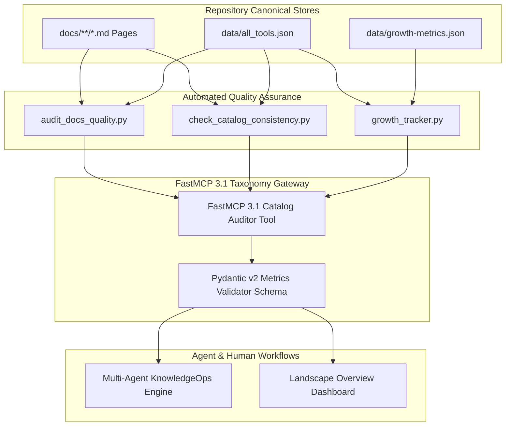

# Landscape Overview

## What it is
The Landscape Overview is a high-level mapping and statistical summary of the entire AI tool and service ecosystem documented in this repository. It provides a bird's-eye view of the catalogue, showing current metrics, connectivity, and recent additions. As of **early January 2027**, it reflects the state of a highly mature, multi-agent KnowledgeOps repository.

## What problem it solves
Navigating hundreds of specialized tools and services can be overwhelming. This overview provides structure, category-based discovery, and growth metrics to help users understand the "big picture" of the repository's contents and the broader AI landscape. It helps identify mature segments and areas ripe for expansion.

## KnowledgeOps Ecosystem Mapping & Data Flow Architecture

The following flowchart illustrates the automated KnowledgeOps data aggregation pipeline that validates, computes, and generates the Landscape Overview catalog metrics across the repository:



## Where it fits in the stack
**Knowledge Base / Ecosystem Map**. It sits at the top of the Knowledge Base layer of the Multi-Agent KnowledgeOps framework, acting as the primary entry point for understanding the breadth and depth of documented resources.

## Typical use cases
- **Discovery**: Finding new tools within a specific category (e.g., "Agents" or "Infrastructure") that fit a specific technical requirement.
- **Triage**: Identifying underdeveloped areas where the repository is actively seeking contributions or technical audits.
- **Trend Analysis**: Tracking the growth and shifting focus of the AI ecosystem over time, such as the rise of Agent Skills and FastMCP 3.1 servers.
- **Onboarding**: Providing a comprehensive map for new agents or human contributors to understand the repository's scope.

## Strengths
- **Data-Driven**: Grounded in repository metadata and growth metrics from `data/growth-metrics.json` and `data/all_tools.json`.
- **Structural Clarity**: Organizes complex information into distinct categories for easy navigation.
- **Graph Insight**: Highlights the most connected and influential tools in the knowledge base, indicating their importance in the stack.
- **January 2027 Context**: Reflects the transition toward autonomous "Software Factories" and agentic orchestration with FastMCP 3.1 standards, Claude 5.6, GPT-5.6, Gemini 4.0 Ultra, and DeepSeek-V4.

## Limitations
- **Repository-Scoped**: Reflects current documentation coverage rather than the entire global AI market.
- **Snapshot-Based**: Metrics are updated during technical audits and may lag behind the absolute latest main branch commits.
- **Manual Synthesis**: While metrics are automated, the strategic "What's New" analysis requires agentic synthesis.

## When to use it
- When you are new to the repository and need a comprehensive map of its contents.
- When you are planning a new integration and want to see existing tools and patterns in that space.
- When you want to see the latest "High Engineering" additions to the catalogue (e.g., Kiro Crew, FastMCP 3.1 Task Protocol servers).

## When not to use it
- When you need deep technical setup instructions for a specific tool (refer to its canonical page instead).
- When looking for real-time price comparisons (use the [API Pricing Matrix](api_pricing_free_tiers.md)).
- For fine-grained architectural diagrams (see the [Architecture Component Map](../architecture/component_map.md)).

## Overview
- **Last Generated:** 2027-01-07
- **Total Docs Documented:** 701 (including 647 tool/knowledge docs and 54 service docs)

## Category Breakdown
Current tool count per category verified against `data/growth-metrics.json` and `data/all_tools.json`:

| Category | Count | Summary |
| :--- | :--- | :--- |
| **AI Assistants & Knowledge (`ai_knowledge`)** | 111 | General-purpose chat interfaces, RAG platforms, and local knowledge bases. |
| **Development & Ops (`development_ops`)** | 75 | Coding assistants, IDEs, agentic development tools, and CLI context servers. |
| **Infrastructure (`infrastructure`)** | 63 | Model serving engines, inference runtimes, vector databases, and compute acceleration. |
| **Services (`services`)** | 54 | Self-hosted services, home automation engines, and offline applications. |
| **Process & Understanding (`process_understanding`)** | 43 | Data extraction, OCR, speech recognition, telemetry, and document understanding tools. |
| **Benchmarking (`benchmarking`)** | 42 | LLM evaluation frameworks, agentic test suites, and performance benchmark suites. |
| **Providers (`providers`)** | 44 | Cloud LLM API providers, model marketplaces, and specialized model hosting. |
| **Frameworks (`frameworks`)** | 38 | Development libraries and SDKs for building LLM applications and agent pipelines. |
| **Agents (`agents`)** | 36 | Multi-agent orchestration frameworks, autonomous coding agents, and agentic skills. |
| **Knowledge Base (`knowledge_base`)** | 36 | Architecture overviews, security guidelines, and design patterns. |
| **Automation & Orchestration (`automation_orchestration`)** | 34 | Workflow automation engines, MCP server implementations, and integration servers. |
| **Pattern Guides (`knowledge_base/patterns`)** | 23 | Reusable AI design patterns, fallbacks, and prompt templates. |
| **Calendar & Tasks (`calendar_tasks`)** | 22 | Scheduling tools, task management integrations, and calendar synchronization servers. |
| **Playbooks (`playbooks`)** | 17 | Actionable operational playbooks and migration step-by-step guides. |
| **Enterprise AI (`enterprise`)** | 17 | Enterprise search engines, identity systems, and enterprise productivity suites. |
| **Intake & Storage (`intake_storage`)** | 10 | Data ingestion tools, self-hosted object storage, and document stores. |
| **Orchestration (`orchestration`)** | 10 | Advanced workflow orchestrators, data pipeline engines, and DAG runners. |

### Categories with Fewer than 8 Docs
None. All 17 active categories currently meet or exceed the target threshold of 8 documents, ranging from **10 docs** in `orchestration` and `intake_storage` to **111 docs** in `ai_knowledge`.

## Top 10 Most-Connected Tools
The top 10 most-connected tools based on the number of outgoing links in their `## Related` sections:

| Tool | Related Links | Canonical Document Path |
| :--- | :--- | :--- |
| **Kestra** | 17 | `docs/tools/orchestration/kestra.md` |
| **ZenML** | 17 | `docs/tools/orchestration/zenml.md` |
| **Apache Hamilton** | 16 | `docs/tools/orchestration/apache-hamilton.md` |
| **Apache Airflow** | 15 | `docs/tools/orchestration/apache-airflow.md` |
| **Flyte** | 15 | `docs/tools/orchestration/flyte.md` |
| **Argo Workflows** | 14 | `docs/tools/orchestration/argo-workflows.md` |
| **Cloud Code** | 14 | `docs/tools/development_ops/cloud_code.md` |
| **Melty** | 14 | `docs/tools/development_ops/melty.md` |
| **RAGFlow** | 14 | `docs/tools/process_understanding/ragflow.md` |
| **Terminus 2** | 14 | `docs/tools/development_ops/terminus-2.md` |

## What's New This Month
New tool documentation added under `docs/tools/` in the last 30 days (verified via `git log` creation tracking):

- **AI Assistants & Knowledge (`ai_knowledge`)**: Integrated **Llama 4 Maverick**, **Google Lyria**, **Inkling Small**, **Udio**, **Logseq**, **LobeHub**, **Breeze**, and **GPT-5.6**.
- **Development & Ops (`development_ops`)**: Added **Symbolic MCP**, **Unsloth Studio**, **Free Will MCP**, **Melty**, **C89 Portability Guide**, **VS Code**, and **Ripgrep**.
- **Infrastructure (`infrastructure`)**: Added **ExLlamaV3**, **Aphrodite Engine**, **Flash MSA**, **Ninfer 4080**, **Diagrid Catalyst**, and **OpenPipe**.
- **Benchmarking (`benchmarking`)**: Integrated **EvalEval**, **MultiPL-E**, **LongCLI Bench**, **Terminal-Bench**, **SharpAI**, and **Giskard**.
- **Process & Understanding (`process_understanding`)**: Added **Cloudflare Agent Tracing**, **Firecrawl**, **PageIndex**, and **Tesseract OCR**.
- **Providers (`providers`)**: Added **Liquid AI**, **DigitalOcean Provider**, **Index-Translate**, and **Cohere**.
- **Frameworks (`frameworks`)**: Integrated **Pydantic AI**, **Langflow**, and **Smolagents**.
- **Agents (`agents`)**: Integrated **Letta**, **OpenHands**, and **Agency Swarm**.
- **Automation & Orchestration (`automation_orchestration`)**: Added **Pipedream**, **Chronos MCP**, and **Atlassian Jira MCP**.
- **Calendar & Tasks (`calendar_tasks`)**: Integrated **Todoist**, **Outlook**, and **Apple Calendar**.
- **Enterprise AI (`enterprise`)**: Added **AmpCode** and **Bloomberg Terminal**.
- **Intake & Storage (`intake_storage`)**: Integrated **Khoj**, **MinIO**, and **S3 Storage**.
- **Orchestration (`orchestration`)**: Added **Argo Workflows**, **Temporal**, and **ZenML**.

## Getting started
To contribute to the landscape or audit existing docs:
1. Run `python3 scripts/growth_tracker.py` to update current repository metrics.
2. Use `python3 scripts/audit_docs_quality.py` to verify 100% doc compliance.
3. Follow the 13-section 'High Confidence' standard in `docs/standards.md`.

## CLI examples
The repository metrics can be audited via the CLI:

```bash
# Update the growth metrics snapshot
python3 scripts/growth_tracker.py

# Check for unlinked tool mentions to improve connectivity
python3 scripts/cross_link_report.py

# Verify docs quality compliance (100% target)
python3 scripts/audit_docs_quality.py

# Verify categories with fewer than 8 documents
python3 -c "import json; d=json.load(open('data/growth-metrics.json')); print([k for k,v in d['by_category'].items() if v < 8])"
```

## API examples

This complete Python tool server provides a FastMCP 3.1 endpoint to audit taxonomy metrics and validate catalog schemas using Pydantic v2 validation models.

```python
import json
import logging
from typing import Dict, List, Optional
from datetime import datetime
from pydantic import BaseModel, Field, ConfigDict, ValidationError
from fastmcp import FastMCP

# Setup logger for Catalog Metrics Server
logging.basicConfig(level=logging.INFO)
logger = logging.getLogger("Landscape-Metrics-Server")

# Initialize FastMCP 3.1 Server
mcp = FastMCP("Landscape-Overview-Auditor", version="3.1.0")

class CategoryMetric(BaseModel):
    model_config = ConfigDict(extra="forbid")

    category_name: str = Field(..., description="Name of doc category, e.g., ai_knowledge")
    document_count: int = Field(..., ge=0, description="Total number of markdown files in category")
    meets_threshold: bool = Field(True, description="Indicates if category count >= 8")

class GrowthMetricsSnapshot(BaseModel):
    model_config = ConfigDict(extra="forbid")

    snapshot_date: str = Field(..., description="Snapshot generation date YYYY-MM-DD")
    total_docs: int = Field(..., ge=1, description="Aggregated file count")
    tool_docs: int = Field(..., ge=1, description="Number of tool pages")
    service_docs: int = Field(..., ge=1, description="Number of service pages")
    by_category: Dict[str, int] = Field(..., description="Map of category names to page counts")
    timestamp: datetime = Field(default_factory=datetime.utcnow)

class CatalogAuditResponse(BaseModel):
    status: str = Field(...)
    is_compliant: bool = Field(...)
    total_docs_scanned: int = Field(...)
    failing_categories: List[str] = Field(default_factory=list)

@mcp.tool(
    name="audit_landscape_metrics",
    description="Validates repository growth snapshot JSON against Pydantic v2 schemas and reports compliance."
)
def audit_landscape_metrics(raw_json: str) -> str:
    """Parses growth-metrics.json string, verifies category thresholds (>=8), and returns audit status."""
    try:
        snapshot = GrowthMetricsSnapshot.model_validate_json(raw_json)
        logger.info(f"Auditing growth metrics snapshot for date: {snapshot.snapshot_date}")

        failing = [cat for cat, count in snapshot.by_category.items() if count < 8]
        compliant = len(failing) == 0

        res = CatalogAuditResponse(
            status="COMPLIANT" if compliant else "THRESHOLD_VIOLATION",
            is_compliant=compliant,
            total_docs_scanned=snapshot.total_docs,
            failing_categories=failing
        )
        return res.model_dump_json(indent=2)

    except ValidationError as e:
        logger.error(f"Pydantic v2 Validation Failure: {e}")
        return json.dumps({"error": "Pydantic v2 Schema Error", "details": e.errors()})

if __name__ == "__main__":
    sample_snapshot = GrowthMetricsSnapshot(
        snapshot_date="2027-01-07",
        total_docs=701,
        tool_docs=647,
        service_docs=54,
        by_category={
            "ai_knowledge": 111,
            "development_ops": 75,
            "infrastructure": 63,
            "services": 54,
            "orchestration": 10
        }
    )
    print(audit_landscape_metrics(sample_snapshot.model_dump_json()))
```

## Production Systemd Service Unit (`landscape-tracker.service`)

Deploy the background growth metrics auditing daemon as a systemd service unit to track document commits and keep metrics JSON in sync:

```ini
[Unit]
Description=Landscape Overview Growth Tracker Daemon
After=network.target
Documentation=https://github.com/joanmarcriera/Home-office-automations

[Service]
Type=oneshot
User=jules
Group=jules
WorkingDirectory=/home/jules/repo
ExecStart=/usr/bin/python3 /home/jules/repo/scripts/growth_tracker.py
ExecStartPost=/usr/bin/python3 /home/jules/repo/scripts/audit_docs_quality.py
StandardOutput=journal
StandardError=journal

# Security Hardening
NoNewPrivileges=true
ProtectSystem=full
ProtectHome=read-only
ReadWritePaths=/home/jules/repo/data /home/jules/repo/docs/reports

[Install]
WantedBy=multi-user.target
```

## Operational Best Practices & Diagnostic Matrix

### Quality Assurance & Audit Rules
1. **Metadata Preservation**: Never update `Last reviewed` metadata dates when performing structural catalog syncs or minor formatting tweaks; keep original review dates intact.
2. **Minimum Category Threshold**: Maintain at least 8 canonical docs per tool category to avoid thin category splits.
3. **100% Quality Pass**: Ensure `python3 scripts/audit_docs_quality.py` passes 100% compliance across all 701+ docs before submitting pull requests.

### Catalog Diagnostic Matrix

| Symptom / Failure | Root Cause | Remediation Strategy |
| :--- | :--- | :--- |
| `Missing metadata header` in doc | Missing contribution metadata block at document end | Add `## Contribution Metadata` block with `Last reviewed` and `Confidence`. |
| `Unlinked tool mention` in audit | Tool name cited in text without relative Markdown link | Run `python3 scripts/fix_internal_links.py` to auto-link tool references. |
| `Category count < 8` in growth metrics | Thin or recently created sub-category | Ingest open sources from `docs/new-sources/` to expand category count to 8+. |
| `Catalog consistency error` | Tool path mismatch between `all_tools.json` and file tree | Run `python3 scripts/check_catalog_consistency.py` to resolve path keys. |
| `Pydantic validation error` in metrics | Schema mismatch in `data/growth-metrics.json` structure | Run `python3 scripts/growth_tracker.py` to regenerate canonical snapshot JSON. |

## Related tools / concepts
- [Architecture Component Map](../architecture/component_map.md)
- [Model Routing Guide](model_routing_guide.md)
- [Model Classes](model_classes.md)
- [API Pricing & Free Tier Matrix](api_pricing_free_tiers.md)
- [Agent Frameworks Learning Map](agent_framework_learning_map.md)
- [AI Tool Access Matrix](ai_tool_access_matrix.md)
- [Multi-Agent KnowledgeOps Architecture](../architecture/multi_agent_knowledgeops.md)

## Sources / references
- [All Tools Metadata](https://github.com/joanmarcriera/Home-office-automations/blob/main/data/all_tools.json)
- [Growth Metrics Snapshot](https://github.com/joanmarcriera/Home-office-automations/blob/main/data/growth-metrics.json)
- [MCP 3.1 Standard Specification](https://modelcontextprotocol.io)
- [FastMCP Task Protocol Specification](https://github.com/jupysql/fastmcp)

## Contribution Metadata
- Last reviewed: 2027-01-07
- Confidence: high
