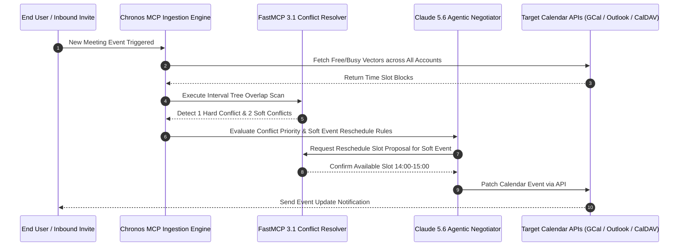

# Multi-Calendar Conflict Detection Research

## What it is
Multi-calendar conflict detection is the computational and algorithmic process of identifying overlapping events, availability gaps, and scheduling constraints across disparate, multi-tenant calendar platforms (Google Calendar, Microsoft Outlook / Graph, CalDAV, Apple iCloud, and local self-hosted instances like Radicale). As of **early January 2027**, this has evolved from rudimentary boolean "busy" checks into **Agentic Calendar Orchestration**, where frontier models like Claude 5.6, GPT-5.6, Gemini 4.0 Ultra, DeepSeek-V4, Llama 4, and Gemma 4 use the **MCP 3.1 Task Protocol** and **FastMCP 3.1** to automatically negotiate schedules across multiple personal and professional accounts with standardized execution, and resolve overlapping scheduling slots on behalf of users.

## System Architecture

```
  +-----------------------+     +-----------------------+     +-----------------------+
  |  Google Calendar API  |     |   Microsoft Outlook   |     |    CalDAV / Radicale  |
  +-----------------------+     +-----------------------+     +-----------------------+
              |                             |                             |
              v                             v                             v
  +-----------------------------------------------------------------------------------+
  |               Chronos MCP / Multi-Calendar Ingestion Engine                       |
  |     - RFC 5545 iCalendar Parser & Timezone Normalizer (UTC Standardization)       |
  |     - Recurrence Expansion Engine (RRULE / RDATE / EXDATE Evaluator)              |
  +-----------------------------------------------------------------------------------+
                                            |
                                            v
  +-----------------------------------------------------------------------------------+
  |               Interval Tree Overlap & Conflict Classification Engine              |
  |     - Augmented Interval Tree Algorithm: Search in O(k + log N) Time              |
  |     - Conflict Matrix: Hard (Non-negotiable) vs. Soft (Movable Focus / 1:1)       |
  +-----------------------------------------------------------------------------------+
                                            |
                                            v
  +-----------------------------------------------------------------------------------+
  |               Agentic Negotiator (Claude 5.6 / FastMCP 3.1 Server)                |
  |     - Automated Alternative Slot Discovery & Buffer Preservation Optimization     |
  |     - Multi-Participant Cross-Calendar Free/Busy Synthesis                        |
  +-----------------------------------------------------------------------------------+
                                            |
                                            v
  +-----------------------------------------------------------------------------------+
  |            User Action Checkpoint / Notification (n8n / Home Assistant)            |
  +-----------------------------------------------------------------------------------+
```

### Multi-Calendar Sync & Conflict Resolution Sequence Flow



### Algorithmic Mechanics of Conflict Detection
1. **Recurrence Expansion (RFC 5545)**: Recurring events governed by `RRULE` directives (e.g., `FREQ=WEEKLY;BYDAY=TU,TH;UNTIL=20271231`) are dynamically bounded and expanded into discrete instances within a rolling evaluation window (typically 30-90 days). Excluded dates (`EXDATE`) and replacement instances (`RDATE`) are calculated to avoid false conflict triggers.
2. **Interval Tree Searching**: Rather than quadratic pairwise comparisons ($O(N^2)$), calendar event blocks $[t_{\text{start}}, t_{\text{end}})$ are inserted into an augmented self-balancing Interval Tree. Querying an event against $N$ registered calendar bookings executes in $O(\log N + k)$ time where $k$ is the number of overlapping events.
3. **Multi-Timezone UTC Normalization**: Cross-calendar events span disparate timezones with asynchronous daylight saving time (DST) shifts. Timestamps are converted into UTC epoch microseconds before interval evaluation, preserving local wall-clock metadata solely for participant notification.
4. **Soft vs. Hard Classification**: Events are segmented into "Hard" commitments (external customer meetings, board sessions, in-person travel) versus "Soft" slots (flexible focus time, asynchronous desk work, optional internal 1-on-1s) using metadata tags and attendee count heuristics.

## What problem it solves
It prevents double-booking and "calendar sprawl" by providing a unified view of availability. It solves the fragmentation problem in multi-user environments (e.g., family scheduling) and multi-role contexts (e.g., freelancer juggling multiple client calendars), automating the labor-intensive task of manual cross-referencing. Furthermore, it safeguards deep-work blocks by dynamically rearranging flexible tasks around immutable meetings without human cognitive overhead.

## Where it fits in the stack
**Category**: Knowledge Base / Pattern. It informs the logic layer of automation platforms like [n8n](../services/n8n.md) and [Home Assistant](../services/home-assistant.md). It serves as the primary data ingestion strategy for AI scheduling agents and "Focus Time" optimizers.

## Calendar Sync & Conflict Engine Comparison

| Capability / Metric | FastMCP 3.1 Chronos | Motion AI | Reclaim.ai | Native GCal / Outlook |
| :--- | :--- | :--- | :--- | :--- |
| **Protocol Support** | CalDAV, Google Graph, Outlook REST | Google, Outlook API | Google, Outlook API | Proprietary Protocols |
| **Conflict Resolution** | Agentic Negotiator (Claude 5.6) | Automated Task Shifting | Flexible Time Buffers | Manual User Selection |
| **Privacy Protection** | Local Zero-Knowledge Free/Busy | SaaS Cloud Sync | SaaS Cloud Sync | Account Isolation |
| **Hard vs. Soft Rules** | Configurable Pydantic v2 Constraints | Fixed Priority Score | Habit & Focus Guards | None |
| **FastMCP Integration** | Native FastMCP 3.1 Tool Server | Third-Party Webhooks | API Key Auth | Native Platform Only |
| **Algorithmic Complexity**| Augmented Interval Tree $O(k + \log N)$ | Proprietary Cloud JIT | Proprietary Cloud JIT | $O(N)$ Sequential Check |
| **Air-Gap Capability** | Full (Radicale / Nextcloud) | No (SaaS Only) | No (SaaS Only) | No (Public Cloud) |

## Typical use cases
- **Multi-Account Coordination**: Automatically blocking "Personal" time on a work calendar when a family event is added, preserving event subject privacy via opaque placeholder titles.
- **Family Syncing**: Identifying the best 2-hour window for a 4-person family dinner across different providers.
- **Agentic Day Planning**: A "Daily Copilot" analyzing multiple calendars to proactively suggest rescheduling lower-priority tasks.
- **Focus Protection**: Automatically declining meeting invites that conflict with pre-existing deep work blocks.
- **Autonomous Multi-Agent Scheduling**: Agents representing separate corporate entities negotiating meeting availability via standardized FastMCP 3.1 calendar protocols.

## Strengths
- **Privacy-Preserving**: Leverages "Free/Busy" visibility levels to check availability without exposing sensitive event details.
- **Cross-Platform**: Bridges the gap between enterprise (Outlook/Google Workspace) and local-first (CalDAV/Nextcloud) ecosystems.
- **Real-Time Responsiveness**: Modern agentic flows can resolve conflicts within seconds of a new invite being received.
- **Context-Aware**: Can distinguish between "hard" conflicts (unmovable meetings) and "soft" conflicts (flexible personal tasks).

## Limitations
- **API Rate Limits**: Aggressive polling of multiple calendar APIs can lead to temporary blocks; requires exponential backoff and Webhook delta-sync tokens.
- **Sync Latency**: Changes made in one calendar may take several minutes to propagate through the orchestration layer.
- **Complex Recurring Logic**: Handling complex recurrence rules (e.g., "third Thursday of the month") across different implementations remains challenging.
- **Authorization Complexity**: Managing OAuth tokens and CalDAV credentials for multiple users requires robust secret management.

## Operational Best Practices & Interval Tree Conflict Scanning

### Augmented Interval Tree Implementation in Python
When detecting overlaps across dozens of subscribed calendars, naive $O(N^2)$ comparison causes latency. Using an augmented interval tree with node maximum endpoints achieves $O(k + \log N)$ search performance:

```python
from datetime import datetime
from typing import Optional, List, Tuple

class IntervalNode:
    def __init__(self, start: datetime, end: datetime, event_id: str, is_hard: bool):
        self.start = start
        self.end = end
        self.event_id = event_id
        self.is_hard = is_hard
        self.max_end = end
        self.left: Optional[IntervalNode] = None
        self.right: Optional[IntervalNode] = None

class CalendarIntervalTree:
    def __init__(self):
        self.root: Optional[IntervalNode] = None

    def insert(self, start: datetime, end: datetime, event_id: str, is_hard: bool):
        self.root = self._insert_node(self.root, start, end, event_id, is_hard)

    def _insert_node(self, node: Optional[IntervalNode], start: datetime, end: datetime, event_id: str, is_hard: bool) -> IntervalNode:
        if not node:
            return IntervalNode(start, end, event_id, is_hard)

        if start < node.start:
            node.left = self._insert_node(node.left, start, end, event_id, is_hard)
        else:
            node.right = self._insert_node(node.right, start, end, event_id, is_hard)

        node.max_end = max(node.max_end, end, (node.left.max_end if node.left else end), (node.right.max_end if node.right else end))
        return node

    def find_overlaps(self, start: datetime, end: datetime) -> List[Tuple[str, bool]]:
        results = []
        self._search_overlaps(self.root, start, end, results)
        return results

    def _search_overlaps(self, node: Optional[IntervalNode], start: datetime, end: datetime, results: List[Tuple[str, bool]]):
        if not node:
            return

        if start < node.end and end > node.start:
            results.append((node.event_id, node.is_hard))

        if node.left and node.left.max_end > start:
            self._search_overlaps(node.left, start, end, results)

        if node.right and start < node.max_end:
            self._search_overlaps(node.right, start, end, results)
```

## When to use it
- When you manage more than two independent calendar accounts.
- When building an autonomous agent that needs to schedule its own tasks or meetings.
- When coordinating schedules across a group where participants use different calendar providers.

## When not to use it
- For single-account users where native "check availability" features are sufficient.
- In environments where calendar data is highly sensitive and cannot be exposed to an orchestration agent.
- For extremely simple "one-off" events that don't justify the setup of an orchestration layer.

## Getting started

### Local Orchestration with Python
The fastest way to start is using an orchestration library like `icalendar` or a framework-specific node in n8n.

1. **Install dependencies**:
   ```bash
   pip install icalendar requests google-api-python-client httpx fastmcp pydantic
   ```
2. **Setup Chronos MCP**:
   Follow the [Chronos MCP](../tools/automation_orchestration/chronos-mcp.md) guide to connect your CalDAV accounts.

### Production Docker Compose Deployment (Chronos Sync Daemon & Redis)
Deploy a multi-calendar synchronizer container alongside Redis cache to ensure sub-second response times:

```yaml
version: '3.8'

services:
  chronos-sync:
    image: python:3.12-slim
    container_name: chronos-sync-daemon
    working_dir: /app
    volumes:
      - ./:/app
    command: python /app/calendar_sync_daemon.py
    environment:
      - REDIS_URL=redis://redis-calendar-cache:6379/0
      - SYNC_INTERVAL_SECONDS=60
      - LOG_LEVEL=INFO
    depends_on:
      - redis-calendar-cache
    restart: unless-stopped
    healthcheck:
      test: ["CMD", "python", "-c", "import urllib.request; urllib.request.urlopen('http://localhost:8080/health')"]
      interval: 30s
      timeout: 5s
      retries: 3

  redis-calendar-cache:
    image: redis:7-alpine
    container_name: redis-calendar-cache
    restart: unless-stopped
    volumes:
      - redis-calendar-data:/data

volumes:
  redis-calendar-data:
```

## CLI examples

### Querying Google Calendar Availability
Using the `gcalcli` tool to check for conflicts:
```bash
# Search for events in a specific time range across all calendars
gcalcli agenda "2027-01-10 09:00" "2027-01-10 17:00"
```

### CalDAV Conflict Check via Curl
Querying a CalDAV server for busy periods:
```bash
curl -X REPORT -u 'user:pass' -H "Content-Type: text/xml" \
     --data '<c:free-busy-query xmlns:c="urn:ietf:params:xml:ns:caldav">
               <c:time-range start="20270110T000000Z" end="20270111T000000Z"/>
             </c:free-busy-query>' \
     https://calendar.example.com/dav/calendars/user/
```

## API examples

### FastMCP 3.1 Multi-Calendar Conflict Resolution Tool with Strict Pydantic v2
Using **Pydantic v2** (`ConfigDict(extra="forbid", frozen=True)`) to model, parse, and validate calendar events, time ranges, and flexibility properties before triggering automated schedule negotiation:

```python
from datetime import datetime, timezone
from typing import List, Dict, Any, Optional
from pydantic import BaseModel, Field, ConfigDict, model_validator
from fastmcp import FastMCP, Context

# Initialize FastMCP 3.1 Server
mcp = FastMCP("Chronos-Conflict-Resolver", version="3.1")

class CalendarEvent(BaseModel):
    model_config = ConfigDict(extra="forbid", frozen=True)
    event_id: str = Field(..., description="Unique event identifier")
    summary: str = Field(..., description="Brief description of the event")
    start_time: datetime = Field(..., description="Event start date/time in UTC")
    end_time: datetime = Field(..., description="Event end date/time in UTC")
    calendar_id: str = Field(..., description="Originating calendar identifier")
    is_flexible: bool = Field(default=False, description="Whether event can be shifted if a conflict arises")
    priority: int = Field(default=5, ge=1, le=10, description="Priority score (10 = unmovable, 1 = trivial)")

    @model_validator(mode="after")
    def validate_time_range(self) -> 'CalendarEvent':
        if self.end_time <= self.start_time:
            raise ValueError("end_time must be strictly after start_time")
        return self

class ConflictScanRequest(BaseModel):
    model_config = ConfigDict(extra="forbid", frozen=True)
    events: List[CalendarEvent]
    candidate_event: CalendarEvent

class ConflictScanResponse(BaseModel):
    model_config = ConfigDict(extra="forbid", frozen=True)
    has_conflict: bool
    conflict_type: str
    conflicting_event_ids: List[str]
    suggested_action: str
    alternative_slots: List[Dict[str, str]]

@mcp.tool()
async def scan_and_resolve_conflicts(
    request: ConflictScanRequest,
    ctx: Optional[Context] = None
) -> Dict[str, Any]:
    """Scans calendar events against a candidate booking and generates autonomous resolution paths."""
    if ctx:
        await ctx.info(f"Scanning conflict for candidate event '{request.candidate_event.summary}'...")

    conflicting = []
    has_hard_conflict = False

    for ev in request.events:
        # Check overlap: start1 < end2 and end1 > start2
        if request.candidate_event.start_time < ev.end_time and request.candidate_event.end_time > ev.start_time:
            conflicting.append(ev)
            if not ev.is_flexible or ev.priority >= 8:
                has_hard_conflict = True

    if not conflicting:
        return ConflictScanResponse(
            has_conflict=False,
            conflict_type="none",
            conflicting_event_ids=[],
            suggested_action="proceed_with_booking",
            alternative_slots=[]
        ).model_dump()

    conflict_type = "hard" if has_hard_conflict else "soft"
    action = "reject_or_find_alternative" if has_hard_conflict else "reschedule_flexible_events"

    # Suggest alternative 1-hour slot after the conflicting block
    latest_conflict_end = max(e.end_time for e in conflicting)
    alternative_start = latest_conflict_end.isoformat()
    duration = request.candidate_event.end_time - request.candidate_event.start_time
    alternative_end = (latest_conflict_end + duration).isoformat()

    response = ConflictScanResponse(
        has_conflict=True,
        conflict_type=conflict_type,
        conflicting_event_ids=[e.event_id for e in conflicting],
        suggested_action=action,
        alternative_slots=[{"start": alternative_start, "end": alternative_end}]
    )
    return response.model_dump()

if __name__ == "__main__":
    mcp.run()
```

## Systemd Daemon Setup for Multi-Calendar Conflict Sync

```ini
[Unit]
Description=Chronos FastMCP 3.1 Multi-Calendar Sync Daemon
Documentation=https://github.com/obra/superpowers
After=network.target

[Service]
Type=simple
User=chronos-sync
Group=chronos-sync
WorkingDirectory=/opt/chronos-sync
ExecStart=/opt/chronos-sync/venv/bin/python /opt/chronos-sync/calendar_sync_daemon.py
Restart=always
RestartSec=15s
Environment=PYTHONUNBUFFERED=1
Environment=FASTMCP_LOG_LEVEL=INFO

# Security Hardening
ProtectSystem=full
ProtectHome=true
PrivateTmp=true
NoNewPrivileges=true

[Install]
WantedBy=multi-user.target
```

## Systematic Troubleshooting Guide

| Issue Symptom | Probable Cause | Diagnostic Command | Remediation Step |
| :--- | :--- | :--- | :--- |
| **OAuth Token Refresh Failure** | Expired Google/Outlook refreshToken or revoked scopes | `journalctl -u chronos-sync.service -n 50` | Re-authenticate via `gcalcli` or refresh OAuth secrets in credential store |
| **CalDAV Sync Lock Stalled** | Radicale database locked by concurrent sync | `radicale --check` | Restart Radicale service and verify file lock permissions on `/var/lib/radicale` |
| **Overlapping Time Slots Missed** | Recurrence expansion ceiling exceeded or unhandled timezone drift | `python3 -m unittest test_interval_tree.py` | Ensure timezone offsets are standardized to UTC before running interval overlap scan |
| **FastMCP Resolver Error** | Context timeout during LLM negotiation | `tail -f /var/log/chronos-fastmcp.log` | Increase tool execution timeout to 30s in FastMCP server initialization |
| **Daylight Saving Time (DST) Jitter** | Wall-clock naive timestamps parsed during DST transition week | `date -d "2027-03-14 02:30:00 UTC"` | Enforce explicit IANA timezone identifiers (e.g., `America/New_York`) rather than fixed offsets |
| **Rate Limiting 429 Errors** | Exceeded Google Graph / CalDAV request quotas per user | Check response headers `Retry-After` | Implement token bucket rate limiting and Redis caching with 30s TTL |

## Related tools / concepts
- [Google Calendar](../tools/calendar_tasks/google_calendar.md) — Primary cloud provider.
- [Chronos MCP](../tools/automation_orchestration/chronos-mcp.md) — Agentic CalDAV orchestration.
- [n8n](../services/n8n.md) — Workflow automation for cross-calendar syncing.
- [Motion](../tools/calendar_tasks/motion.md) — AI-driven day planning and conflict resolution.
- [Reclaim](../tools/calendar_tasks/reclaim.md) — Automated focus time and habit scheduling.
- [Radicale](../services/radicale.md) — Self-hosted CalDAV server for local aggregation.
- [Nextcloud](../services/nextcloud.md) — Comprehensive suite with built-in multi-calendar support.
- [Home Assistant](../services/home-assistant.md) — Using calendar triggers for home automation.
- [Claude](../tools/ai_knowledge/claude.md) — Frontier model used for schedule negotiation.
- [Gemma 3](../tools/ai_knowledge/local_llms.md) — Local model for privacy-preserving negotiation.

## Sources / references
- [Google Calendar Free/Busy API Documentation](https://developers.google.com/calendar/api/v3/reference/freebusy/query)
- [RFC 4791: CalDAV Scheduling Extensions](https://datatracker.ietf.org/doc/html/rfc4791)
- [MCP 3.1 Task Protocol Specification](https://modelcontextprotocol.io/spec/3.1/task-protocol)

## Contribution Metadata
- Last reviewed: 2027-01-07
- Confidence: high
