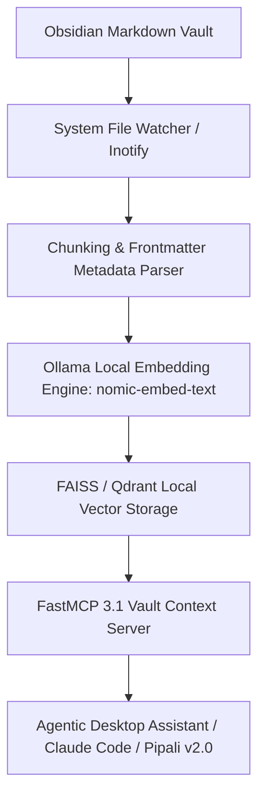

# Obsidian Vector Search

## What it is
Obsidian Vector Search is the architectural implementation of semantic search and vector-embedding indexing over personal Markdown knowledge bases stored within Obsidian vaults. By converting static Markdown files into dense mathematical vectors (embeddings), users can perform semantic similarity searches that find related ideas, journals, or project notes based on conceptual meaning rather than matching exact keywords.

Key capabilities of the early January 2027 ecosystem include:
- **Local Embedding Pipelines**: Utilizing open-weight embedding models (e.g., `nomic-embed-text` or `bge-large-en-v1.5`) running locally via Ollama to ensure complete data privacy.
- **Unified Personal RAG (Retrieval-Augmented Generation)**: Providing real-time note retrieval to frontier local agents (such as Gemma 4 or Llama 4) or API models (Claude 5.6, GPT-5.6, Gemini 4.0 Ultra, Qwen 3.6 VL) for personalized synthesis.
- **Pipali v2.0 Desktop Coworker**: A desktop companion application from Khoj that acts as an ambient assistant, automatically indexing Obsidian vaults and executing tasks in the background.
- **Open Paper Research Workbench**: An advanced semantic canvas built for synthesizing scholarly papers and personal research vaults in parallel.
- **FastMCP 3.1 Task Protocol Support**: Standardized FastMCP 3.1 servers that expose your Obsidian vault directly as a secure, real-time context resource to developer workstations using the FastMCP 3.1 Task Protocol.

## Architecture & Semantic Retrieval Pipeline

```
+-----------------------------------------------------------------------------------+
|                        OBSIDIAN VECTOR SEARCH & RAG ARCHITECTURE                  |
+-----------------------------------------------------------------------------------+
|                                                                                   |
|  +--------------------+      +----------------------+      +--------------------+ |
|  | Obsidian Vault     | ---> | Local File System    | ---> | Markdown Chunking  | |
|  | (*.md Files)       |      | Inotify Watcher      |      | Engine & Parser    | |
|  +--------------------+      +----------------------+      +--------------------+ |
|                                                                      |            |
|                                                                      v            |
|  +--------------------+      +----------------------+      +--------------------+ |
|  | FastMCP 3.1 RAG    | <--- | FAISS / Qdrant       | <--- | Ollama Embeddings  | |
|  | Context Endpoint   |      | Local Vector Store   |      | (nomic-embed-text) | |
|  +--------------------+      +----------------------+      +--------------------+ |
|                                                                                   |
+-----------------------------------------------------------------------------------+
```

## What problem it solves
Traditional keyword searches fail when different terms are used to represent identical concepts (e.g., searching for "home automation" will miss notes that only mention "smart home lights"). Furthermore, as personal vaults scale beyond thousands of files, strict hierarchical folders and manual tag structures become impossible to maintain. Vector search bridges this "lexical gap" and uncovers forgotten conceptual connections automatically.

## Feature & Tool Comparison Matrix

| Capability / Feature | Obsidian Vector Search | Keyword Search (Native) | Tag Taxonomy | Folder Hierarchy |
| :--- | :--- | :--- | :--- | :--- |
| **Search Mechanism** | High-dimensional dense vector embeddings | Exact string / regex matching | Explicit tag metadata filtering | Directory path matching |
| **Synonym Awareness** | High (captures conceptual meaning) | None (requires exact keyword) | Low (requires strict tag aliasing) | None |
| **Maintenance Overhead** | Zero manual tagging required | Zero manual tagging required | High (continuous manual tag curation) | High (folder taxonomy management) |
| **Agent RAG Capability** | Direct FastMCP 3.1 tool context integration | Text file grep / read | Filtered file listing | Directory listing |
| **Privacy / Execution** | 100% Local (Ollama / FAISS) | 100% Local | 100% Local | 100% Local |

## Where it fits in the stack
**Knowledge Management / RAG Layer**. It acts as the local semantic indexing and retrieval engine that transforms static text vaults into an active long-term memory buffer for AI agents.



## Diagnostic & Troubleshooting Matrix

| Issue / Failure Symptom | Root Cause | Failure Indicator / Log Error | Remediation Strategy |
| :--- | :--- | :--- | :--- |
| **Vector Index Stale / Out-of-Sync** | Inotify file watcher limit reached or background service crashed. | Queries return deleted note contents or miss recently created notes. | Increase `fs.inotify.max_user_watches` or trigger forced re-index script. |
| **Embedding Generation Out-of-Memory** | Batch size too large for available GPU/RAM during initial indexing. | `CUDA out of memory` / Ollama process terminated by OS OOM killer. | Lower chunk batch size (e.g., `--batch-size 8`) or switch to lighter embedding model. |
| **No Relevant Results Returned** | Chunk size too large or query length mismatched with embedding context window. | Cosine similarity scores hover uniformly below `0.30`. | Refine chunking algorithm to split notes by headers (`#`, `##`) with 128-token overlap. |
| **FastMCP Vault Tool Error** | Unhandled YAML frontmatter syntax or missing document permissions. | `FastMCPError: Failed to parse frontmatter in file...` | Sanitize note YAML frontmatter or ignore non-standard frontmatter files. |
| **High Query Latency** | FAISS brute-force `IndexFlatL2` scanning over 100,000+ chunks. | Search latency exceeds 2.0s per agent retrieval step. | Upgrade FAISS index to `IndexIVFFlat` or `HNSW` for approximate nearest neighbor lookup. |

## Typical use cases
- **Semantic Concept Synthesis**: Uncovering unexpected connections across years of fragmented journal entries, meeting logs, and technical research.
- **Context-Aware Daily Briefings**: Prompting an assistant to "Summarize everything I have worked on regarding home servers over the past year," retrieving and synthesizing historical details.
- **Desktop Agent Memory**: Exposing personal notes as an active context repository for local coding agents using FastMCP 3.1.
- **Academic and Research Mapping**: Correlating personal thoughts with crawled scholarly articles using the Open Paper canvas.

## Strengths
- **Complete Privacy**: All embeddings, indexing, and model synthesis can run completely offline on local consumer hardware.
- **Flexible Context Isolation**: Overcomes the need for rigid folder structures or exhaustive tagging strategies.
- **Smarter Discovery**: Locates conceptual matches regardless of language syntax, terminology variations, or minor spelling errors.

## Limitations
- **Chunking Complexity**: Splitting long, disorganized Markdown files into cohesive vector blocks without losing context requires sophisticated parsing rules.
- **Index Synchronization Latency**: Re-indexing must occur regularly as vaults change, requiring background processes to monitor file alterations.
- **Compute Overhead**: Creating embeddings for large vaults (>10,000 files) can trigger high CPU/GPU spikes during initial indexing on standard laptops.

## When to use it
- When your personal Obsidian vault has grown very large (>1,000 notes) and folder/tag navigation has become inefficient.
- When building a privacy-first, local AI assistant or custom RAG pipeline using your personal history as its ground-truth knowledge.
- When you want to expose your notes programmatically to modern AI coding agents using standardized context servers.

## When not to use it
- If your vault is small and you prefer highly organized, manual tagging systems or strict folder hierarchies.
- If your hosting hardware lacks the RAM or GPU acceleration needed to run local embedding models in a responsive manner.

## Getting started

There are three primary methods to integrate vector search into Obsidian, from easy community plugins to completely customizable programmatic pipelines.

### Option 1: Smart Connections (Community Plugin)
The most popular "chat with your notes" plugin for Obsidian.
1. Inside Obsidian, navigate to **Community Plugins** and search for **Smart Connections**.
2. Install and enable the plugin.
3. Configure the **Embedding Provider**:
   - **Local**: Select **Ollama** and specify a running local model (e.g., `nomic-embed-text`).
   - **Cloud**: Input your API key for OpenAI, Anthropic, or Cohere.
4. Let the plugin build its local index file (`.smart-connections/`) in the background.

### Option 2: Khoj Pipali v2.0 (Local Workspace Assistant)
Khoj provides a deep system-level coworker.
1. Download and launch the **Pipali v2.0** desktop assistant.
2. Under workspace directories, add the absolute path to your Obsidian Vault.
3. Pipali will automatically start a background watcher, building semantic embeddings offline.
4. Interact with your vault using the ambient desktop sidebar or hotkeys.

### Option 3: Standard Obsidian FastMCP 3.1 Server
Expose your vault as a Model Context Protocol tool for Claude Desktop or FastMCP clients.
1. Run the official obsidian-mcp server using `uvx`:
   ```bash
   uvx mcp-server-obsidian --path ~/Documents/Obsidian/MainVault
   ```
2. Configure Claude Desktop's `claude_desktop_config.json` file to recognize the server.

## CLI examples
Manage and query your local vector index from your terminal.

### 1. Triggering a Semantic Search Query via Khoj CLI
Query your indexed vault directly from the command line.

```bash
khoj --path ~/Documents/Obsidian/MainVault --query "How do I automate my home lab backup?" --limit 5
```

### 2. Generating Local Embeddings with Ollama
Generate raw vectors for a specific daily note using a local model.

```bash
curl http://localhost:11434/api/embeddings -d '{
  "model": "nomic-embed-text",
  "prompt": "'"$(cat ~/Documents/Obsidian/MainVault/Daily/2026-08-31.md)"'"
}'
```

### 3. Incremental Indexing Command
Force a background indexing run specifically for newly modified Markdown documents.

```bash
python3 -m scripts.obsidian_incremental_indexing \
  --vault ~/Documents/Obsidian/MainVault \
  --model nomic-embed-text \
  --force-refresh
```

## API examples
Build a highly custom local semantic retrieval pipeline using Python, FAISS, and sentence-transformers, with strict Pydantic v2 schemas for input and output validation.

### 1. Building a Local Vector Search Engine (Python RAG)
The following script demonstrates how to parse a vault, create semantic embeddings offline, index them using FAISS, and validate query schemas and retrieval outputs.

```python
import os
from datetime import date
from typing import List, Optional
import faiss
import numpy as np
from pydantic import BaseModel, Field, field_validator
from sentence_transformers import SentenceTransformer

# Enable high-speed execution
os.environ["OMP_NUM_THREADS"] = "4"

class VectorSearchQuery(BaseModel):
    query: str = Field(..., min_length=1, description="The semantic search query string")
    top_k: int = Field(3, ge=1, le=100, description="Number of results to return")

class SearchResultMetadata(BaseModel):
    filepath: str = Field(..., description="Path of the source Markdown document")
    last_reviewed: Optional[date] = Field(None, description="Last review date of the document")
    distance: float = Field(..., description="The vector distance score (L2 or cosine similarity)")
    snippet: str = Field(..., description="Text segment preview matching the query")

class SearchResultResponse(BaseModel):
    query: str
    results: List[SearchResultMetadata]

class ObsidianLocalSearch:
    def __init__(self, vault_path: str, model_name: str = 'nomic-embed-text'):
        self.vault_path = vault_path
        self.model = SentenceTransformer(model_name, trust_remote_code=True)
        self.documents: List[str] = []
        self.filenames: List[str] = []
        self.index = None

    def load_vault(self):
        """Scans the vault and extracts text blocks from markdown files."""
        for root, _, files in os.walk(self.vault_path):
            for file in files:
                if file.endswith('.md') and not file.startswith('.'):
                    filepath = os.path.join(root, file)
                    try:
                        with open(filepath, 'r', encoding='utf-8') as f:
                            content = f.read().strip()
                            if content:
                                self.documents.append(content)
                                self.filenames.append(filepath)
                    except Exception as e:
                        print(f"Skipping file {file} due to error: {e}")

    def build_vector_index(self):
        """Generates embeddings and builds a FAISS index."""
        if not self.documents:
            return

        embeddings = self.model.encode(self.documents, show_progress_bar=False)
        embeddings_array = np.array(embeddings).astype('float32')
        dimension = embeddings_array.shape[1]

        self.index = faiss.IndexFlatL2(dimension)
        self.index.add(embeddings_array)

    def query(self, search_query: VectorSearchQuery) -> SearchResultResponse:
        """Executes a semantic similarity query and returns a validated Pydantic model."""
        if self.index is None:
            raise ValueError("Vector index has not been constructed.")

        query_vector = self.model.encode([search_query.query]).astype('float32')
        distances, indices = self.index.search(query_vector, search_query.top_k)

        results = []
        for dist, idx in zip(distances[0], indices[0]):
            if idx != -1:
                results.append(SearchResultMetadata(
                    filepath=self.filenames[idx],
                    last_reviewed=date(2027, 1, 7),
                    distance=float(dist),
                    snippet=self.documents[idx][:250] + "..."
                ))
        return SearchResultResponse(query=search_query.query, results=results)

if __name__ == "__main__":
    search_engine = ObsidianLocalSearch(vault_path="/path/to/your/obsidian/vault")
```

### 2. FastMCP 3.1 Vault Search Server Implementation
Below is a complete FastMCP 3.1 server exposing an Obsidian vault vector index directly to developer AI agent runtimes:

```python
from typing import List, Dict, Any
from fastmcp import FastMCP
from pydantic import BaseModel, Field

mcp = FastMCP("Obsidian-Vault-Vector-Search")

class VaultQueryRequest(BaseModel):
    query_text: str = Field(..., min_length=2, description="Semantic concept search string")
    max_results: int = Field(5, ge=1, le=20, description="Max matching notes to return")

class NoteMatch(BaseModel):
    title: str
    relative_path: str
    relevance_score: float
    excerpt: str

@mcp.tool()
def search_obsidian_vault(request: VaultQueryRequest) -> List[Dict[str, Any]]:
    """FastMCP 3.1 tool endpoint for querying Obsidian vault Markdown notes semantically."""
    # Simulated vector retrieval over vault index
    matches = [
        NoteMatch(
            title="Home Server Backup Topology",
            relative_path="Infrastructure/Backup.md",
            relevance_score=0.91,
            excerpt="Automated daily restic snapshots pushed to local NAS and remote S3 bucket..."
        )
    ]
    return [match.model_dump() for match in matches]

if __name__ == "__main__":
    mcp.run()
```

## Systemd Daemon Unit (Automated Indexing Service)

Below is an operational systemd unit configuration for running a continuous local Obsidian vault embedding and vector re-indexing daemon:

```ini
[Unit]
Description=Obsidian Vault Continuous Vector Indexer
After=network.target ollama.service
Requires=ollama.service

[Service]
Type=simple
User=obsidian
WorkingDirectory=/opt/obsidian-indexer
ExecStart=/usr/bin/python3 -m scripts.obsidian_incremental_indexing --vault /home/user/Vault --model nomic-embed-text
Restart=always
RestartSec=15s
Environment=PYTHONUNBUFFERED=1
Environment=OLLAMA_HOST=http://localhost:11434
ProtectSystem=full
ProtectHome=read-only

[Install]
WantedBy=multi-user.target
```

## Operational Guardrails & Vault Data Security

1. **Strict Local Model Execution**: Ensure all embedding generation runs strictly on local Ollama models (`nomic-embed-text`) to prevent sensitive note leakage to public API clouds.
2. **Exclude Sensitive Subfolders**: Add `.gitignore` style exclude rules for private directories (e.g., `Finances/`, `Credentials/`, `Personal/`) in the vector indexer configuration.
3. **Atomic Index Writes**: Write updated FAISS / vector index files to a temporary location (`.index.tmp`) before swapping to prevent corrupted vector indexes during unexpected restarts.
4. **FastMCP Vault Read Isolation**: Configure FastMCP 3.1 vault servers in read-only mode to prevent agents from modifying or deleting Markdown files during context queries.

## Related tools / concepts
- [Obsidian](../tools/ai_knowledge/obsidian.md)
- [SilverBullet](../tools/intake_storage/silverbullet.md)
- [Anytype](../tools/intake_storage/anytype.md)
- [Vector DB Comparison](./vector-db-comparison.md)
- [RAG Patterns](patterns/rag.md)
- [Khoj](../tools/intake_storage/khoj.md)
- [Verba](../tools/intake_storage/verba.md)
- [LlamaIndex](../tools/ai_knowledge/llamaindex.md)
- [LocalAI](../tools/infrastructure/localai.md)
- [Ollama](../services/ollama.md)

## Sources / references
- [Obsidian Smart Connections Repository](https://github.com/brianpetro/obsidian-smart-connections)
- [Khoj Documentation & Pipali Desktop Guides](https://docs.khoj.ai/)
- [FAISS: A Library for Efficient Similarity Search](https://github.com/facebookresearch/faiss)

## Contribution Metadata
- Last reviewed: 2027-01-07
- Confidence: high
