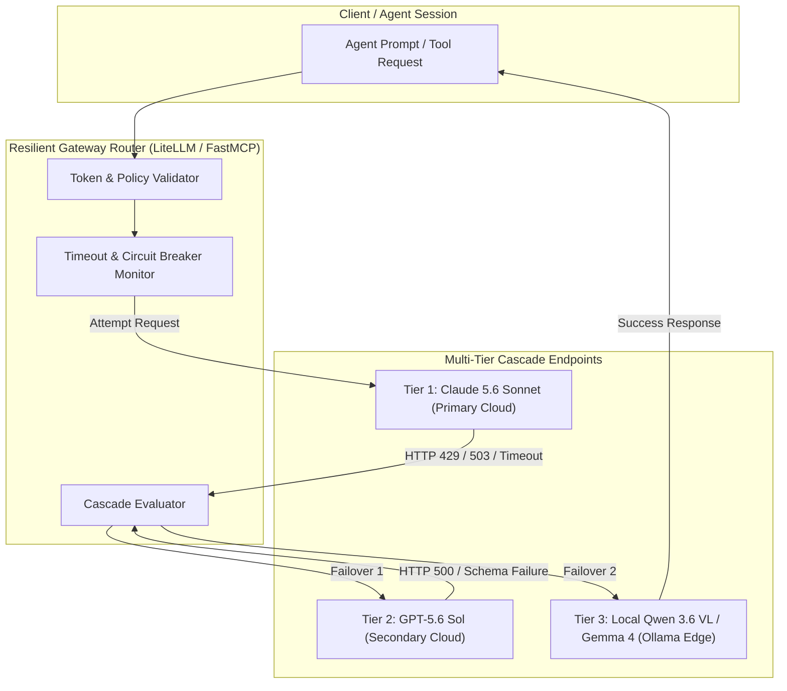

# Fallback Patterns

## What it is
Fallback and failover patterns are architectural resilience strategies designed to ensure high availability and reliability for AI applications. They automatically redirect request traffic between different Large Language Model (LLM) providers, models, or local configurations when a primary server encounters failures, rate limits, latency spikes, or response quality drops. As of early January 2027, these have evolved into highly sophisticated "Self-Healing Agentic Cascades" that dynamically recover from API or connectivity outages.

## Architecture & Cascade Failover Sequence



## System Execution Sequence Flow

```
+-----------------------------------------------------------------------------------+
|                        CASCADE FAILOVER SEQUENCE FLOW                             |
+-----------------------------------------------------------------------------------+

[Agent Request] --> [Gateway Policy Router] --(Attempt 1)--> [Claude 5.6 Primary]
                                                                     |
                                                           (HTTP 429 / Timeout)
                                                                     v
[Client Response] <-- (Return Result) <-- [Local Ollama] <-- (Attempt 2)
```

## What problem it solves
LLM API integrations are susceptible to multiple distinct failure modes in modern multi-agent systems:
- **API Outages**: Cloud providers experience service degradation or total downtime (e.g., HTTP 500/503 errors).
- **Rate Limiting**: Reaching Tier caps or experiencing request bursts triggers HTTP 429 (Too Many Requests).
- **Latency Spikes**: High global demand can stall generation times, causing timeouts in time-critical agent pipelines.
- **Structural Integrity Failures**: A model may fail to output valid JSON or violate a schema, requiring an immediate fallback escalation to a more capable reasoning engine like [GPT-5.6](../../tools/ai_knowledge/openai.md) (utilizing Sol/Luna/Terra reasoning tiers) or [Claude 5.6](../../tools/ai_knowledge/claude.md).
- **Local-to-Cloud Boundaries**: Edge devices running [Gemma 4](../../tools/ai_knowledge/gemma-4-31b-antihal.md) or [Qwen 3.6 VL](../../tools/ai_knowledge/qwen.md) may hit resource constraints, requiring a cloud fallback to [Gemini 4.0 Ultra](../../tools/ai_knowledge/gemini.md).

## Where it fits in the stack
Fallback patterns typically reside in the **Middleware or Gateway Layer** (such as [LiteLLM](../../services/litellm.md) or [Portkey](../../tools/providers/portkey.md)). They act as a smart interceptor between raw agent prompts and the physical inference API hosts. In durable agentic loops, fallback and retry policies are built into the **Workflow Orchestration** engine (such as [Temporal](../../tools/orchestration/temporal.md)) to maintain transaction state.

## Comparison of Fallback Strategies

| Strategy | Primary Trigger | Recovery Speed | Cost Impact | Context Preservation |
| :--- | :--- | :--- | :--- | :--- |
| **Model Cascade** | Rate Limits (429) / Outages (503) | Fast (< 2s) | Cost-Neutral / Lower | High (Direct Prompt Pass) |
| **Local Failover** | Internet Loss / Cloud Outage | Medium (~3-5s) | Zero API Cost | Medium (Context Compression) |
| **Schema Escalation** | JsonValidationError / Parsing Fail | Fast (< 1.5s) | Higher (More Capable LLM) | High (Preserves Output Format) |
| **Provider Hedging** | High Latency P99 Spikes | Fastest (Parallel) | 2x-3x API Cost | High (First Response Wins) |

## Typical use cases
- **Frontier Model Escalation**: Attempting extraction with cheap, fast models (Claude 5.6 Haiku) and failing over to premium models (GPT-5.6 Sol) on exception.
- **Local-First Failover**: Running primary offline workflows on [Ollama](../../services/ollama.md) (DeepSeek-V4 or Qwen 3.6 VL) and calling cloud endpoints only when local hardware is overloaded or unavailable.
- **Multi-Gateway Buffering**: Distributing high-volume requests across backup routes in [OpenRouter](../../tools/ai_knowledge/openrouter.md) to circumvent regional rate limits.
- **Dynamic Context Routing**: Automatically switching a 500k token processing task from Claude 5.6 to Gemini 4.0 Ultra if Anthropic endpoints report capacity limits.

## Strengths
- **Service Continuity**: Insulates downstream services and end-users from intermittent provider downtime.
- **Cost Minimization**: Allows "cheapest-model-first" execution policies with conditional escalation to premium tiers.
- **Predictable Latency**: Cuts off slow requests early using aggressive timeout policies and retries on faster endpoints.
- **Resilient Tool Use**: Seamlessly maintains FastMCP 3.1 Task Protocol sessions even if a specific server node resets.

## Limitations
- **Accumulated Latency**: Sequential retries add up, increasing the overall round-trip time for end-users.
- **Context Loss risk**: Different target models have varying context sizes and system prompt sensitivities, requiring careful context transformation.
- **Output Inconsistencies**: Model output style, behavior, and formatting style vary, which can impact downstream parser logic.
- **State Synchronisation**: Retrying complex multi-step agents requires substantial orchestration overhead to avoid duplicating side-effects (e.g., executing a tool call twice).

## When to use it
- In mission-critical production environments where service uptime (99.9%+) is mandatory.
- In multi-agent autonomous loops where a single step failure would compromise a long-running execution thread.
- When managing heavily rate-limited developer tier APIs in a hybrid homelab environment.

## When not to use it
- In simple, single-turn human-chat prototypes where immediate failure notifications are sufficient.
- For tasks with hard sub-second response limits where the latency of a single timeout-and-retry is unacceptable.
- If the workflow strictly requires the domain-specific fine-tuned properties of a single specific model.

## Getting started
To set up a fallback cascade in your local stack:
1. Configure a universal routing gateway like [LiteLLM](../../services/litellm.md).
2. Define a multi-provider fallback list in your gateway configuration file.
3. Integrate resilient client SDK code with robust timeout and status-code filtering.
4. Establish local fallback endpoints using [Ollama](../../services/ollama.md).

## CLI examples

### Testing Fallback Policies via LiteLLM CLI
Start a local proxy configured with fallback models using a declarative YAML structure:
```bash
# Start litellm with fallback routing enabled
litellm --config fallback_config.yaml --port 4000
```

Example `fallback_config.yaml`:
```yaml
model_list:
  - model_name: primary-frontier
    litellm_params:
      model: anthropic/claude-5-6-sonnet
      api_key: os.environ/ANTHROPIC_API_KEY
  - model_name: secondary-frontier
    litellm_params:
      model: openai/gpt-5.6-sol
      api_key: os.environ/OPENAI_API_KEY
  - model_name: local-backup
    litellm_params:
      model: ollama/gemma4
      api_base: http://localhost:11434

router_settings:
  fallback_policy:
    primary-frontier: ["secondary-frontier", "local-backup"]
  allowed_fails: 2
  cooldown_time: 30
```

## Systemd Proxy Service Unit Configuration

For production deployments running LiteLLM fallback proxy, configure `/etc/systemd/system/litellm-proxy.service`:

```ini
[Unit]
Description=LiteLLM Resilient Fallback Gateway Proxy Service
After=network.target ollama.service
Wants=ollama.service

[Service]
Type=simple
User=litellm
Group=litellm
WorkingDirectory=/opt/litellm
EnvironmentFile=/etc/litellm/environment
ExecStart=/opt/litellm/venv/bin/litellm --config /etc/litellm/config.yaml --port 4000 --num_workers 4
Restart=always
RestartSec=3s
LimitNOFILE=65536

# Security Hardening
ProtectSystem=full
ProtectHome=true
NoNewPrivileges=true
PrivateTmp=true

[Install]
WantedBy=multi-user.target
```

## API examples

### Python: Robust Pydantic v2 Validated Fallback Router & FastMCP 3.1 Gateway
The following script demonstrates how to define, validate, and execute a fallback cascade utilizing Pydantic v2 schemas, mock HTTP clients, and a FastMCP 3.1 gateway tool. It illustrates a self-healing pattern transitioning from Anthropic Claude 5.6 Sonnet to OpenAI GPT-5.6 Sol, and finally to local Qwen 3.6 VL.

```python
import time
import json
from typing import List, Dict, Any, Optional
from pydantic import BaseModel, Field, HttpUrl, field_validator, ValidationError
from mcp.server.fastmcp import FastMCP

# Initialize FastMCP 3.1 Server Gateway
mcp = FastMCP("Fallback-Cascade-Gateway", version="3.1")

# 1. Define configuration schemas with Pydantic v2
class ModelEndpoint(BaseModel):
    model_id: str = Field(..., description="Canonical ID of the model")
    endpoint_url: HttpUrl = Field(..., description="API base URL")
    timeout_seconds: float = Field(default=5.0, ge=1.0, le=30.0)
    api_key_env: str = Field(..., description="Environment variable holding the credential")

class FallbackPolicy(BaseModel):
    policy_id: str
    primary_endpoint: ModelEndpoint
    cascade_endpoints: List[ModelEndpoint] = Field(default_factory=list)
    max_retries_per_step: int = Field(default=2, ge=1, le=5)

    @field_validator("cascade_endpoints")
    @classmethod
    def ensure_distinct_endpoints(cls, v: List[ModelEndpoint], info) -> List[ModelEndpoint]:
        primary = info.data.get("primary_endpoint")
        if primary:
            ids = {primary.model_id}
            for ep in v:
                if ep.model_id in ids:
                    raise ValueError(f"Duplicate model_id detected in cascade: {ep.model_id}")
                ids.add(ep.model_id)
        return v

# 2. Resilient Execution Logic
class FallbackRunner:
    def __init__(self, policy: FallbackPolicy):
        self.policy = policy

    def execute_with_failover(self, prompt: str) -> Dict[str, Any]:
        targets = [self.policy.primary_endpoint] + self.policy.cascade_endpoints

        for idx, endpoint in enumerate(targets):
            print(f"[{endpoint.model_id}] Attempting request to {endpoint.endpoint_url} (Timeout: {endpoint.timeout_seconds}s)...")

            # Simulate real-world failures for demonstration:
            # - Primary Anthropic: Simulates a 429 Rate Limit
            # - Secondary OpenAI: Simulates a 503 Outage
            # - Local Qwen 3.6 VL: Succeeds gracefully
            try:
                if "claude" in endpoint.model_id:
                    raise RuntimeError("HTTP 429 Too Many Requests - Anthropic Rate Limit Reached")
                elif "gpt-5" in endpoint.model_id:
                    raise RuntimeError("HTTP 503 Service Unavailable - OpenAI Gateway Outage")

                # Successful local processing simulation
                time.sleep(0.1)
                return {
                    "status": "success",
                    "resolved_model": endpoint.model_id,
                    "endpoint_used": str(endpoint.endpoint_url),
                    "response": f"Processed prompt successfully by {endpoint.model_id} local server.",
                    "attempts_made": idx + 1
                }
            except Exception as ex:
                print(f"[{endpoint.model_id}] Failed with error: {ex}")
                if idx == len(targets) - 1:
                    raise RuntimeError("All fallback targets exhausted. Cascade failed completely.")
                print(f"[{endpoint.model_id}] Initiating fallback to next target in cascade...")

        raise RuntimeError("Cascade aborted unexpectedly.")

@mcp.tool(name="execute_resilient_prompt", description="Executes agent prompts across a multi-tier fallback cascade.")
def execute_resilient_prompt(prompt: str) -> str:
    policy_data = {
        "policy_id": "homelab-orchestration-safety",
        "primary_endpoint": {
            "model_id": "claude-5.6-sonnet",
            "endpoint_url": "https://api.anthropic.com/v1",
            "api_key_env": "ANTHROPIC_API_KEY"
        },
        "cascade_endpoints": [
            {
                "model_id": "gpt-5.6-sol",
                "endpoint_url": "https://api.openai.com/v1",
                "api_key_env": "OPENAI_API_KEY",
                "timeout_seconds": 8.0
            },
            {
                "model_id": "qwen-3.6-vl-local",
                "endpoint_url": "http://localhost:11434/v1",
                "api_key_env": "LOCAL_OLLAMA_KEY",
                "timeout_seconds": 15.0
            }
        ]
    }

    try:
        validated_policy = FallbackPolicy.model_validate(policy_data)
        runner = FallbackRunner(validated_policy)
        result = runner.execute_with_failover(prompt)
        return json.dumps(result, indent=2)
    except ValidationError as val_err:
        return json.dumps({"status": "POLICY_ERROR", "errors": val_err.errors()})
    except Exception as err:
        return json.dumps({"status": "CASCADE_FAILED", "error": str(err)})

if __name__ == "__main__":
    mcp.run()
```

## Diagnostic & Troubleshooting Matrix

| Issue / Error Symptom | Cause | Diagnostic Command | Remediation Action |
| :--- | :--- | :--- | :--- |
| `Cascade Latency > 10s` | Sequential timeouts accumulating across 3+ offline endpoints. | `curl -w "@curl-format.txt" http://localhost:4000/v1/chat/completions` | Lower individual endpoint timeout thresholds (`timeout_seconds: 3.0`) and use parallel hedging. |
| `Context Window Overflow on Failover` | Secondary model context window smaller than primary model prompt length. | `litellm --test_context_length` | Enable automatic context truncation/summarization filters in LiteLLM router config. |
| `Tool Call Schema Mismatch` | Local Ollama model outputs non-standard JSON tool arguments during fallback. | `python3 -m litellm.test_tools` | Standardize tool definitions into FastMCP 3.1 Pydantic v2 validation models. |
| `Infinite Cascade Loop` | Router policy configured with cyclic model fallback dependencies. | `litellm --validate_config fallback_config.yaml` | Ensure fallback target graphs form a Directed Acyclic Graph (DAG) with strict exit nodes. |
| `Circuit Breaker Stuck Open` | Backup endpoint kept in cooldown state after transient network blip. | `curl http://localhost:4000/router/status` | Reset LiteLLM cooldown settings (`cooldown_time: 10`) or clear circuit breaker cache. |

## Production Best Practices & Guardrails

### 1. Idempotency Guarantees
Ensure external tool calls executed during an agent step are strictly idempotent or protected by state locking in [Temporal](../../tools/orchestration/temporal.md) to prevent duplicated side-effects during failover retries.

### 2. Rate-Limit Cooldown Windows
Configure cooldown timers (10-30s) on endpoints returning HTTP 429 to avoid repeatedly slamming rate-limited cloud APIs while failover targets absorb traffic.

### 3. Context Transformation Normalization
When falling back from proprietary models (Claude 5.6 / GPT-5.6) to open-weights local models (Gemma 4 / DeepSeek-V4), apply explicit system prompt normalizers to format tool-use instructions appropriately.

## Related tools / concepts
- [Temporal](../../tools/orchestration/temporal.md) — Durable execution framework for managing multi-step state.
- [LiteLLM](../../services/litellm.md) — Universal proxy for model-neutral fallback management.
- [OpenRouter](../../tools/ai_knowledge/openrouter.md) — Managed multi-provider routing and automatic retries.
- [Portkey](../../tools/providers/portkey.md) — Enterprise-grade AI gateway with automated fallback policies.
- [Ollama](../../services/ollama.md) — Local inference server hosting backup open-weights models.
- [Vercel AI SDK](../../tools/providers/vercel-ai-gateway.md) — Comprehensive framework for frontend and server-side fallback handling.
- [Model Routing Guide](../model_routing_guide.md) — General selection strategy across model tiers.
- [Agentic Workflows](agentic-workflows.md) — Multi-agent system orchestration patterns.

## Sources / references
- [Anthropic Resilience and API Fallbacks Guide](https://docs.anthropic.com/claude/docs/resilience-and-fallbacks)
- [LiteLLM Routing & Fallback Policies](https://docs.litellm.ai/docs/proxy/fallbacks)
- [Vercel AI SDK: Client-side Resilience Strategies](https://sdk.vercel.ai/docs/concepts/resilience)
- [Temporal Retry Policies & Durable Execution Patterns](https://docs.temporal.io/workflows#retry-policy)

## Contribution Metadata
- Last reviewed: 2027-01-07
- Confidence: high
