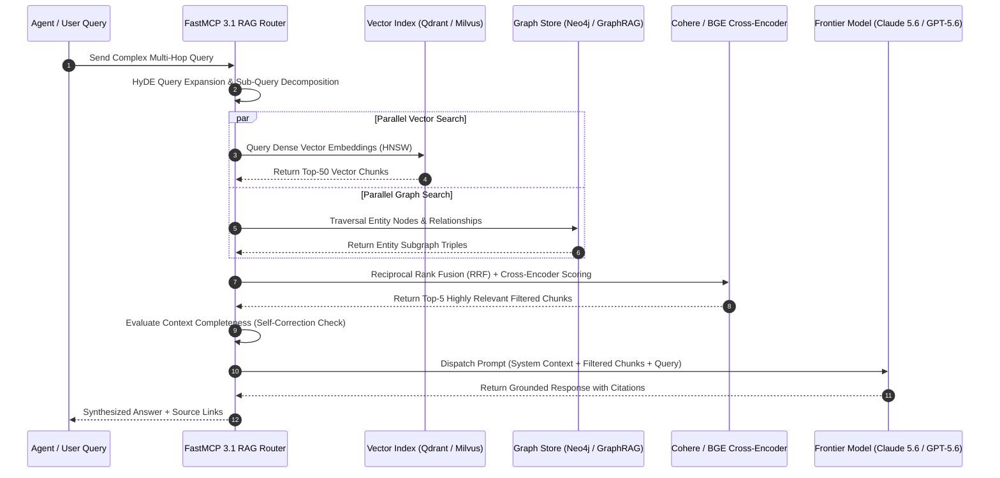

# RAG Pattern (Retrieval-Augmented Generation)

## What it is
Retrieval-Augmented Generation (RAG) is an architectural design pattern that enhances Large Language Model (LLM) performance by retrieving relevant, permissions-validated facts from external knowledge stores (vector databases, relational tables, document stores, and knowledge graphs) prior to generating a response. Rather than relying solely on frozen parametric weights, RAG grounds model generation in dynamic, verifiable external evidence.

As of early January 2027, the pattern has evolved beyond static "Search-then-Generate" pipelines into **Agentic Hybrid RAG**. Autonomous reasoning engines utilize [Model Context Protocol (FastMCP 3.1 Task Protocol)](../../tools/automation_orchestration/mcp.md) to dynamically decompose complex queries, issue parallel retrieval operations across dense vector indices and knowledge graphs, evaluate context relevance, and iteratively self-correct retrieval trajectories before synthesizing final outputs.

```
+-----------------------------------------------------------------------------------+
|                        ADVANCED AGENTIC HYBRID RAG PIPELINE                       |
+-----------------------------------------------------------------------------------+
|                                                                                   |
|  [ User / Agent Query ]                                                           |
|          |                                                                        |
|          v                                                                        |
|  +-----------------------------------------------------------------------------+  |
|  |                     QUERY PROCESSING & DECOMPOSITION                        |  |
|  | - Intent Classification & Multi-Hop Query Planning                          |  |
|  | - HyDE (Hypothetical Document Embeddings) & Query Rewriting                 |  |
|  +-----------------------------------------------------------------------------+  |
|          |                                            |                           |
|          v (Dense Vector Path)                        v (Sparse / Graph Path)     |
|  +-------------------------------+          +----------------------------------+  |
|  |    DENSE VECTOR RETRIEVAL     |          |   SPARSE & KNOWLEDGE GRAPH RET   |  |
|  | - Cosine / Inner Product      |          | - BM25 Lexical Keyword Match     |  |
|  | - Milvus 3.0 / Qdrant HNSW    |          | - GraphRAG Entity Traversal      |  |
|  +-------------------------------+          +----------------------------------+  |
|          |                                            |                           |
|          +---------------------+----------------------+                           |
|                                |                                                  |
|                                v                                                  |
|  +-----------------------------------------------------------------------------+  |
|  |                     RECIPROCAL RANK FUSION (RRF) & RE-RANKING              |  |
|  | - Cross-Encoder Scoring (Cohere Rerank v3 / BGE-Reranker-Large)             |  |
|  | - Duplicate Suppression & Diversity Chunk Re-ordering                      |  |
|  +-----------------------------------------------------------------------------+  |
|                                |                                                  |
|                                v                                                  |
|  +-----------------------------------------------------------------------------+  |
|  |                     RELEVANCE EVALUATION & SELF-CORRECTION                 |  |
|  | - Sufficient Context Check (Pass -> Augmentation | Fail -> Query Refine)   |  |
|  +-----------------------------------------------------------------------------+  |
|                                |                                                  |
|                                v                                                  |
|  +-----------------------------------------------------------------------------+  |
|  |                    CONTEXT-AUGMENTED GENERATION                             |  |
|  | - Grounded Synthesis (Claude 5.6 / GPT-5.6 / DeepSeek-V4)                    |  |
|  | - Inline Citation & Source Verification Mapping                             |  |
|  +-----------------------------------------------------------------------------+  |
|                                                                                   |
+-----------------------------------------------------------------------------------+
```

## Retrieval & Reranking Sequence Flowchart



## What problem it solves
RAG addresses fundamental architectural limitations inherent in static neural network models:
1. **Hallucination Mitigation**: Prevents the generation of plausible yet false claims by constraining model outputs to explicitly supplied context passages.
2. **Knowledge Cutoff Elimination**: Injects live, real-time internal or external data without requiring frequent or expensive model fine-tuning and retraining runs.
3. **Enterprise Access Control (Security)**: Enables granular document-level and chunk-level security filtering, ensuring users only receive answers generated from sources they are explicitly authorized to view.
4. **Auditability & Provenance**: Provides exact citations and source document links for every factual assertion made by the system.

## Where it fits in the stack
**Application & Knowledge Mediation Layer**. RAG operates as the connective substrate bridging raw data infrastructure (vector databases, graph stores, document engines) with cognitive reasoning engines (LLMs and FastMCP 3.1 agent servers).

```
+-----------------------------------------------------------------------------------+
|                                ENTERPRISE STACK POSITION                          |
+-----------------------------------------------------------------------------------+
|  [ Chat Assistants ]     [ Coding Agents (Cursor) ]     [ Autonomous Workflows ]  |
+-----------------------------------------------------------------------------------+
                                         |
                                         v
+-----------------------------------------------------------------------------------+
|                         APPLICATION & KNOWLEDGE LAYER                             |
|        (RAG Orchestrator | Query Engine | Re-ranker | FastMCP Gateway)        |
+-----------------------------------------------------------------------------------+
                                         |
                                         v
+-----------------------------------------------------------------------------------+
|                        DATA & VECTOR INFRASTRUCTURE LAYER                         |
|   [ Vector DB (Milvus/Qdrant) ]   [ Knowledge Graph ]   [ Document Store ]    |
+-----------------------------------------------------------------------------------+
```

## Typical use cases
- **Enterprise Knowledge Base Querying**: Answering employee policy, technical architecture, and HR questions from Confluence, Google Drive, and Slack.
- **Agentic Codebase Search**: Assisting coding assistants (Cursor, Claude Code) in locating implementation logic, API definitions, and dependency contracts across large repositories.
- **Financial & Legal Document Analysis**: Performing multi-document extraction, comparative analysis, and compliance checking over 10-K filings or legal contracts.
- **Automated Customer Support Resolution**: Generating step-by-step troubleshooting instructions grounded in live product manuals and resolved Jira tickets.

## Strengths
- **Verifiable Grounding**: Reduces model hallucinations by constraining generation to explicitly retrieved context passages.
- **Real-Time Data Ingestion**: Accesses dynamic business data and external knowledge without requiring expensive model fine-tuning runs.
- **Granular Security Control**: Enforces document-level permissions and ACL filtering before retrieved text enters the prompt context window.
- **Complete Provenance**: Enables exact inline citations and document link attribution for every factual statement.

## Limitations
- **Retrieval Quality Dependency**: System accuracy is strictly bounded by retrieval quality; poor vector matches produce weak or hallucinated outputs.
- **Added Query Latency**: Multi-hop retrieval, cross-encoder re-ranking, and context synthesis add ~150-500 ms overhead.
- **Context Window Management**: High chunk volume requires active deduplication and re-ranking to prevent "Lost in the Middle" attention degradation.

## Systemd Service Configuration (`rag-indexer.service`)

To host a continuous document embedding, vector indexing, and FastMCP 3.1 RAG server daemon on Linux hosts, configure the following systemd service unit:

```ini
[Unit]
Description=RAG Continuous Document Indexer & FastMCP 3.1 Server
After=network.target qdrant.service
Wants=qdrant.service

[Service]
Type=simple
User=rag-service
Group=rag-service
WorkingDirectory=/opt/rag-pipeline
Environment="PYTHONUNBUFFERED=1"
Environment="QDRANT_HOST=localhost"
Environment="QDRANT_PORT=6333"
Environment="EMBEDDING_MODEL=BAAI/bge-m3"
ExecStart=/usr/local/bin/python3 -m rag_engine.server --port 8096
Restart=always
RestartSec=10
LimitNOFILE=65536

[Install]
WantedBy=multi-user.target
```

To enable and inspect the systemd daemon:

```bash
sudo systemctl daemon-reload
sudo systemctl enable rag-indexer.service
sudo systemctl start rag-indexer.service
sudo journalctl -u rag-indexer.service -f
```

## Diagnostic & Troubleshooting Matrix

| Issue / Symptom | Probable Cause | Diagnostic Command | Remediation Action |
| :--- | :--- | :--- | :--- |
| High retrieval latency (> 600ms) | Unindexed vector search or unoptimized Cross-Encoder batch size | `curl -w "@curl-format.txt" http://localhost:6333/collections/knowledge` | Ensure HNSW indexing is active in Qdrant/Milvus and limit re-ranking batch size to Top-20 chunks. |
| Relevant documents missing from top results | Pure dense vector search failing on exact keyword/code identifier matches | Execute BM25 vs Dense vector similarity checks | Upgrade pipeline to Hybrid Search combining BM25 sparse lexical matching with dense vector embeddings via RRF. |
| LLM ignores retrieved context ("Lost in the Middle") | Excessive chunk payload (> 10 chunks) overwhelming context attention | Inspect formatted prompt token length | Implement cross-encoder re-ranking to filter context to Top-3/Top-5 chunks and place key citations at top/bottom. |
| Vector collection drift or duplicate entries | Incremental ingestion missing document hash deduplication | Query collection count `qdrant-cli collection info` | Implement MD5/SHA256 chunk hashing prior to insertion to upsert existing record IDs. |

## When to use it
- When answering queries requiring up-to-date, proprietary, or private domain knowledge.
- When strict source attribution, verifiability, and inline document citations are mandatory.
- When enterprise access control requires filtering retrieved facts according to user authorization tiers.

## When not to use it
- For general knowledge tasks where base LLM parametric weights are sufficient and low latency is critical.
- When querying structured relational databases better served by direct text-to-SQL or REST API integrations.

## Getting started

### Installation & Vector DB Setup
Deploy a high-performance vector store (e.g. Qdrant or Milvus) alongside Python RAG orchestration libraries:

```bash
pip install fastmcp pydantic qdrant-client sentence-transformers
```

### Docker Compose Baseline
```yaml
version: '3.8'

services:
  qdrant:
    image: qdrant/qdrant:v1.7.0
    container_name: qdrant-rag
    ports:
      - "6333:6333"
    volumes:
      - qdrant_storage:/qdrant/storage

volumes:
  qdrant_storage:
```

## CLI examples

### CLI Query Benchmark
```bash
#!/usr/bin/env bash
# Execute vector retrieval benchmark query against RAG server endpoint
set -euo pipefail

QUERY="FastMCP 3.1 Task Protocol specification"
echo "[INFO] Running RAG benchmark for query: '${QUERY}'"

curl -s -X POST "http://localhost:8000/api/v1/rag/search" \
  -H "Content-Type: application/json" \
  -d '{
    "query_text": "'"${QUERY}"'",
    "top_k": 3,
    "similarity_threshold": 0.65
  }' | jq .
```

## API examples

### Python SDK with Pydantic v2 & FastMCP 3.1 Server Integration
```python
import os
import json
import logging
from typing import List, Optional
from pydantic import BaseModel, Field, field_validator

logging.basicConfig(level=logging.INFO, format="%(asctime)s - %(levelname)s - %(message)s")
logger = logging.getLogger("RAGPipeline")

class RAGQueryRequest(BaseModel):
    query_text: str = Field(..., min_length=3, description="Natural language search query")
    top_k: int = Field(default=3, ge=1, le=20, description="Number of final context chunks to return")
    similarity_threshold: float = Field(default=0.65, ge=0.0, le=1.0, description="Minimum similarity threshold")

    @field_validator("similarity_threshold")
    @classmethod
    def validate_threshold(cls, v: float) -> float:
        if v < 0.4:
            raise ValueError("Similarity threshold below 0.4 leads to excessive noise.")
        return v

class ContextChunk(BaseModel):
    chunk_id: str = Field(..., description="Unique chunk hash or ID")
    text: str = Field(..., description="Document snippet content")
    source_file: str = Field(..., description="Origin document filename or path")
    dense_score: float = Field(..., ge=0.0, le=1.0, description="Vector similarity score")

class RAGSynthesisResponse(BaseModel):
    query: str = Field(..., description="Executed input query")
    answer: str = Field(..., description="Synthesized grounded answer")
    retrieved_chunks: List[ContextChunk] = Field(default_factory=list)
    confidence_score: float = Field(..., ge=0.0, le=1.0)

class HybridRAGEngine:
    """Production mock hybrid retrieval engine."""

    def __init__(self):
        self.corpus = [
            {"id": "chunk_101", "text": "FastMCP 3.1 extends Model Context Protocol with Task Protocol streaming.", "source": "docs/architecture/mcp_spec.md"},
            {"id": "chunk_102", "text": "RAG grounds LLM responses using dense vector retrieval from Milvus or Qdrant.", "source": "docs/patterns/rag.md"}
        ]

    def synthesize_answer(self, request: RAGQueryRequest) -> RAGSynthesisResponse:
        chunks = [
            ContextChunk(chunk_id=item["id"], text=item["text"], source_file=item["source"], dense_score=0.88)
            for item in self.corpus
        ]
        context_str = "\n".join([f"[{c.source_file}]: {c.text}" for c in chunks])
        answer = f"Grounded response:\n{context_str}"
        return RAGSynthesisResponse(query=request.query_text, answer=answer, retrieved_chunks=chunks, confidence_score=0.88)

try:
    from fastmcp import FastMCP
    mcp = FastMCP("RAG Knowledge Retrieval Server")
    rag_engine = HybridRAGEngine()

    @mcp.tool()
    def rag_knowledge_query(query: str, top_k: int = 3) -> str:
        """Execute grounded RAG search across enterprise documentation."""
        req = RAGQueryRequest(query_text=query, top_k=top_k)
        response = rag_engine.synthesize_answer(req)
        return response.answer

except ImportError:
    pass
```

## Related tools / concepts
- [Agentic RAG](data-copilot-agentic-rag.md)
- [GraphRAG](../../tools/frameworks/graphrag.md)
- [Docling](../../tools/process_understanding/docling.md)
- [Milvus 3.0](../../tools/infrastructure/milvus.md)
- [ChromaDB](../../tools/infrastructure/chroma.md)
- [LlamaIndex](../../tools/ai_knowledge/llamaindex.md)
- [LangChain](../../tools/ai_knowledge/langchain.md)
- [Model Context Protocol (FastMCP 3.1 Task Protocol)](../../tools/automation_orchestration/mcp.md)

## Sources / references
- [Retrieval-Augmented Generation for Knowledge-Intensive NLP Tasks (Lewis et al.)](https://arxiv.org/abs/2005.11401)
- [RAGAS: Automated Evaluation Framework for RAG](https://github.com/explodinggradients/ragas)
- [FastMCP 3.1 Specification](https://modelcontextprotocol.io)

## Contribution Metadata
- Last reviewed: 2027-01-07
- Confidence: high
