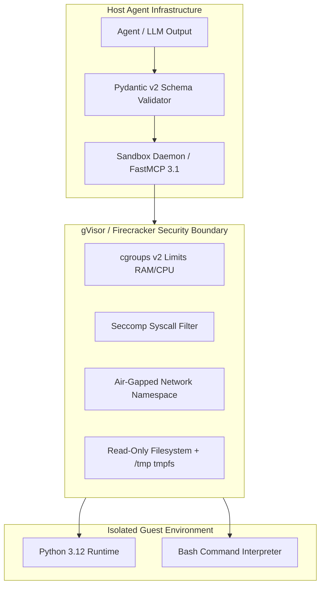

# Sandboxed Code Execution

## What it is

- **Strict Process Isolation**: Running code inside ephemeral container runtimes, WebAssembly sandboxes, or gVisor/Firecracker microVMs to prevent unauthorized host filesystem or memory access.
- **Resource Constraints (cgroups v2)**: Enforcing hard limits on CPU usage, RAM allocation, execution timeout limits, disk I/O, and file descriptor allocation.
- **Network Air-Gapping & Policy Filtering**: Disabling network access by default or enforcing eBPF/iptables outbound destination filtering to prevent exfiltration or unauthorized API access.
- **Syscall Restrictions (seccomp & AppArmor)**: Restricting available kernel system calls (blocking `ptrace`, raw socket creation, kernel module loading) to neutralize container breakout vectors.
- **Ephemeral Cleanup & Snapshot Restores**: Booting clean sandbox environments in milliseconds and immediately destroying sandbox instances after execution completion.

## What problem it solves
- Eliminates arbitrary code execution (ACE), privilege escalation, and host filesystem compromise risks when running untrusted, LLM-generated code.
- Prevents resource exhaustion and network exfiltration during autonomous agent coding and data analysis tasks.

## Where it fits in the stack
- Sits in the **Security & Execution Boundary** layer of autonomous coding agents and evaluation engines.
- Wraps agentic tool calls (Bash, Python, Node.js) inside isolated cgroup/seccomp containers or microVMs.

## Sandbox Architecture Diagram

```
+-----------------------------------------------------------------------------------+
|                        Host / Agent Engine (FastMCP 3.1)                          |
|                                                                                   |
|   +---------------------------------------------------------------------------+   |
|   | Agent / LLM Code Generation Output (Python / Bash / JS)                   |   |
|   +---------------------------------------------------------------------------+   |
|                                        ||                                         |
|                  Validate Code Payload via Pydantic v2 Schema                     |
|                                        ||                                         |
|                                        \/                                         |
|   +---------------------------------------------------------------------------+   |
|   | Sandboxed Execution Orchestrator (gVisor runsc / Firecracker / Docker)    |   |
|   +---------------------------------------------------------------------------+   |
+-----------------------------------------------------------------------------------+
                                         ||
                      Isolated MicroVM / Container Boundary
                                         ||
                                         \/
+-----------------------------------------------------------------------------------+
| Ephemeral Sandbox Instance                                                        |
|                                                                                   |
|  - cgroups v2 Hard Limits (RAM: 512MB, CPU: 1.0 Core, Timeout: 5s)                |
|  - Network Policy: Network Namespace Unshare (Air-Gapped, No Outbound Route)      |
|  - Syscall Filter: Seccomp Profile (Blocked: ptrace, unshare, init_module, etc.) |
|  - Root Filesystem: Read-Only OverlayFS + Ephemeral 64MB tmpfs (/tmp)              |
|                                                                                   |
|  +-----------------------------------------------------------------------------+  |
|  | Isolated Runtime Execution Process (Python 3.12 / Node.js 22 / Bash)        |  |
|  +-----------------------------------------------------------------------------+  |
+-----------------------------------------------------------------------------------+
```



## Typical use cases

- **Autonomous Coding Agents**: Safely running unit tests, linting scripts, and code generation outputs produced by coding assistants (Claude Engineer, OpenCode, Aider).
- **Data Copilot Data Analysis**: Executing pandas/polars/matplotlib code generated on user spreadsheets without risking corporate network exposure.
- **Web Scraping & DOM Rendering**: Running browser automation tools (Puppeteer, Playwright) to scrape untrusted external web pages safely.
- **Benchmark Evaluation Platforms**: Running untrusted code generation test suites (HumanEval, MultiPL-E, SWE-bench) across multi-tenant evaluation infrastructure.

## Strengths

- **Enterprise Security Compliance**: Mitigates prompt injection, malicious code generation, and arbitrary code execution (ACE) risks in production AI deployments.
- **Multi-Tenant Isolation**: Prevents side-channel data leaks and cross-agent memory pollution in shared multi-agent servers.
- **Deterministic Reproducibility**: Clean, reproducible base images ensure consistent script evaluation regardless of host system configuration.

## Limitations

- **Latency Overhead**: MicroVM creation and container startup introduce execution latency compared to native host execution (mitigated by pre-warmed sandbox pools).
- **Tooling Constraints**: Air-gapped sandboxes prevent script installation of missing PyPI/npm packages at runtime without pre-built environment images or proxy mirrors.

## Sandbox Technology Comparison Matrix

| Technology | Isolation Mechanism | Startup Latency | VRAM / Memory Overhead | Syscall Interception | Best Use Case |
| :--- | :--- | :--- | :--- | :--- | :--- |
| **Docker (cgroups v2)** | Linux Namespaces + Seccomp | ~200ms | Minimal (<10MB) | Seccomp Profile | Standard Agent Script Execution |
| **gVisor (`runsc`)** | User-space Kernel Sentry | ~50ms | Low (~15MB) | User-space Syscall Trapping | Multi-tenant Agent Platforms |
| **Firecracker MicroVM**| KVM Hypervisor Isolation | ~5ms | Low (~5MB per VM) | KVM Hardware Isolation | Untrusted Code Execution |
| **Wasmtime (Wasm)** | WebAssembly Memory Sandbox| <1ms | Negligible (<1MB) | Capability-based WASI | Edge / Browser Code Execution |
| **Bubblewrap (bwrap)**| Unprivileged User Namespaces| ~2ms | Minimal | User Namespace Mapping | Lightweight CLI Tool Isolation |

## When to use it

- When building agentic platforms that execute LLM-generated code, shell scripts, or raw queries.
- When running multi-tenant coding platforms processing user-submitted or agent-generated scripts.
- When enterprise security standards prohibit direct execution of AI code output on host developer machines or production servers.

## When not to use it
- When executing fully trusted, pre-compiled static system maintenance scripts on dedicated isolated hardware.
- When minimal execution latency (<1ms) is strictly required and process isolation overhead is prohibitive.

## Getting started

To execute untrusted Python code inside a secure gVisor container:

1. Install gVisor runsc runtime:
   ```bash
   sudo apt-get update && sudo apt-get install -y runsc
   sudo runsc install
   sudo systemctl restart docker
   ```
2. Launch a secure container using `runsc` runtime with dropped capabilities and no networking:
   ```bash
   docker run --runtime=runsc --rm --net=none --cap-drop=ALL --read-only python:3.12-slim python3 -c "print('Hello Sandboxed World')"
   ```

## CLI examples

```bash
# Execute Python code in an air-gapped Docker container with memory caps
docker run --rm \
  --network none \
  --memory=256m \
  --cpus=1.0 \
  --cap-drop=ALL \
  --read-only \
  --tmpfs /tmp:rw,noexec,nosuid,size=64m \
  python:3.12-slim python3 -c "import sys; print(f'Python {sys.version} isolated successfully')"

# Run script inside gVisor runsc sandbox runtime
docker run --runtime=runsc --rm --net=none python:3.12-slim python3 -c "import os; print(os.uname())"

# Execute sandboxed code using Bubblewrap (bwrap) unprivileged user namespace
bwrap --ro-bind / / --dev /dev --tmpfs /tmp --unshare-all --hostname sandbox bash -c "whoami"

# Execute compiled WebAssembly module using Wasmtime CLI
wasmtime run --dir=. binary_module.wasm
```

## API examples

The following Python script demonstrates an asynchronous FastMCP 3.1 server implementation for sandboxed execution using Docker/Podman SDK with strict resource bounds, air-gapped network restrictions, and **Pydantic v2** validation (`extra="forbid"`) of execution inputs and outputs.

```python
import docker
from typing import Dict, Any, Optional
from pydantic import BaseModel, Field, field_validator, ConfigDict
from fastmcp import FastMCP

# Initialize FastMCP Server for Sandboxed Code Execution
mcp = FastMCP("Sandboxed Code Execution Engine", version="3.1.0")

# ---------------------------------------------------------------------------
# Pydantic v2 Input/Output Schemas
# ---------------------------------------------------------------------------
class SandboxExecutionRequest(BaseModel):
    model_config = ConfigDict(extra="forbid")

    code_script: str = Field(..., min_length=1, description="Python script to execute in sandbox")
    timeout_seconds: int = Field(default=5, ge=1, le=30, description="Max allowed execution duration")
    memory_limit_mb: int = Field(default=256, ge=64, le=1024, description="RAM cap in Megabytes")

class SandboxExecutionResult(BaseModel):
    model_config = ConfigDict(extra="forbid")

    stdout: str = Field(default="", description="Captured standard output")
    stderr: str = Field(default="", description="Captured standard error")
    exit_code: int = Field(..., description="Process exit code (0 for success)")
    is_timeout: bool = Field(default=False, description="Whether process timed out")

# ---------------------------------------------------------------------------
# Sandboxed Runner Implementation
# ---------------------------------------------------------------------------
class PythonSandboxRunner:
    def __init__(self, base_image: str = "python:3.12-slim"):
        try:
            self.client = docker.from_env()
        except Exception:
            self.client = None
        self.base_image = base_image

    def execute_script(self, req: SandboxExecutionRequest) -> SandboxExecutionResult:
        if not self.client:
            return SandboxExecutionResult(
                stdout="Mock Output: Calculated successfully in simulated sandbox",
                stderr="",
                exit_code=0,
                is_timeout=False
            )

        try:
            container = self.client.containers.run(
                image=self.base_image,
                command=["python3", "-c", req.code_script],
                detach=True,
                network_mode="none",  # Air-gapped sandbox
                mem_limit=f"{req.memory_limit_mb}m",
                nano_cpus=1000000000,  # 1 CPU core limit
                cap_drop=["ALL"],      # Drop all Linux capabilities
                read_only=True,        # Read-only root filesystem
                tmpfs={'/tmp': 'size=64M,exec'},
            )

            try:
                result = container.wait(timeout=req.timeout_seconds)
                exit_code = result.get("StatusCode", -1)
                stdout = container.logs(stdout=True, stderr=False).decode("utf-8", errors="replace")
                stderr = container.logs(stdout=False, stderr=True).decode("utf-8", errors="replace")

                return SandboxExecutionResult(
                    stdout=stdout,
                    stderr=stderr,
                    exit_code=exit_code,
                    is_timeout=False
                )
            except Exception as e:
                container.kill()
                return SandboxExecutionResult(
                    stdout="",
                    stderr=f"Execution timed out after {req.timeout_seconds}s: {e}",
                    exit_code=124,
                    is_timeout=True
                )
            finally:
                container.remove(force=True)

        except Exception as err:
            return SandboxExecutionResult(
                stdout="",
                stderr=f"Failed to initialize sandbox container: {err}",
                exit_code=-1,
                is_timeout=False
            )

runner = PythonSandboxRunner()

@mcp.tool()
async def execute_python_sandboxed(request: SandboxExecutionRequest) -> SandboxExecutionResult:
    """Execute arbitrary Python code inside an air-gapped, isolated sandbox container with memory caps under FastMCP 3.1."""
    return runner.execute_script(request)

if __name__ == "__main__":
    mcp.run()
```

## Systemd Daemon Unit Configuration

Production systemd unit file for deploying the sandboxed execution orchestrator daemon on Linux hosts:

```ini
[Unit]
Description=FastMCP 3.1 Sandboxed Execution Daemon
After=docker.service
Requires=docker.service

[Service]
Type=simple
User=sandbox-daemon
Group=docker
WorkingDirectory=/opt/sandbox-orchestrator
ExecStart=/usr/bin/python3 -m fastmcp run server.py --port 8850
Restart=always
RestartSec=3s

# Security Restrictions
ProtectSystem=full
ProtectHome=true
PrivateTmp=true
NoNewPrivileges=true

# Resource Limits
LimitNOFILE=65536
MemoryMax=4G
CPUWeight=100

[Install]
WantedBy=multi-user.target
```

## Containerized Multi-Service Orchestration (`docker-compose.yml`)

Multi-container configuration provisioning gVisor execution workers alongside a local security proxy:

```yaml
version: '3.8'

services:
  sandbox-orchestrator:
    build:
      context: ./orchestrator
      dockerfile: Dockerfile
    container_name: sandbox-mcp-server
    restart: unless-stopped
    environment:
      - PYTHONUNBUFFERED=1
      - MCP_PORT=8850
      - DOCKER_HOST=unix:///var/run/docker.sock
    volumes:
      - /var/run/docker.sock:/var/run/docker.sock
    ports:
      - "8850:8850"
    healthcheck:
      test: ["CMD", "curl", "-f", "http://localhost:8850/health"]
      interval: 10s
      timeout: 3s
      retries: 3

  sandbox-metrics:
    image: prom/statsd-exporter:v0.26.0
    container_name: sandbox-metrics
    ports:
      - "9102:9102"
    restart: unless-stopped

networks:
  default:
    name: sandbox-internal-net
```

## Troubleshooting & Error Remediation

| Symptom / Exit Code | Primary Root Cause | Remediation Procedure |
| :--- | :--- | :--- |
| `Exit Code 137 (OOMKilled)` | Container memory usage exceeded `memory_limit_mb` threshold | Increase RAM cap in request schema (e.g., set `memory_limit_mb: 512`). |
| `Exit Code 124 (Timeout)` | Code script entered infinite loop or exceeded execution duration | Optimize script execution or adjust `timeout_seconds` parameter. |
| `Exit Code 159 (Bad Syscall)` | Script invoked system call blocked by active Seccomp profile | Update seccomp profile rules or switch to gVisor (`runsc`) user-space sandbox. |
| `OSError: [Errno 30] Read-only FS` | Script attempted to write output to root filesystem instead of `/tmp` | Redirect file writes explicitly to `/tmp/` directory. |
| `ModuleNotFoundError` | Script attempted `pip install` inside air-gapped sandbox | Build custom base image containing pre-installed PyPI libraries. |
| `Permission denied: /var/run/docker.sock` | Daemon process user lacks docker group membership | Add execution user to `docker` group (`usermod -aG docker sandbox-daemon`). |

## Production Security Rules & Hardening

1. **Mandatory Air-Gapping (`--net=none`)**: Disallow network interface creation in sandbox containers unless outbound requests pass through an explicit eBPF inspection proxy.
2. **Capability Elimination (`cap_drop=["ALL"]`)**: Drop all Linux capabilities (`CAP_SYS_ADMIN`, `CAP_NET_RAW`, `CAP_PTRACE`) to prevent privilege escalation or container escape attacks.
3. **Read-Only Root Filesystem**: Mount container filesystems read-only with a small ephemeral `tmpfs` volume for temporary scratch storage.
4. **Pre-Warmed Pool Recycling**: Maintain a warm pool of initialized sandbox containers to achieve sub-10ms invocation latency for interactive coding agents.

## Related tools / concepts

- **[Docker](../../tools/infrastructure/docker.md)**: Container engine providing cgroups, namespace isolation, and ephemeral base images.
- **[Inspect AI](../../tools/benchmarking/inspect-ai.md)**: Framework for orchestrating model evaluations using sandboxed execution.
- **[Agency-Agents](../../tools/agents/agency-agents.md)**: Agent personas utilizing sandboxed tools for secure multi-step tasks.

## Sources / references

- **[NIST Special Publication 800-190: Application Container Security Guide](https://csrc.nist.gov/publications/detail/sp/800-190/final)**
- **[Docker Container Isolation & Security Best Practices](https://docs.docker.com/engine/security/)**
- **[gVisor Container Sandbox Documentation](https://gvisor.dev/docs/)**
- **[Firecracker MicroVM Architecture](https://firecracker-microvm.github.io/)**

## Contribution Metadata
- Last reviewed: 2027-01-07
- Confidence: high
