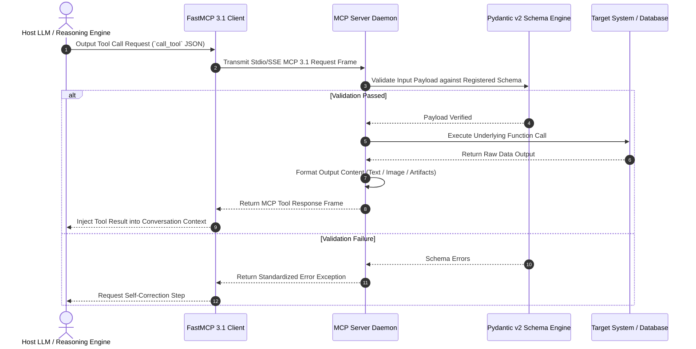

# Tool Calling & Model Context Protocol (MCP)

## What it is
**Tool calling** (also known as function calling) is a standardized pattern where Large Language Models (LLMs) generate structured data (typically JSON) to signal their intent to invoke external functions, rather than just generating text. This allows the model to act as a "reasoning engine" that can decide when and how to use external capabilities.

**Model Context Protocol (MCP 3.1)** is the early January 2027 universal standard that provides a unified, secure, and bidirectional way to connect LLMs (like [Claude 5.6](../../tools/providers/anthropic.md), [GPT-5.6](../../tools/ai_knowledge/openai.md), [Gemini 4.0 Ultra](../../tools/providers/google-ai-studio.md), [DeepSeek-V4](../../tools/providers/deepseek.md), Llama 4, Gemma 4, and Qwen 3.6) to external tools, resources, and data sources. It decouples the model from specific tool implementations, allowing a single MCP server to provide capabilities to any compatible host (IDE, agent framework, or chat interface). **FastMCP 3.1** introduces advanced async/sync decorators, built-in schema generation using Pydantic v2, streaming-based progress telemetry, and sandboxed execution runtimes, making it the bedrock of multi-agent knowledge engineering.

## What problem it solves
LLMs are traditionally "isolated" from the real world, limited by their training data and the text-based interface of their context window. Tool calling and MCP solve several critical limitations:
- **Dynamic Data Access**: Allows LLMs to query databases, search the web, or read local files to get up-to-date information.
- **Real-World Actions**: Enables LLMs to perform operations like sending emails, updating Jira tickets, or controlling a browser.
- **Ecosystem Portability**: MCP specifically solves the "N-to-M" problem where every agent framework needs its own integration for every tool. With MCP 3.1, you build a tool once and it works across all agentic platforms.
- **Agentic Recursion**: Through the "Sampling" capability, MCP allows tools to recursively call back into the model to solve sub-problems.

Furthermore, unstandardized tool integrations create severe security vulnerabilities, including direct command injection, token scope inflation, and lack of deterministic audit trails. MCP 3.1 mitigates these risks through mandatory capability handshakes, JSON schema validation, cryptographically signed audit spans, and sandboxed execution boundaries.

## System Architecture Topology

```
+-----------------------------------------------------------------------------------+
|                        MCP 3.1 Bidirectional Tool Architecture                    |
|                                                                                   |
|  +-----------------------------------------------------------------------------+  |
|  | Host Runtime / Agent Engine (Claude 5.6, GPT-5.6, Agno, CrewAI, FastMCP)      |  |
|  +-----------------------------------------------------------------------------+  |
|                                        ||                                         |
|                           Stdio / SSE / Unix Domain Socket                        |
|                                        ||                                         |
|  +-----------------------------------------------------------------------------+  |
|  | FastMCP 3.1 Tool Gateway & Pydantic v2 Schema Negotiator                      |  |
|  +-----------------------------------------------------------------------------+  |
|                                        ||                                         |
|                  +---------------------+---------------------+                    |
|                  |                                           |                    |
|                  v                                           v                    |
|  +-------------------------------+           +---------------------------------+  |
|  | Managed Auth Vault & Tokens   |           | Isolated Sandboxed Execution    |  |
|  | (OAuth2, Scopes, AES Key)   |           | (Docker / Subprocess / eBPF)    |  |
|  +-------------------------------+           +---------------------------------+  |
|                  |                                           |                    |
|                  +---------------------+---------------------+                    |
|                                        ||                                         |
|                                        \/                                         |
|  +-----------------------------------------------------------------------------+  |
|  | Physical Endpoints & APIs (PostgreSQL, GitHub, Slack, Local File System)      |  |
|  +-----------------------------------------------------------------------------+  |
+-----------------------------------------------------------------------------------+
```



## Where it fits in the stack
Within the AI Tooling Landscape, Tool Calling and MCP sit at **Layer 4 (Protocols & Standards)**. They serve as the critical interface between Layer 2/3 (Models and Inference) and Layer 5/6 (Frameworks and Agents), enabling standardized communication between the "brain" and its "hands."

## Typical use cases
- **Autonomous Development**: Searching codebases, running tests, and managing Git repositories via [Claude Code](../../tools/development_ops/claude-code-setup.md) or [Aider](../../tools/development_ops/aider.md).
- **Personal Agentic Planning**: Checking calendars, scheduling meetings, and managing tasks via [Google Calendar](../../tools/calendar_tasks/google-tasks.md) and [Vikunja](../../services/vikunja.md) MCP servers.
- **Enterprise Automation**: Connecting AI agents to legacy systems like [Jira](../../tools/automation_orchestration/atlassian-jira-mcp.md), [ServiceNow](../../tools/automation_orchestration/servicenow-mcp.md), or Slack.
- **Secure System Remediation**: Allowing agents to interact with host operating systems via [Desktop Commander](../../tools/development_ops/desktop-commander-mcp.md) to fix configuration drift.

### Architectural Trade-offs: Native vs. MCP-Hosted Tooling

| Dimension | Native Tool Calling (Vendor-Specific) | MCP-Hosted Tools (Decoupled) |
| :--- | :--- | :--- |
| **Context Overhead** | High (full tool definitions injected directly into each prompt payload). | Minimal (definitions fetched once during initial capability negotiation/handshake). |
| **Latency** | Low direct execution, but high payload serialization over the network. | Slight protocol handshake overhead, but extremely low execution overhead via secure TCP/Unix domain sockets. |
| **Reusability** | Low (vendor-specific schema mapping required for each target framework/API). | High (implement once, run across Cursor, Claude Code, LlamaIndex, LangChain, etc. natively). |
| **Security & Sandbox**| Low (host runs tool code in its own process/environment; high security exposure). | High (strict isolation via SSH tunnels, process boundaries, token auth, or containerized sandboxes). |
| **Telemetry & Tracing**| Proprietary vendor logs | Standardized OpenTelemetry Spans & FastMCP 3.1 Tracing |

## Strengths
- **Universal Interoperability**: MCP 3.1 allows one tool implementation to serve multiple LLMs (Claude 5.6, GPT-5.6, Gemini 4.0 Ultra, DeepSeek-V4, Llama 4, Gemma 4, Qwen 3.6).
- **Grounding & Trust**: Reduces hallucinations by forcing the model to rely on external, verifiable data sources.
- **Dynamic Discovery**: MCP servers describe their capabilities to the host at runtime, enabling plug-and-play agentic architectures.
- **Security Isolation**: Supports secure SSH tunneling, token-based authentication (OAuth2), and containerized execution for sensitive tool operations.
- **Dynamic Capability Negotiation**: Host-client handshakes dynamically determine client features (e.g., streaming support, sampling capability) during initial connection.

## Limitations
- **Latency Overheads**: Each tool call requires an extra round-trip to the model, which can impact real-time responsiveness.
- **Token Consumption**: Tool definitions and result data consume space in the context window, increasing cost.
- **Reasoning Failures**: Even frontier models can occasionally fail to generate valid JSON or choose the wrong tool for a complex task.
- **Permission Complexity**: Granting an LLM autonomous tool access requires sophisticated "Human-in-the-Loop" approval flows for sensitive actions.

## When to use it
- When the model needs access to private, proprietary, or rapidly changing information.
- When factual accuracy and citation of sources are mandatory requirements.
- When you need to scale knowledge access to millions of documents without fine-tuning costs.
- When building [Agentic Workflows](agentic-workflows.md) that require long-term memory.

## When not to use it
- For purely creative writing (fiction, poetry) where external facts are unnecessary.
- When the entire dataset fits within a frontier model's massive context window (e.g., Gemini 4.0's 10M tokens) and cost is not a primary constraint.
- When sub-100ms latency is required for a simple, non-factual interaction.
- When the LLM's base training data is already sufficient and up-to-date for the task.

## Getting started

### 1. Building an MCP 3.1 Server (Python)
The `FastMCP` SDK is the recommended way to build servers in early January 2027, offering native typing, structured arguments, and robust execution contexts.

```python
# pip install mcp psutil pydantic fastmcp
from fastmcp import FastMCP, Context
import psutil

# Create a server instance with metadata
mcp = FastMCP("SystemHealth", version="3.1")

@mcp.tool(name="get_cpu_usage", description="Get current host CPU usage percentage")
async def get_cpu_usage(ctx: Context) -> str:
    """Get the current CPU usage of the host system.

    Args:
        ctx: Context object for progress reporting and logging.
    """
    await ctx.info("Retrieving CPU usage percentage via psutil")
    usage = psutil.cpu_percent(interval=0.1)
    await ctx.report_progress(100, 100)
    return f"Current CPU usage: {usage}%"

if __name__ == "__main__":
    mcp.run()
```

### 2. Registering an MCP Server in Claude Desktop
Add the server configuration to your `claude_desktop_config.json`:

```json
{
  "mcpServers": {
    "health-check": {
      "command": "python3",
      "args": ["/path/to/server.py"]
    }
  }
}
```

## Systemd Service Unit Template

In production Linux environments, background MCP 3.1 servers are managed via systemd to guarantee resilience, logging, and automatic restarts:

```ini
[Unit]
Description=FastMCP 3.1 System Health Daemon
Documentation=https://modelcontextprotocol.io/
After=network.target

[Service]
Type=simple
User=mcp-daemon
Group=mcp-daemon
WorkingDirectory=/opt/mcp-servers
ExecStart=/opt/mcp-servers/venv/bin/python3 /opt/mcp-servers/health_mcp_server.py
Restart=always
RestartSec=3s

# Security Restrictions
ProtectSystem=strict
ProtectHome=true
PrivateTmp=true
NoNewPrivileges=true
ReadWritePaths=/var/log/mcp-servers
Environment=PYTHONUNBUFFERED=1
MemoryMax=1G
LimitNOFILE=65536

[Install]
WantedBy=multi-user.target
```

## CLI examples

### Inspecting an MCP Server
Using the `mcp-cli` to verify server capabilities:

```bash
# List all tools and resources provided by a local server
mcp-cli list --server-path ./my_server.py

# Manually trigger a tool call for testing
mcp-cli call get_cpu_usage --server-path ./my_server.py
```

### Managing Remote MCP Connections
```bash
# Connect to a remote MCP server via secure SSH tunnel
mcp-cli connect ssh://user@remote-host:port/server-name
```

## Systematic Diagnostic Troubleshooting Guide

| Issue Symptom | Probable Cause | Diagnostic Command | Remediation Step |
| :--- | :--- | :--- | :--- |
| **`Tool Call JSON Parsing Error`** | Malformed JSON output generated by model or unescaped characters | `mcp-cli inspect --raw` | Enforce rigid Pydantic v2 response schemas or enable FastMCP response auto-repair. |
| **`Stdio Pipe Broken / EOF`** | Server process crashed on startup due to missing python dependency | `journalctl -u mcp-health-daemon -n 50` | Verify Python environment packages (`pip install fastmcp pydantic`). |
| **`Capability Negotiation Timeout`** | Protocol mismatch between MCP 2.0 client and MCP 3.1 server | `mcp-cli status --protocol fastmcp3.1` | Upgrade client/host library to align with FastMCP 3.1 specifications. |
| **`OAuth Token Expired (401)`** | Expired access token in auth vault for protected tool endpoint | `mcp-cli auth status` | Refresh OAuth credentials or verify token encryption key in environment variables. |

## API examples

### Pydantic v2 Schema Validation for MCP Config (Python)
Validating client configurations programmatically using modern Pydantic v2 syntax before establishing transport sessions.

```python
from pydantic import BaseModel, Field, field_validator, ConfigDict, ValidationError
from typing import Dict, List, Optional
from fastmcp import FastMCP

mcp = FastMCP("mcp-config-validator", version="3.1")

class MCPServerConfig(BaseModel):
    model_config = ConfigDict(extra="forbid", str_strip_whitespace=True)

    command: str = Field(..., description="Executable path or command name", min_length=1)
    args: List[str] = Field(default_factory=list, description="CLI arguments list")
    env: Optional[Dict[str, str]] = Field(default=None, description="Environment variables dict")

    @field_validator("command")
    @classmethod
    def validate_command(cls, v: str) -> str:
        forbidden = [";", "&&", "||", "|"]
        if any(char in v for char in forbidden):
            raise ValueError("Command contains forbidden shell metacharacters")
        return v

# FastMCP Tool for Config Verification
@mcp.tool(name="validate_mcp_config", description="Validate MCP client configuration file schema")
def validate_mcp_config(config_dict: Dict[str, str]) -> Dict[str, str]:
    try:
        config = MCPServerConfig.model_validate(config_dict)
        return {"status": "VALID", "command": config.command}
    except ValidationError as e:
        return {"status": "INVALID", "error": str(e)}

if __name__ == "__main__":
    try:
        sample_config = {
            "command": "python3",
            "args": ["/opt/mcp/server.py"],
            "env": {"PYTHONUNBUFFERED": "1"}
        }
        res = validate_mcp_config(sample_config)
        print("Validation Result:", res)
    except Exception as e:
        print("Validation failed:", e)
```

### Sampling with MCP 3.1
The Sampling capability allows an MCP server to ask the client (host) to run an LLM completion.

```python
# In an MCP server tool definition
async def complex_task(query: str, ctx: Context):
    # Ask the client to use its LLM to summarize intermediate results
    summary = await ctx.sample(
        prompt=f"Summarize these technical logs: {query}",
        max_tokens=100
    )
    return f"Analysis complete: {summary}"
```

### Parallel Tool Calling (OpenAI SDK)
Frontier models can generate multiple calls in one turn.

```python
from openai import OpenAI
client = OpenAI()

response = client.chat.completions.create(
    model="gpt-5.6",
    messages=[{"role": "user", "content": "Check the weather in London, NYC, and Tokyo."}],
    tools=weather_tools # Defined with list of 3 calls
)

# Process all 3 tool calls in parallel
for tool_call in response.choices[0].message.tool_calls:
    execute_tool(tool_call)
```

### Programmatic Host Integration (Python Client API)
A host framework client registers a server connection, negotiates capabilities, lists available tools, and invokes a tool call.

```python
import asyncio
from mcp.client.session import ClientSession
from mcp.client.stdio import stdio_client

async def run_client():
    # Define local server connection parameters
    server_params = {
        "command": "python3",
        "args": ["/path/to/server.py"]
    }

    print("Initiating stdio channel with MCP server...")
    async with stdio_client(server_params) as (read_stream, write_stream):
        async with ClientSession(read_stream, write_stream) as session:
            # 1. Establish session and negotiate capabilities
            await session.initialize()
            print("Session initialized successfully.")

            # 2. Query available server-side tools
            tools_response = await session.list_tools()
            print("Discovered tools:")
            for tool in tools_response.tools:
                print(f"  - [{tool.name}]: {tool.description}")

            # 3. Securely invoke tool execution with exception boundaries
            try:
                print("\nExecuting get_cpu_usage...")
                result = await session.call_tool("get_cpu_usage", arguments={})
                if getattr(result, "is_error", False):
                    print(f"Execution Error: {result.content}")
                else:
                    for content_item in result.content:
                        if content_item.type == "text":
                            print(f"Tool Output: {content_item.text}")
            except Exception as err:
                print(f"Failed to execute target tool: {err}")

if __name__ == "__main__":
    asyncio.run(run_client())
```

## Related tools / concepts
- [Agent Protocols](../agent_protocols.md) — The broader context for MCP and ACP.
- [Agno](../../tools/agents/agno.md) — Agentic framework with native MCP 3.1 support.
- [Bee Agent Framework](../../tools/agents/bee-agent-framework.md) — IBM's framework for observability-by-design tool use.
- [Pulse MCP](../../tools/automation_orchestration/pulse-mcp.md) — Heartbeat and health monitoring tool for FastMCP 3.1 servers.
- [Desktop Commander MCP](../../tools/development_ops/desktop-commander-mcp.md) — Standard server for local OS interaction.
- [Symbolic MCP](../../tools/development_ops/symbolic-mcp.md) — Formal verification via tool calling.
- [Vikunja MCP](../../tools/automation_orchestration/vikunja-mcp.md) — Task management via MCP.
- [Chronos MCP](../../tools/automation_orchestration/chronos-mcp.md) — Advanced scheduling tool.
- [Jupyter Kernel MCP](../../tools/development_ops/jupyter-kernel-mcp.md) — Code execution environment.
- [LlamaIndex](../../tools/ai_knowledge/llamaindex.md) — RAG framework with native MCP 3.1 Task Protocol support.

## Sources / references
- [Model Context Protocol (MCP) Official Specification](https://modelcontextprotocol.io/)
- [Anthropic: Introducing MCP 3.1 (October 2026)](https://www.anthropic.com/news/model-context-protocol-3-1)
- [MCP Registry: A Global Catalog of MCP Servers](https://mcp-registry.org/)

## Contribution Metadata
- Last reviewed: 2027-01-07
- Confidence: high
