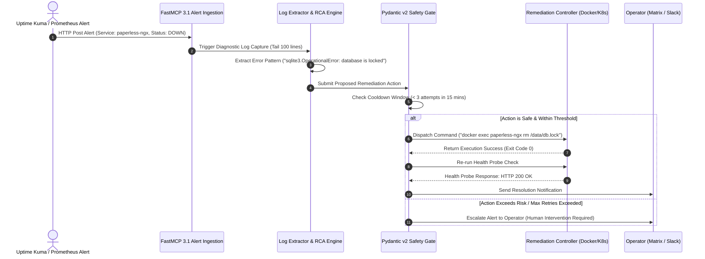

# Self-Healing Homelab Agent Research

## What it is
A specialized monitoring, diagnostic, and autonomous remediation agent (implemented via custom Python services, n8n workflows, or managed agent platforms) designed to detect infrastructure failures, service crashes, and configuration drifts in homelabs and enterprise edge environments. By synthesizing real-time observability telemetry (Prometheus metrics, Uptime Kuma health probes, Docker event streams, and journald logs) with local or cloud reasoning LLMs, self-healing agents perform automated root-cause analysis (RCA) and execute non-destructive recovery actions.

As of early 2027, self-healing agents rely on **FastMCP 3.1 Task Protocol** for secure infrastructure manipulation and local models like **Gemma 3** or **Llama 4** for low-latency, privacy-preserving edge reasoning.

## Observability & Self-Healing Loop Topology

```
+-----------------------------------------------------------------------------------+
|                        SELF-HEALING AGENT REMEDIATION FLOW                         |
+-----------------------------------------------------------------------------------+
                                          |
  +----------------------+      +-----------------------+      +--------------------+
  |  UPTIME KUMA / PROME | ---> | FASTMCP 3.1 WEBHOOK   | ---> | LOG EXTRACTION     |
  |  HEALTH CHECK ALERT  |      | INGESTION ENGINE      |      | (Docker / K8s API) |
  +----------------------+      +-----------------------+      +--------------------+
                                                                          |
                                                                          v
  +----------------------+      +-----------------------+      +--------------------+
  | LOCAL REASONING MODEL| <--- | ROOT CAUSE ANALYSIS   | <--- | LOG PATTERN        |
  | (Gemma 3 / Claude)   |      | ENGINE                |      | CLASSIFICATION     |
  +----------------------+      +-----------------------+      +--------------------+
             |
             v
  +---------------------------------------------------------------------------------+
  |                       PYDANTIC V2 ACTION VALIDATION GATE                        |
  |   - Verify Cooldown Matrix      - Check Safety Boundary     - Assess Risk       |
  +---------------------------------------------------------------------------------+
             |
    +--------+--------+
    |                 |
    v                 v
[SAFE ACTION]    [HIGH RISK]
    |                 |
    v                 v
+---------+      +------------------------------------------------------------------+
| DOCKER/ |      | ESCALATE TO HUMAN OPERATOR VIA MATRIX / NOTIFICATION             |
| KUBECTL |      +------------------------------------------------------------------+
+---------+
```

### Detailed Diagnostic & Remediation Sequence



## What problem it solves
- **Manual Monitoring Overhead**: Eliminates the need for system operators to manually inspect server logs, restart containers, or monitor dashboard graphs during off-hours.
- **Extended Downtime & High MTTR**: Dramatically shortens the "Mean Time To Recovery" (MTTR) by analyzing failures and applying fixes within seconds of detection.
- **Alert Fatigue**: Filters operational noise by attempting automated recovery (e.g. clearing lock files, restarting hung workers) before bothering human operators with notifications.
- **Context-Aware Root Cause Analysis**: Utilizes LLMs to reason across multi-container log streams, distinguishing between transient database locks and unrecoverable disk corruption.

## Where it fits in the stack
**Category**: [Knowledge Base](../knowledge_base/index.md) / Observability & Automation Pattern. Operating at the **Observability / Infrastructure Control Layer**, self-healing agents sit alongside core homelab services (Paperless-ngx, Home Assistant, Vikunja) and infrastructure nodes (K3s, Docker, TrueNAS), bridging detection tools with automated remediation scripts via **FastMCP 3.1** and REST webhooks.

## Key Technical Specifications & Architectural Standards

| Dimension | Standard / Specification | Production Requirement |
| :--- | :--- | :--- |
| **Alert Transport** | FastMCP 3.1 / Webhook Endpoint | Signed JSON payload with timestamp verification |
| **Data Validation** | Pydantic v2 Models | Strict constraint validation on retry limits and command strings |
| **Reasoning Engine** | Local Gemma 3 / Llama 4 / Claude 3.5 | Sub-3 second inference latency for log evaluation |
| **Security Containment** | Restricted Sudo / Kubernetes ServiceAccount | Scoped RBAC permissions preventing root host manipulation |

## Typical use cases
- **Hung Web Services & Stale Containers**: Detecting when a container's main process is active but HTTP health endpoints are unresponsive, triggering a graceful container restart.
- **Database Lock Remediation**: Automatically identifying SQLite database file locks or PostgreSQL connection queue exhaustion and executing non-destructive lock file purges.
- **Automated Configuration Rollbacks**: Detecting container crash loops immediately after a GitOps update and executing a `git revert` to restore the last working deployment state.
- **Proactive Disk & Cache Cleanup**: Monitoring host storage utilization thresholds and automatically clearing dangling Docker image caches or temporary log files when storage exceeds 90%.

## Failure Mode & Remediation Strategy Matrix

| Failure Pattern | Detection Signal | Automated Action | Safety Boundary | Human Escalation Trigger |
| :--- | :--- | :--- | :--- | :--- |
| **SQLite Lock Contention** | `database is locked` in logs | Purge stale lock / Graceful restart | Max 2 retries in 10m | Persistent lock > 15 mins |
| **Out of Memory (OOM)** | Exit code 137 / Kernel OOM log | Temporary pod/container restart | Alert operator on 1st occurrence | Memory usage exceeds node alloc |
| **Upstream Network Blip** | HTTP 502 Bad Gateway | Exponential backoff retry | Non-destructive polling only | Downstream service down > 5m |
| **Config Syntax Error** | Container crashloop | GitOps rollback to previous commit | Revert 1 commit max | Rollback fails to clear error |
| **Disk Space Exhaustion** | Storage utilization > 95% | Purge Docker image cache / tmp files | Do not touch persistent data | Free space remains < 5% |

## Strengths
- **Low Latency Recovery**: Sub-second to multi-second response times when backed by edge-hosted LLMs like Gemma 3.
- **Intelligent Reasoning**: LLM reasoning avoids naive restart loops by verifying prerequisites and identifying root causes in unstructured logs.
- **Comprehensive Audit Trail**: Every diagnostic step, Pydantic validation check, and command execution is logged with structured telemetry.
- **Reduced Human Fatigue**: Converts repetitive maintenance tasks into silent, self-correcting system events.

## Limitations
- **Risk of Infinite Loops**: A service failing due to broken configuration will continue restarting unless capped by strict exponential backoffs and cooldown gates.
- **State Corruption Risks**: Naive remediation against stateful databases or file systems during active write operations risks data corruption.
- **Privilege Escalation Vector**: Agents holding elevated Docker socket or `kubectl` permissions require strict sandboxing to prevent compromised containers from manipulating host infrastructure.

## When to use it
- For **non-critical stateful or stateless services** where container restarts, lock file cleanups, or cache purges resolve common failures.
- When operating **distributed homelabs or edge deployments** where the administrator is not continuously available.
- When health check probes and structured logs clearly indicate service state.

## When not to use it
- **Critical Stateful Systems**: Avoid fully automated remediation on production primary databases or file systems where restarts during corruption can destroy data.
- **Core Networking Layer**: Do not run self-healing on primary routers, BGP daemons, or Tailscale control planes without out-of-band management channels.

## System Configuration & Operational Parameters

| Environment Variable | Default Value | Description |
| :--- | :--- | :--- |
| `HEALING_AGENT_PORT` | `8092` | Network listener port for the self-healing alert ingestion server. |
| `HEALING_MAX_RETRIES` | `3` | Maximum automated retry attempts allowed within the cooldown window. |
| `HEALING_COOLDOWN_MIN` | `15` | Time window (in minutes) for calculating retry attempt frequency. |
| `HEALING_REASONING_MODEL` | `gemma3:8b` | Ollama / local LLM model name used for unstructured log analysis. |
| `HEALING_LOG_DIR` | `/var/log/self-healing` | File system location for audit telemetry logs. |

## Getting started

### 1. Monitoring Setup
Configure **Uptime Kuma** or **Prometheus Alertmanager** to send HTTP POST webhooks to your agent when a service enters a non-healthy state.

### 2. Remediation Engine Deployment
Deploy the FastMCP 3.1 self-healing router alongside an edge reasoning model (e.g. Gemma 3 running on Ollama).

## CLI examples

### 1. Manual Diagnostic Probe & Log Inspection
```bash
# Check container health and last 100 log lines for AI parsing
docker logs --tail 100 paperless-ngx

# Execute health probe check against local HTTP endpoint
curl -fsSL --max-time 5 http://localhost:8000/healthz || echo "SERVICE_DOWN"
```

### 2. Manual Container Remediation & Rollback
```bash
# Force a rollout restart of a Kubernetes deployment
kubectl rollout restart deployment/paperless-ngx -n apps

# Revert a bad configuration commit in a local GitOps repository
git revert HEAD --no-edit && git push origin main
```

## API examples

### 1. FastMCP 3.1 Self-Healing Remediation Server
The following complete FastMCP 3.1 server ingests alerts, inspects logs, and returns Pydantic v2 validated remediation plans:

```python
import re
from typing import Optional, List, Dict, Any
from pydantic import BaseModel, Field, field_validator
from mcp.server.fastmcp import FastMCP
import logging

logging.basicConfig(level=logging.INFO)
logger = logging.getLogger("SelfHealingServer")

mcp = FastMCP("SelfHealingAgent")

class LogPatternRequest(BaseModel):
    service_name: str = Field(..., description="Name of failing service (e.g. 'paperless-ngx', 'vikunja')")
    log_dump: str = Field(..., description="Recent log dump (max 100 lines) of the failing service")
    exit_code: int = Field(default=0, description="Process exit code, if applicable")
    retry_count: int = Field(default=0, description="Number of previous automated retry attempts within cooldown")

    @field_validator("retry_count")
    def check_max_retries(cls, v: int) -> int:
        if v > 5:
            raise ValueError("Retry count exceeded maximum safety threshold (max 5). Human intervention mandatory.")
        return v

class RemediationAction(BaseModel):
    action_type: str = Field(..., description="Action strategy: 'restart', 'rollback', 'clear_cache', or 'escalate'")
    command: str = Field(..., description="Exact shell command or script to execute")
    confidence: float = Field(..., ge=0.0, le=1.0, description="Confidence score from 0.0 to 1.0")

class DiagnosticReport(BaseModel):
    service_name: str
    root_cause: str = Field(..., description="Inferred root cause of failure")
    recommended_action: RemediationAction = Field(..., description="Validated remediation action")
    requires_human: bool = Field(default=False, description="Whether human escalation is required")

@mcp.tool(description="Analyzes container failure logs and generates safe remediation actions.")
def analyze_logs_and_remediate(request: LogPatternRequest) -> str:
    """Analyzes failure logs and outputs Pydantic v2 validated remediation instructions."""
    logger.info(f"Processing alert for service: {request.service_name} (retry #{request.retry_count})")
    log_lower = request.log_dump.lower()

    if request.retry_count >= 3:
        report = DiagnosticReport(
            service_name=request.service_name,
            root_cause="Automated retry threshold reached without service recovery.",
            recommended_action=RemediationAction(
                action_type="escalate",
                command=f"notify-operator --service {request.service_name} --msg 'Max retries exceeded'",
                confidence=1.0
            ),
            requires_human=True
        )
        return report.model_dump_json(indent=2)

    # Log pattern classification rules
    if "database lock" in log_lower or "sqlite3.operationalerror: database is locked" in log_lower:
        root_cause = "Database file is locked due to concurrent write contention."
        action_type = "clear_cache"
        command = f"docker exec -it {request.service_name} rm -f /data/db.lock || true"
        confidence = 0.90
        requires_human = False
    elif "connection refused" in log_lower or "database system is starting up" in log_lower:
        root_cause = "Upstream database dependency is starting up or temporarily unreachable."
        action_type = "restart"
        command = f"docker restart {request.service_name}"
        confidence = 0.85
        requires_human = False
    elif "out of memory" in log_lower or "oomkilled" in log_lower:
        root_cause = "Service process terminated by system OOM-killer."
        action_type = "escalate"
        command = f"notify-operator --service {request.service_name} --msg 'OOM Killed'"
        confidence = 0.95
        requires_human = True
    else:
        root_cause = "Unclassified runtime exception in service log."
        action_type = "restart"
        command = f"docker restart {request.service_name}"
        confidence = 0.60
        requires_human = False

    report = DiagnosticReport(
        service_name=request.service_name,
        root_cause=root_cause,
        recommended_action=RemediationAction(
            action_type=action_type,
            command=command,
            confidence=confidence
        ),
        requires_human=requires_human
    )
    return report.model_dump_json(indent=2)

if __name__ == "__main__":
    mcp.run()
```

### 2. Pydantic v2 Alert Payload & Safety Boundary Validator
```python
from pydantic import BaseModel, Field, HttpUrl, field_validator
from typing import Optional, List
from datetime import datetime

class AlertPayload(BaseModel):
    alert_id: str = Field(..., description="Unique alert identifier")
    service_name: str = Field(..., description="Target service name")
    status: str = Field(..., description="Alert status (DOWN, DEGRADED, UNHEALTHY)")
    timestamp: datetime = Field(default_factory=datetime.utcnow)
    health_check_url: HttpUrl = Field(..., description="Service health endpoint")
    consecutive_failures: int = Field(default=1, ge=1)

    @field_validator("status")
    def validate_alert_status(cls, v: str) -> str:
        valid_statuses = {"DOWN", "DEGRADED", "UNHEALTHY"}
        if v.upper() not in valid_statuses:
            raise ValueError(f"Invalid status '{v}'. Expected one of {valid_statuses}")
        return v.upper()

if __name__ == "__main__":
    sample_alert = {
        "alert_id": "alt-8801",
        "service_name": "paperless-ngx",
        "status": "DOWN",
        "health_check_url": "http://paperless.local:8000/healthz",
        "consecutive_failures": 2
    }
    validated = AlertPayload.model_validate(sample_alert)
    print(f"Validated Alert: {validated.service_name} -> {validated.status}")
```

## Production Systemd Service Unit Configuration

To deploy the self-healing agent as a persistent background daemon in Linux environments, create the systemd unit file at `/etc/systemd/system/self-healing-agent.service`:

```ini
[Unit]
Description=FastMCP 3.1 Self-Healing Homelab Remediation Service
After=network.target docker.service
Wants=docker.service

[Service]
Type=simple
User=root
WorkingDirectory=/opt/self-healing-agent
Environment="PATH=/opt/self-healing-agent/venv/bin:/usr/local/bin:/usr/bin"
Environment="HEALING_AGENT_PORT=8092"
Environment="HEALING_MAX_RETRIES=3"
Environment="HEALING_COOLDOWN_MIN=15"
ExecStart=/opt/self-healing-agent/venv/bin/python3 -m self_healing.server
Restart=always
RestartSec=5
LimitNOFILE=65536

# System Protection
ProtectSystem=full
ProtectHome=true
PrivateTmp=true

[Install]
WantedBy=multi-user.target
```

Enable and start the service using systemctl commands:
```bash
sudo systemctl daemon-reload
sudo systemctl enable --now self-healing-agent.service
sudo systemctl status self-healing-agent.service
```

## Diagnostic Troubleshooting Matrix

| Symptom / Issue | Primary Cause | Diagnostic Command | Remediation Strategy |
| :--- | :--- | :--- | :--- |
| **Agent Infinite Restart Loop** | Target service fails continuously and agent retry count resets incorrectly. | `journalctl -u self-healing-agent.service -n 50` | Enforce persistent cooldown state tracking in Redis/JSON. Reduce `HEALING_MAX_RETRIES` to 2. |
| **Docker Socket Permission Denied** | Agent daemon user lacks permissions to read Docker daemon socket. | `ls -la /var/run/docker.sock` | Add service user to docker group via `usermod -aG docker self-healing` or run service under root. |
| **Inference Timeout on Log RCA** | Local Ollama / Gemma 3 model experiencing CPU/GPU bottleneck. | `curl http://localhost:11434/api/generate -d '{"model": "gemma3:8b"}'` | Pin model to GPU VRAM or switch log analysis to lightweight regex rules for fast-path errors. |
| **False-Positive Remediation** | Short transient network blips triggering container restarts unnecessarily. | `tail -f /var/log/self-healing/audit.log` | Increase health check failure threshold in Uptime Kuma to require 3 consecutive failed probes. |

## Related tools / concepts
- [n8n Error Handling](patterns/n8n-error-handling.md) — Specific patterns for building resilient workflows.
- [Agentic Workflows](patterns/agentic-workflows.md) — Broader context for autonomous agent logic.
- [Invisible Kubernetes](invisible_kubernetes.md) — The infrastructure layer these agents often manage.
- [Home Admin Agent Architecture](home-admin-agent-architecture.md) — Integration with the primary family assistant.
- [Gitea](../services/gitea.md) — For config rollback patterns.
- [n8n](../services/n8n.md) — Automation platform for recovery workflows.
- [Home Assistant](../services/home-assistant.md) — For service monitoring and triggers.
- [Gemma 3](../tools/ai_knowledge/local_llms.md) — Preferred local reasoning engine for edge remediation.
- [MCP (Model Context Protocol)](../tools/automation_orchestration/mcp.md) — The protocol enabling secure tool access for agents.

## Sources / references
- [Kubernetes Self-Healing Patterns (CNCF)](https://www.cncf.io/blog/2026/02/10/self-healing-kubernetes-agentic-patterns/)
- [Gemma 3 for Ops (Google AI Blog)](https://ai.google.dev/gemma)
- [n8n AI Node Documentation](https://docs.n8n.io/integrations/builtin/app-nodes/n8n-nodes-base.ai-agent/)
- [Model Context Protocol (MCP) 3.1 Specification](https://modelcontextprotocol.info)

---
## Contribution Metadata
- Last reviewed: 2027-01-07
- Confidence: high
