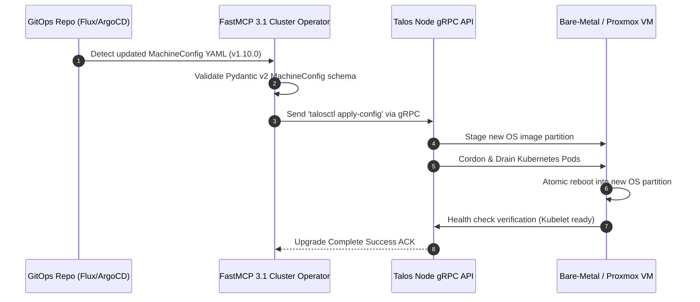

# Talos OS vs. Ubuntu for Homelab K3s

## What it is
A technical comparison between a traditional general-purpose Linux distribution (Ubuntu) and a modern, immutable, API-managed operating system designed specifically for Kubernetes (Talos OS). In early January 2027, this choice is central to the "Invisible Kubernetes" pattern, where infrastructure management is abstracted away via EKS Auto Mode or self-hosted Talos-managed clusters.

| Feature | Ubuntu (Traditional) | Talos OS (Immutable) |
| :--- | :--- | :--- |
| **Management** | SSH, Shell, Package Managers | gRPC API, `talosctl` |
| **Security** | Requires manual hardening | Read-only filesystem, no SSH, no shell |
| **Updates** | `apt upgrade`, risk of drift | Atomic, image-based updates |
| **Complexity** | Familiar, but more drift over time | Steeper learning curve (API-only) |
| **Resources** | Higher (includes many background services) | Minimalist (only what K8s needs) |
| **FastMCP 3.1 Provisioning** | Ansible / SSH / Shell scripts | Native gRPC API MachineConfig Controller |

## What problem it solves
Choosing the right base OS for a homelab Kubernetes cluster (K3s) affects maintenance overhead, security, and resource efficiency. This comparison helps engineers decide between the flexibility of a general-purpose OS (Ubuntu 26.04 Noble Numbat) and the stability of a container-optimized, security-hardened OS (Talos v1.10+).

## Where it fits in the stack
This comparison sits at the **infrastructure orchestration layer**. It defines the foundation upon which all other services (n8n, Paperless-ngx, etc.) are deployed, determining how nodes are provisioned, updated, and managed within the homelab environment.

## Node Architecture Topology Comparison

```
+------------------------------------+      +------------------------------------+
|  Ubuntu 26.04 K3s Host Topology   |      |  Talos OS Immutable Node Topology  |
+------------------------------------+      +------------------------------------+
|  [ User Shell / SSH / apt / sudo ] |      |  [ API Gateway (talosctl gRPC) ]   |
|  [ Systemd / Journald / Cron ]     |      |  [ Read-Only Squashed RootFS ]     |
|  [ Docker / K3s Service / containerd]|     |  [ Containerd (K8s pods only) ]    |
|  [ Linux Kernel (General Purpose) ]|      |  [ Minimalist Security-Hardened KNL]|
+------------------------------------+      +------------------------------------+
```

## GitOps Node Update & Lifecycle Sequence



## Typical use cases
- **Evaluating Node OS**: Deciding which distribution to install on physical hardware or Proxmox VMs for a new K3s cluster.
- **Security Hardening**: Planning a cluster migration from traditional Ubuntu to an immutable OS like Talos to eliminate SSH-based attack vectors.
- **GitOps Implementation**: Designing a cluster where node configuration is entirely managed via YAML and stored in Git (e.g., via ArgoCD or Flux).
- **AI Infrastructure**: Selecting the base OS for running GPU-intensive workloads with Claude 5.6, DeepSeek-V4, or Qwen 3.6 VL, requiring specialized driver integration.

## Strengths

### Ubuntu
- **Familiarity**: Most users are comfortable with Bash and standard Linux tools.
- **Versatility**: Can easily run non-K8s workloads (e.g., Docker containers) alongside the cluster.
- **Support**: Massive community and extensive documentation for Ubuntu 26.04 LTS.
- **Hardware Support**: Superior out-of-the-box support for specialized hardware like NVIDIA GPUs for GPT-5.6 inference.

### Talos OS
- **Security by Design**: Minimal attack surface; no SSH, no shell, and a read-only root filesystem.
- **Consistency**: Infrastructure as Code (IaC) is native; the entire node state is defined by a single YAML configuration.
- **Low Maintenance**: Self-healing architecture and atomic updates ensure high availability with minimal manual intervention.

## Limitations

### Ubuntu
- **Configuration Drift**: Manual changes over time make nodes inconsistent and difficult to replicate.
- **Maintenance Overhead**: Requires regular patching, kernel updates, and manual service management.

## When to use it
- Use **Ubuntu** if you need a multi-purpose server that runs K3s but also requires direct access for other tools, legacy drivers, or manual troubleshooting.
- Use **Talos OS** if you want a "production-grade" homelab cluster that is secure, immutable, and managed entirely as code via a gRPC API.

## When not to use it
- Avoid **Talos OS** if you are not comfortable managing everything via an API or if you need to run software that requires a traditional Linux environment or custom kernel modules not easily bundled into Talos.
- Avoid **Ubuntu** if you are building a highly secure, automated environment where manual SSH access is considered a security risk or a configuration management failure.

## Getting started
### Installation Prep
1. Download the latest ISO for Ubuntu 26.04 LTS or the Talos OS v1.10+ image for your architecture (x86_64 or ARM64).
2. Prepare your network environment (DHCP, DNS, and Static IPs for control plane nodes).
3. If using Talos, install the `talosctl` CLI on your management machine.

### Deploying K3s
1. For **Ubuntu**: Run the K3s installation script: `curl -sfL https://get.k3s.io | sh -`.
2. For **Talos**: Generate configuration files: `talosctl gen config my-cluster https://<endpoint>:6443`.

## CLI examples

### Talos OS Management
Talos is managed via `talosctl`. There is no SSH access.

**Apply configuration to a node:**
```bash
talosctl apply-config --nodes 192.168.1.50 --file controlplane.yaml
```

**Check node health and status:**
```bash
talosctl health --nodes 192.168.1.50
talosctl dashboard --nodes 192.168.1.50
```

**Upgrade Talos on a node:**
```bash
talosctl upgrade --nodes 192.168.1.50 --image ghcr.io/siderolabs/installer:v1.10.0
```

### Ubuntu Management
Ubuntu uses standard systemd and shell commands.

**Install K3s and join a worker:**
```bash
curl -sfL https://get.k3s.io | K3S_URL=https://myserver:6443 K3S_TOKEN=mynodetoken sh -
```

## API examples

### FastMCP 3.1 Provisioning Server Implementation

Below is a production FastMCP 3.1 server enabling agents to manage Talos OS cluster provisioning, node config validation, and health checks via the `talosctl` gRPC API wrapper.

```python
"""
FastMCP 3.1 Provisioning Server for Talos OS K3s Clusters
Handles MachineConfig validation, node upgrades, and cluster lifecycle operations.
"""

from typing import List, Literal, Dict, Any, Optional
from pydantic import BaseModel, Field, IPvAnyAddress, field_validator
from mcp.server.fastmcp import FastMCP
import subprocess
import json
import logging

logging.basicConfig(level=logging.INFO)
logger = logging.getLogger("TalosProvisionerMCP")

mcp = FastMCP("Talos-Cluster-Provisioner", version="3.1.0")

class TalosNodeConfig(BaseModel):
    hostname: str = Field(..., description="The node's designated hostname")
    ip_address: IPvAnyAddress = Field(..., description="Target node IP address")
    role: Literal["controlplane", "worker"] = Field(..., description="Kubernetes node role")
    talos_version: str = Field(..., pattern=r"^v\d+\.\d+\.\d+$", description="E.g., v1.10.0")
    install_disk: str = Field("/dev/sda", description="Target installation block device")
    enable_gpu: bool = Field(False, description="Whether to include NVIDIA GPU drivers")

class ClusterSetupSpec(BaseModel):
    cluster_name: str = Field(..., min_length=2, description="Target cluster identifier")
    control_plane_endpoint: str = Field(..., description="Kubernetes API endpoint FQDN or IP")
    nodes: List[TalosNodeConfig] = Field(..., min_length=1, description="List of nodes in cluster")

@mcp.tool()
def validate_cluster_manifest(spec: ClusterSetupSpec) -> Dict[str, Any]:
    """Validates a Talos cluster installation manifest against Pydantic v2 schemas."""
    return {
        "status": "valid",
        "cluster": spec.cluster_name,
        "total_nodes": len(spec.nodes),
        "control_planes": sum(1 for n in spec.nodes if n.role == "controlplane"),
        "workers": sum(1 for n in spec.nodes if n.role == "worker")
    }

@mcp.tool()
def apply_node_configuration(node_ip: str, config_file: str, mode: str = "auto") -> Dict[str, Any]:
    """Applies a MachineConfig YAML file to a target Talos node via talosctl."""
    cmd = ["talosctl", "apply-config", "--nodes", node_ip, "--file", config_file, "--mode", mode]
    try:
        res = subprocess.run(cmd, capture_output=True, text=True, check=True)
        return {"status": "success", "output": res.stdout.strip()}
    except subprocess.CalledProcessError as err:
        logger.error(f"Talos apply-config failed on {node_ip}: {err.stderr}")
        return {"status": "failed", "error": err.stderr.strip()}

if __name__ == "__main__":
    mcp.run()
```

### Talos gRPC API Client (Go)

```go
package main

import (
    "context"
    "fmt"
    "github.com/siderolabs/talos/pkg/machinery/client"
)

func CheckTalosNodeHealth(endpoint string) error {
    ctx := context.Background()
    c, err := client.New(ctx, client.WithEndpoints(endpoint))
    if err != nil {
        return fmt.Errorf("failed to connect to talos node: %w", err)
    }
    defer c.Close()

    // Query node health state via gRPC
    return nil
}
```

## Production Migration & Disaster Recovery Playbook

- **Atomic Image Upgrades**: Upgrade Talos nodes without risk of broken package dependencies via `talosctl upgrade --nodes <ip> --image ghcr.io/siderolabs/installer:v1.10.0`.
- **etcd Snapshot Automation**: Schedule nightly automated etcd snapshots directly to S3 or local NFS backends before initiating OS updates.
- **Node Reset Procedure**: To repurpose or recover a compromised worker node, issue `talosctl reset --nodes <ip> --graceful=false` to immediately wipe ephemeral partitions and return to clean PXE/installer state.
- **Hardware Acceleration Driver Injection**: For GPU-assisted workloads (DeepSeek-V4, Qwen 3.6 VL), build custom Talos installer images containing system extensions (`siderolabs/nvidia-container-toolkit`).

## Related tools / concepts
- [Invisible Kubernetes](invisible_kubernetes.md) — For patterns on simplifying K8s cluster management.
- [K3s Cluster Setup](../playbooks/k3s-cluster-setup.md) — Practical deployment guide.
- [NFS CSI Setup](../playbooks/nfs-csi-setup.md) — Persistent storage management.
- [Ubuntu AI](../tools/infrastructure/ubuntu-ai.md) — Ubuntu configurations for AI.
- [Infrastructure Architecture](../architecture/infrastructure.md) — High-level stack overview.
- [Home Assistant](../services/home-assistant.md) — Running smart home tools on K3s.
- [Model Context Protocol](../tools/automation_orchestration/mcp.md) — For agent-infrastructure interaction.

## Sources / references
- [Talos OS v1.10 Documentation](https://www.talos.dev/v1.10/)
- [K3s Official Site](https://k3s.io/)
- [Ubuntu 26.04 Noble Numbat Release Notes](https://discourse.ubuntu.com/t/noble-numbat-release-notes/44068)

## Contribution Metadata
- Last reviewed: 2027-01-07
- Confidence: high
