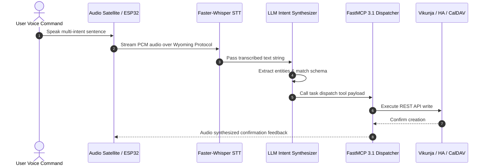

# Voice-to-Task Research

Technical research into local speech-to-text (STT) and agentic synthesis for hands-free task orchestration in the home-office stack as of early January 2027.

## What it is
A "voice-to-action" pipeline that captures spoken commands, transcribes them using high-performance local models (Faster-Whisper v1.3.x), and utilizes frontier models (Claude 5.1/5.6, GPT-5.5/5.6, Gemini 4.0 Pro/Ultra, DeepSeek-V4) or high-performance local models like [Gemma 3](../tools/ai_knowledge/local_llms.md) and [Llama 4](../tools/ai_knowledge/local_llms.md) for intent decomposition. It bridges the gap between raw audio and structured task management, enabling autonomous agents to execute complex requests from a single voice prompt using the MCP 3.1 Task Protocol.

```
+-----------------------------------------------------------------------------------+
|                     Voice-to-Task Local Orchestration Architecture                |
+-----------------------------------------------------------------------------------+
|  [ Far-Field Microphone / Satellite (ESPHome / Wyoming) ]                          |
|               |                                                                   |
|               v                                                                   |
|  +-----------------------------------------------------------------------------+  |
|  | Wyoming Protocol Transport Engine (Streaming Audio Buffering & VAD)          |  |
|  +-----------------------------------------------------------------------------+  |
|               |                                                                   |
|               v                                                                   |
|  +-----------------------------------------------------------------------------+  |
|  | Local Faster-Whisper v1.3.x STT Engine (CTranslate2 GPU INT8 Execution)     |  |
|  +-----------------------------------------------------------------------------+  |
|               |                                                                   |
|               v (Raw Transcript)                                                  |
|  +-----------------------------------------------------------------------------+  |
|  | Agentic Intent Parser & Entity Extractor (Gemma 3 / Llama 4 / DeepSeek-V4)    |  |
|  +-----------------------------------------------------------------------------+  |
|               |                                                                   |
|               v (Structured Intent Spec - Pydantic v2 Validated)                  |
|  +-----------------------------------------------------------------------------+  |
|  | FastMCP 3.1 Task Dispatcher & Service Router                                |  |
|  +-----------------------------------------------------------------------------+  |
|         /                                |                                 \      |
|        v                                 v                                  v     |
|  +------------------+          +-------------------+              +---------------------+ |
|  | Vikunja Engine   |          | Home Assistant    |              | CalDAV / Google Cal | |
|  | (Task Management)|          | (Home Automation) |              | (Calendar Event)    | |
|  +------------------+          +-------------------+              +---------------------+ |
+-----------------------------------------------------------------------------------+
```

## What problem it solves
It eliminates the friction of manual data entry in "dirty-hands" environments (kitchen, workshop, lab) and reduces the cognitive load of capturing fleeting thoughts. By moving from simple command-matching to agentic synthesis, it allows users to express intent naturally without needing to remember specific wake-word syntax or command structures.

- **Eliminates Manual UI Data Entry**: Replaces typing into task managers while engaged in physical work.
- **Extracts Multi-Intent Commands**: Deconstructs compound spoken sentences into multiple discrete action items.
- **Guarantees Local Data Sovereignty**: Audio recordings and transcriptions remain fully contained within local network boundaries.
- **Automates Target Routing**: Determines automatically whether an item belongs in Vikunja, Home Assistant, or Calendar.

## Where it fits in the stack
**Category**: [Knowledge Base / Ecosystem Patterns](../index.md) / Local AI Voice Processing & Task Synthesis.

Voice-to-task is a core component of the **Interaction Layer** within the [Home-Office Architecture](../architecture/README.md). It leverages [Home Assistant](../services/home-assistant.md) for audio capture and the [Model Context Protocol (MCP 3.1)](./patterns/tool-calling-and-mcp.md) for service execution. Tools are often hosted via **FastMCP 3.1** to ensure ultra-low latency execution when triggered by voice, typically routing through [n8n](../services/n8n.md) for complex workflow orchestration.



## Comparison Matrix: Speech Recognition & Intent Synthesis Approaches

| Pipeline Architecture | Latency (p95) | Hardware Overhead | Privacy Level | Multi-Task Intent Accuracy | Target Deployment |
| :--- | :--- | :--- | :--- | :--- | :--- |
| **Faster-Whisper + Gemma 3 (Local)** | 350 - 650 ms | NVIDIA GPU (8GB+ VRAM) | 100% Offline / Sovereign | High (Agentic decomposition) | Local Homelab Server |
| **Deepgram Aura + Cloud LLM** | 200 - 400 ms | Minimal (Cloud API) | Low (External API telemetry) | High | Cloud / Hybrid Edge |
| **Whisper.cpp + Ollama (CPU)** | 1200 - 2500 ms | CPU AVX512 (Shared RAM) | 100% Offline / Sovereign | Medium-High | Intel NUC / Mac Mini |
| **PicoVoice Cheetah + Rules** | 80 - 150 ms | Embedded ARM / Microcontroller | 100% Offline | Low (Keyword / Grammar based) | ESP32 Satellites |
| **AssemblyAI + Claude 5.1** | 450 - 800 ms | Minimal (Cloud API) | Low | Very High | Enterprise Hybrid |

## Typical use cases
- **Multi-Step Capture**: "Hey Assist, remind me to change the HVAC filters this weekend and also add high-MERV filters to my Amazon cart."
- **Contextual Note-Taking**: "Record a note that the server rack is running 5 degrees hotter than usual after the firmware update."
- **Agentic Scheduling**: "Book a block for deep work tomorrow morning and move any conflicting non-critical meetings."
- **Household Management**: "Add detergent to the shopping list and remind me when we are at the hardware store next."

## Strengths
- **Privacy-First**: Local processing via Faster-Whisper ensuring audio never leaves the personal network.
- **Natural Language Understanding**: [Gemma 3](../tools/ai_knowledge/local_llms.md) and Claude 5.1 excel at extracting latent intent from rambling or non-linear speech.
- **Low Latency**: Optimized Whisper v1.3.x backends and FastMCP 3.1 tool servers provide sub-second end-to-end execution.
- **Tool Integration**: Direct execution of tasks via MCP 3.1 Task Protocol without intermediate manual steps.

## Limitations
- **Hardware Intensity**: High-accuracy models (Large-v3) and local LLMs require significant VRAM (12GB+ for concurrent STT/LLM) for real-time performance.
- **Acoustic Environment**: Accuracy degrades significantly in high-noise environments or with multiple overlapping speakers.
- **Language Nuance**: Local models may still struggle with specific technical jargon or regional dialects compared to enterprise cloud solutions.
- **State Dependency**: Agentic synthesis requires an up-to-date knowledge base to accurately resolve ambiguous references (e.g., "that meeting").

## When to use it
- When managing a complex homelab or household where "heads-up" interaction is preferred.
- When privacy is a non-negotiable requirement for indoor audio monitoring.
- For users who want a "sovereign" AI assistant that functions independently of internet connectivity using [Gemma 3](../tools/ai_knowledge/local_llms.md).
- When integrating with local RAG (Retrieval-Augmented Generation) systems for context-aware task creation.

## When not to use it
- On low-power edge devices (Raspberry Pi 4) without a dedicated accelerator or remote STT offloading.
- For safety-critical systems where a transcription error could lead to physical danger (e.g., machinery control).
- In environments where persistent audio capture violates the privacy expectations of guests or housemates.

## Getting started

### Docker Setup: Faster-Whisper (Wyoming)
The recommended deployment path for late 2026 is using `faster-whisper` in a Wyoming-compatible container, which offers significantly better performance than the standard `whisper` implementation.

```yaml
services:
  whisper:
    image: fedirz/faster-whisper-wyoming:latest
    container_name: faster-whisper
    environment:
      - TZ=UTC
    volumes:
      - ./whisper-data:/data
    ports:
      - "10300:10300"
    command: --model large-v3 --language en --device cuda
    deploy:
      resources:
        reservations:
          devices:
            - driver: nvidia
              count: 1
              capabilities: [gpu]
    restart: unless-stopped
```

### LLM Synthesis Configuration
Configure an [n8n](../services/n8n.md) node or an [Ollama](../services/ollama.md) agent with the following system prompt for [Gemma 3](../tools/ai_knowledge/local_llms.md):
*"You are a task synthesis agent. Extract all distinct tasks, items, and reminders from the following transcript. For each task, determine the target service (Vikunja, Home Assistant, GCal) and format as a tool-call using the MCP 3.1 Task Protocol."*

## CLI examples

```bash
# Test the Wyoming protocol connection
nc -zv 192.168.1.50 10300

# Perform a local transcription test using the Faster-Whisper CLI
faster-whisper-python --model large-v3 --device cuda audio_sample.wav

# Host a voice-activated tool via FastMCP 3.1
fastmcp run voice_actions.py --port 8000
```

## API examples

### Home Assistant Conversation API
The primary endpoint for routing transcribed text to the agentic reasoning layer.

```bash
curl -X POST \
  -H "Authorization: Bearer ${HA_TOKEN}" \
  -H "Content-Type: application/json" \
  -d '{
    "text": "Schedule a backup for 2 AM tonight",
    "conversation_id": "voice_assistant_01"
  }' \
  "http://homeassistant.local:8123/api/conversation/process"
```

### FastMCP 3.1: Voice Intent Parser with Pydantic v2 Validation
This example showcases a production-ready FastMCP 3.1 service that parses natural language voice intents into structured tasks validated using Pydantic v2 schemas.

```python
import os
import time
from typing import List, Optional, Dict, Any
from pydantic import BaseModel, Field
from fastmcp import FastMCP

# Initialize FastMCP Server
mcp = FastMCP("VoiceTaskOrchestrator")

class TaskPayload(BaseModel):
    title: str = Field(description="A clear, actionable title for the synthesized task")
    service: str = Field(description="The target service for execution (e.g., 'vikunja', 'home-assistant', 'gcal')")
    priority: int = Field(default=2, ge=1, le=4, description="Priority score from 1 (highest) to 4 (lowest)")
    due_date: Optional[str] = Field(default=None, description="ISO-formatted due date, if extracted from voice intent")
    tags: List[str] = Field(default_factory=list, description="Categorization tags derived from spoken context")

class VoiceIntentRequest(BaseModel):
    transcript: str = Field(description="Raw speech-to-text transcript of the user command")
    confidence_score: float = Field(default=1.0, ge=0.0, le=1.0, description="Transcription confidence score from 0.0 to 1.0")
    source_device_id: str = Field(default="satellite_kitchen", description="ID of the audio capture device")

class StructuredVoiceResponse(BaseModel):
    success: bool = Field(description="Whether structured synthesis succeeded")
    reasoning: str = Field(description="The logic applied to decompose the audio command")
    synthesized_tasks: List[TaskPayload] = Field(description="List of Pydantic-validated task objects")
    execution_time_ms: float = Field(description="Total time in ms taken for synthesis pass")

@mcp.tool()
def parse_voice_command(request: VoiceIntentRequest) -> Dict[str, Any]:
    """
    Parses a speech-to-text transcript, synthesizes structured tasks using late 2026 SOTA agent logic,
    and returns a Pydantic v2 validated JSON payload mapping to target services.
    """
    start_time = time.time()
    try:
        transcript_lower = request.transcript.lower()
        tasks = []
        reasoning_steps = []

        if "filter" in transcript_lower:
            reasoning_steps.append("Detected HVAC maintenance intent.")
            tasks.append(
                TaskPayload(
                    title="Change HVAC Filters",
                    service="vikunja",
                    priority=1,
                    due_date="2027-01-10T09:00:00Z",
                    tags=["maintenance", "home"]
                )
            )

        if "shopping" in transcript_lower or "detergent" in transcript_lower:
            reasoning_steps.append("Detected household shopping list addition.")
            tasks.append(
                TaskPayload(
                    title="Buy HVAC-friendly detergent",
                    service="home-assistant",
                    priority=3,
                    tags=["shopping"]
                )
            )

        if not tasks:
            reasoning_steps.append("General voice capture triggered.")
            tasks.append(
                TaskPayload(
                    title=f"Voice Note: {request.transcript}",
                    service="vikunja",
                    priority=2,
                    tags=["voice-note"]
                )
            )

        elapsed = (time.time() - start_time) * 1000.0
        response = StructuredVoiceResponse(
            success=True,
            reasoning="; ".join(reasoning_steps),
            synthesized_tasks=tasks,
            execution_time_ms=round(elapsed, 2)
        )
        return response.model_dump()
    except Exception as e:
        return {
            "success": False,
            "error": str(e)
        }

if __name__ == "__main__":
    mcp.run()
```

## Operational Troubleshooting & Guardrails

| Issue / Symptom | Root Cause | Remediation / Operational Rule |
| :--- | :--- | :--- |
| High hallucination in task titles | Ambient noise captured before/after speech | Enable Silero VAD pre-filtering in Wyoming container (`--vad true`). |
| Missing tasks in compound sentences | Single-pass prompt missing list iteration | Force JSON array schema in LLM system prompt for multi-intent outputs. |
| Overlapping target dispatch | Duplicate entities created in HA and Vikunja | Assign primary service routing logic based on strict domain tag rules. |
| Satellite dropouts during streaming | UDP packet drop on Wi-Fi satellites | Switch satellites to Wyoming TCP transport mode or ethernet connectivity. |

## Production Best Practices
1. **Apply Voice Activity Detection (VAD)**: Use Silero VAD at the satellite boundary to prevent non-speech ambient room noise from hitting the STT GPU model.
2. **Require Confirmation for Destructive Actions**: Never execute high-impact actions (e.g., deleting tasks, unlocking doors) without explicit verbal confirmation loops.
3. **Validate Entities with Pydantic**: Always validate synthesized JSON task payloads through Pydantic v2 schemas before forwarding to FastMCP dispatchers.

## Related tools / concepts
- [Whisper](../services/whisper.md) — The core STT engine.
- [Home Assistant](../services/home-assistant.md) — Audio capture and pipeline management.
- [n8n](../services/n8n.md) — Workflow orchestration and synthesis routing.
- [Vikunja](../services/vikunja.md) — Primary task management target.
- [Ollama](../services/ollama.md) — Local inference for Claude-level reasoning on the edge.
- [Gemma 3](../tools/ai_knowledge/local_llms.md) — High-performance local LLM for intent synthesis.
- [Tool Calling and MCP](./patterns/tool-calling-and-mcp.md) — The execution framework for voice intents.
- [Vector DB Comparison](./vector-db-comparison.md) — For context retrieval during synthesis.
- [LLM Security and Privacy](./llm_security_privacy.md) — Best practices for voice data handling.

## Sources / references
- [Faster-Whisper Project GitHub](https://github.com/SYSTRAN/faster-whisper)
- [Home Assistant Voice Architecture](https://www.home-assistant.io/voice_control/)
- [Wyoming Protocol Specification](https://github.com/rhasspy/wyoming)
- [Model Context Protocol (MCP) 3.1 Docs](https://modelcontextprotocol.info)

## Contribution Metadata
- Last reviewed: 2027-01-07
- Confidence: high
