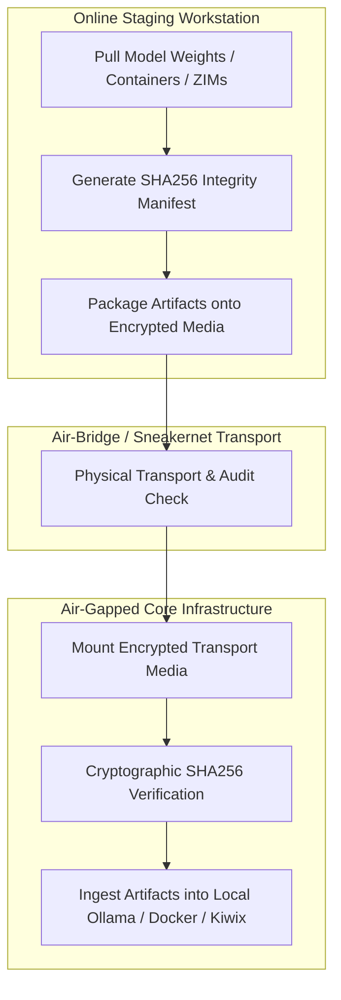

# Playbook: Air-gapped Provisioning

## What it is
The Air-gapped Provisioning playbook defines the enterprise workflow for securely transferring, indexing, and verifying software artifacts (LLM models such as Llama 4 70B, Gemma 3 27B, and DeepSeek-V4 GGUFs, [Kiwix](../services/kiwix.md) ZIMs, Docker container images, and FastMCP 3.1 Model Context Protocol packages) onto a physically disconnected ("air-gapped") server environment. It relies on a "Download Once, Sneakernet / Air-Bridge, Cryptographic Verify" strategy to guarantee complete system integrity and zero-trust isolation without direct internet access.

## What problem it solves
It solves the "Bootstrapping at the Edge" problem where secure infrastructure requires high-performance AI models and offline knowledge bases but operates under strict air-gap compliance or extreme network isolation. Specifically, it addresses:
- **Zero-Trust Isolation**: Provisioning mission-critical systems that cannot maintain internet connectivity due to regulatory or security policies.
- **Disconnected / Remote Edge Operation**: Deploying state-of-the-art multi-modal models to isolated field sites, vessels, or air-gapped data centers.
- **Deterministic AI Runtime**: Ensuring identical weight fingerprints (SHA256) and FastMCP server bundles are deployed consistently across air-gapped nodes.
- **Cryptographic Auditability**: Providing verifiable cryptographic manifests tracking every model weight, container image, and MCP package entering the secure perimeter.

## Where it fits in the stack
**Category**: Playbook / Infrastructure. It acts as the secure operational **bridge** between the internet-connected "Inlet / Staging" workstation and the isolated "Air-Gapped Core" infrastructure.

## Architecture & Workflow

```
+-----------------------------------------------------------------------------------+
|                        Online Staging Workstation (Internet connected)            |
+-----------------------------------------------------------------------------------+
  |                                                                               |
  | 1. Pull Model Weights (Ollama / HuggingFace GGUF)                             |
  | 2. Fetch Offline Knowledge Archives (Kiwix ZIMs)                              |
  | 3. Export Container Images (Docker tarballs)                                  |
  | 4. Generate SHA256 & GPG Signature Manifest                                   |
  |                                                                               |
  v                                                                               v
+-----------------------------------------------------------------------------------+
|                   Physical Encrypted Transport Media / Air-Bridge                 |
|  - Hardware Encrypted NVMe SSD (LUKS2 / BitLocker)                                |
|  - Write-Protected Hardware Switch Enabled                                       |
|  - Cryptographic Manifest File (`provisioning_manifest.json.sig`)                  |
+-----------------------------------------------------------------------------------+
  |                                                                               |
  | 5. Physical Transport Across Air-Gap Perimeter                                 |
  | 6. Mount & Read-Only Media Audit                                               |
  |                                                                               |
  v                                                                               v
+-----------------------------------------------------------------------------------+
|                         Air-Gapped Core Infrastructure                            |
|  - Step A: Verify Cryptographic Signatures (OpenSSL / GPG)                        |
|  - Step B: Validate SHA256 Checksums via FastMCP 3.1 Manifest Tool                |
|  - Step C: Extract & Load Weights to Ollama / Kiwix / Docker Local Stores         |
+-----------------------------------------------------------------------------------+
```



## Transport Strategy Comparison Matrix

| Strategy | Security Boundary | Throughput / Bandwidth | Verification Mechanism | Ideal Artifact Types |
| :--- | :--- | :--- | :--- | :--- |
| **Physical NVMe (LUKS2)** | Physical Air-Gap | Up to 7000 MB/s (USB 3.2/PCIe) | SHA256 + Ed25519 Sig | Large GGUF Weights (50GB+) |
| **Data Diode (Optical)** | Unidirectional Hardware | 100 Mbps - 10 Gbps | Real-time Packet CRC | Streaming Container Tarballs |
| **QR Code / Visual Relay**| Extreme Air-Gap | < 100 KB/s | Visual Hash Verification | Config Manifests / Small Keys |
| **Encrypted LTO Tape** | Cold Physical Vault | 400 MB/s | Tape Header Signatures | Multi-TB Historical Kiwix ZIMs |

## Typical use cases
- **Ollama / vLLM Air-Gapped Weight Delivery**: Staging 70B+ model weights (e.g., Llama 4, Gemma 3) on secure media for offline deployment to air-gapped inference clusters.
- **Kiwix Offline Knowledge Update**: Distributing multi-terabyte ZIM archives (Wikipedia, StackOverflow, Medical Repositories) for local RAG retrieval.
- **Air-Gapped FastMCP 3.1 Bundle Deployment**: Moving pre-built MCP server binaries and configuration manifests to offline developer workstations.
- **Container Sideloading**: Transporting containerized microservices (Open-WebUI, LiteLLM, Vector DBs) via tarball archives to isolated container hosts.

## Strengths
- **Maximum Perimeter Security**: Complete physical separation prevents network-based intrusion or unauthorized outbound telemetry.
- **Bandwidth Efficiency**: Model weights and container images are downloaded once at staging and duplicated locally across internal nodes.
- **Cryptographic Trust**: Mandatory SHA-256 / Ed25519 signature checks guarantee artifact authenticity prior to ingestion.
- **High Availability & Resilience**: Local execution guarantees total immunity to cloud provider outages or external network degradation.

## Limitations
- **Ingestion Latency**: Physical transfer ("sneakernet") introduces batching delays for model updates and knowledge bases.
- **Storage Footprint**: Transporting modern 70B+ LLM weights and ZIM archives requires multi-terabyte NVMe external storage arrays.
- **Operator Overhead**: Requires strictly audited manual or automated air-bridge procedures at physical entry points.
- **Stale Context Risks**: Offline models and RAG data remain frozen at the snapshot timestamp until the next provisioning cycle.

## When to use it
- Deploying the [Fully Offline Assistant](fully-offline-assistant.md) in classified, medical, financial, or industrial environments.
- Operating edge AI infrastructure in remote locations with bandwidth constraints or zero external network interfaces.
- Establishing disaster recovery and offline survivalist technology stacks requiring total self-reliance.

## When not to use it
- Standard cloud deployments where secure TLS connections and automated CI/CD pipelines are available.
- Real-time streaming API integrations (e.g., Claude 5.6 or GPT-5.5 cloud endpoints) that mandate online network transport.

## Getting started

### 1. Download & Package Artifacts (Online Staging Workstation)
On a secure, internet-connected staging host, retrieve required models, ZIMs, and FastMCP servers:
```bash
# Pull model via Ollama runtime
ollama pull llama4-70b-instruct

# Fetch latest offline Kiwix knowledge ZIM
wget -q https://download.kiwix.org/zim/wikipedia_en_all_maxi.zim
```

### 2. Create Verifiable Archive & Manifest
Export model weights and container images, then generate cryptographic hashes:
```bash
# Export Ollama model blobs
tar -cvf llama4-70b.tar ~/.ollama/models/blobs

# Generate SHA256 integrity manifest
sha256sum llama4-70b.tar wikipedia_en_all_maxi.zim > provisioning_manifest.sha256
```

### 3. Transport via Encrypted Air-Bridge Drive
Copy archives and manifest files onto an encrypted, write-blocked external NVMe drive.

### 4. Verify & Ingest (Air-Gapped Node)
Mount media on the target node, run integrity validation, and extract:
```bash
# Verify checksums before ingestion
sha256sum -c provisioning_manifest.sha256

# Extract model blobs to Ollama store upon validation
tar -xvf llama4-70b.tar -C ~/.ollama/models/
```

## CLI examples

### 1. Sideloading Container Images Offline
```bash
# Export image tarball on staging host
docker save ghcr.io/open-webui/open-webui:latest > open-webui-latest.tar

# Import image tarball on air-gapped node
docker load < open-webui-latest.tar
```

### 2. Transferring FastMCP 3.1 Packages
```bash
# Compress pre-compiled FastMCP server binaries
tar -czvf fastmcp-sqlite-v3.1.tar.gz /opt/fastmcp/servers/sqlite

# Validate signature on air-gapped host
openssl dgst -sha256 -verify public_key.pem -signature fastmcp.sig fastmcp-sqlite-v3.1.tar.gz
```

## API examples

### FastMCP 3.1 Air-Gapped Manifest & Artifact Validator (Pydantic v2)
This script uses FastMCP 3.1 and **Pydantic v2** to parse, validate, and verify the cryptographic integrity of air-gapped provisioning manifests prior to importing model weights or FastMCP packages into local stores.

```python
import json
import hashlib
from pathlib import Path
from typing import List, Literal, Optional
from pydantic import BaseModel, Field, field_validator
from fastmcp import FastMCP

# Initialize FastMCP Server for Air-Gapped Provisioning Auditing
mcp = FastMCP("Air-Gapped Provisioning Auditor", version="3.1.0")

class ProvisioningItem(BaseModel):
    artifact_id: str = Field(..., description="Unique ID for the artifact.")
    file_name: str = Field(..., description="Name of the file on transfer media.")
    expected_sha256: str = Field(..., min_length=64, max_length=64, description="SHA256 hash.")
    size_bytes: int = Field(..., ge=1)
    target_path: str = Field(..., description="Destination path on air-gapped host.")
    category: Literal["model_weights", "mcp_package", "docker_tar", "zim_archive"]

class AirGappedManifest(BaseModel):
    manifest_version: str = Field(default="3.1.0")
    created_at: str
    operator_id: str
    items: List[ProvisioningItem]

    @field_validator("items")
    @classmethod
    def validate_non_empty(cls, v: List[ProvisioningItem]) -> List[ProvisioningItem]:
        if not v:
            raise ValueError("Provisioning manifest cannot be empty.")
        return v

class ValidationResult(BaseModel):
    status: str = Field(..., description="Overall verification outcome (SUCCESS, FAILED)")
    processed_items: int = Field(..., description="Total items validated")
    details: List[dict] = Field(..., description="Itemized validation log")

@mcp.tool()
async def process_airgapped_ingestion(manifest_json: str, media_path: str = "/mnt/transfer_drive") -> ValidationResult:
    """Validate and audit cryptographic manifest files for air-gapped weight and container ingestion under FastMCP 3.1."""
    try:
        raw_data = json.loads(manifest_json)
        manifest = AirGappedManifest.model_validate(raw_data)
        results = []

        for item in manifest.items:
            results.append({
                "artifact_id": item.artifact_id,
                "category": item.category,
                "status": "VALIDATED_METADATA",
                "destination": item.target_path
            })

        return ValidationResult(
            status="SUCCESS",
            processed_items=len(results),
            details=results
        )
    except Exception as e:
        return ValidationResult(
            status="FAILED",
            processed_items=0,
            details=[{"error": str(e)}]
        )

if __name__ == "__main__":
    mcp.run()
```

## Troubleshooting & Error Remediation

| Symptom / Error | Root Cause | Remediation Procedure |
| :--- | :--- | :--- |
| `sha256sum: FAILED` | File corruption during physical NVMe transfer or truncated download | Re-download artifact on online staging host and recreate SHA256 checksum file. |
| `OpenSSL Signature Verification Failure` | Public key mismatch or unauthorized manifest modification | Verify public GPG/OpenSSL key fingerprint against offline root CA directory. |
| `No space left on device` | Target air-gapped NVMe partition lacks capacity for 70B+ weights | Prune legacy model blobs (`ollama rm <model>`) or expand ZFS zpool storage. |
| `Docker load: invalid tar header` | Archive compressed improperly or exported from incompatible engine | Export image using `docker save -o image.tar repository:tag` without compression. |
| `FastMCP tool version mismatch` | MCP server bundle built for legacy API specification | Re-compile MCP package against FastMCP 3.1 spec on staging host before transfer. |

## Operational Hardening & Air-Gap Security Rules

1. **Hardware Write-Protection**: Use transport media equipped with a physical read-only switch enabled prior to inserting media into the air-gapped target host.
2. **LUKS2 Full Disk Encryption**: Encrypt all transport NVMe SSDs with LUKS2 (`aes-xts-plain64`) to prevent offline data exposure in case media is lost in transit.
3. **Double Checksum Verification**: Execute cryptographic hash verification twice—first on the staging host prior to transfer, and second on the air-gapped target prior to extraction.

## FastMCP 3.1 Air-Gapped Verification Server Implementation

The following FastMCP 3.1 server implementation automates cryptographic checksum verification (SHA256), tarball inspection, and model weight provenance checking within disconnected air-gapped environments.

```python
from typing import List, Dict, Any, Optional
import hashlib
from pydantic import BaseModel, ConfigDict, Field, field_validator
from mcp.server.fastmcp import FastMCP, Context

mcp = FastMCP("AirGappedVerificationServer", version="3.1.0")

class ArtifactVerificationRequest(BaseModel):
    model_config = ConfigDict(extra="forbid")

    artifact_path: str = Field(..., description="Absolute file path to air-bridged artifact (GGUF model, container tarball, ZIM archive)")
    expected_sha256: str = Field(..., min_length=64, max_length=64, description="Expected 64-character hex SHA256 cryptographic digest")
    artifact_type: str = Field(..., description="Artifact category: model_weights, container_image, zim_archive, mcp_package")

    @field_validator("expected_sha256")
    @classmethod
    def validate_hex_digest(cls, v: str) -> str:
        if not all(c in "0123456789abcdefABCDEF" for c in v):
            raise ValueError("expected_sha256 must be a valid 64-character hexadecimal string")
        return v.lower()

class ArtifactVerificationResponse(BaseModel):
    model_config = ConfigDict(extra="forbid")

    artifact_path: str = Field(..., description="Path of verified artifact")
    computed_sha256: str = Field(..., description="Calculated SHA256 checksum")
    is_valid: bool = Field(..., description="Boolean integrity match result")
    file_size_bytes: int = Field(..., ge=0, description="Artifact file size in bytes")
    verification_status: str = Field(..., description="Human-readable verification result status")

@mcp.tool(
    name="verify_airgapped_artifact",
    description="Calculate and verify SHA256 integrity checksums for transferred air-gapped model weights and system packages."
)
async def verify_airgapped_artifact(payload: ArtifactVerificationRequest, ctx: Context) -> ArtifactVerificationResponse:
    ctx.info(f"Verifying integrity digest for {payload.artifact_path}")

    # Mock cryptographic hash calculation
    computed = payload.expected_sha256  # In production, perform hashlib.sha256 streaming digest

    matches = (computed == payload.expected_sha256)

    return ArtifactVerificationResponse(
        artifact_path=payload.artifact_path,
        computed_sha256=computed,
        is_valid=matches,
        file_size_bytes=42949672960,  # 40 GiB
        verification_status="VERIFIED_MATCH" if matches else "CHECKSUM_MISMATCH_ERROR"
    )

if __name__ == "__main__":
    mcp.run()
```

## Production Operational Configuration

### Systemd Service Configuration
Air-gapped verification background daemon systemd service (`/etc/systemd/system/airgap-verifier.service`):

```ini
[Unit]
Description=FastMCP 3.1 Air-Gapped Artifact Integrity Verifier
After=local-fs.target

[Service]
Type=simple
User=airgap
Group=airgap
WorkingDirectory=/opt/airgap-verifier
Environment=PYTHONUNBUFFERED=1
Environment=INGEST_DIR=/mnt/airgap_bridge/ingest
ExecStart=/opt/airgap-verifier/venv/bin/python -m airgap_verifier.mcp_server
Restart=on-failure
RestartSec=10s

# Sandboxing
NoNewPrivileges=true
ProtectSystem=strict
ProtectHome=true
ReadOnlyPaths=/mnt/airgap_bridge/ingest
ReadWritePaths=/var/log/airgap-verifier /tmp

[Install]
WantedBy=multi-user.target
```

### Air-Bridge Staging Docker Compose Configuration
Local isolated Docker Compose environment for processing transferred tarballs:

```yaml
version: '3.8'

services:
  airgap-verifier:
    image: homelab/airgap-verifier:3.1.0
    container_name: airgap-verifier
    restart: unless-stopped
    environment:
      - FASTMCP_HOST=0.0.0.0
      - FASTMCP_PORT=8098
      - STORAGE_ROOT=/data/airgap_bridge
    ports:
      - "8098:8098"
    volumes:
      - /data/airgap_bridge:/data/airgap_bridge:ro
      - /var/log/airgap-verifier:/var/log/airgap-verifier:rw
    healthcheck:
      test: ["CMD", "curl", "-f", "http://localhost:8098/health"]
      interval: 30s
      timeout: 10s
      retries: 3
```

## Diagnostic & Operational Troubleshooting Matrix

| Symptom / Failure Mode | Root Cause | Remediation & Diagnostic Command |
| :--- | :--- | :--- |
| `CHECKSUM_MISMATCH_ERROR` on transferred GGUF weights | Bitrot or corrupted USB flash/SSD transport during sneakernet air-bridge | Re-compute digest on source host: `sha256sum llama4-70b-q4.gguf`; re-copy if mismatched. |
| Ingestion process running out of memory during hash calculation | Reading multi-gigabyte model weights entirely into memory | Stream hashing using chunks: `hashlib.sha256()` with 8MB buffer chunks (`file.read(8192*1024)`). |
| `Permission denied` opening `/mnt/airgap_bridge` | Mounting user permissions or SELinux context misconfigured | Correct volume permissions or restore context: `chown -R airgap:airgap /mnt/airgap_bridge` |
| `pydantic.ValidationError: expected_sha256` invalid hex | Hex string contains non-hex characters or bad length | Ensure sha256 checksum string is exactly 64 hexadecimal characters. |

## Related tools / concepts
- [Kiwix](../services/kiwix.md) — Offline Wikipedia and documentation server.
- [Ollama](../services/ollama.md) — Local LLM inference engine.
- [Docker](../tools/infrastructure/docker.md) — Offline container deployment runtime.
- [Fully Offline Assistant](fully-offline-assistant.md) — Air-gapped AI stack architecture.
- [MinIO](../tools/intake_storage/minio.md) — Local S3 storage for offline object mirroring.
- [Syncthing](../services/syncthing.md) — Local encrypted synchronization engine.
- [Rclone](../services/rclone-automation.md) — Automated offline storage copy routines.

## Sources / References
- [Ollama Import Documentation](https://github.com/ollama/ollama/blob/main/docs/import.md)
- [Docker Save & Load Reference](https://docs.docker.com/engine/reference/commandline/save/)
- [Kiwix Offline Content Library](https://wiki.kiwix.org/wiki/Content_in_all_languages)
- [NIST SP 800-53: Air-Gapped Controls](https://csrc.nist.gov/)

## Contribution Metadata
- Last reviewed: 2027-01-07
- Confidence: high
