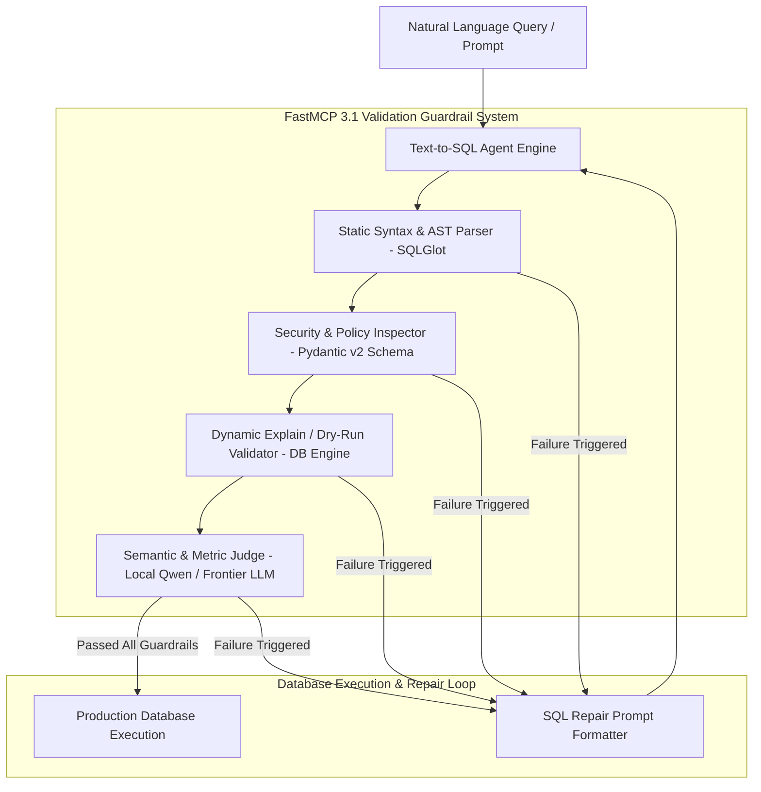
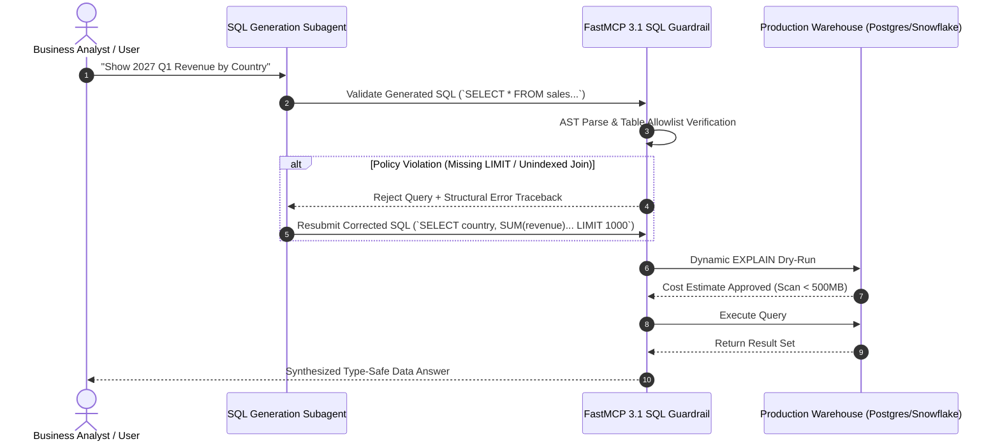

# Playbook: Data Copilot SQL Validation & Repair

## What it is
A technical blueprint and operational framework for validating AI-generated SQL queries before they reach the database. It establishes a "guardrail" system that combines static analysis, dynamic dry-runs, and LLM-based semantic checks to ensure safety, performance, and correctness. This playbook leverages state-of-the-art early January 2027 patterns designed for frontier architectures like Claude 5.6, GPT-5.6, Gemini 4.0 Ultra, and DeepSeek-V4.

## What problem it solves
Prevents "hallucinated" SQL from causing data breaches (SQL injection), performance degradation (cross-joins on large tables), or business errors (incorrect metric calculations).



## Where it fits in the stack
It operates within the **Inference Pipeline**, specifically between the **SQL Generation Agent** and the **Database Execution Engine**.



## Comparative Dialect & Validation Analysis

| Validation Metric / Dimension | PostgreSQL | Snowflake | BigQuery | DuckDB / SQLite |
| :--- | :--- | :--- | :--- | :--- |
| **Dry-Run Mechanism** | `EXPLAIN (FORMAT JSON)` | `EXPLAIN USING TEXT` | `DRY_RUN=True` API | `EXPLAIN QUERY PLAN` |
| **AST Transpilation Support** | Native (Full AST) | Full Support | Full Support | Native (Full AST) |
| **Hard Row Limit Control** | `LIMIT n` / `FETCH FIRST` | `LIMIT n` / `TOP n` | `LIMIT n` | `LIMIT n` |
| **PII Column Masking** | Dynamic Data Masking | Policy Tags & Masking | Policy Tags | Programmatic Projection |
| **Validation Latency Overhead** | < 5ms (Local AST) | 20-50ms (Cloud EXPLAIN) | 30-80ms (Cloud API) | < 2ms (In-Memory AST) |
| **FastMCP 3.1 Integration** | Native Tool Gateway | Native Tool Gateway | Native Tool Gateway | Native Tool Gateway |

## Typical use cases
- **Automated PII Masking**: Ensuring that any query targeting the `users` table automatically excludes `email` or `password_hash` columns.
- **Query Optimization**: Catching unindexed filters in natural language questions like "Show me every transaction since 2010" before they scan millions of rows.
- **Dialect Conversion**: Automatically correcting minor syntax errors when an LLM trained on Postgres tries to query a SQLite database.
- **Safety Enforcement**: Blocking `DROP TABLE` or `DELETE` commands that might be generated due to prompt injection or model hallucination.
- **Home automation bots**: Triggering database-driven actions (e.g., "Show me my energy usage") with guaranteed safety.
- **FastMCP 3.1 Task Interception**: Restricting direct DB schema modification tools via dynamic payload verification.

## Strengths
- **Defense in Depth**: Multiple layers of validation ensure that even if one check misses a risk, another will likely catch it.
- **Reduced Hallucinations**: The self-correction loop allows the model to learn from its own mistakes in real-time.
- **Cost Savings**: Prevents expensive, inefficient queries from consuming excessive cloud database resources.
- **Safety**: Multi-layered defense against malicious or accidental query errors.
- **Pydantic v2 Native**: Fully robust metadata and schema payload validation with real-time feedback.

## Limitations
- **Validation Latency**: Each check adds overhead to the total response time.
- **Rule Maintenance**: Policy allowlists must be updated whenever the database schema changes.
- **LLM-as-a-Judge Bias**: Semantic validation using a second LLM is not 100% foolproof and may itself hallucinate.
- **Dialect Parity Gap**: Complex analytic queries translated across dialects sometimes lose specific partitioning semantics.

## When to use it
- In any production environment where LLMs generate SQL queries for live databases.
- When working with high-volume or highly sensitive data.
- When utilizing smaller, less reliable models for SQL generation that require a "safety net."

## When not to use it
- **Development/Sandbox Environments**: Where risks are low and rapid prototyping is more important than strict validation.
- **Read-Only Public Datasets**: If the data is already public and the database is small enough that performance is not a concern.
- **Fixed-Query Systems**: If the AI is just selecting from a set of pre-written, human-verified SQL queries.

## Getting started

To implement basic static validation, use the `sqlglot` library to parse and inspect generated queries.

### Installation
```bash
pip install sqlglot pydantic>=2.0.0 fastmcp
```

### Basic Usage

```python
import sqlglot
from sqlglot import exp
from pydantic import BaseModel, Field, ConfigDict

class SQLValidationResult(BaseModel):
    model_config = ConfigDict(extra="forbid")

    is_safe: bool = Field(..., description="Whether the query passed all safety checks")
    error_message: str | None = Field(None, description="The error message if safety check failed")
    corrected_query: str | None = Field(None, description="Corrected query after validation adjustments")

def is_query_safe(sql_query: str, allowed_tables: list[str]) -> SQLValidationResult:
    try:
        # Parse the SQL into an expression tree
        expressions = sqlglot.parse(sql_query)

        for expression in expressions:
            if expression is None:
                continue

            # 1. Check for forbidden mutation keywords
            if any(isinstance(node, (exp.Delete, exp.Drop, exp.Update, exp.Insert, exp.Alter))
                   for node, *_ in expression.walk()):
                return SQLValidationResult(is_safe=False, error_message="Mutation detected.")

            # 2. Verify table allowlist
            for table in expression.find_all(exp.Table):
                if table.name.lower() not in [t.lower() for t in allowed_tables]:
                    return SQLValidationResult(is_safe=False, error_message=f"Table '{table.name}' not in allowlist.")

            # 3. Ensure LIMIT is present (optional but recommended)
            if not expression.find(exp.Limit):
                # Programmatically append LIMIT 100
                modified_expr = expression.limit(100)
                return SQLValidationResult(is_safe=True, corrected_query=modified_expr.sql())

        return SQLValidationResult(is_safe=True, corrected_query=sql_query)
    except sqlglot.errors.ParseError as e:
        return SQLValidationResult(is_safe=False, error_message=f"Syntax Error: {e}")

# Example Usage
query = "SELECT * FROM users; DROP TABLE products;"
tables = ["items", "categories", "users"]
result = is_query_safe(query, tables)
print(f"Safe: {result.is_safe}, Error: {result.error_message}, SQL: {result.corrected_query}")
```

## The Validation Pipeline

1.  **Syntactic Validation**: Does the SQL run? (Dry-run)
2.  **Policy Validation**: Does it violate security rules? (Allowlists, row limits)
3.  **Semantic Validation**: Does it match the intended metrics/filters? (LLM-as-a-Judge)

### 1. Syntax Validation (Dry-Run)
Before returning or executing, the system must perform an `EXPLAIN` or a dry-run with `LIMIT 0`.
- **Low-cost implementation**: Use local SQLite `EXPLAIN QUERY PLAN` or a temporary in-memory DB to verify syntax without hitting production data.

### 2. Policy Validation Checklist
Every query must pass these automated checks:
- [x] **Row Limits**: Does the query have a `LIMIT` clause? (Hard cap e.g., 1000).
- [x] **Table Allowlist**: Does it only touch tables defined in the Workspace context?
- [x] **No Mutations**: Does it contain forbidden keywords like `DROP`, `DELETE`, `UPDATE`, `INSERT`, `ALTER`, `GRANT`?
- [x] **PII/PHI Masking**:
  - Sensitive columns (e.g., `ssn`, `password_hash`) must be excluded from the `SELECT` list.
  - If a sensitive column is needed for filtering (e.g., `user_id`), it must be hashed or replaced with a pseudonym in the final output returned to the UI.

### 3. Semantic Validation & Risk Taxonomy
A query can be syntactically perfect but business-incorrect.

| Risk Type | Symptom | Example |
| :--- | :--- | :--- |
| **Syntactic Pass** | Query runs but is slow. | Missing a join condition (Cross Join). |
| **Metric Drift** | Wrong column for a metric. | Using `subtotal` instead of `total_including_tax`. |
| **Filter Failure** | Wrong time range or scope. | Showing "Global" data when asked for "UK only". |
| **Join Explosion** | Joining too many tables. | Joining 5 tables to answer a 1-table question. |
| **Performance Risk** | Missing indexes or scans. | Querying a 10M row table without an indexed filter. |

### 4. Self-Correction Loop (Repair)
If validation fails, the "SQL Repair" flow is triggered:
1.  **Capture Error**: Gather the SQL + Error Message (from DB) or Policy Violation (from Guardrail).
2.  **Prompt Generator**: Feed the error back to the LLM using a repair template.
3.  **Retry Limit**: Max 2 retries. If still failing, trigger "Stop and Escalate".

### 5. Stop and Escalate Criteria
Stop the automated flow and notify a human if:
1.  **Ambiguous Metric**: Multiple valid columns match the user's intent.
2.  **Permission Denied**: The query attempts to access a restricted schema.
3.  **Repair Timeout**: Max retries reached without a valid query.
4.  **Complex Logic**: The intent requires a logic depth the current model cannot reliably produce.

## CLI examples

### 1. Static Validation
```bash
python3 -c "import sqlglot; print(sqlglot.transpile('SELECT * FROM users', read='postgres', write='sqlite')[0])"
```

### 2. Formatted SQL
```bash
python3 -c "import sqlglot; print(sqlglot.parse_one('SELECT * FROM users WHERE id=1').sql(pretty=True))"
```

### 3. Programmatic CLI Repair Invocation
```bash
python3 -c "from pydantic import BaseModel; import pydantic; print(f'Pydantic loaded version: {pydantic.__version__}')"
```

## API examples

### Programmatic SQL Parsing & Transpilation
```python
import sqlglot
from sqlglot import exp

# Transpile PostgreSQL syntax into DuckDB dialect
duckdb_sql = sqlglot.transpile("SELECT * FROM sales_data LIMIT 10", read="postgres", write="duckdb")[0]

# Inspect AST columns programmatically
parsed = sqlglot.parse_one("SELECT user_id, email, total_spend FROM users_summary")
columns = [col.name for col in parsed.find_all(exp.Column)]
print(f"Target Columns: {columns}")
```

## FastMCP 3.1 SQL Guardrail Tool Server Integration

The following Python script implements a production **FastMCP 3.1** server that intercepts SQL generation requests, enforces Pydantic v2 schemas, and executes static AST checks:

```python
import sqlglot
from sqlglot import exp
from typing import Dict, Any, List, Optional
from pydantic import BaseModel, Field
from fastmcp import FastMCP

mcp = FastMCP(
    "sql-guardrail-server",
    instructions="FastMCP 3.1 guardrail server providing static AST validation and query repair services."
)

class SQLGuardrailRequest(BaseModel):
    raw_sql: str = Field(..., description="AI-generated SQL query to validate")
    target_dialect: str = Field(default="postgres", description="Target database SQL dialect")
    allowed_tables: List[str] = Field(..., description="Allowlist of table names")
    max_row_limit: int = Field(default=1000, ge=1, le=10000)

class SQLGuardrailResponse(BaseModel):
    is_approved: bool
    sanitized_sql: Optional[str]
    violation_type: Optional[str]
    suggested_fix: Optional[str]

@mcp.tool()
def validate_and_sanitize_sql(request: SQLGuardrailRequest) -> Dict[str, Any]:
    """
    Validates SQL queries against table allowlists, mutation blocks, and hard limits.
    """
    try:
        expressions = sqlglot.parse(request.raw_sql, read=request.target_dialect)
        for expr in expressions:
            if expr is None:
                continue

            # Check for mutation statement
            if any(isinstance(node, (exp.Delete, exp.Drop, exp.Update, exp.Insert, exp.Alter))
                   for node, *_ in expr.walk()):
                response = SQLGuardrailResponse(
                    is_approved=False,
                    sanitized_sql=None,
                    violation_type="FORBIDDEN_MUTATION",
                    suggested_fix="Remove non-SELECT mutation statement."
                )
                return {"status": "rejected", "result": response.model_dump()}

            # Validate tables
            for table in expr.find_all(exp.Table):
                if table.name.lower() not in [t.lower() for t in request.allowed_tables]:
                    response = SQLGuardrailResponse(
                        is_approved=False,
                        sanitized_sql=None,
                        violation_type="UNAUTHORIZED_TABLE",
                        suggested_fix=f"Table '{table.name}' is prohibited."
                    )
                    return {"status": "rejected", "result": response.model_dump()}

            # Enforce hard LIMIT
            if not expr.find(exp.Limit):
                expr = expr.limit(request.max_row_limit)

        response = SQLGuardrailResponse(
            is_approved=True,
            sanitized_sql=expr.sql(dialect=request.target_dialect),
            violation_type=None,
            suggested_fix=None
        )
        return {"status": "approved", "result": response.model_dump()}
    except Exception as err:
        return {"status": "error", "message": str(err)}

if __name__ == "__main__":
    mcp.run()
```

## Troubleshooting & Diagnostics

| Symptom / Violation | Root Cause | Remediation Procedure |
| :--- | :--- | :--- |
| `ParseError: Unexpected token` | Vendor-specific SQL syntax dialect mismatch (e.g. Snowflake `QUALIFY`). | Pass explicit `read='snowflake'` parameter to SQLGlot parser. |
| `FORBIDDEN_MUTATION: Drop` | Prompt injection attack or LLM hallucinated table reset. | Hard-block request at FastMCP 3.1 gateway and alert security team. |
| `UNAUTHORIZED_TABLE: information_schema` | LLM trying to inspect metadata tables outside granted schema. | Provide synthetic table schema DDL in system prompt to prevent information schema queries. |
| `EXPLAIN Query Cost High` | Missing index on `WHERE` filter causing full table scan on 10M+ rows. | Reject query and suggest indexed column constraints via the repair prompt. |

## Operational & Security Guardrails
- **Read-Only Database Roles**: Ensure that the database credentials assigned to the execution engine are granted strictly `SELECT` privileges at the PostgreSQL or Snowflake role level.
- **Query Timeout Enforcement**: Set database-level query statement timeouts (e.g., `SET statement_timeout = '5s'`) to kill long-running runaway joins.
- **Audit Logging**: Log all raw generated SQL, AST parse results, policy validation statuses, and execution latencies to an immutable logging bucket for compliance.

## Related tools / concepts
- [Data Copilot Architecture](../architecture/data-copilot-text-to-sql.md)
- [Data Copilot MCP Tooling](../knowledge_base/patterns/data-copilot-mcp-tooling.md)
- [Data Copilot Agentic RAG](../knowledge_base/patterns/data-copilot-agentic-rag.md)
- [Answer Synthesis Schema](../reference-implementations/data-copilot/answer-synthesis-schema.md)
- [Tool Calling & Model Context Protocol (MCP)](../knowledge_base/patterns/tool-calling-and-mcp.md)
- [Fiddler AI Guardrails](../tools/process_understanding/fiddler.md)
- [LastMile AI Eval](../tools/process_understanding/lastmile.md)
- [Ragas Evaluation Metrics](../tools/process_understanding/ragas.md)
- [Langfuse Tracing](../tools/process_understanding/langfuse.md)
- [Pydantic AI Framework](../tools/frameworks/pydantic-ai.md)

## Sources / References
- [SQLGlot Documentation](https://github.com/tobymao/sqlglot)
- [Guardrails AI](https://www.guardrailsai.com/)
- [Pydantic v2 Documentation](https://docs.pydantic.dev/latest/)

---
## Contribution Metadata
- Last reviewed: 2027-01-07
- Confidence: high
- Related Issues: #189
