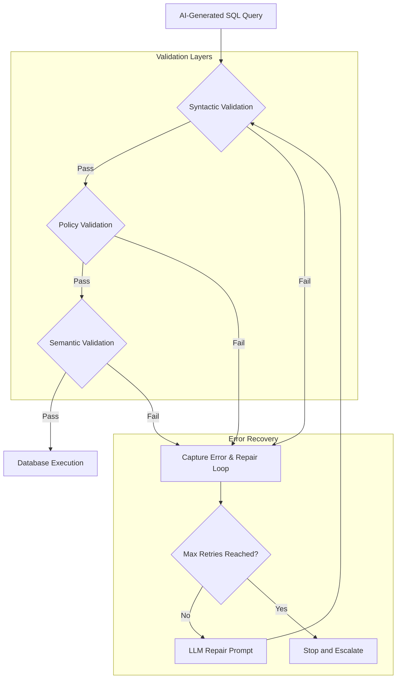

# Playbook: Data Copilot SQL Validation & Repair

## What it is
A technical blueprint and operational framework for validating AI-generated SQL queries before they reach the database. It establishes a "guardrail" system that combines static analysis, dynamic dry-runs, and LLM-based semantic checks to ensure safety, performance, and correctness. This playbook leverages state-of-the-art early January 2027 patterns designed for frontier architectures like Claude 5.6, GPT-5.6, Gemini 4.0 Ultra, and DeepSeek-V4.

## What problem it solves
Prevents "hallucinated" SQL from causing data breaches (SQL injection), performance degradation (cross-joins on large tables), or business errors (incorrect metric calculations).

## Where it fits in the stack
It operates within the **Inference Pipeline**, specifically between the **SQL Generation Agent** and the **Database Execution Engine**.

```
+--------------------------+       +-------------------------------+       +----------------------------+
|   SQL Generation Agent   | ----> | FastMCP 3.1 SQL Validation    | ----> | Database Execution Engine  |
| (Claude 5.6 / GPT-5.6)   |       | Guardrail Interceptor         |       | (PostgreSQL / Snowflake)   |
+--------------------------+       +---------------+---------------+       +----------------------------+
                                                   |
                                                   v
                                   +-------------------------------+
                                   | Pydantic v2 AST & Policy      |
                                   | Validation Engine (SQLGlot)   |
                                   +-------------------------------+
```

## Validation Approach Comparison Matrix

| Approach / Technique | Static AST Parsing (SQLGlot) | Dynamic Dry-Run (`EXPLAIN`) | LLM-as-a-Judge Evaluation | FastMCP 3.1 Interception |
| :--- | :--- | :--- | :--- | :--- |
| **Execution Overhead** | Sub-millisecond (< 5ms) | Low (10 - 50ms) | High (500ms - 2000ms) | Very Low (< 10ms) |
| **Mutation Prevention** | 100% Deterministic (Keyword AST) | High (Database Permissions) | Variable (Model Reliability) | 100% Deterministic (Schema Guard) |
| **Dialect Compatibility** | Broad (Transpiles 20+ dialects) | Specific to Target DB | General NL Reasoning | Transport Neutral |
| **PII/PHI Detection** | Column Allowlist Matching | DB Schema Metadata Check | Contextual Sensitivity Check | Schema Rules Enforcement |
| **Semantic Correctness** | Syntactic Only | Verifies Table/Column Existence | High (Evaluates Business Logic) | Protocol Level Verification |
| **Resource Cost** | Minimal Local CPU | Low DB Connection Query | API Token Cost per Query | Minimal Local Runtime |

## Typical use cases
- **Automated PII Masking**: Ensuring that any query targeting the `users` table automatically excludes `email` or `password_hash` columns.
- **Query Optimization**: Catching unindexed filters in natural language questions like "Show me every transaction since 2010" before they scan millions of rows.
- **Dialect Conversion**: Automatically correcting minor syntax errors when an LLM trained on Postgres tries to query a SQLite database.
- **Safety Enforcement**: Blocking `DROP TABLE` or `DELETE` commands that might be generated due to prompt injection or model hallucination.
- **Home automation bots**: Triggering database-driven actions (e.g., "Show me my energy usage") with guaranteed safety.
- **FastMCP 3.1 Task Interception**: Restricting direct DB schema modification tools via dynamic payload verification.

## Strengths
- **Defense in Depth**: Multiple layers of validation ensure that even if one check misses a risk, another will likely catch it.
- **Reduced Hallucinations**: The self-correction loop allows the model to learn from its own mistakes in real-time.
- **Cost Savings**: Prevents expensive, inefficient queries from consuming excessive cloud database resources.
- **Safety**: Multi-layered defense against malicious or accidental query errors.
- **Pydantic v2 Native**: Fully robust metadata and schema payload validation with real-time feedback.

## Limitations
- **Validation Latency**: Each check adds overhead to the total response time.
- **Rule Maintenance**: Policy allowlists must be updated whenever the database schema changes.
- **LLM-as-a-Judge Bias**: Semantic validation using a second LLM is not 100% foolproof and may itself hallucinate.
- **Dialect Parity Gap**: Complex analytic queries translated across dialects sometimes lose specific partitioning semantics.

## When to use it
- In any production environment where LLMs generate SQL queries for live databases.
- When working with high-volume or highly sensitive data.
- When utilizing smaller, less reliable models for SQL generation that require a "safety net."

## When not to use it
- **Development/Sandbox Environments**: Where risks are low and rapid prototyping is more important than strict validation.
- **Read-Only Public Datasets**: If the data is already public and the database is small enough that performance is not a concern.
- **Fixed-Query Systems**: If the AI is just selecting from a set of pre-written, human-verified SQL queries.

## Getting started

To implement basic static validation, use the `sqlglot` library to parse and inspect generated queries.

### Installation
```bash
pip install sqlglot pydantic>=2.0.0 fastmcp
```

### Basic Usage

```python
import sqlglot
from sqlglot import exp
from pydantic import BaseModel, Field, ConfigDict

class SQLValidationResult(BaseModel):
    model_config = ConfigDict(extra="forbid")

    is_safe: bool = Field(..., description="Whether the query passed all safety checks")
    error_message: str | None = Field(None, description="The error message if safety check failed")
    corrected_query: str | None = Field(None, description="Corrected query after validation adjustments")

def is_query_safe(sql_query: str, allowed_tables: list[str]) -> SQLValidationResult:
    try:
        # Parse the SQL into an expression tree
        expressions = sqlglot.parse(sql_query)

        for expression in expressions:
            if expression is None:
                continue

            # 1. Check for forbidden mutation keywords
            if any(isinstance(node, (exp.Delete, exp.Drop, exp.Update, exp.Insert, exp.Alter))
                   for node, *_ in expression.walk()):
                return SQLValidationResult(is_safe=False, error_message="Mutation detected.")

            # 2. Verify table allowlist
            for table in expression.find_all(exp.Table):
                if table.name.lower() not in [t.lower() for t in allowed_tables]:
                    return SQLValidationResult(is_safe=False, error_message=f"Table '{table.name}' not in allowlist.")

            # 3. Ensure LIMIT is present (optional but recommended)
            if not expression.find(exp.Limit):
                # Programmatically append LIMIT 100
                modified_expr = expression.limit(100)
                return SQLValidationResult(is_safe=True, corrected_query=modified_expr.sql())

        return SQLValidationResult(is_safe=True, corrected_query=sql_query)
    except sqlglot.errors.ParseError as e:
        return SQLValidationResult(is_safe=False, error_message=f"Syntax Error: {e}")

# Example Usage
query = "SELECT * FROM users; DROP TABLE products;"
tables = ["items", "categories", "users"]
result = is_query_safe(query, tables)
print(f"Safe: {result.is_safe}, Error: {result.error_message}, SQL: {result.corrected_query}")
```

## The Validation Pipeline

1.  **Syntactic Validation**: Does the SQL run? (Dry-run)
2.  **Policy Validation**: Does it violate security rules? (Allowlists, row limits)
3.  **Semantic Validation**: Does it match the intended metrics/filters? (LLM-as-a-Judge)

### 1. Syntax Validation (Dry-Run)
Before returning or executing, the system must perform an `EXPLAIN` or a dry-run with `LIMIT 0`.
- **Low-cost implementation**: Use local SQLite `EXPLAIN QUERY PLAN` or a temporary in-memory DB to verify syntax without hitting production data.

### 2. Policy Validation Checklist
Every query must pass these automated checks:
- [x] **Row Limits**: Does the query have a `LIMIT` clause? (Hard cap e.g., 1000).
- [x] **Table Allowlist**: Does it only touch tables defined in the Workspace context?
- [x] **No Mutations**: Does it contain forbidden keywords like `DROP`, `DELETE`, `UPDATE`, `INSERT`, `ALTER`, `GRANT`?
- [x] **PII/PHI Masking**:
  - Sensitive columns (e.g., `ssn`, `password_hash`) must be excluded from the `SELECT` list.
  - If a sensitive column is needed for filtering (e.g., `user_id`), it must be hashed or replaced with a pseudonym in the final output returned to the UI.

### 3. Semantic Validation & Risk Taxonomy
A query can be syntactically perfect but business-incorrect.

| Risk Type | Symptom | Example |
| :--- | :--- | :--- |
| **Syntactic Pass** | Query runs but is slow. | Missing a join condition (Cross Join). |
| **Metric Drift** | Wrong column for a metric. | Using `subtotal` instead of `total_including_tax`. |
| **Filter Failure** | Wrong time range or scope. | Showing "Global" data when asked for "UK only". |
| **Join Explosion** | Joining too many tables. | Joining 5 tables to answer a 1-table question. |
| **Performance Risk** | Missing indexes or scans. | Querying a 10M row table without an indexed filter. |

### 4. Self-Correction Loop (Repair)
If validation fails, the "SQL Repair" flow is triggered:
1.  **Capture Error**: Gather the SQL + Error Message (from DB) or Policy Violation (from Guardrail).
2.  **Prompt Generator**: Feed the error back to the LLM using a repair template.
3.  **Retry Limit**: Max 2 retries. If still failing, trigger "Stop and Escalate".

### 5. Stop and Escalate Criteria
Stop the automated flow and notify a human if:
1.  **Ambiguous Metric**: Multiple valid columns match the user's intent.
2.  **Permission Denied**: The query attempts to access a restricted schema.
3.  **Repair Timeout**: Max retries reached without a valid query.
4.  **Complex Logic**: The intent requires a logic depth the current model cannot reliably produce.

## Workflow Architecture



## CLI examples

### 1. Static Validation
```bash
python3 -c "import sqlglot; print(sqlglot.transpile('SELECT * FROM users', read='postgres', write='sqlite')[0])"
```

### 2. Formatted SQL
```bash
python3 -c "import sqlglot; print(sqlglot.parse_one('SELECT * FROM users WHERE id=1').sql(pretty=True))"
```

### 3. Programmatic CLI Repair Invocation
```bash
python3 -c "from pydantic import BaseModel; import pydantic; print(f'Pydantic loaded version: {pydantic.__version__}')"
```

## API examples

### FastMCP 3.1 & Pydantic v2 Production Implementation

The following complete Python module provides a FastMCP 3.1 server that intercepts SQL execution requests, runs static and policy validation via Pydantic v2 and SQLGlot, and returns structured validation objects:

```python
import sqlglot
from sqlglot import exp
from typing import List, Dict, Any, Optional
from pydantic import BaseModel, Field, field_validator, ValidationError
from fastmcp import FastMCP

mcp = FastMCP(
    "sql-guardrail-server",
    instructions="FastMCP 3.1 server for validating and sanitizing AI-generated SQL queries prior to database execution."
)

class SQLGuardrailPolicy(BaseModel):
    allowed_tables: List[str] = Field(..., min_length=1, description="List of allowlisted database tables")
    forbidden_columns: List[str] = Field(default_factory=lambda: ["password_hash", "ssn", "credit_card_number"])
    max_row_limit: int = Field(default=1000, ge=1, le=50000)
    allow_mutations: bool = Field(default=False)

class SQLValidationRequest(BaseModel):
    sql_query: str = Field(..., min_length=5, description="Generated SQL statement to validate")
    target_dialect: str = Field(default="postgres", description="Target SQL dialect (postgres, sqlite, snowflake, duckdb)")
    policy: SQLGuardrailPolicy

class SQLValidationReport(BaseModel):
    is_safe: bool
    risk_level: str = Field(..., description="Risk classification: LOW, MEDIUM, HIGH, CRITICAL")
    violations: List[str] = Field(default_factory=list)
    sanitized_sql: Optional[str] = None

@mcp.tool()
def validate_and_sanitize_sql(request: SQLValidationRequest) -> Dict[str, Any]:
    """
    Validates a generated SQL statement against security policy rules and dialect syntax.
    """
    violations = []
    sanitized = request.sql_query
    risk_level = "LOW"

    try:
        expressions = sqlglot.parse(request.sql_query, read=request.target_dialect)

        for expr in expressions:
            if expr is None:
                continue

            # 1. Mutation Check
            if not request.policy.allow_mutations:
                if any(isinstance(node, (exp.Delete, exp.Drop, exp.Update, exp.Insert, exp.Alter)) for node, *_ in expr.walk()):
                    violations.append("FORBIDDEN_MUTATION: Query contains state-modifying operations (DELETE/DROP/UPDATE/INSERT).")
                    risk_level = "CRITICAL"

            # 2. Table Allowlist Check
            for table in expr.find_all(exp.Table):
                if table.name.lower() not in [t.lower() for t in request.policy.allowed_tables]:
                    violations.append(f"UNAUTHORIZED_TABLE: Table '{table.name}' is not in the allowlist.")
                    if risk_level != "CRITICAL":
                        risk_level = "HIGH"

            # 3. Sensitive Column Check
            for col in expr.find_all(exp.Column):
                if col.name.lower() in [c.lower() for c in request.policy.forbidden_columns]:
                    violations.append(f"PII_EXPOSURE_RISK: Column '{col.name}' accesses forbidden sensitive data.")
                    if risk_level not in ["CRITICAL", "HIGH"]:
                        risk_level = "HIGH"

            # 4. Limit Clause Enforcement
            if not expr.find(exp.Limit):
                expr = expr.limit(request.policy.max_row_limit)
                sanitized = expr.sql(dialect=request.target_dialect)
                violations.append(f"MISSING_LIMIT_ADDED: Automatically appended LIMIT {request.policy.max_row_limit}.")

        report = SQLValidationReport(
            is_safe=(len([v for v in violations if "FORBIDDEN" in v or "UNAUTHORIZED" in v or "PII" in v]) == 0),
            risk_level=risk_level,
            violations=violations,
            sanitized_sql=sanitized
        )

        return {
            "status": "success",
            "report": report.model_dump()
        }

    except sqlglot.errors.ParseError as e:
        report = SQLValidationReport(
            is_safe=False,
            risk_level="HIGH",
            violations=[f"SYNTAX_PARSE_ERROR: {str(e)}"],
            sanitized_sql=None
        )
        return {
            "status": "syntax_error",
            "report": report.model_dump()
        }

if __name__ == "__main__":
    mcp.run()
```

## Diagnostic & Troubleshooting Guide

| Symptom / Issue | Root Cause | Diagnostic Step | Resolution / Fix |
| :--- | :--- | :--- | :--- |
| **`ParseError: Unknown Dialect Keyword`** | Dialect mismatch between generated SQL dialect and SQLGlot parser configuration | Inspect `target_dialect` parameter | Set exact dialect (e.g., `read="snowflake"` or `read="postgres"`) |
| **False Positive Mutation Flags on CTEs** | CTE expressions using terms like `UPDATE` in alias names | Inspect SQL AST node types rather than regex string matching | Use `isinstance(node, exp.Update)` on AST nodes instead of string search |
| **Cross-Join Cartesian Explosion** | LLM omitted `ON` join predicate when joining multiple large tables | Check `EXPLAIN` query plan for `Nested Loop` or `Cartesian Product` | Reject query in static AST check if `exp.Join` lacks `on` predicate |
| **Repair Retry Loop Exhaustion** | SQL repair prompt lacks exact error string from database driver | Inspect repair loop logs for missing error context | Pass full database exception string and schema definition in repair prompt |
| **PII Exposure via SELECT *** | Dynamic `SELECT *` expanding into sensitive columns | Trace column expansion via database catalog schema | Enforce explicit column lists in SQL Generation system prompt |

## Operational Best Practices & Guardrails

### 1. Database User Permission Guardrails
- **Read-Only Credentials**: Connect Text-to-SQL execution agents strictly using read-only database roles (`db_datareader` or `GRANT SELECT`).
- **Statement Timeouts**: Set aggressive statement timeouts (`SET statement_timeout = '5000ms';`) on database connection pools to cancel unoptimized scans automatically.

### 2. Multi-Layered Validation Defense
- **Combine Static & Dynamic Checks**: Always run local SQLGlot static validation prior to issuing dynamic `EXPLAIN` dry-runs against the production server.
- **Audit Logging**: Log all AI-generated queries, policy violations, and repair iterations to a security audit log for compliance and model evaluation.

## Related tools / concepts
- [Data Copilot Architecture](../architecture/data-copilot-text-to-sql.md)
- [Data Copilot MCP Tooling](../knowledge_base/patterns/data-copilot-mcp-tooling.md)
- [Data Copilot Agentic RAG](../knowledge_base/patterns/data-copilot-agentic-rag.md)
- [Answer Synthesis Schema](../reference-implementations/data-copilot/answer-synthesis-schema.md)
- [Tool Calling & Model Context Protocol (MCP)](../knowledge_base/patterns/tool-calling-and-mcp.md)
- [Fiddler AI Guardrails](../tools/process_understanding/fiddler.md)
- [LastMile AI Eval](../tools/process_understanding/lastmile.md)
- [Ragas Evaluation Metrics](../tools/process_understanding/ragas.md)
- [Langfuse Tracing](../tools/process_understanding/langfuse.md)
- [Pydantic AI Framework](../tools/frameworks/pydantic-ai.md)

## Sources / References
- [SQLGlot Documentation](https://github.com/tobymao/sqlglot)
- [Guardrails AI](https://www.guardrailsai.com/)
- [Pydantic v2 Documentation](https://docs.pydantic.dev/latest/)

---
## Contribution Metadata
- Last reviewed: 2027-01-07
- Confidence: high
- Related Issues: #189
