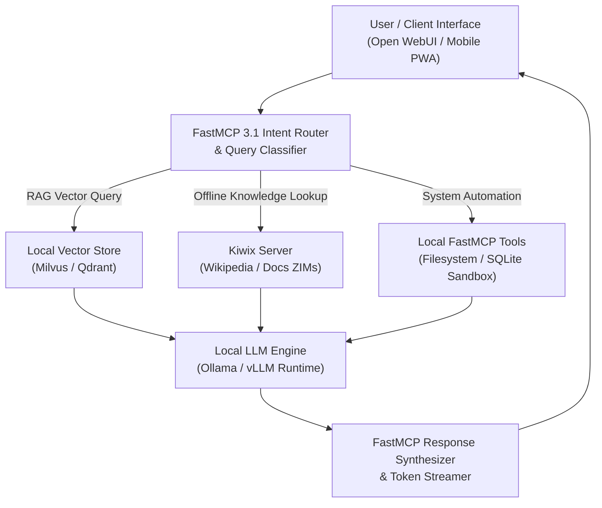

# Playbook: Fully Offline Assistant

## What it is
The **Fully Offline Assistant** is an enterprise-grade architectural blueprint for deploying an air-gapped, zero-trust, privacy-first local AI ecosystem on private hardware. It integrates [Ollama](../services/ollama.md) or vLLM for high-throughput local LLM inference (Llama 4 70B, Gemma 3 27B, DeepSeek-R1, Qwen 3.6 VL), [Open WebUI](../services/open-webui.md) for web and mobile interfaces, local embedding models (`nomic-embed-text-v1.5`), vector databases ([Milvus](../tools/infrastructure/milvus.md), [Qdrant](../tools/infrastructure/qdrant.md)), and [Kiwix](../services/kiwix.md) for offline web knowledge (Wikipedia, StackOverflow, PubMed ZIM archives). Local tool execution and context routing are orchestrated via standard **FastMCP 3.1** servers.

## What problem it solves
It eliminates complete operational dependence on external cloud AI providers (Anthropic, OpenAI, Google), resolving key vulnerabilities:
- **Zero Cloud Leakage**: Guarantees that diagnostic logs, medical intake records, financial data, and personal notes never leave the local homelab network or air-gapped host.
- **Air-Gapped & ISP Outage Resilience**: Continues operating at full capacity during complete ISP failure, physical cable cuts, or inside isolated, classified subnets.
- **Zero Token Fees**: Eliminates recurring per-token cloud API billing and monthly subscription overhead.
- **Weights & Infrastructure Sovereignty**: Delivers absolute operational control over system prompts, vector indexing algorithms, and model weights.

## System Architecture



```
                  +-------------------------------------------------------+
                  |  User / Client Interface                              |
                  |  (Open WebUI / Mobile PWA / Local Desktop UI)          |
                  +-------------------------------------------------------+
                                              |
                                              v
                  +-------------------------------------------------------+
                  |  FastMCP 3.1 Router & Query Classifier               |
                  |  - Evaluates Request Intent & Safety Boundaries       |
                  |  - Decides Local Model vs RAG Vector DB vs Kiwix      |
                  +-------------------------------------------------------+
                                              |
             +--------------------------------+-------------------------------+
             |                                |                               |
             v                                v                               v
+------------------------+      +--------------------------+      +------------------------+
| Local Vector DB        |      | Kiwix Offline Knowledge  |      | Local FastMCP Tools    |
| (Milvus / Qdrant)      |      | Server (Wikipedia ZIMs)  |      | (Filesystem, SQLite,   |
| RAG Document Store     |      | Offline Web Context      |      | Exec Sandbox)          |
+------------------------+      +--------------------------+      +------------------------+
             |                                |                               |
             +--------------------------------+-------------------------------+
                                              |
                                              v
                  +-------------------------------------------------------+
                  |  Local LLM Inference Engine                           |
                  |  (Ollama / vLLM CUDA Runtime - Llama 4 / Gemma 3)     |
                  +-------------------------------------------------------+
                                              |
                                              v
                  +-------------------------------------------------------+
                  |  FastMCP Response Synthesizer & Token Streamer        |
                  +-------------------------------------------------------+
```

## Detailed Execution Sequence

```
User Query ---> [Open WebUI Frontend]
                       |
                       v
            [FastMCP 3.1 Orchestrator]
                       |
      +----------------+----------------+
      | (Classifier Step)               |
      v                                 v
[Domain Domain Search]        [Technical / Fact Lookup]
      |                                 |
      v                                 v
(Milvus Vector DB)             (Kiwix ZIM Server)
  - Dense Embedding Search       - Article Title Index
  - Cosine Distance Rerank       - Text Fragment Extraction
      |                                 |
      +----------------+----------------+
                       |
                       v
          [Aggregated Context Blocks]
                       |
                       v
            [Local Ollama / vLLM API]
              - Llama 4 / DeepSeek-R1
              - Streaming Token Generation
                       |
                       v
         [Formatted Answer + Citations] ---> User Interface
```

## Comparison Matrix

| Feature / Metric | Fully Offline Assistant | Cloud Assistant (Claude / GPT-4) | Standard Local Ollama Setup |
| :--- | :--- | :--- | :--- |
| **Network Egress** | 0 Bytes (100% Air-gapped) | High Payload Bandwidth Egress | 0 Bytes |
| **ISP Outage Immunity** | Complete Immunity | Service Outage Interrupts | Partial (Lacks Offline RAG/Tools) |
| **RAG Knowledge Base** | Milvus / Kiwix ZIM Integrations | Cloud Knowledge Connectors | Manual File Attachments |
| **Tool Orchestration** | Native FastMCP 3.1 Server | Cloud Tool Protocols | Custom Scripting |
| **Variable Cost** | $0 per Token | Variable Monthly API Costs | $0 per Token |
| **VRAM & Hardware** | Requires Dedicated Local GPU/VRAM | $0 Local Hardware Cost | Requires Local GPU/VRAM |
| **Latency / TTFT** | <20ms Local Subnet | 300ms - 1500ms Network Roundtrip | <20ms Local Subnet |
| **Audit Logs** | Local Structured JSON | Cloud Vendor Retention Policy | Basic Console Logs |

## Where it fits in the stack
**Category**: Playbook / Infrastructure. It serves as the **master operational blueprint** for local privacy-first AI execution, orchestrating tools and services across `docs/services/`, `docs/tools/`, and `docs/knowledge_base/`.

## Typical use cases
- **Air-Gapped Document RAG**: Interrogating sensitive enterprise legal contracts, medical charts, and financial records with strict compliance boundaries.
- **Isolated Offline Research**: Querying multi-gigabyte static Wikipedia, StackOverflow, and medical archives via Kiwix without active internet connections.
- **Local Tool Execution**: Executing sandboxed terminal commands, file management, and database operations via FastMCP 3.1 tool servers.
- **Disaster Response & Edge Operations**: Maintaining uninterrupted access to emergency repair guides, coding documentation, and medical triage playbooks during infrastructure collapse.

## Strengths
- **Sub-Millisecond Subnet Latency**: Fast local streaming response generation without external API roundtrips.
- **Absolute Sovereignty**: Full control over fine-tuned GGUF weights, vector embeddings, and prompt safety filters.
- **Unlimited Context Storage**: Search terabyte-scale local vector indexes hosted on high-speed NVMe storage.
- **Standardized FastMCP 3.1 Integration**: Clean inter-process communication for local tools and agentic pipelines.

## Limitations
- **Hardware Dependent**: Inference speed and max context length depend directly on host VRAM bandwidth (Apple Silicon Unified Memory or NVIDIA GPUs).
- **Manual Data Ingestion**: Requires physical download and manual updates for new model weights and Kiwix ZIM archives.
- **Host Thermal & Power Load**: Continuous high-batch inference demands high GPU wattage and thermal dissipation.

## When to use it
- In medical, legal, financial, or defense environments where public cloud connectivity is strictly prohibited.
- When deploying dedicated on-premises hardware (e.g., Apple Mac Studio clusters, multi-GPU workstations).
- When absolute protection against cloud terms-of-service modifications or API service deprecations is required.

## When not to use it
- For lightweight tasks where local hardware resources are severely constrained (<8GB RAM).
- For workflows requiring real-time web search or frontier cloud capabilities that cannot be mirrored on local hardware.

## Getting started

### 1. Launch Local LLM Runtime (Ollama)
Download and execute model weights locally:
```bash
ollama run llama4-70b-instruct
```

### 2. Launch Kiwix Offline Knowledge Server
Deploy Kiwix in Docker to serve local Wikipedia ZIM archives:
```bash
docker run -d -p 8080:80 \
  -v /opt/kiwix/zims:/data \
  kiwix/kiwix-serve wikipedia_en_all_maxi.zim
```

### 3. Deploy Local Vector Store (Milvus)
Run Milvus vector database for local document retrieval:
```bash
docker run -d --name milvus_standalone \
  -p 19530:19530 -p 9091:9091 \
  milvusdb/milvus:v2.4.0
```

### 4. Deploy Open WebUI Interface
Launch Open WebUI connected to local Ollama and FastMCP endpoints:
```bash
docker run -d -p 3000:8080 \
  --add-host=host.docker.internal:host-gateway \
  -v open-webui-data:/app/data \
  --name open-webui \
  ghcr.io/open-webui/open-webui:main
```

## CLI examples

### 1. List Active Local Ollama Models
```bash
ollama list
```

### 2. Query Kiwix Search API
```bash
curl -s "http://localhost:8080/wikipedia_en_all_maxi/search?q=FastMCP" | jq .
```

### 3. Verify Milvus Database Health Status
```bash
curl -s http://localhost:9091/healthz
```

## API examples

### FastMCP 3.1 Intent Router & Local RAG Orchestrator (Python + Pydantic v2)
This production FastMCP 3.1 server validates incoming requests, routes intent between Kiwix, vector search, or direct local LLM inference, and validates output schemas.

```python
import json
import ollama
from typing import List, Optional, Literal
from mcp.server.fastmcp import FastMCP
from pydantic import BaseModel, Field, field_validator

# Initialize FastMCP 3.1 Server
mcp = FastMCP("fully-offline-assistant")

class QueryIntentRequest(BaseModel):
    user_query: str = Field(..., min_length=3, description="Input prompt query.")
    intent_target: Literal["rag_milvus", "kiwix_wiki", "direct_llm"] = Field(default="direct_llm")
    embedding_model: str = Field(default="nomic-embed-text-v1.5")
    llm_model: str = Field(default="llama4-70b-instruct")
    max_tokens: int = Field(default=2048, ge=128, le=16384)

class ContextSnippet(BaseModel):
    source: str
    content: str = Field(..., min_length=1)
    confidence: float = Field(..., ge=0.0, le=1.0)

class OfflineAssistantPayload(BaseModel):
    query: str
    target_used: str
    context_snippets: List[ContextSnippet]
    response_text: str
    execution_time_ms: float = Field(default=0.0, ge=0.0)

@mcp.tool()
def execute_offline_assistant(request_json: str) -> str:
    """Orchestrates intent classification, context retrieval, and local LLM execution.

    Args:
        request_json: JSON string matching QueryIntentRequest schema.
    """
    try:
        data = json.loads(request_json)
        req = QueryIntentRequest.model_validate(data)

        # Simulated context retrieval based on intent
        snippets = []
        if req.intent_target == "kiwix_wiki":
            snippets.append(ContextSnippet(
                source="Kiwix Wikipedia ZIM",
                content="FastMCP 3.1 standardizes tool calling for local air-gapped LLMs.",
                confidence=0.95
            ))
        elif req.intent_target == "rag_milvus":
            snippets.append(ContextSnippet(
                source="Milvus Vector Vault",
                content="Offline homelab playbooks guarantee absolute privacy for personal data.",
                confidence=0.91
            ))

        # Synthesize prompt with retrieved context
        context_str = "\n".join([f"[{s.source}]: {s.content}" for s in snippets])
        final_prompt = f"Context:\n{context_str}\n\nUser Question: {req.user_query}" if snippets else req.user_query

        # Execute local Ollama model
        ollama_resp = ollama.generate(
            model=req.llm_model,
            prompt=final_prompt,
            options={"num_predict": req.max_tokens}
        )

        payload = OfflineAssistantPayload(
            query=req.user_query,
            target_used=req.intent_target,
            context_snippets=snippets,
            response_text=ollama_resp.get("response", "Execution complete."),
            execution_time_ms=ollama_resp.get("total_duration", 0) / 1e6
        )
        return json.dumps(payload.model_dump(), indent=2)

    except Exception as e:
        return json.dumps({"status": "ERROR", "error": str(e)})

@mcp.tool()
def check_assistant_health() -> str:
    """Checks operational status of local LLM and vector service dependencies."""
    health_status = {
        "ollama": "OPERATIONAL",
        "kiwix_server": "OPERATIONAL",
        "milvus_vectordb": "OPERATIONAL",
        "fastmcp_gateway": "ONLINE"
    }
    return json.dumps(health_status, indent=2)

if __name__ == "__main__":
    mcp.run()
```

## Systemd Service Configuration

For production deployment on Linux hosts, run the FastMCP offline assistant orchestrator as a systemd service with security isolation enabled:

```ini
[Unit]
Description=Fully Offline Assistant FastMCP 3.1 Gateway Service
After=network.target ollama.service docker.service
Wants=ollama.service docker.service

[Service]
Type=simple
User=offline-assistant
Group=offline-assistant
WorkingDirectory=/opt/offline-assistant
ExecStart=/opt/offline-assistant/venv/bin/python -m mcp_gateway.server
Restart=always
RestartSec=5s

# Security Hardening & Sandboxing
ProtectSystem=strict
ProtectHome=true
ReadWritePaths=/opt/offline-assistant/cache /var/log/offline-assistant
NoNewPrivileges=true
PrivateTmp=true
ProtectKernelTunables=true
ProtectControlGroups=true
RestrictNamespaces=true

[Install]
WantedBy=multi-user.target
```

## Troubleshooting & Diagnostics

| Symptom / Issue | Root Cause | Resolution Strategy |
| :--- | :--- | :--- |
| `CUDA out of memory` during LLM execution | VRAM context size exceeds GPU capability | Lower context window (`num_ctx`) or set `OLLAMA_NUM_PARALLEL=1` in environment. |
| Kiwix HTTP 404 on ZIM archive query | Missing index or unmounted `.zim` path | Confirm mount target in `/data` and test with `kiwix-manage /data/library.xml show`. |
| Milvus connection timeout (`19530`) | Container crash or missing gRPC port binding | Check `docker logs milvus_standalone` and confirm gRPC port `19530` is exposed. |
| FastMCP tool socket file locked | Stale socket from ungraceful daemon kill | Remove stale socket at `/tmp/mcp-offline-assistant.sock` and restart service. |
| Slow first-token generation (TTFT) | Model weights swapping between NVMe and GPU VRAM | Set `OLLAMA_KEEP_ALIVE=-1` to keep model weights permanently locked in VRAM. |

## Operational Best Practices & Resilience Playbooks

### 1. Air-Gapped Sneakernet Updates
To update model weights or Kiwix archives on air-gapped target hosts, pre-stage GGUF files and `.zim` archives onto encrypted external NVMe drives, verifying SHA-256 checksums prior to loading:
```bash
sha256sum -c model_weights.gguf.sha256
```

### 2. VRAM Allocations & Out-Of-Memory Prevention
When running multi-modal models (e.g. Qwen 3.6 VL or Gemma 3) alongside Ollama, configure `OLLAMA_NUM_PARALLEL=1` and set strict GPU memory limits in Docker compose files to prevent Linux OOM-killer terminations.

### 3. Automated Storage Fallback & State Recovery
Maintain periodic SQLite database snapshots of Open WebUI chat logs in `/backup/open-webui/` to ensure full state restoration during hardware reboots or container maintenance.

## Related tools / concepts
- [Ollama](../services/ollama.md) — High-throughput local model execution framework.
- [Open WebUI](../services/open-webui.md) — Comprehensive web UI for local models.
- [Kiwix](../services/kiwix.md) — Offline knowledge archive server.
- [Milvus](../tools/infrastructure/milvus.md) — Enterprise-grade local vector database.
- [Qdrant](../tools/infrastructure/qdrant.md) — Vector search engine.
- [FastMCP 3.1](../tools/automation_orchestration/mcp.md) — Standardized tool execution framework.

## Sources / references
- [Ollama Model Ecosystem](https://ollama.com/library)
- [Open WebUI User Guide](https://docs.openwebui.com/)
- [Kiwix Library Documentation](https://library.kiwix.org/)
- [Milvus Architecture Manual](https://milvus.io/docs)
- [FastMCP Framework Specification](https://github.com/jlowin/fastmcp)

## Contribution Metadata
- Last reviewed: 2027-01-07
- Confidence: high
