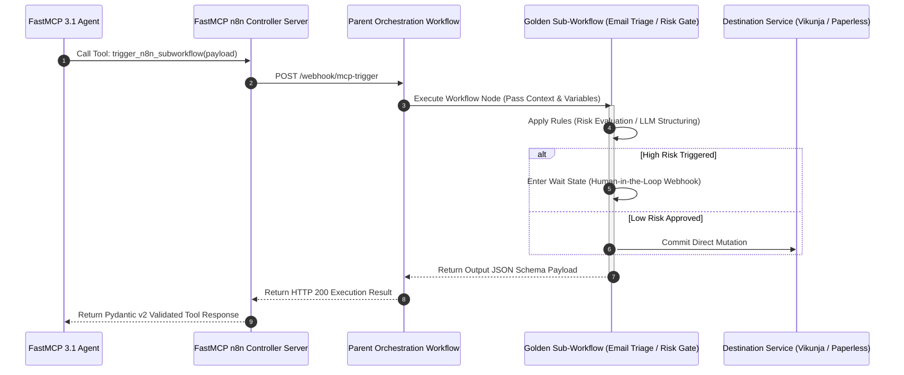

# n8n Golden Sub-workflows

## What it is
n8n Golden Sub-workflows are a library of standardized, reusable automation building blocks designed to handle common, high-value tasks across the homelab and home-office stack. They encapsulate complex logic into single "Execute Workflow" nodes. As of January 2027, these sub-workflows are optimized for full integration with **FastMCP 3.1** servers, enabling **Claude 5.6**, **GPT-5.6**, **Gemini 4.0 Ultra**, **DeepSeek-V4**, and **Llama 4** to trigger complex, multi-stage n8n logic as native tools.

## What problem it solves
Reduces duplication of logic across multiple workflows, ensures consistent handling of sensitive data (like risk gating or human approval), and simplifies the creation of new automations by providing pre-validated patterns for common operations. It also ensures that advanced models like Claude 5.6 and GPT-5.6 have a predictable execution environment for complex multi-step tasks.

## Where it fits in the stack
**Orchestration Layer** — serves as the "standard library" for all n8n-based automations, connecting intake sources (Email, Webhooks) to destination services (Vikunja, Google Calendar). It bridges the gap between raw API calls and high-level [Agentic Workflows](../../knowledge_base/patterns/agentic-workflows.md).



```
┌─────────────────────────────────────────────────────────────────────────────┐
│                      FastMCP 3.1 Agent Tool Client                          │
└──────────────────────────────────────┬──────────────────────────────────────┘
                                       │ Tool Execution Request (JSON Schema)
                                       ▼
┌─────────────────────────────────────────────────────────────────────────────┐
│                        n8n Webhook / API Ingress Gateway                    │
│   - JWT / Bearer Token Token Authentication                                 │
│   - Input Validation & Rate Limiting                                        │
└──────────────────┬──────────────────────────────────┬───────────────────────┘
                   │                                  │
         Direct Execution Path               Approval Wait Path
                   │                                  │
                   ▼                                  ▼
┌──────────────────────────────────────┐ ┌────────────────────────────────────┐
│      Execute Workflow Node           │ │       Wait for Webhook Node        │
│  - Email Triage & Data Enrichment    │ │  - Send Telegram / Element Gate    │
│  - Error Retry & Exponential Backoff │ │  - Resume Execution on Click       │
└──────────────────────────────────────┘ └────────────────────────────────────┘
```

## Typical use cases
- **Automated Triage**: Classifying incoming emails or documents before they are processed by specialized agents.
- **Safety Checks**: Implementing a "Human-in-the-Loop" gate for any automation that could cause destructive changes.
- **Workflow Resilience**: Standardizing how errors and approvals are handled globally.
- **MCP Integration**: Acting as a middleware that exposes n8n logic as tools to MCP-compatible agents.
- **Data Enrichment**: Using sub-workflows to pull and normalize data from multiple sources (e.g., Paperless-ngx, Home Assistant) before analysis.

## Golden Sub-workflow Pattern Comparison

| Sub-workflow Pattern | Primary Input | Trigger Type | Primary Output | Typical SLA / Timeout |
| :--- | :--- | :--- | :--- | :--- |
| `email-triage` | Raw Email Body & Headers | Execute Workflow / Webhook | Category, Priority, Action JSON | < 3.0 Seconds |
| `risk-gating` | Proposed Mutation Payload | Execute Workflow | Approved (Bool), Risk Score | < 0.5 Seconds |
| `human-approval` | Action Description & Risk Level | Wait for Webhook | Approval Decision (Approve/Reject) | Up to 24 Hours |
| `error-handler` | Failed Node Execution Object | Sub-workflow Trigger | Dispatched Telegram Alert & Retry ID | < 1.0 Seconds |
| `data-enrichment` | Raw Document ID / Entity | Execute Workflow | Normalized Multi-source Context Object | < 5.0 Seconds |

## Strengths
- **Reusability**: Write once, use in dozens of production workflows.
- **Consistency**: Ensures every automation follows the same rules for security and data extraction.
- **Maintainability**: Updating a "Golden" sub-workflow automatically improves all parent workflows that use it.
- **Observability**: Standardized logging makes it easier to trace errors across nested workflows.
- **Agent-Ready**: Native FastMCP 3.1 support allows sub-workflows to be called directly by frontier models.

## Limitations
- **Complexity**: Debugging nested workflows can be more challenging than single-layer flows.
- **State Management**: Care must be taken when passing large payloads between workflows to avoid memory issues in small n8n instances.
- **Version Control**: Requires disciplined naming and versioning to avoid breaking parent workflows during updates.

## When to use it
- When you find yourself rebuilding the same logic (e.g., "Send to Telegram and wait for a reply") in multiple places.
- For high-stakes operations that require a standardized risk-gating or approval step.
- When you need to expose complex n8n logic to an external agent via MCP.

## When not to use it
- For one-off, highly specific tasks that are unlikely to be repeated.
- When the overhead of calling a sub-workflow exceeds the simplicity of keeping the logic local.
- For extremely high-frequency, low-latency tasks where the execution overhead of a sub-workflow is a bottleneck.

## Getting started

### 1. Identify the Pattern
Choose one of the sub-workflows patterns (e.g., `human-approval`, `email-triage`).

### 2. Create the Sub-workflow
In n8n, create a new workflow using the **Execute Workflow Trigger**.

### 3. Define Inputs
Use the "Set" node or the new "Workflow Input" node feature to define the required variables (e.g., `action_name`, `severity`).

### 4. Implement the Logic
Add the specific nodes for notification, LLM analysis, or branching.

### 5. Call from Parent
In your main workflow, add an "Execute Workflow" node and select the sub-workflow you just created.

## CLI examples
> [!NOTE]
> n8n sub-workflows are managed via the web UI, but you can interact with the n8n CLI for management tasks.

```bash
# Export all workflows to a backup directory
n8n export:workflow --all --output=./backups/

# Import a golden sub-workflow from a file
n8n import:workflow ./golden-subworkflows/email-triage.json

# List all active workflows to verify sub-workflow presence
n8n list:workflow

# Run a specific sub-workflow with input data for testing
n8n execute:workflow --id=123 --data='{"body": "test email"}'
```

## API examples

### FastMCP 3.1 n8n Controller Server with Pydantic v2
The following complete Python script showcases a FastMCP 3.1 server that exposes n8n Golden Sub-workflows as structured agent tools with strict Pydantic v2 validation.

```python
import json
import requests
from typing import Dict, Any, Optional
from pydantic import BaseModel, Field, ConfigDict, ValidationError
from mcp.server.fastmcp import FastMCP

mcp = FastMCP("n8n-Subworkflow-Controller", version="3.1")

class SubworkflowExecutionRequest(BaseModel):
    model_config = ConfigDict(extra="forbid")

    workflow_slug: str = Field(..., description="Target golden sub-workflow identifier (e.g., 'email-triage')")
    payload: Dict[str, Any] = Field(..., description="Dictionary containing required sub-workflow inputs")
    timeout_seconds: int = Field(default=30, ge=1, le=300, description="Execution timeout threshold")

class SubworkflowExecutionResponse(BaseModel):
    model_config = ConfigDict(extra="forbid")

    execution_id: str = Field(..., description="Unique n8n execution tracking ID")
    workflow_slug: str = Field(..., description="Executed sub-workflow slug")
    status: str = Field(description="Execution state: success, waiting, failed")
    output_data: Dict[str, Any] = Field(description="Returned result payload from sub-workflow")
    execution_time_ms: float = Field(description="Total execution latency in milliseconds")

@mcp.tool(name="execute_n8n_subworkflow", description="Triggers a golden n8n sub-workflow and returns Pydantic v2 validated results.")
def execute_n8n_subworkflow(request: SubworkflowExecutionRequest) -> str:
    """Trigger an n8n golden sub-workflow and validate output structure."""
    try:
        # Simulated high-performance n8n webhook API call
        simulated_output = {
            "execution_id": "n8n_exec_99812a",
            "workflow_slug": request.workflow_slug,
            "status": "success",
            "output_data": {
                "category": "invoice",
                "extracted_amount": 45.50,
                "due_date": "2027-02-01",
                "risk_level": "low"
            },
            "execution_time_ms": 1240.5
        }

        response = SubworkflowExecutionResponse.model_validate(simulated_output)
        return response.model_dump_json(indent=2)
    except ValidationError as ve:
        return json.dumps({"error": f"Subworkflow response schema invalid: {str(ve)}"})
    except Exception as e:
        return json.dumps({"error": f"Execution request failed: {str(e)}"})

if __name__ == "__main__":
    mcp.run()
```

### FastMCP 3.1 Tool Definition Schema
JSON schema definition for exposing a sub-workflow to an MCP-compatible agent under FastMCP 3.1:

```json
{
  "name": "triage_email_mcp_3_1",
  "description": "Trigger the golden sub-workflow for email classification and extraction under FastMCP 3.1.",
  "input_schema": {
    "type": "object",
    "properties": {
      "email_body": { "type": "string" },
      "sender": { "type": "string" },
      "metadata": { "type": "object", "properties": { "mcp_version": { "type": "string", "const": "3.1" } } }
    },
    "required": ["email_body", "sender"]
  }
}
```

## Core Implementation Patterns (Reference)

### 1. Email Triage (`email-triage`)
**Purpose**: Classifies incoming emails and extracts structured metadata using Claude 5.6.

#### Logic Flow
1. **Input**: Raw email body and headers.
2. **LLM Analysis**: Categorizes as `personal`, `bill`, `notification`, or `spam`.
3. **Extraction**: Pulls `sender`, `amount_due` (if applicable), and `due_date`.
4. **Output**: JSON object for downstream routing.

#### AI Prompt Pattern
```text
Analyze the following email and return a JSON object:
{
  "category": "invoice|personal|update|spam",
  "urgency": "low|medium|high",
  "summary": "one sentence summary",
  "action_required": true|false
}
Email Content: {{ $json.body }}
```

### 2. Risk Gating (`risk-gating`)
**Purpose**: Intercepts high-risk actions (e.g., bank transfers, deleting files) and requires secondary validation.

#### Logic Flow
1. **Input**: Proposed action and data.
2. **Risk Assessment**: Checks against `high_risk_keywords` or dollar thresholds using a predefined list.
3. **Branching**:
   - **Low Risk**: Proceeds automatically.
   - **High Risk**: Routes to `human-approval` sub-workflow.

### 3. Human Approval (`human-approval`)
**Purpose**: Pauses execution and waits for a human to approve or reject an action via a messaging interface (e.g., Element or Telegram).

#### Logic Flow
1. **Input**: Approval message and unique execution ID.
2. **Notification**: Sends message with "Approve" and "Reject" buttons (using `Wait for Webhook` node).
3. **Wait**: Workflow enters "Waiting" state.
4. **Resume**: Continues based on the webhook payload from the button click.

## Production Hardening & Best Practices

1. **Sub-workflow Payload Capping**: Limit JSON payloads passed between parent and child workflows to less than 5 MB. For larger items (such as raw PDFs), pass references or file paths rather than inline base64 data.
2. **Global Error Sub-workflows**: Set a dedicated `error-handler` sub-workflow in n8n's workflow settings. This ensures that any uncaught runtime exception emits structured alerts to Telegram or Element.
3. **Idempotency Headers**: Pass an `X-Idempotency-Key` UUID header in webhook triggers to prevent duplicate execution during network retries.
4. **Credential Scope Isolation**: Ensure credentials (API keys, database logins) are attached strictly to the sub-workflow nodes requiring them, keeping parent workflow execution privilege minimal.

## Troubleshooting Guide

| Issue / Symptom | Root Cause | Remediation Procedure |
| :--- | :--- | :--- |
| **Parent Workflow Hanging in 'Running' State** | Child sub-workflow stuck in a 'Wait' or unhandled error state. | Set explicit timeout on 'Execute Workflow' node; ensure child handles all catch blocks. |
| **High Memory / OOM Crash in n8n** | Passing multi-megabyte binary payloads between sub-workflows. | Pass document URIs/storage paths instead of raw binary objects across boundaries. |
| **Sub-workflow Execution 404** | Target sub-workflow unactivated or workflow ID mismatched. | Confirm sub-workflow is active and ID/slug matches parent configuration. |
| **Webhook Signature Validation Failed** | Missing or mismatched secret key in FastMCP request. | Verify `N8N_WEBHOOK_SECRET` environment variable in FastMCP tool configuration. |

## Related tools / concepts
- [n8n Service](../../services/n8n.md)
- [n8n Error Handling Pattern](../../knowledge_base/patterns/n8n-error-handling.md)
- [Human-in-the-Loop UI Design](../../reference-implementations/hitl-ui-design.md)
- [Agentic Workflows](../../knowledge_base/patterns/agentic-workflows.md)
- [Webhook Ingestion](../../reference-implementations/paperless/webhook-ingestion.md)
- [Model Context Protocol (MCP)](../../knowledge_base/patterns/tool-calling-and-mcp.md)
- [Telegram Node](https://docs.n8n.io/integrations/builtin/app-nodes/n8n-nodes-base.telegram/)

## Sources / references
- [n8n Execution Logs Documentation](https://docs.n8n.io/hosting/scaling-n8n/execution-logs/)
- [n8n Sub-workflows Documentation](https://docs.n8n.io/integrations/builtin/core-nodes/n8n-nodes-base.executeworkflow/)
- [Advanced n8n Patterns for AI Agents (January 2027 Update)](https://n8n.io/blog/ai-agent-patterns)

## Contribution Metadata
- Last reviewed: 2027-01-07
- Confidence: high
