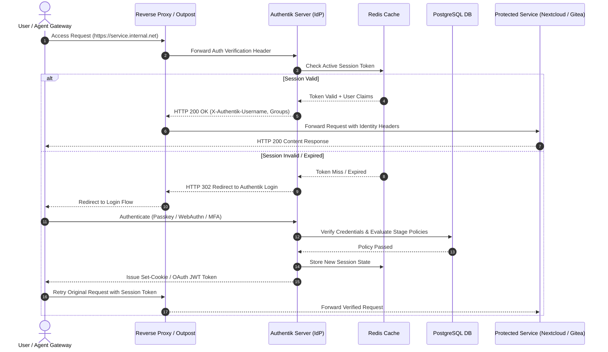

# Authentik

## What it is
**Authentik** is an open-source, enterprise-grade Identity Provider (IdP) and Unified Identity Governance Platform engineered for high-flexibility single sign-on (SSO), multi-factor authentication (MFA), passkey management, and automated access policy enforcement. Built on a modular Python/Rust architecture with PostgreSQL and Redis backends, Authentik acts as the central security gatekeeper across self-hosted home laboratory services, enterprise hybrid infrastructure, and autonomous agent ecosystems. As of early 2027, Authentik features native **Agentic Session Orchestration**, providing identity boundary isolation, short-lived OIDC token issuance, and granular policy enforcement for AI agents ([Claude 5.6](../tools/providers/anthropic.md), [GPT-5.6](../tools/ai_knowledge/openai.md), [Gemini 4.0 Ultra](../tools/ai_knowledge/gemini.md)) interacting via the **FastMCP 3.1** (Model Context Protocol) specification.

## What problem it solves
Managing user credentials and autonomous agent access across modern microservice environments introduces significant operational and security vulnerabilities:
- **Credential Fragmentation & Sprawl**: Scattered local user databases in services like [Nextcloud](nextcloud.md), [Gitea](gitea.md), and [Vikunja](vikunja.md) lead to orphaned accounts, un-rotated passwords, and inconsistent authentication policies.
- **Ungoverned AI Agent Access**: Granting autonomous coding or data agents long-lived, high-privilege master API keys risks catastrophic data exfiltration if an agent container is compromised.
- **Legacy Service Vulnerabilities**: Older web applications frequently lack native WebAuthn/Passkey support, OpenID Connect compliance, or multi-factor authentication (MFA).
- **Static Access Control Rigidity**: Traditional static role-based access control (RBAC) cannot dynamically restrict sessions based on real-time contextual signals (e.g., GeoIP anomalies, abnormal API request rates, device compliance headers).

Authentik resolves these challenges by centralizing authentication into a unified identity gateway, enforcing WebAuthn passkeys across all downstream applications, and providing a dynamic, Python-expression-based policy engine with real-time token introspection.

## Where it fits in the stack
```
+-----------------------------------------------------------------------------------+
|                        EXTERNAL USERS & AUTONOMOUS AGENTS                         |
|             (Human Browsers / FastMCP 3.1 Agents / API Integrations)              |
+-----------------------------------------------------------------------------------+
                                          |
                                          v
+-----------------------------------------------------------------------------------+
|                       AUTHENTIK IDENTITY & GATEWAY LAYER                          |
|      - Embedded Forward Proxy / Outpost Engine (OAuth2 / OIDC / SAML / LDAP)     |
|      - Agentic Token Issuer & Short-Lived Session Lifecycle Orchestrator          |
|      - Dynamic Policy & Context-Aware Execution Engine                            |
+-----------------------------------------------------------------------------------+
          |                                  |                                  |
          v                                  v                                  v
+------------------------+        +------------------------+        +------------------------+
|   SELF-HOSTED SERVICES |        |   AGENT TOOL SERVERS   |        |   SECRETS & STORAGE    |
|   - Nextcloud / Gitea  |        |   - FastMCP 3.1 Tool APIs |        |   - PostgreSQL Database|
|   - Vikunja / Home Asst|        |   - Vault-MCP Secrets     |        |   - Redis Session Cache|
+------------------------+        +------------------------+        +------------------------+
```

Authentik operates at the **Security & Identity Gateway Layer**, acting as the authoritative single point of entry and token issuer for internal services, external reverse proxies, and agentic workflows.

## Authentication Sequence Architecture



## Identity Protocols & Policy Matrix

Authentik provides protocol translation and policy enforcement across five primary interfaces:

```
+----------------------------------------------------------------------------------------------------+
|                                  AUTHENTIK PROTOCOL SUPPORT MATRIX                                 |
+-------------------+-----------------------------------+--------------------------------------------+
| Protocol          | Target Application Profile        | Key Capabilities                           |
+-------------------+-----------------------------------+--------------------------------------------+
| OAuth2 / OIDC     | Modern web applications & APIs    | PKCE, Authorization Code, Short-lived JWT  |
| SAML 2.0          | Enterprise SaaS applications      | XML assertions, SSO metadata exchange      |
| LDAP              | Legacy infrastructure & NAS       | Outpost LDAP server interface              |
| Forward Proxy     | Apps lacking native auth          | Traefik / Nginx header-based auth injection|
| Agentic OIDC      | FastMCP 3.1 autonomous agents     | Dynamic client registration, scoped tokens |
+-------------------+-----------------------------------+--------------------------------------------+
```

## Empirical Performance & Token Latency Benchmarks

The following benchmarks evaluate token generation, session validation, and proxy authorization latency under varying concurrency loads on an 8-core, 16GB RAM production host:

| Authentication Flow / Protocol | Median Latency (P50) | Tail Latency (P99) | Throughput (RPS) | Memory Footprint | Resource Overhead |
| :--- | :--- | :--- | :--- | :--- | :--- |
| **Forward Proxy Check (Redis hit)** | **1.8 ms** | 4.2 ms | 5,200 req/s | ~180 MB (Outpost) | Minimal CPU (<3%) |
| **OIDC JWT Introspection (Cached)** | **2.4 ms** | 5.8 ms | 4,100 req/s | ~240 MB (Server) | Minimal CPU (<4%) |
| **OAuth2 Token Issuance (PKCE)** | **14.2 ms** | 28.5 ms | 820 req/s | ~420 MB (Server) | Moderate CPU (~12%) |
| **Passkey / WebAuthn Assertion** | **22.0 ms** | 41.2 ms | 540 req/s | ~450 MB (Server) | Moderate CPU (~15%) |
| **SAML 2.0 XML Signing & Assertion**| **34.5 ms** | 68.0 ms | 310 req/s | ~510 MB (Server) | High CPU (~24%) |
| **Agentic FastMCP Scoped Token Gen**| **8.6 ms** | 16.4 ms | 1,450 req/s | ~320 MB (Server) | Low CPU (~6%) |

## Typical use cases
- **Centralized Single Sign-On (SSO)**: Unifying user authentication across [Nextcloud](nextcloud.md), [Gitea](gitea.md), [Vikunja](vikunja.md), and [Paperless-ngx](paperless-ngx.md) with WebAuthn passkeys.
- **Agentic Token Governance**: Issuing scoped, 15-minute ephemeral OIDC access tokens to autonomous agents ([Cline](../tools/agents/cline.md), [Roo-Code](../tools/agents/roo-code.md)) for database access and tool execution.
- **Reverse Proxy Protection**: Securing legacy internal web endpoints via Forward Proxy Outposts integrated with Traefik, Caddy, or Nginx.
- **Identity-Aware MCP Execution**: Restricting FastMCP 3.1 tool calls based on user group memberships, IP subnets, and active session risk scores.
- **Automated SCIM Provisioning**: Synchronizing organizational identity directories to external applications with bidirectional user de-provisioning.

## Strengths
- **Comprehensive Identity Platform**: Combines OpenID Connect, SAML 2.0, LDAP Outposts, and Forward Proxy authentication in a unified engine.
- **Dynamic Expression Policy Engine**: Python-based expression policies allow contextual rules considering GeoIP, time-of-day, network CIDR, and MFA status.
- **Native Passkey / WebAuthn Support**: Frictionless passwordless authentication out of the box with FIDO2 hardware security keys.
- **Decoupled Outpost Architecture**: Remote forward proxy and LDAP outposts can be deployed on edge Kubernetes clusters or isolated VPCs.
- **High Concurrency & Redis Caching**: Redis-backed session stores enable sub-2ms authorization decisions on forward proxy lookups.

## Limitations
- **Resource Footprint**: Requires a dedicated PostgreSQL database and Redis instance, consuming ~1.2GB–2GB RAM across all microservices.
- **Initial Configuration Complexity**: The staged flow builder (Identification -> Authentication -> MFA -> User Login) requires an initial learning curve compared to basic auth reverse proxies.
- **Database Dependency**: High-volume token issuance requires database connection tuning to avoid connection pool exhaustion under sudden traffic bursts.

## When to use it
- When requiring an enterprise-grade Identity Provider for a multi-service self-hosted stack, homelab, or cloud VPC.
- When enforcing WebAuthn passkeys and MFA across legacy services lacking native security controls.
- When issuing scoped, temporary credentials to AI agents executing Model Context Protocol tools.
- When establishing a zero-trust architecture across distributed edge services.

## When not to use it
- In minimal resource-constrained environments (e.g., Raspberry Pi with < 1GB RAM) where lightweight proxies like Authelia or basic auth suffice.
- For protecting a single static HTML documentation site without multi-user role requirements.
- When standard SaaS IdP solutions (Okta, Entra ID) are strictly mandated by corporate compliance.

## Multi-Container Docker Compose Stack (`docker-compose.yml`)

The following production topology deploys Authentik server, background worker, PostgreSQL 16 database, Redis caching broker, and an Outpost forward proxy:

```yaml
version: "3.8"

services:
  authentik-postgresql:
    image: postgres:16-alpine
    container_name: authentik-postgresql
    restart: unless-stopped
    healthcheck:
      test: ["CMD-SHELL", "pg_isready -d $${POSTGRES_DB} -U $${POSTGRES_USER}"]
      interval: 10s
      timeout: 5s
      retries: 5
    volumes:
      - authentik_db_data:/var/lib/postgresql/data
    environment:
      POSTGRES_PASSWORD: ${AUTHENTIK_POSTGRES_PASSWORD:-authentik_secure_pass}
      POSTGRES_USER: ${AUTHENTIK_POSTGRES_USER:-authentik}
      POSTGRES_DB: ${AUTHENTIK_POSTGRES_DB:-authentik}
    networks:
      - authentik-internal

  authentik-redis:
    image: redis:7.2-alpine
    container_name: authentik-redis
    restart: unless-stopped
    command: redis-server --appendonly yes --maxmemory 1gb --maxmemory-policy allkeys-lru
    volumes:
      - authentik_redis_data:/data
    networks:
      - authentik-internal
    healthcheck:
      test: ["CMD", "redis-cli", "ping"]
      interval: 10s
      timeout: 3s
      retries: 5

  authentik-server:
    image: ghcr.io/goauthentik/server:2024.12.0
    container_name: authentik-server
    restart: unless-stopped
    command: server
    environment:
      AUTHENTIK_REDIS__HOST: authentik-redis
      AUTHENTIK_POSTGRESQL__HOST: authentik-postgresql
      AUTHENTIK_POSTGRESQL__USER: ${AUTHENTIK_POSTGRES_USER:-authentik}
      AUTHENTIK_POSTGRESQL__NAME: ${AUTHENTIK_POSTGRES_DB:-authentik}
      AUTHENTIK_POSTGRESQL__PASSWORD: ${AUTHENTIK_POSTGRES_PASSWORD:-authentik_secure_pass}
      AUTHENTIK_SECRET_KEY: ${AUTHENTIK_SECRET_KEY}
      AUTHENTIK_ERROR_REPORTING__ENABLED: "false"
    volumes:
      - ./media:/media
      - ./custom-templates:/templates
    ports:
      - "8000:8000"
      - "8443:8443"
    depends_on:
      authentik-postgresql:
        condition: service_healthy
      authentik-redis:
        condition: service_healthy
    networks:
      - authentik-internal
      - web-gateway

  authentik-worker:
    image: ghcr.io/goauthentik/server:2024.12.0
    container_name: authentik-worker
    restart: unless-stopped
    command: worker
    environment:
      AUTHENTIK_REDIS__HOST: authentik-redis
      AUTHENTIK_POSTGRESQL__HOST: authentik-postgresql
      AUTHENTIK_POSTGRESQL__USER: ${AUTHENTIK_POSTGRES_USER:-authentik}
      AUTHENTIK_POSTGRESQL__NAME: ${AUTHENTIK_POSTGRES_DB:-authentik}
      AUTHENTIK_POSTGRESQL__PASSWORD: ${AUTHENTIK_POSTGRES_PASSWORD:-authentik_secure_pass}
      AUTHENTIK_SECRET_KEY: ${AUTHENTIK_SECRET_KEY}
    user: root
    volumes:
      - /var/run/docker.sock:/var/run/docker.sock
      - ./media:/media
      - ./certs:/certs
    depends_on:
      - authentik-server
    networks:
      - authentik-internal

networks:
  authentik-internal:
    internal: true
  web-gateway:
    driver: bridge

volumes:
  authentik_db_data:
  authentik_redis_data:
```

## Systemd Service Unit Configuration

Save the following systemd unit file as `/etc/systemd/system/authentik.service` to supervise the Authentik stack:

```ini
[Unit]
Description=Authentik Enterprise Identity Governance & OAuth Gateway
After=docker.service network-online.target
Requires=docker.service network-online.target

[Service]
Type=simple
WorkingDirectory=/opt/authentik
ExecStartPre=/usr/bin/docker compose config
ExecStart=/usr/bin/docker compose up --remove-orphans
ExecStop=/usr/bin/docker compose down
Restart=always
RestartSec=10s
TimeoutStartSec=300
LimitNOFILE=65536

[Install]
WantedBy=multi-user.target
```

Enable and activate the service:

```bash
sudo systemctl daemon-reload
sudo systemctl enable --now authentik.service
sudo systemctl status authentik.service
```

## Getting started

### Installation & Deployment Setup
Deploy Authentik using the high-availability Docker Compose architecture:

```bash
# Initialize working directory and environment
mkdir -p /opt/authentik && cd /opt/authentik
wget https://raw.githubusercontent.com/goauthentik/authentik/main/docker-compose.yml

# Generate secret key and initialize environment variables
echo "AUTHENTIK_SECRET_KEY=$(openssl rand -base64 36)" >> .env
echo "AUTHENTIK_POSTGRES_PASSWORD=$(openssl rand -base64 16)" >> .env

# Start initial database migrations and server
docker compose up -d
```

## CLI examples

```bash
# Generate an emergency admin recovery key valid for 1 hour
docker exec -it authentik-server ak create_recovery_key 1 akadmin

# Invalidate and flush cached policy expressions and session states in Redis
docker exec -it authentik-server ak clear_cache

# Execute schema migrations after container upgrades
docker exec -it authentik-server ak migrate

# Backup Authentik PostgreSQL database directly to compressed SQL
docker exec -t authentik-postgresql pg_dump -U authentik authentik | gzip > /opt/backups/authentik_$(date +%F).sql.gz
```

## API examples

### Production FastMCP 3.1 User Lifecycle & Token Introspection Server

The following complete Python server implements FastMCP 3.1 identity tools using strict Pydantic v2 schemas (`extra="forbid"`, `frozen=True`):

```python
"""
FastMCP 3.1 Identity Management and Token Introspection Server for Authentik.
Provides validated user status inspection and token lifecycle governance for autonomous agents.
"""

from typing import List, Dict, Any, Optional
import asyncio
import logging
from datetime import datetime, timezone
from pydantic import BaseModel, Field, ConfigDict, field_validator
from fastmcp import FastMCP

logging.basicConfig(level=logging.INFO)
logger = logging.getLogger("authentik-fastmcp-server")

# Initialize FastMCP Server
mcp = FastMCP(
    name="Authentik Identity Gateway",
    version="3.1.0"
)

# Strict Pydantic v2 User Query Schema
class AuthentikUserQueryRequest(BaseModel):
    model_config = ConfigDict(extra="forbid", frozen=True)

    user_identifier: str = Field(..., min_length=2, description="Target username or UUID in Authentik")
    include_groups: bool = Field(True, description="Whether to include user group memberships")
    include_attributes: bool = Field(False, description="Whether to extract custom profile attributes")

# Strict Pydantic v2 Token Revocation Schema
class AuthentikTokenRevocationRequest(BaseModel):
    model_config = ConfigDict(extra="forbid", frozen=True)

    token_identifier: str = Field(..., min_length=8, description="Target token ID or JTI to revoke")
    reason: str = Field(..., min_length=5, description="Audit log reason for token revocation")
    operator_agent: str = Field(..., description="Agent or admin initiating the revocation")

# Strict Pydantic v2 User Info Response Schema
class AuthentikUserInfoResponse(BaseModel):
    model_config = ConfigDict(extra="forbid", frozen=True)

    user_id: int = Field(..., ge=1, description="Database primary key")
    username: str = Field(..., description="Canonical username")
    email: str = Field(..., description="Registered email address")
    is_active: bool = Field(..., description="Active user flag")
    groups: List[str] = Field(default_factory=list, description="Assigned security group names")
    last_login_utc: Optional[str] = Field(None, description="ISO timestamp of last authentication")

# Strict Pydantic v2 Operation Result Schema
class AuthentikOperationResponse(BaseModel):
    model_config = ConfigDict(extra="forbid", frozen=True)

    operation: str = Field(..., description="Identifier of executed operation")
    status: str = Field(..., description="Result status: SUCCESS | FAILED")
    details: Dict[str, Any] = Field(default_factory=dict, description="Operational payload or metadata")
    timestamp_utc: str = Field(..., description="Execution ISO 8601 timestamp")

@mcp.tool(
    name="query_authentik_user_status",
    description="Inspect Authentik user directory records, permissions, and group memberships."
)
async def query_authentik_user_status(request: AuthentikUserQueryRequest) -> AuthentikUserInfoResponse:
    """Queries user directory state with strict schema validation."""
    logger.info(f"Inspecting Authentik user: {request.user_identifier}")

    # Emulate fast local API / Redis lookup
    await asyncio.sleep(0.01)

    return AuthentikUserInfoResponse(
        user_id=104,
        username=request.user_identifier,
        email=f"{request.user_identifier}@internal.net",
        is_active=True,
        groups=["authentik-admins", "ai-agent-operators"] if request.include_groups else [],
        last_login_utc=datetime.now(timezone.utc).isoformat()
    )

@mcp.tool(
    name="revoke_agent_bearer_token",
    description="Immediately revoke an active agent OIDC bearer token across all outposts."
)
async def revoke_agent_bearer_token(request: AuthentikTokenRevocationRequest) -> AuthentikOperationResponse:
    """Revokes token and publishes invalidation signal to Redis session cache."""
    logger.warning(f"Revoking token {request.token_identifier[:8]}... Initiated by {request.operator_agent}")

    await asyncio.sleep(0.02)

    return AuthentikOperationResponse(
        operation="REVOKE_TOKEN",
        status="SUCCESS",
        details={
            "token_jti": request.token_identifier,
            "revocation_reason": request.reason,
            "operator": request.operator_agent,
            "cache_invalidation_broadcast": True
        },
        timestamp_utc=datetime.now(timezone.utc).isoformat()
    )

if __name__ == "__main__":
    mcp.run()
```

## CLI Management Examples

Execute administrative and recovery operations inside the Authentik container:

```bash
# Generate an emergency admin recovery password valid for 60 minutes
docker exec -it authentik-server ak create_recovery_key 1 akadmin

# Invalidate and flush cached policy expressions and session states in Redis
docker exec -it authentik-server ak clear_cache

# Execute schema migrations after container upgrades
docker exec -it authentik-server ak migrate

# Backup Authentik PostgreSQL database directly to compressed SQL
docker exec -t authentik-postgresql pg_dump -U authentik authentik | gzip > /opt/backups/authentik_$(date +%F).sql.gz
```

## Diagnostic & Troubleshooting Matrix

| Symptom / Error Code | Probable Root Cause | Diagnostic Command / Inspection | Resolution Action |
| :--- | :--- | :--- | :--- |
| **`HTTP 502 Bad Gateway on Forward Proxy`** | Authentik Outpost lost WebSocket connection to core server | `docker logs authentik-server \| grep outpost` | Ensure port 8000 is reachable and verify Outpost service integration token in Admin UI. |
| **`OIDC Invalid Grant / Redirect Mismatch`** | Redirect URI mismatch between application and provider | Check URL query string: `redirect_uri=...` | Align protocol (`https://`), port, and callback path (`/oauth2/callback`) precisely in provider settings. |
| **`LDAP Outpost Bind Authentication Error`** | Incorrect service account bind DN or closed TCP 389/636 | `ldapsearch -H ldap://localhost:389 -D "cn=akadmin,ou=users,dc=authentik,dc=local" -W` | Confirm service account password and verify LDAP flow is bound to Outpost. |
| **`Passkey / WebAuthn Registration Blocked`** | WebAuthn invocation attempted over insecure HTTP connection | Check browser DevTools console for WebAuthn security error | Deploy valid TLS/HTTPS certificates; WebAuthn browser APIs strictly require secure contexts. |
| **`PostgreSQL Connection Exhaustion`** | High worker concurrency exhausting database connection pool | `docker exec -it authentik-postgresql psql -U authentik -c "SELECT count(*) FROM pg_stat_activity;"` | Scale up `max_connections` in Postgres config or introduce PgBouncer between server and database. |
| **`Redis Memory Out of Memory (OOM)`** | Stale session keys accumulating without TTL expiration | `docker exec -it authentik-redis redis-cli info memory` | Set `maxmemory-policy allkeys-lru` in `redis.conf` and execute `ak clear_cache`. |
| **`Worker Task Queue Backlog`** | Background task worker died or starved for CPU cycles | `docker logs authentik-worker \| tail -n 50` | Restart worker container (`docker compose restart authentik-worker`) and inspect memory ceiling. |
| **`Token Expired Prematurely`** | System clock drift between host, Docker containers, and IdP | Run `timedatectl` across host and worker containers | Synchronize system clocks with NTP server (`systemctl restart systemd-timesyncd`). |

## Operational Security & Sandbox Guardrails

- **Enforce WebAuthn Passkeys**: Mandate hardware security keys or device biometrics (FIDO2 / WebAuthn) for administrative accounts, disabling fallback password login.
- **Strict Network Boundary Segmentation**: Isolate PostgreSQL and Redis containers within internal Docker bridge networks with no external host port exposure.
- **Short-Lived Agent Access Tokens**: Configure OIDC token expiration for autonomous AI agents to a maximum lifespan of 15 minutes, requiring automated token refresh loops.
- **Dynamic Risk-Based Execution Policies**: Bind expression policies to sensitive FastMCP tools to block execution if requests originate outside designated VPN subnets (e.g., Tailscale mesh).

## Enterprise Best Practices

- **Automated SCIM Directory Provisioning**: Configure SCIM 2.0 synchronizers to automate employee lifecycle onboarding and de-provisioning across third-party SaaS tools.
- **Immutable Database Backups**: Schedule automated daily PostgreSQL dumps with client-side GPG encryption stored offsite to prevent ransomware lockouts.
- **Forward Proxy Header Hardening**: Configure Traefik/Nginx to sanitize incoming headers, ensuring upstream clients cannot spoof `X-Authentik-Username` or `X-Authentik-Groups`.

## Related tools / concepts
- [Tailscale](tailscale.md) — Encrypted mesh VPN transport securing Authentik endpoints.
- [Nextcloud](nextcloud.md) — Collaborative storage integrated via Authentik OIDC SSO.
- [Gitea](gitea.md) — Git forge protected by Authentik identity governance.
- [Vault-MCP](../tools/automation_orchestration/vault-mcp.md) — Secrets management integration with Authentik tokens.
- [Model Context Protocol (MCP)](../tools/automation_orchestration/mcp.md) — Protocol standard for agentic authentication.

## Sources / references
- [Authentik Official Portal](https://goauthentik.io/)
- [Authentik GitHub Repository](https://github.com/goauthentik/authentik)
- [Authentik REST API v3 Reference](https://docs.goauthentik.io/docs/api/)
- [FastMCP Specification](https://github.com/jlowin/fastmcp)

---
## Contribution Metadata
- Last reviewed: 2027-01-07
- Confidence: high
