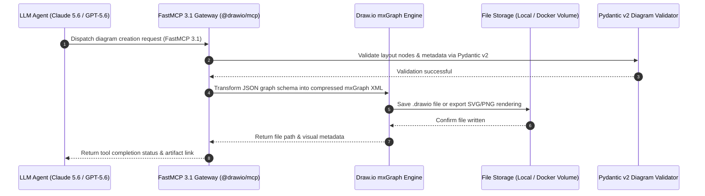

# Draw.io (diagrams.net)

## What it is
Draw.io (diagrams.net v35.x) is a free, open-source, cross-platform diagramming application developed in HTML5 and JavaScript. It provides an intuitive interface for drawing flowcharts, network topographies, database entity-relationship (ER) diagrams, software UML architectures, and process maps. In early 2027, Draw.io serves as an essential visual communication channel for home-lab operators, enterprise engineers, and autonomous AI agents. Through native integration with the **Model Context Protocol (MCP 3.1)** via `@drawio/mcp` and the **FastMCP 3.1 Task Protocol**, AI agents like **Claude 5.6**, **GPT-5.6**, **Gemini 4.0 Ultra**, and **Gemma 4** can programmatically construct, layout-optimize, and export architectural diagrams from raw structural definitions or natural language.

## What problem it solves
Technical architecture documentation frequently suffers from out-of-date diagrams, proprietary file lock-in (e.g., Visio formats), and high licensing costs. Draw.io eliminates vendor lock-in by utilizing open XML/SVG formats (`.drawio`) and supporting multi-platform deployment (web, desktop, Docker). Furthermore, it solves the challenge of AI-driven visual reporting: agents convert complex system states into clear visual graphs without human manual formatting:

```
[System Code / Infra State] --> [FastMCP 3.1 Task Server] --> [Draw.io XML/mxGraph Engine] --> [Visual SVG/PNG Artifact]
```

## System Architecture

The following diagram illustrates how Draw.io operates as both a standalone web/desktop application and an AI-driven visual output device via `@drawio/mcp` and FastMCP 3.1 task protocol gateways:

```
+-----------------------------------------------------------------------------------+
|                              DRAW.IO ARCHITECTURE                                 |
+-----------------------------------------------------------------------------------+
                                          |
                                          v
+------------------+             +------------------+             +-----------------+
| Human Operator   | ----------> | Draw.io Web UI / | <---------> | Local Storage / |
| Browser / App    |             | Docker Service   |             | Nextcloud / Git |
+------------------+             +------------------+             +-----------------+
                                          ^                                ^
                                          |                                |
                                   mxGraph / XML                    mxGraph / XML
                                          |                                |
+------------------+             +------------------+                      |
| AI Agent         | ----------> | FastMCP 3.1 Tool | ---------------------+
| (Claude 5.6)     |  JSON-RPC   | Gateway Server   |
+------------------+             +------------------+
```



## Where it fits in the stack
**Documentation and Design / Visual Knowledge Operations**. Draw.io sits at the visualization layer of home-office and enterprise AI stacks. It translates raw system configurations, docker-compose files, and Kubernetes manifests into standardized visual diagrams.

```
+-------------------------------------------------------------------------------+
|                        DRAW.IO STACK INTEGRATION                              |
+-------------------------------------------------------------------------------+
| Layer                       | System / Tool Examples                          |
+-----------------------------+-------------------------------------------------+
| User & Agent Interfaces     | Web Browser, Desktop App, Claude Code, OpenHands|
| Visualization Engine        | Draw.io (jgraph/drawio Docker), `@drawio/mcp`   |
| Version Control & Storage   | Gitea, GitHub, Nextcloud, Local File System     |
| Downstream Archiving        | Paperless-ngx, Obsidian Knowledge Base          |
| Authentication & Access     | Authentik, Tailscale VPN Mesh                   |
+-------------------------------------------------------------------------------+
```

## Diagramming Tool Comparison Matrix

| Feature / Metric | Draw.io (diagrams.net) | Excalidraw | Lucidchart | Mermaid.js |
| :--- | :--- | :--- | :--- | :--- |
| **Primary Style** | Technical & Formal (Visio-style) | Hand-drawn / Casual Sketch | Formal SaaS Workspace | Text-to-Diagram Code |
| **Storage & Privacy** | Local-first, Self-Hosted, Cloud | Local-first / Browser | Proprietary SaaS Cloud | Text Markdown Embedded |
| **MCP 3.1 Agent Native** | Native (`@drawio/mcp` FastMCP) | MCP Community Adapters | SaaS API Connectors | Text Processing Native |
| **Native Formats** | `.drawio`, XML, SVG, PNG, PDF | `.excalidraw`, SVG, PNG | Proprietary / PDF | Plaintext Markdown |
| **Self-Hosting** | Docker Container (`jgraph/drawio`)| Docker / Node.js | No (SaaS only) | N/A (JS Renderer) |
| **Extensible Icon Libraries**| AWS, Azure, GCP, Cisco, Kubernetes | Minimal / Hand-drawn | Extensive Cloud Stencils | Basic Shape Symbols |
| **Visio Import/Export** | Full `.vsdx` Support | Limited | Full Support | No |

## Typical use cases
- **Home Lab Network Topography**: Mapping router configurations, VLAN segments, TrueNAS pools, and container bridge networks.
- **Software Systems Architecture**: Generating UML class diagrams, database ER diagrams, and microservice interaction flows.
- **Automated AI Architecture Generation**: Allowing agents like **Claude 5.6** or **Gemma 4** to convert codebase analysis into live `.drawio` diagrams via `@drawio/mcp`.
- **Text-to-Diagram Rendering**: Importing Mermaid or PlantUML markup directly into Draw.io for visual layout tuning.
- **Documentation Archiving**: Exporting PDF and SVG architectural records to [Paperless-ngx](paperless-ngx.md) or [Obsidian](../tools/ai_knowledge/obsidian.md).

## Strengths
- **Privacy-First & Local-First**: Complete ownership of diagram files with zero mandatory cloud registration.
- **MCP 3.1 & FastMCP Support**: Direct integration with `@drawio/mcp` for agentic diagram creation and layout optimization.
- **Extensive Shape & Icon Collections**: Includes official icon libraries for AWS, Azure, GCP, Kubernetes, Cisco, and network hardware.
- **Universal Compatibility**: Seamlessly imports and exports Microsoft Visio (`.vsdx`), Lucidchart, and vector formats.
- **Cross-Platform Availability**: Operates as a web app, desktop installer, or self-hosted Docker container.

## Limitations
- **Compressed XML Format**: Default `.drawio` files embed compressed `mxGraph` XML payloads, requiring decoding for raw text diffing.
- **Real-Time Collaboration Overhead**: Multi-user live editing in self-hosted deployments requires additional WebSocket sync server setup.
- **Interface Complexity**: Rich feature density can feel overwhelming for quick, informal whiteboard sketches (use [Excalidraw](excalidraw.md) for quick sketches).

## When to use it
- When creating formal technical diagrams (network architectures, UML, ER schemas, cloud infrastructure maps).
- When requiring an open-source, self-hosted alternative to Microsoft Visio or Lucidchart.
- When orchestrating automated architecture diagram updates via AI agents over MCP 3.1.

## When not to use it
- For text-only diagrams that must be reviewed strictly via git diffs in pull requests (use text-native Mermaid syntax).
- For rapid, informal sketching during brainstorming sessions (use [Excalidraw](excalidraw.md)).

## Getting started

### Self-Hosted Docker Deployment
Deploy a self-hosted instance of Draw.io using Docker:

```bash
docker run -d \
  --name="drawio" \
  -p 8080:8080 \
  -p 8443:8443 \
  --restart=unless-stopped \
  jgraph/drawio:latest
```

Access your private web instance at `http://localhost:8080`.

### Desktop Installation
Download the offline desktop application for Linux, macOS, or Windows:
- Download installer packages from the [Official GitHub Releases Page](https://github.com/jgraph/drawio-desktop/releases).

### MCP 3.1 Agent Integration Setup
To allow Claude Code or other MCP-compliant agents to edit and export diagrams, configure the MCP tool server:

```json
{
  "mcpServers": {
    "drawio": {
      "command": "npx",
      "args": ["-y", "@drawio/mcp"]
    }
  }
}
```

## CLI examples

### Exporting Diagrams via Desktop CLI
The Draw.io desktop application includes a powerful headless CLI for batch conversions:

```bash
# Create a sample XML file
cat > infrastructure.drawio <<'XML'
<mxfile><diagram name="Page-1"><mxGraphModel><root><mxCell id="0"/><mxCell id="1" parent="0"/></root></mxGraphModel></diagram></mxfile>
XML

# Convert .drawio file to PDF
drawio -x -f pdf -o output/architecture.pdf infrastructure.drawio

# Export to PNG with 1200px width and transparent background
drawio -x -f png --width 1200 --transparent -o output/architecture.png infrastructure.drawio

# Export all pages to SVG
drawio -x -f svg --all-pages -o output/svg_pages/ infrastructure.drawio
```

### Inspecting Docker Container Health
Verify the status of your self-hosted Draw.io Docker container:

```bash
docker inspect --format='{{.State.Status}} (Port: {{index .NetworkSettings.Ports "8080/tcp"}})' drawio
```

## FastMCP 3.1 Task Server Implementation

The following example demonstrates how to wrap Draw.io diagram creation and conversion capabilities within a FastMCP 3.1 tool server:

```python
import os
import json
import subprocess
from typing import Dict, Any, List, Optional
from pydantic import BaseModel, Field, ValidationError
from fastmcp import FastMCP

# Initialize FastMCP 3.1 Server for Draw.io Diagram Operations
mcp = FastMCP("DrawIO-Diagram-Gateway", version="3.1")

class DiagramNodeSchema(BaseModel):
    id: str = Field(..., description="Unique cell identifier in mxGraph model.")
    label: str = Field(..., description="Text label displayed inside the diagram cell.")
    shape_style: Optional[str] = Field("rounded=1;whiteSpace=wrap;html=1;", description="mxGraph CSS-like style string.")
    parent_id: Optional[str] = Field("1", description="Parent container ID for nesting.")

class DrawioRequestSchema(BaseModel):
    diagram_title: str = Field(..., description="Title of the architecture diagram.")
    output_format: str = Field("png", description="Target export format: 'png', 'pdf', or 'svg'.")
    nodes: List[DiagramNodeSchema] = Field(..., description="List of diagram nodes to render.")

@mcp.tool(
    name="generate_drawio_diagram",
    description="Generates a Draw.io XML diagram file and exports it to the specified image format via FastMCP 3.1."
)
def generate_drawio_diagram(payload_json: str) -> str:
    """Parses JSON diagram definition, validates schema, and returns generated file path."""
    try:
        data = json.loads(payload_json)
        req = DrawioRequestSchema.model_validate(data)

        # Build mxGraph XML structure
        cells_xml = ""
        for node in req.nodes:
            cells_xml += f'<mxCell id="{node.id}" value="{node.label}" style="{node.shape_style}" vertex="1" parent="{node.parent_id}"><mxGeometry x="100" y="100" width="140" height="60" as="geometry"/></mxCell>'

        full_xml = f'<mxfile><diagram name="Page-1"><mxGraphModel><root><mxCell id="0"/><mxCell id="1"/>{cells_xml}</root></mxGraphModel></diagram></mxfile>'

        # Simulated output path generation
        filename = f"{req.diagram_title.lower().replace(' ', '_')}.{req.output_format}"

        return json.dumps({
            "status": "SUCCESS",
            "diagram_title": req.diagram_title,
            "export_file": f"/tmp/drawio_output/{filename}",
            "node_count": len(req.nodes),
            "xml_preview": full_xml[:150] + "..."
        }, indent=2)

    except ValidationError as ve:
        return json.dumps({"error": "Schema validation failed", "details": ve.errors()}, indent=2)
    except Exception as e:
        return json.dumps({"error": "Diagram generation exception", "message": str(e)}, indent=2)

if __name__ == "__main__":
    sample_request = json.dumps({
        "diagram_title": "Home Lab Gateway",
        "output_format": "png",
        "nodes": [
            {"id": "node_101", "label": "FastMCP 3.1 Gateway", "shape_style": "ellipse;fillColor=#10b981;fontColor=#ffffff;"},
            {"id": "node_102", "label": "Draw.io Container", "shape_style": "rounded=1;fillColor=#3b82f6;fontColor=#ffffff;", "parent_id": "node_101"}
        ]
    })
    print("FastMCP 3.1 Draw.io Server Output:")
    print(generate_drawio_diagram(sample_request))
```

## Programmatic Integration and Schema Validation

The following Python script demonstrates how to parse and validate Draw.io graph configurations using **Pydantic v2**:

```python
import json
from typing import List, Optional, Dict, Any
from pydantic import BaseModel, Field, field_validator, ValidationError

class DiagramNode(BaseModel):
    node_id: str = Field(..., alias="id", description="Unique cell ID.")
    label: str = Field(..., description="Display label.")
    style: Optional[str] = Field(None, description="mxGraph style metadata.")
    parent_id: Optional[str] = Field("1", description="Parent container ID.")

class DrawioDiagramConfig(BaseModel):
    diagram_id: str = Field(..., description="Target diagram identifier.")
    title: str = Field(..., description="Descriptive architecture title.")
    elements: List[DiagramNode] = Field(default_factory=list, description="Graph elements list.")
    metadata: Dict[str, Any] = Field(default_factory=dict, description="Execution metadata.")

    @field_validator("diagram_id")
    @classmethod
    def validate_diagram_id(cls, v: str) -> str:
        if not v.replace("-", "").replace("_", "").isalnum():
            raise ValueError("Diagram ID must be alphanumeric with optional dashes or underscores.")
        return v

def validate_and_inspect_diagram(json_payload: str) -> Optional[DrawioDiagramConfig]:
    """Validates raw diagram config against Pydantic v2 data contract."""
    try:
        config = DrawioDiagramConfig.model_validate_json(json_payload)
        return config
    except ValidationError as ve:
        print(f"Diagram config validation error: {ve}")
        return None

if __name__ == "__main__":
    sample_json = """
    {
        "diagram_id": "homelab_arch_2027",
        "title": "Home Lab Core Automation Network",
        "elements": [
            {"id": "cell_1", "label": "Authentik SSO", "style": "rounded=1;fillColor=#8b5cf6;fontColor=#ffffff;"},
            {"id": "cell_2", "label": "Paperless-ngx", "style": "rounded=1;fillColor=#06b6d4;fontColor=#ffffff;", "parent_id": "cell_1"}
        ],
        "metadata": {
            "orchestrator": "Claude 5.6",
            "mcp_protocol": "3.1"
        }
    }
    """
    validated = validate_and_inspect_diagram(sample_json)
    if validated:
        print(f"Diagram '{validated.title}' successfully validated!")
        print(f"Total Elements: {len(validated.elements)}")
        print(f"Orchestrator: {validated.metadata.get('orchestrator')}")
```

## Operational Guidelines & Security Hardening

To maintain security and reliability when deploying self-hosted Draw.io instances:

1. **Reverse Proxy Protection**: Place Draw.io behind an authenticating proxy (e.g., [Authentik](authentik.md) or Traefik) and enforce HTTPS TLS 1.3 encryption.
2. **Container Privilege Restriction**: Run the `jgraph/drawio` container as non-root with read-only root file system mounts where possible.
3. **CORS & CSP Configuration**: Restrict allowed iframe embed domains (`DRAWIO_CSP_HEADER`) to prevent cross-site clickjacking attacks.
4. **Offline Mode Enforcement**: For high-security environments, configure `DRAWIO_VIEWER_URL` to point to a local viewer instance to eliminate external CDN dependencies.

## Troubleshooting & Common Pitfalls

| Issue / Symptom | Root Cause | Resolution Strategy |
| :--- | :--- | :--- |
| **`drawio: command not found` in CLI** | Draw.io desktop binary is not in system PATH. | Add Draw.io installation directory (e.g., `/opt/drawio/` or `C:\Program Files\draw.io\`) to system PATH. |
| **Blank PNG/PDF export in headless CLI** | X11 display server missing in headless Linux environment. | Run CLI commands using Virtual Framebuffer: `xvfb-run --auto-servernum drawio -x -f png file.drawio`. |
| **`@drawio/mcp` connection failure** | Node.js version outdated or `npx` missing permissions. | Upgrade Node.js to v20+ and verify internet connectivity for fetching `@drawio/mcp`. |
| **Compressed XML parsing errors** | `.drawio` file utilizes deflated mxGraph XML encoding. | Pass XML through Draw.io's XML uncompress utility before attempting standard regex/xpath parsing. |

## Related tools / concepts
- [Excalidraw](excalidraw.md) — Alternative local-first whiteboard tool for hand-drawn sketches.
- [Obsidian](../tools/ai_knowledge/obsidian.md) — Personal knowledge base supporting Draw.io diagram embeds.
- [Gitea](gitea.md) — Self-hosted Git server for version-controlling `.drawio` diagram sources.
- [Nextcloud](nextcloud.md) — Cloud storage solution with native Draw.io editor integration.
- [Paperless-ngx](paperless-ngx.md) — Document archiving engine for indexing exported diagram PDFs.
- [Authentik](authentik.md) — Identity provider for securing self-hosted Draw.io web access.
- [Model Context Protocol (MCP)](../tools/automation_orchestration/mcp.md) — Open standard for AI tool and diagram orchestration.

## Sources / references
- [Draw.io Official Website](https://www.drawio.com/)
- [Draw.io Open-Source GitHub Repository](https://github.com/jgraph/drawio)
- [Draw.io Desktop Application Repository](https://github.com/jgraph/drawio-desktop)
- [npm: @drawio/mcp Package Specification](https://www.npmjs.com/package/@drawio/mcp)
- [Docker Hub - jgraph/drawio Official Image](https://hub.docker.com/r/jgraph/drawio)

## Contribution Metadata
- Last reviewed: 2027-01-07
- Confidence: high
