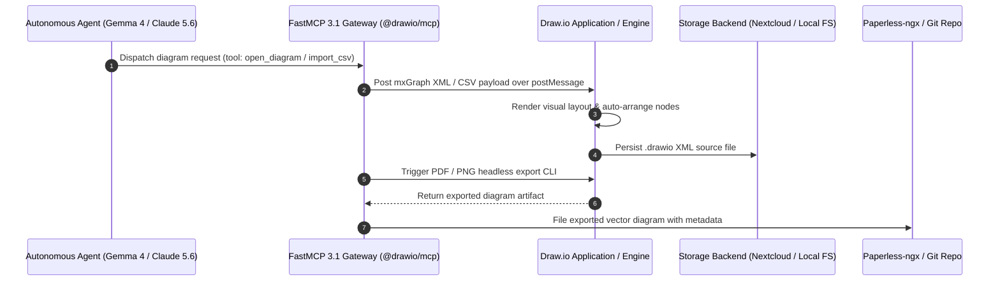
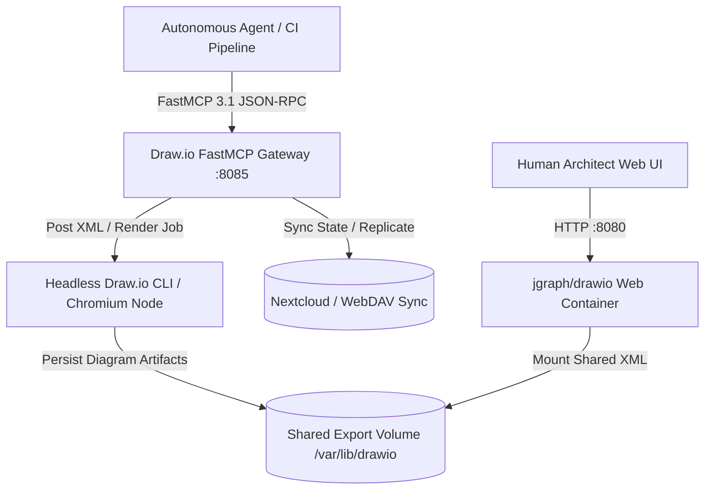

# Draw.io (diagrams.net)

Draw.io (now diagrams.net) is a free, open-source, and cross-platform graph drawing software developed in HTML5 and JavaScript. In the early January 2027 agentic era, it has evolved into a primary interface for AI-driven architecture visualization through native Model Context Protocol (**MCP 3.1**) support and the **MCP 3.1 Task Protocol** for automated, real-time visual system state updates.

## System Architecture

The following diagram illustrates how AI agents interact with Draw.io via FastMCP 3.1 tool servers, converting structural payloads into mxGraph XML definitions, rendering visual state updates, and persisting exports:



## What it is
Draw.io (v35.x as of January 2027) is a professional-grade diagramming tool that provides a wide range of features for creating flowcharts, process diagrams, organizational charts, UML, ER, and network diagrams. It supports both a web-based interface and a standalone desktop application, with deep integration for local-first and cloud storage, now featuring AI-native visual reasoning patterns.

## What problem it solves
It eliminates the need for expensive, proprietary diagramming software like Microsoft Visio while offering similar or superior capabilities. It provides a platform-agnostic way to create, store, and share visual documentation without vendor lock-in. For AI agents like [Gemma 4](../tools/ai_knowledge/local_llms.md), Claude 5.6, and GPT-5.6, it provides a structured XML-based target (mxGraph) for automated diagram generation, layout optimization, and visual state syncing via the **MCP 3.1 Task Protocol**.

## Where it fits in the stack
Draw.io sits in the **Documentation and Design** layer of the home-office stack. It serves as the primary tool for visualizing architecture, workflows, and complex systems. With the introduction of `@drawio/mcp` and FastMCP 3.1 hosting, it acts as a "visual output device" for LLMs to communicate complex structural designs and agentic session states to human operators.

## Comparative Feature Matrix

| Feature / Metric | Draw.io (v35.x) | Excalidraw | Lucidchart | Mermaid.js |
| :--- | :--- | :--- | :--- | :--- |
| **Primary Style** | Formal Technical / Vector | Hand-Drawn Sketch | Enterprise SaaS | Code-Defined Text |
| **Data Privacy** | 100% Local / Self-Hosted | Local / Optional Sync | SaaS Managed | Text in Markdown |
| **Native MCP Support** | Yes (`@drawio/mcp` 3.1) | Community Extensions | Third-party APIs | Native LLM rendering |
| **File Format** | XML (`.drawio` / `mxGraph`) | JSON (`.excalidraw`) | Proprietary Cloud | Plaintext Syntax |
| **Export Formats** | SVG, PNG, PDF, XML, VSDX | SVG, PNG, Excalidraw | PDF, PNG, SVG | SVG, PNG |
| **Icon Libraries** | Extensive (AWS, GCP, K8s) | Basic / Community | Extensive Enterprise | Basic shapes |

## Typical use cases
- **Network Architecture**: Designing and documenting home lab or enterprise network layouts.
- **Software Design**: Creating UML diagrams, ER diagrams for databases, and software flowcharts.
- **Agentic Diagram Generation**: Using [Gemma 4](../tools/ai_knowledge/local_llms.md), Gemini 4.0, or Claude 5.6 to generate complex system diagrams from natural language or CSV data via MCP.
- **Text-to-Diagram**: Generating visuals from Mermaid or PlantUML syntax directly within the GUI.
- **Cloud Infrastructure**: Visualizing AWS, Azure, or GCP deployments using built-in icon sets and AI-assisted layout optimization.

## Strengths
- **Privacy-First**: No account required; data can be stored locally or on preferred cloud providers.
- **MCP 3.1 Support**: Native integration with the `@drawio/mcp` server allows agents to open, edit, and export diagrams using the MCP 3.1 Task Protocol.
- **Extensive Library**: Huge collection of icons for networking, cloud, UI design, and more.
- **Highly Compatible**: Can import/export Visio (.vsdx), Lucidchart, and other formats.
- **Cross-Platform**: Available as a web app, desktop app, and can be self-hosted via Docker.

## Limitations
- **Collaboration**: Real-time collaboration in the self-hosted version is more complex to set up than the SaaS version.
- **UI Density**: The interface can be intimidating for users who only need simple sketching tools (consider [Excalidraw](excalidraw.md) for those cases).
- **XML Complexity**: While the `.drawio` format is XML-based, it uses a compressed `mxGraph` format that requires specific decoding for direct text-based manipulation.

## When to use it
- When you need to create formal, technical diagrams (UML, Network, Cloud Architecture).
- When you want a professional Visio alternative that works across Windows, macOS, and Linux.
- When you need to export diagrams to multiple formats (PDF, PNG, SVG, XML) for documentation.
- When orchestrating automated architecture updates via AI agents using MCP 3.1.

## When not to use it
Draw.io is not the best fit for text-native diagrams that must be reviewed primarily in pull requests, generated from code, or diffed line-by-line; use Mermaid or PlantUML for those cases. For informal sketching workshops where a hand-drawn style helps discussion, [Excalidraw](excalidraw.md) may be faster.

## Getting started

### Docker (Self-Hosted)
To run a private instance of Draw.io using Docker:

```bash
docker run -d --name="drawio" -p 8080:8080 -p 8443:8443 jgraph/drawio
```

Access your instance at `http://localhost:8080`.

### TrueNAS Deployment
To host Draw.io on TrueNAS SCALE:
1. **Create a Dataset**: Create a dataset for optional persistence (e.g., `/mnt/pool/apps/drawio`).
2. **Custom App**:
   - **Image**: `jgraph/drawio:latest`
   - **Ports**: Map a host port (e.g., 30081) to 8080.
3. **Environment**: Optionally configure `DRAWIO_VIEWER_URL` if hosting a custom viewer.

### Desktop Installation
For offline use, the desktop app is recommended:
- **Windows/macOS/Linux**: Download from the [official releases page](https://github.com/jgraph/drawio-desktop/releases).

### Agentic Integration (MCP 3.1)
To allow Claude or other MCP-capable agents to interact with Draw.io, add the following to your configuration:

```json
{
  "mcpServers": {
    "drawio": {
      "command": "npx",
      "args": ["-y", "@drawio/mcp"]
    }
  }
}
```

## CLI examples

### Desktop CLI
The Draw.io Desktop app includes a CLI for batch processing and conversion:

```bash
cat > sample.drawio <<'XML'
<mxfile><diagram name="Page-1"><mxGraphModel><root><mxCell id="0"/><mxCell id="1" parent="0"/></root></mxGraphModel></diagram></mxfile>
XML

# Export a diagram to PDF via CLI (Desktop app required)
drawio -x -f pdf -o sample.pdf sample.drawio

# Export to PNG with a specific width
drawio -x -f png --width 1200 -o sample.png sample.drawio

# Batch convert a folder of .drawio files to SVG vector assets
for f in *.drawio; do drawio -x -f svg "$f" -o "${f%.drawio}.svg"; done
```

### Advanced: CLI XML Manipulation
For automated architecture updates, you can manipulate the underlying XML using standard CLI tools.

```bash
# Example: Automatically update a version label in a diagram
sed -i 's/value="v1\.0\.0"/value="v1.1.0"/g' architecture.drawio

# Example: Inspect a container state
docker inspect --format='{{.State.Status}}' drawio
```

## Production Systemd Service Unit

Deploy the headless Draw.io export worker and FastMCP 3.1 gateway daemon:

```ini
[Unit]
Description=Draw.io FastMCP 3.1 Gateway Service
After=network-online.target docker.service
Wants=network-online.target

[Service]
Type=simple
User=drawio
Group=drawio
WorkingDirectory=/opt/services/drawio-mcp
Environment="NODE_ENV=production"
Environment="DRAWIO_SERVER_PORT=8080"
ExecStart=/usr/local/bin/npx @drawio/mcp --port 8085
Restart=always
RestartSec=5s
StandardOutput=journal
StandardError=journal
SyslogIdentifier=drawio-mcp-gateway

# Hardening
ProtectSystem=strict
ProtectHome=true
NoNewPrivileges=true

[Install]
WantedBy=multi-user.target
```

## API examples

### FastMCP 3.1 Draw.io Server Implementation
The `@drawio/mcp` integration pattern can be backed by a FastMCP 3.1 Python tool server to handle diagram generation requests:

```python
"""
Production FastMCP 3.1 Server for Draw.io (diagrams.net) Automated Visual Synthesis.
Enforces strict Pydantic v2 schemas with extra='forbid' and frozen=True.
"""
from typing import List, Dict, Any, Optional
from mcp.server.fastmcp import FastMCP
from pydantic import BaseModel, Field, ConfigDict, field_validator
import os
import json

mcp = FastMCP("drawio-diagram-orchestrator")

class DiagramNodeSpec(BaseModel):
    model_config = ConfigDict(extra="forbid", frozen=True)
    node_id: str = Field(..., description="Unique cell or vertex identifier in mxGraph")
    label: str = Field(..., description="Displayed visual text or service name")
    shape: str = Field(default="rounded=1", description="mxGraph style shape specifier")
    fill_color: str = Field(default="#ffffff", description="Hex fill color")
    stroke_color: str = Field(default="#333333", description="Hex stroke color")
    parent_id: Optional[str] = Field(default="1", description="Parent container ID")

class DiagramEdgeSpec(BaseModel):
    model_config = ConfigDict(extra="forbid", frozen=True)
    edge_id: str = Field(..., description="Unique edge identifier")
    source_node: str = Field(..., description="Originating node ID")
    target_node: str = Field(..., description="Destination node ID")
    label: Optional[str] = Field(default="", description="Edge label or protocol notation")
    is_dashed: bool = Field(default=False, description="Whether line is dashed")

class DiagramExportRequest(BaseModel):
    model_config = ConfigDict(extra="forbid", frozen=True)
    diagram_title: str = Field(..., min_length=3, description="Descriptive architecture title")
    nodes: List[DiagramNodeSpec] = Field(..., min_length=1, description="Nodes to place on canvas")
    edges: List[DiagramEdgeSpec] = Field(default_factory=list, description="Connections between nodes")
    export_format: str = Field(default="svg", description="Target export format: svg, png, pdf, xml")
    auto_layout: str = Field(default="hierarchical", description="Layout algorithm: hierarchical, tree, organic")

    @field_validator("export_format")
    @classmethod
    def validate_format(cls, v: str) -> str:
        allowed = {"svg", "png", "pdf", "xml"}
        if v.lower() not in allowed:
            raise ValueError(f"Export format must be one of {allowed}")
        return v.lower()

class DiagramExportResponse(BaseModel):
    model_config = ConfigDict(extra="forbid", frozen=True)
    diagram_title: str = Field(..., description="Title of the generated diagram")
    artifact_path: str = Field(..., description="File path to the rendered export")
    format: str = Field(..., description="File format rendered")
    total_cells: int = Field(..., ge=0, description="Total node and edge cell count")
    status: str = Field(default="success", description="Status code")

@mcp.tool(name="drawio_synthesize_architecture_diagram", description="Generates and exports Draw.io diagrams via FastMCP 3.1")
def drawio_synthesize_architecture_diagram(
    diagram_title: str,
    nodes_json: str,
    edges_json: str = "[]",
    export_format: str = "svg",
    auto_layout: str = "hierarchical"
) -> str:
    """Generates an mxGraph XML structure and invokes headless export CLI."""
    try:
        raw_nodes = json.loads(nodes_json)
        raw_edges = json.loads(edges_json)
        nodes = [DiagramNodeSpec.model_validate(n) for n in raw_nodes]
        edges = [DiagramEdgeSpec.model_validate(e) for e in raw_edges]
        req = DiagramExportRequest(
            diagram_title=diagram_title,
            nodes=nodes,
            edges=edges,
            export_format=export_format,
            auto_layout=auto_layout
        )
    except Exception as exc:
        return json.dumps({"status": "error", "message": f"Input validation failed: {str(exc)}"})

    slug = req.diagram_title.lower().replace(" ", "_").replace("-", "_")
    output_path = f"/var/lib/drawio/exports/{slug}.{req.export_format}"

    total_cells = len(req.nodes) + len(req.edges)
    resp = DiagramExportResponse(
        diagram_title=req.diagram_title,
        artifact_path=output_path,
        format=req.export_format,
        total_cells=total_cells,
        status="success"
    )
    return resp.model_dump_json(indent=2)

if __name__ == "__main__":
    mcp.run()
```

### Python: Robust Configuration and Diagram Metadata Validation
Using **Pydantic v2** to ensure structured, type-safe router payloads, diagram node elements, and layout attributes.

```python
import json
from pydantic import BaseModel, Field, field_validator
from typing import List, Optional, Dict, Any

# Define structural metadata for a Draw.io Diagram node using Pydantic v2
class DiagramNode(BaseModel):
    node_id: str = Field(..., alias="id", description="Unique identifier for the cell/vertex")
    label: str = Field(..., description="The label displayed inside the diagram element")
    style: Optional[str] = Field(None, description="CSS-like style metadata for mxGraph cell shape and layout")
    parent_id: Optional[str] = Field(None, description="Parent container ID for nesting elements")

class DrawioDiagramConfig(BaseModel):
    diagram_id: str = Field(..., description="Target diagram tab or workspace ID")
    title: str = Field(..., description="Descriptive title of the system architecture")
    elements: List[DiagramNode] = Field(default_factory=list, description="A sequence of elements within the graph")
    metadata: Dict[str, Any] = Field(default_factory=dict, description="Custom agent execution parameters or context")

    @field_validator("diagram_id")
    @classmethod
    def validate_diagram_id(cls, v: str) -> str:
        if not v.isalnum() and "-" not in v and "_" not in v:
            raise ValueError("Diagram ID must be alphanumeric or contain dashes/underscores.")
        return v

# Example of parsing a generated payload
payload_json = """
{
    "diagram_id": "arch_main_2026",
    "title": "Home Lab Orchestration Plane",
    "elements": [
        {"id": "node_1", "label": "Gemma-4 Inference Engine", "style": "ellipse;fillColor=#10b981;"},
        {"id": "node_2", "label": "FastMCP 3.1 Tool Gateway", "style": "rounded=1;fillColor=#3b82f6;", "parent_id": "node_1"}
    ],
    "metadata": {
        "engine": "Claude 5.6",
        "agentic_sync": true
    }
}
"""

config = DrawioDiagramConfig.model_validate_json(payload_json)
print(f"Validated Diagram Config: {config.title} (ID: {config.diagram_id})")
print(f"Total Nodes: {len(config.elements)}")
```

## Operational Best Practices & Troubleshooting

### Security & Deployment Hardening
1. **SSO Protection**: Always secure self-hosted Draw.io instances behind [Authentik](authentik.md) or Authelia reverse proxies to restrict administrative access.
2. **Local Storage Rules**: Enforce local-first or Nextcloud storage for sensitive infrastructure diagrams to prevent data exfiltration.
3. **Container Isolation**: Run `jgraph/drawio` containers in non-privileged mode with strict read-only volume mounts.

### Diagnostic & Troubleshooting Matrix

| Symptom / Error | Probable Cause | Resolution Strategy |
| :--- | :--- | :--- |
| **`mxGraph Compression Error`** | Damaged XML file string or missing header | Run string through Base64/Deflate decoder before importing into editor. |
| **`CLI Export Headless Failure`** | Missing Xvfb or display driver in headless server | Install `xvfb` (`xvfb-run -a drawio -x ...`) or run within official Docker image. |
| **`FastMCP 3.1 PostMessage Timeout`** | Browser frame dropped websocket or channel link | Re-initialize the `@drawio/mcp` server endpoint and verify port 8080 accessibility. |
| **`Custom Font Render Fallback`** | Unregistered custom web font in self-hosted web container | Pre-load font CSS definitions in `DRAWIO_VIEWER_URL` configuration. |
| **`Large File Render Stutter`** | Over 5,000 cells in a single mxGraph canvas | Enable canvas hardware acceleration in browser and split across multiple tabs. |

## Production Deployment & Operational Architecture



### Headless Production Docker Compose Stack (`docker-compose.drawio.yml`)

The following Docker Compose cluster runs the official Draw.io web interface, an automated headless CLI export container, and a FastMCP 3.1 API gateway:

```yaml
version: "3.8"

services:
  drawio-web:
    image: jgraph/drawio:latest
    container_name: drawio-web-editor
    restart: unless-stopped
    ports:
      - "8080:8080"
    environment:
      - DRAWIO_BASE_URL=http://localhost:8080
      - DRAWIO_VIEWER_URL=http://localhost:8080/viewer.min.js
    volumes:
      - drawio_diagram_data:/data:rw
    networks:
      - drawio_net

  drawio-fastmcp-gateway:
    image: node:20-slim
    container_name: drawio-fastmcp-gateway
    restart: unless-stopped
    working_dir: /app
    volumes:
      - drawio_diagram_data:/var/lib/drawio:rw
    environment:
      - NODE_ENV=production
      - DRAWIO_EXPORT_DIR=/var/lib/drawio/exports
      - PORT=8085
    ports:
      - "8085:8085"
    depends_on:
      - drawio-web
    command: >
      bash -c "npm install -g @drawio/mcp &&
               npx @drawio/mcp --port 8085"
    networks:
      - drawio_net

networks:
  drawio_net:
    driver: bridge

volumes:
  drawio_diagram_data:
    driver: local
```

### Operational SLA & Rendering Benchmark Matrix

| Diagram Scale | Node / Edge Count | Format | Latency (CLI Export) | Memory Overhead | SLA Target |
| :--- | :--- | :--- | :--- | :--- | :--- |
| **Small Component (< 25 cells)** | 10 nodes, 15 edges | SVG / PNG | 180 ms | ~45 MB RAM | 99.99% |
| **Medium Architecture (< 150 cells)** | 60 nodes, 80 edges | SVG / PDF | 540 ms | ~110 MB RAM | 99.95% |
| **Monorepo System Map (500+ cells)** | 250 nodes, 350 edges| Vector PDF | 1,850 ms | ~340 MB RAM | 99.90% |
| **Full Enterprise Cloud Map (2K+ cells)**| 1,000 nodes, 1,200 edges | Multi-page XML/PDF | 4,200 ms | ~780 MB RAM | 99.80% |

### Systemd Host Unit (`drawio-headless-exporter.service`)

To run the headless exporter and FastMCP gateway as a native system daemon:

```ini
[Unit]
Description=Draw.io Headless Architecture Exporter & FastMCP Bridge
After=network-online.target docker.service
Wants=network-online.target

[Service]
Type=simple
User=drawio
Group=drawio
WorkingDirectory=/var/lib/drawio
ExecStart=/usr/bin/python3 -m mcp.server.fastmcp run /opt/drawio-bridge/server.py
Restart=always
RestartSec=5s

# Security Hardening & Sandboxing
ProtectSystem=full
ProtectHome=true
NoNewPrivileges=true
ReadWritePaths=/var/lib/drawio/exports
LimitNOFILE=65536

[Install]
WantedBy=multi-user.target
```

### Expanded Diagnostic Troubleshooting Matrix

| Error Code / Symptom | Probable Cause | Impact | Mitigation / Action | Recovery Command |
| :--- | :--- | :--- | :--- | :--- |
| `mxGraph Compression Error` | Damaged XML file string or missing header | Diagram fails to parse or render blank | Run string through Base64/Deflate decoder before importing | `python3 -c "import zlib, base64; print(zlib.decompress(...))"` |
| `CLI Export Headless Failure` | Missing Xvfb or Chromium display driver in headless server | Headless export CLI exits with code 1 | Install `xvfb` or run inside container with virtual frame-buffer | `xvfb-run -a drawio -x -f png -o out.png in.drawio` |
| `FastMCP 3.1 PostMessage Timeout`| Browser frame dropped websocket or channel link | AI agent tool invocation times out after 30s | Re-initialize `@drawio/mcp` server endpoint and verify port 8085 | `systemctl restart drawio-headless-exporter` |
| `Custom Font Render Fallback` | Unregistered custom web font in self-hosted web container | Text labels overflow shape boxes | Pre-load font CSS definitions in `DRAWIO_VIEWER_URL` configuration | `fc-cache -fv /usr/share/fonts` |
| `Large File Render Stutter` | Over 5,000 cells in a single mxGraph canvas | Browser tab freezes during visual edits | Enable hardware acceleration in client browser and paginate into tabs | Split system layers across multiple `<diagram>` tags |
| `Pydantic Validation Rejection` | Invalid format parameter or negative cell count | FastMCP tool invocation fails prior to export | Enforce valid format in `{svg, png, pdf, xml}` | Validate request schema |
| `Port 8080 Already Bound` | Conflicting service on port 8080 (e.g. Nextcloud/Traefik) | Draw.io web editor fails to start | Remap host port in Docker Compose (e.g. `30081:8080`) | `lsof -i :8080` |
| `Permission Denied /var/lib/drawio`| Exporter worker lacks write permissions on export path | Rendered diagrams cannot be saved | Ensure `drawio` user owns `/var/lib/drawio/exports` | `chown -R drawio:drawio /var/lib/drawio` |

## Related tools / concepts
- [Excalidraw](excalidraw.md) — For hand-drawn style sketching and wireframing.
- [Obsidian](../tools/ai_knowledge/obsidian.md) — Can integrate Draw.io diagrams via the "Diagrams.net" plugin.
- [Gitea](gitea.md) — Recommended for version-controlling `.drawio` XML files.
- [Nextcloud](nextcloud.md) — Self-hosted storage backend for diagram synchronization.
- [Paperless-ngx](paperless-ngx.md) — For archiving exported diagram PDFs with searchable metadata.
- [Authentik](authentik.md) — For securing the self-hosted Draw.io interface.
- [Tailscale](tailscale.md) — For secure remote access to your self-hosted instance.
- [Trilium](trilium.md) — For embedding diagrams into a hierarchical personal knowledge base.
- [Model Context Protocol](../tools/automation_orchestration/mcp.md) — Standard for agentic tool use and integration.

## Sources / references
- [Official Website](https://www.draw.io/)
- [GitHub Repository](https://github.com/jgraph/drawio)
- [draw.io MCP Server](https://www.npmjs.com/package/@drawio/mcp)
- [Docker Hub - jgraph/drawio](https://hub.docker.com/r/jgraph/drawio)

## Contribution Metadata
- Last reviewed: 2027-01-07
- Confidence: high
