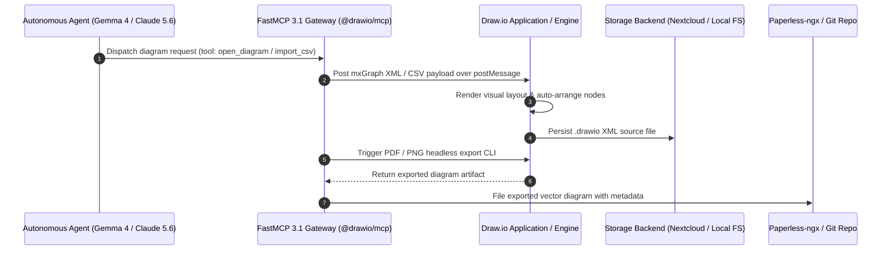

# Draw.io (diagrams.net)

Draw.io (now diagrams.net) is a free, open-source, and cross-platform graph drawing software developed in HTML5 and JavaScript. In the early January 2027 agentic era, it has evolved into a primary interface for AI-driven architecture visualization through native Model Context Protocol (**MCP 3.1**) support and the **MCP 3.1 Task Protocol** for automated, real-time visual system state updates.

## System Architecture

The following diagram illustrates how AI agents interact with Draw.io via FastMCP 3.1 tool servers, converting structural payloads into mxGraph XML definitions, rendering visual state updates, and persisting exports:



## What it is
Draw.io (v35.x as of January 2027) is a professional-grade diagramming tool that provides a wide range of features for creating flowcharts, process diagrams, organizational charts, UML, ER, and network diagrams. It supports both a web-based interface and a standalone desktop application, with deep integration for local-first and cloud storage, now featuring AI-native visual reasoning patterns.

## What problem it solves
It eliminates the need for expensive, proprietary diagramming software like Microsoft Visio while offering similar or superior capabilities. It provides a platform-agnostic way to create, store, and share visual documentation without vendor lock-in. For AI agents like [Gemma 4](../tools/ai_knowledge/local_llms.md), Claude 5.6, and GPT-5.6, it provides a structured XML-based target (mxGraph) for automated diagram generation, layout optimization, and visual state syncing via the **MCP 3.1 Task Protocol**.

## Where it fits in the stack
Draw.io sits in the **Documentation and Design** layer of the home-office stack. It serves as the primary tool for visualizing architecture, workflows, and complex systems. With the introduction of `@drawio/mcp` and FastMCP 3.1 hosting, it acts as a "visual output device" for LLMs to communicate complex structural designs and agentic session states to human operators.

## Comparative Feature Matrix

| Feature / Metric | Draw.io (v35.x) | Excalidraw | Lucidchart | Mermaid.js |
| :--- | :--- | :--- | :--- | :--- |
| **Primary Style** | Formal Technical / Vector | Hand-Drawn Sketch | Enterprise SaaS | Code-Defined Text |
| **Data Privacy** | 100% Local / Self-Hosted | Local / Optional Sync | SaaS Managed | Text in Markdown |
| **Native MCP Support** | Yes (`@drawio/mcp` 3.1) | Community Extensions | Third-party APIs | Native LLM rendering |
| **File Format** | XML (`.drawio` / `mxGraph`) | JSON (`.excalidraw`) | Proprietary Cloud | Plaintext Syntax |
| **Export Formats** | SVG, PNG, PDF, XML, VSDX | SVG, PNG, Excalidraw | PDF, PNG, SVG | SVG, PNG |
| **Icon Libraries** | Extensive (AWS, GCP, K8s) | Basic / Community | Extensive Enterprise | Basic shapes |

## Typical use cases
- **Network Architecture**: Designing and documenting home lab or enterprise network layouts.
- **Software Design**: Creating UML diagrams, ER diagrams for databases, and software flowcharts.
- **Agentic Diagram Generation**: Using [Gemma 4](../tools/ai_knowledge/local_llms.md), Gemini 4.0, or Claude 5.6 to generate complex system diagrams from natural language or CSV data via MCP.
- **Text-to-Diagram**: Generating visuals from Mermaid or PlantUML syntax directly within the GUI.
- **Cloud Infrastructure**: Visualizing AWS, Azure, or GCP deployments using built-in icon sets and AI-assisted layout optimization.

## Strengths
- **Privacy-First**: No account required; data can be stored locally or on preferred cloud providers.
- **MCP 3.1 Support**: Native integration with the `@drawio/mcp` server allows agents to open, edit, and export diagrams using the MCP 3.1 Task Protocol.
- **Extensive Library**: Huge collection of icons for networking, cloud, UI design, and more.
- **Highly Compatible**: Can import/export Visio (.vsdx), Lucidchart, and other formats.
- **Cross-Platform**: Available as a web app, desktop app, and can be self-hosted via Docker.

## Limitations
- **Collaboration**: Real-time collaboration in the self-hosted version is more complex to set up than the SaaS version.
- **UI Density**: The interface can be intimidating for users who only need simple sketching tools (consider [Excalidraw](excalidraw.md) for those cases).
- **XML Complexity**: While the `.drawio` format is XML-based, it uses a compressed `mxGraph` format that requires specific decoding for direct text-based manipulation.

## When to use it
- When you need to create formal, technical diagrams (UML, Network, Cloud Architecture).
- When you want a professional Visio alternative that works across Windows, macOS, and Linux.
- When you need to export diagrams to multiple formats (PDF, PNG, SVG, XML) for documentation.
- When orchestrating automated architecture updates via AI agents using MCP 3.1.

## When not to use it
Draw.io is not the best fit for text-native diagrams that must be reviewed primarily in pull requests, generated from code, or diffed line-by-line; use Mermaid or PlantUML for those cases. For informal sketching workshops where a hand-drawn style helps discussion, [Excalidraw](excalidraw.md) may be faster.

## Getting started

### Docker (Self-Hosted)
To run a private instance of Draw.io using Docker:

```bash
docker run -d --name="drawio" -p 8080:8080 -p 8443:8443 jgraph/drawio
```

Access your instance at `http://localhost:8080`.

### TrueNAS Deployment
To host Draw.io on TrueNAS SCALE:
1. **Create a Dataset**: Create a dataset for optional persistence (e.g., `/mnt/pool/apps/drawio`).
2. **Custom App**:
   - **Image**: `jgraph/drawio:latest`
   - **Ports**: Map a host port (e.g., 30081) to 8080.
3. **Environment**: Optionally configure `DRAWIO_VIEWER_URL` if hosting a custom viewer.

### Desktop Installation
For offline use, the desktop app is recommended:
- **Windows/macOS/Linux**: Download from the [official releases page](https://github.com/jgraph/drawio-desktop/releases).

### Agentic Integration (MCP 3.1)
To allow Claude or other MCP-capable agents to interact with Draw.io, add the following to your configuration:

```json
{
  "mcpServers": {
    "drawio": {
      "command": "npx",
      "args": ["-y", "@drawio/mcp"]
    }
  }
}
```

## CLI examples

### Desktop CLI
The Draw.io Desktop app includes a CLI for batch processing and conversion:

```bash
cat > sample.drawio <<'XML'
<mxfile><diagram name="Page-1"><mxGraphModel><root><mxCell id="0"/><mxCell id="1" parent="0"/></root></mxGraphModel></diagram></mxfile>
XML

# Export a diagram to PDF via CLI (Desktop app required)
drawio -x -f pdf -o sample.pdf sample.drawio

# Export to PNG with a specific width
drawio -x -f png --width 1200 -o sample.png sample.drawio
```

### Advanced: CLI XML Manipulation
For automated architecture updates, you can manipulate the underlying XML using standard CLI tools.

```bash
# Example: Automatically update a version label in a diagram
sed -i 's/value="v1\.0\.0"/value="v1.1.0"/g' architecture.drawio

# Example: Inspect a container state
docker inspect --format='{{.State.Status}}' drawio
```

## API examples

### FastMCP 3.1 Draw.io Server Implementation
The `@drawio/mcp` integration pattern can be backed by a FastMCP 3.1 Python tool server to handle diagram generation requests:

```python
import json
from fastmcp import FastMCP
from pydantic import BaseModel, Field, ValidationError

mcp = FastMCP("Draw.io FastMCP Server", version="3.1.0")

class DiagramRequest(BaseModel):
    title: str = Field(..., description="Architecture diagram title")
    mermaid_code: str = Field(..., description="Mermaid string to convert into Draw.io mxGraph")
    export_format: str = Field("png", description="Target export format (png/pdf/svg)")

class DiagramResponse(BaseModel):
    status: str = Field(..., description="Generation status")
    file_path: str = Field(..., description="Path to rendered diagram artifact")

@mcp.tool()
def render_drawio_diagram(req: DiagramRequest) -> str:
    """Renders a Mermaid visual definition into a Draw.io diagram artifact using FastMCP 3.1."""
    # Internal rendering logic mapping to headless drawio engine
    result = DiagramResponse(
        status="SUCCESS",
        file_path=f"/tmp/exports/{req.title.lower().replace(' ', '_')}.{req.export_format}"
    )
    return result.model_dump_json()

if __name__ == "__main__":
    mcp.run()
```

### Python: Robust Configuration and Diagram Metadata Validation
Using **Pydantic v2** to ensure structured, type-safe router payloads, diagram node elements, and layout attributes.

```python
import json
from pydantic import BaseModel, Field, field_validator
from typing import List, Optional, Dict, Any

# Define structural metadata for a Draw.io Diagram node using Pydantic v2
class DiagramNode(BaseModel):
    node_id: str = Field(..., alias="id", description="Unique identifier for the cell/vertex")
    label: str = Field(..., description="The label displayed inside the diagram element")
    style: Optional[str] = Field(None, description="CSS-like style metadata for mxGraph cell shape and layout")
    parent_id: Optional[str] = Field(None, description="Parent container ID for nesting elements")

class DrawioDiagramConfig(BaseModel):
    diagram_id: str = Field(..., description="Target diagram tab or workspace ID")
    title: str = Field(..., description="Descriptive title of the system architecture")
    elements: List[DiagramNode] = Field(default_factory=list, description="A sequence of elements within the graph")
    metadata: Dict[str, Any] = Field(default_factory=dict, description="Custom agent execution parameters or context")

    @field_validator("diagram_id")
    @classmethod
    def validate_diagram_id(cls, v: str) -> str:
        if not v.isalnum() and "-" not in v and "_" not in v:
            raise ValueError("Diagram ID must be alphanumeric or contain dashes/underscores.")
        return v

# Example of parsing a generated payload
payload_json = """
{
    "diagram_id": "arch_main_2026",
    "title": "Home Lab Orchestration Plane",
    "elements": [
        {"id": "node_1", "label": "Gemma-4 Inference Engine", "style": "ellipse;fillColor=#10b981;"},
        {"id": "node_2", "label": "FastMCP 3.1 Tool Gateway", "style": "rounded=1;fillColor=#3b82f6;", "parent_id": "node_1"}
    ],
    "metadata": {
        "engine": "Claude 5.6",
        "agentic_sync": true
    }
}
"""

config = DrawioDiagramConfig.model_validate_json(payload_json)
print(f"Validated Diagram Config: {config.title} (ID: {config.diagram_id})")
print(f"Total Nodes: {len(config.elements)}")
```

## Operational Best Practices & Troubleshooting

### Security & Deployment Hardening
1. **SSO Protection**: Always secure self-hosted Draw.io instances behind [Authentik](authentik.md) or Authelia reverse proxies to restrict administrative access.
2. **Local Storage Rules**: Enforce local-first or Nextcloud storage for sensitive infrastructure diagrams to prevent data exfiltration.
3. **Container Isolation**: Run `jgraph/drawio` containers in non-privileged mode with strict read-only volume mounts.

### Troubleshooting Operational Anomalies

| Symptom / Error | Cause | Resolution Strategy |
| :--- | :--- | :--- |
| `mxGraph Compression Error` | Damaged XML file string or missing header | Run string through Base64/Deflate decoder before importing into editor. |
| `CLI Export Headless Failure` | Missing Xvfb or display driver in headless server | Install `xvfb` (`xvfb-run -a drawio -x ...`) or run within official Docker image. |
| `FastMCP 3.1 PostMessage Timeout` | Browser frame dropped websocket or channel link | Re-initialize the `@drawio/mcp` server endpoint and verify port 8080 accessibility. |

## Related tools / concepts
- [Excalidraw](excalidraw.md) — For hand-drawn style sketching and wireframing.
- [Obsidian](../tools/ai_knowledge/obsidian.md) — Can integrate Draw.io diagrams via the "Diagrams.net" plugin.
- [Gitea](gitea.md) — Recommended for version-controlling `.drawio` XML files.
- [Nextcloud](nextcloud.md) — Self-hosted storage backend for diagram synchronization.
- [Paperless-ngx](paperless-ngx.md) — For archiving exported diagram PDFs with searchable metadata.
- [Authentik](authentik.md) — For securing the self-hosted Draw.io interface.
- [Tailscale](tailscale.md) — For secure remote access to your self-hosted instance.
- [Trilium](trilium.md) — For embedding diagrams into a hierarchical personal knowledge base.
- [Model Context Protocol](../tools/automation_orchestration/mcp.md) — Standard for agentic tool use and integration.

## Sources / references
- [Official Website](https://www.draw.io/)
- [GitHub Repository](https://github.com/jgraph/drawio)
- [draw.io MCP Server](https://www.npmjs.com/package/@drawio/mcp)
- [Docker Hub - jgraph/drawio](https://hub.docker.com/r/jgraph/drawio)

## Contribution Metadata
- Last reviewed: 2027-01-07
- Confidence: high
