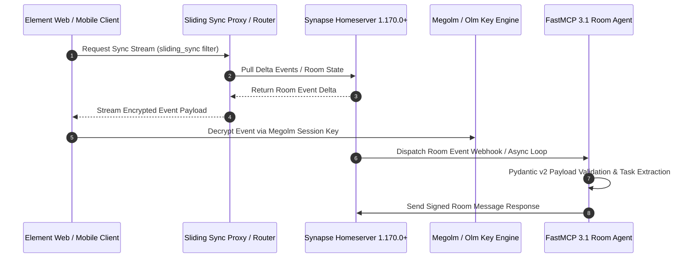

# Element

Element is a secure, decentralized communication app built on the [Matrix](https://matrix.org) protocol.

## What it is
Element (formerly Riot) is the flagship client for the Matrix protocol, providing a user-friendly interface for end-to-end encrypted messaging, voice, and video calls. As of **early January 2027**, it supports **Matrix v1.170.0+**, featuring advanced metadata protection, sliding sync capabilities natively, and **FastMCP 3.1** / **MCP 3.1** tool routing for agentic participation in rooms. It operates in a decentralized manner, allowing users to choose or host their own "homeserver" while communicating seamlessly across federated networks.

```
+-----------------------------------------------------------------------------------+
|                              ELEMENT CLIENT PLANE                                 |
|      Element Web / Element Desktop / Element X (Mobile - Rust Core SDK)           |
+-----------------------------------------+-----------------------------------------+
                                          |
                                          | Sliding Sync / Matrix API v1.170.0+
                                          v
+-----------------------------------------------------------------------------------+
|                             MATRIX HOMESERVER PLANE                               |
|        Synapse 1.170.0+ / Dendrite / Federated Peer Homeservers                   |
+-----------------------------------------+-----------------------------------------+
                                          |
                        +-----------------+-----------------+
                        |                                   |
                        v                                   v
+---------------------------------------+ +-----------------------------------------+
| E2EE ENCRYPTION & KEY MANAGEMENT      | | FastMCP 3.1 BOT / AGENT LAYER           |
| Megolm / Olm Ratchet, Cross-Signing   | | Room Participant Agents (Claude / Gemma)|
+---------------------------------------+ +-----------------------------------------+
```

## What problem it solves
It solves the problem of "walled gardens" in communication (like WhatsApp or Slack) by using an open standard. It provides sovereign control over data without sacrificing modern features like multi-device sync, rich media sharing, and integrations.

## Where it fits in the stack
Element sits in the **Communication and Collaboration** layer. It serves as the primary interface for both human-to-human communication and bot-to-human notifications within a self-hosted ecosystem.

## Architectural Topology & Message Routing



```
+-----------------------------------------------------------------------------------+
|                              USER INTERFACE & BRIDGES                             |
|  +--------------------+   +---------------------+   +--------------------------+  |
|  | Element Clients    |   | Telegram / Discord  |   | Matrix RTC SFU           |  |
|  | (E2EE GUI / Web)   |   | Matrix Bridges      |   | (High-Perf Video Calls)  |  |
|  +--------------------+   +---------------------+   +--------------------------+  |
+-----------------------------------------+-----------------------------------------+
                                          |
                                          v
+-----------------------------------------------------------------------------------+
|                           SYNAPSE HOMESERVER ROUTER                               |
|  - PostgreSQL Database Backend with Partitioned History Caching                   |
|  - Authentik OAuth2 / OIDC SSO Authentication Provider                            |
+-----------------------------------------+-----------------------------------------+
                                          |
                                          v
+-----------------------------------------------------------------------------------+
|                        AGENTIC INTEGRATION PLANE (FastMCP 3.1)                    |
|  - Matrix AsyncClient listening for room events                                  |
|  - Pydantic v2 Payload validation for automated alert dispatching                 |
+-----------------------------------------------------------------------------------+
```

## Typical use cases
- **Personal Messaging**: Secure, E2EE alternative to commercial messaging apps.
- **Team Collaboration**: Organizing projects and discussions into "Spaces" and "Rooms".
- **Home Automation Notifications**: Receiving alerts from services like Home Assistant or custom scripts.
- **Bridging**: Acting as a unified interface for Discord, Telegram, and Slack via Matrix bridges.
- **Agentic Room Participation**: Integrating [Gemma 3](../tools/ai_knowledge/local_llms.md) or **Claude 5.6** / **GPT-5.6** as a room participant for real-time summarization, message transcription, and task extraction via FastMCP 3.1.

## Strengths
- **Sovereignty**: Full control over your data when self-hosted.
- **E2EE**: High-grade end-to-end encryption for all conversations.
- **Extensibility**: Powerful API and "Widget" system for custom integrations.
- **Open Standard**: Interoperable with any other Matrix client or server.
- **Matrix 1.20+ / 1.25+ Safety**: Enhanced trust and safety features including Policy Servers and granular invite blocking.

## Limitations
- **UX Complexity**: The decentralized nature (homeservers, cross-signing) can be confusing for new users compared to centralized apps.
- **Resource Intensive**: Running a full Matrix homeserver (Synapse) can be resource-heavy for low-end hardware.
- **Storage Growth**: Encrypted history and media can grow significantly over time without proper cleanup policies.

## Matrix Protocol Architecture Comparison

| Dimension / Metric | Element / Matrix | Slack | Signal | Telegram |
| :--- | :--- | :--- | :--- | :--- |
| **Architecture** | Open Decentralized Federated | Closed Centralized SaaS | Centralized Non-Profit | Centralized Proprietary |
| **Encryption (E2EE)** | Olm / Megolm (Standard) | Paid Enterprise Add-on | Signal Protocol (Mandatory) | Optional Secret Chats |
| **Data Ownership** | 100% Self-Hosted Sovereign | Vendor Controlled | Client Only (Centralized Server) | Vendor Controlled Cloud |
| **Agent / Bot Integration** | Native FastMCP 3.1 / Webhooks | Custom Apps / Webhooks | Strictly Limited APIs | Bot API / Webhooks |
| **Multi-Device Support** | High (Sliding Sync) | High | High (Linked Devices) | High |

## Production Systemd Service Units (`element-web.service` & `matrix-sfu.service`)

To deploy Element Web and the Matrix RTC SFU sidecar as managed systemd daemons, deploy the unit file below:

```ini
[Unit]
Description=Element Web Frontend Container Service
After=docker.service network.target
Requires=docker.service

[Service]
Type=simple
User=element
Group=element
WorkingDirectory=/opt/element-web
ExecStart=/usr/bin/docker run --rm --name element-web \
    -p 8080:80 \
    -v /opt/element-web/config.json:/app/config.json:ro \
    vectorim/element-web:latest
ExecStop=/usr/bin/docker stop element-web
Restart=always
RestartSec=5s

# Hardening
ProtectSystem=full
PrivateTmp=true

[Install]
WantedBy=multi-user.target
```

## Diagnostic Troubleshooting Matrix

| Issue / Error Symptom | Root Cause | Verification Procedure | Remediation Strategy |
| :--- | :--- | :--- | :--- |
| **Sliding Sync connection failure** | Misconfigured proxy header or expired auth token | Execute `curl -i https://matrix.example.com/_matrix/client/unstable/org.matrix.msc3575/sync` | Verify proxy reverse host headers and restart `sliding-sync-proxy.service` |
| **Unable to decrypt message (E2EE)** | Out-of-sync Megolm session keys or unverified device | Check room encryption settings and active key backups in Element | Re-verify user session via cross-signing or import recovery key backup |
| **Federation timeout to remote homeserver** | Broken TLS certificates or port 8448 blockage | Run `curl -v https://remote-homeserver.com:8448/_matrix/federation/v1/version` | Audit firewall rules and verify SRV records (`_matrix._tcp.domain.com`) |
| **High latency during large room joins** | PostgreSQL memory exhaustion or unindexed state tables | Monitor DB query latency via `pg_stat_activity` | Run Synapse database vacuuming and optimize shared buffer caches |
| **FastMCP Bot missing room messages** | Insufficient room permission or unaccepted invite | Check room power levels using `matrix-commander --room-info` | Promote agent bot power level to `50` (Moderator) and accept pending invite |

## When to use it
- When you need secure, encrypted communication that you fully control.
- When you want to bridge multiple messaging platforms (Discord, Telegram, Slack) into a single client.
- When you need a reliable notification channel for your home automation system.

## When not to use it
Do not use Element as a drop-in replacement for simple SMS-style family messaging if users are not ready to understand homeservers, key backup, and device verification. For large regulated organizations, validate Matrix retention, moderation, discovery, and e-discovery requirements before replacing Slack or Microsoft Teams.

## Getting started

### Web/Desktop App
The easiest way to start is by using the hosted version or the desktop client:
1. Download Element from [element.io](https://element.io/get-started).
2. Create an account on the default `matrix.org` server or specify your own.

### Docker (Self-Hosted Web Client)
To host the Element web interface yourself (requires a separate homeserver like Synapse). Ensure you use the latest stable branch for Matrix 1.20+ / 1.25+ compatibility.

```yaml
services:
  element:
    image: vectorim/element-web:latest
    ports:
      - "8080:80"
    restart: always
    environment:
      - ELEMENT_DEFAULT_HS_URL=https://matrix.example.com
```

### Matrix RTC SFU (Video Calls)
For high-performance video conferencing in Element, a Selective Forwarding Unit (SFU) is recommended:

```yaml
services:
  matrix-rtc-sfu:
    image: ghcr.io/element-hq/matrix-rtc-sfu:latest
    ports:
      - "8090:8090"
    environment:
      - SFU_EXTERNAL_URL=https://sfu.example.com
```

## CLI examples
While Element is a GUI, the Matrix ecosystem provides CLI tools like `matrix-commander` for automation:

```bash
# Install the CLI in an isolated Python environment
python3 -m pip install --user matrix-commander

# Log in interactively and store credentials for later commands
matrix-commander --login password

# Send a message using exported room configuration
: "${MATRIX_ROOM_ID:?set MATRIX_ROOM_ID to a Matrix room ID}"
matrix-commander --room "$MATRIX_ROOM_ID" --message "Hello from the home-office automation stack"

# Get room info for the same configured room
matrix-commander --room "$MATRIX_ROOM_ID" --room-info
```

## API examples

### Python (using `matrix-nio` with FastMCP 3.1 & Pydantic v2 Validation)
This production-ready tool server uses Pydantic v2 validation to sanitize messaging payloads, integrating Element/Matrix alerting workflows directly with frontier models like **Claude 5.6**, **Claude 5.1**, **GPT-5.6**, and **Gemini 4.0**.

```python
import asyncio
import json
import os
from pydantic import BaseModel, Field
from fastmcp import FastMCP
from nio import AsyncClient

# Initialize FastMCP 3.1 Server
mcp = FastMCP("ElementAlertManager", version="3.1.0")

class MatrixAlertSchema(BaseModel):
    room_id: str = Field(description="The Matrix Room ID to dispatch the message to")
    message: str = Field(description="The text body of the alert/notification")
    alert_level: str = Field(default="INFO", description="Level of severity: INFO, WARNING, or CRITICAL")

@mcp.tool(
    name="send_matrix_alert",
    description="Dispatches a structured alert message to a Matrix room via AsyncClient."
)
async def send_matrix_alert(alert_json: str) -> str:
    """
    Establishes an async connection to a Matrix homeserver, validates credentials,
    and sends a formatted structural notification to the selected Room ID.
    """
    try:
        data = json.loads(alert_json)
        validated = MatrixAlertSchema(**data)

        # Retrieve environment configurations
        homeserver = os.getenv("MATRIX_HOMESERVER", "https://matrix.org")
        user_id = os.getenv("MATRIX_USER_ID")
        password = os.getenv("MATRIX_PASSWORD")

        if not user_id or not password:
            return json.dumps({"status": "error", "message": "Missing environment credentials (MATRIX_USER_ID/MATRIX_PASSWORD)"})

        client = AsyncClient(homeserver, user_id)
        login_response = await client.login(password)
        if getattr(login_response, "access_token", None) is None:
            await client.close()
            return json.dumps({"status": "error", "message": "Matrix authentication failed"})

        formatted_body = f"[{validated.alert_level}] {validated.message}"

        await client.room_send(
            room_id=validated.room_id,
            message_type="m.room.message",
            content={
                "msgtype": "m.text",
                "body": formatted_body
            }
        )

        await client.close()
        return json.dumps({"status": "success", "room_id": validated.room_id, "sent_message": formatted_body})
    except Exception as e:
        return json.dumps({"status": "error", "message": str(e)})

if __name__ == "__main__":
    mcp.run(transport="stdio")
```

### Curl example
```bash
: "${MATRIX_HOMESERVER:=https://matrix.org}"
: "${MATRIX_ROOM_ID:?set MATRIX_ROOM_ID to a Matrix room ID}"
: "${MATRIX_ACCESS_TOKEN:?set MATRIX_ACCESS_TOKEN to a bot or user access token}"

curl -X POST \
  -H "Authorization: Bearer $MATRIX_ACCESS_TOKEN" \
  -H "Content-Type: application/json" \
  -d '{"msgtype":"m.text","body":"Hello from curl"}' \
  "$MATRIX_HOMESERVER/_matrix/client/v3/rooms/$MATRIX_ROOM_ID/send/m.room.message/$(date +%s)"
```

## Production Hardening & Operational Best Practices

1. **Enable Sliding Sync Engine**: Use Matrix v1.170.0+ Sliding Sync proxy or native homeserver support to achieve sub-second mobile synchronization without battery drain.
2. **Key Backup Verification**: Always set up cross-signing keys and secure secret storage during initial account setup to prevent loss of encrypted chat history.
3. **Database Pruning Policies**: Configure Synapse media retention policies (`media_store_path` cleanup) to auto-delete unreferenced media uploads older than 90 days.

## Related tools / concepts
- [Synapse](synapse.md) — The most common Matrix homeserver (v1.170.0+).
- [Dendrite](https://github.com/element-hq/dendrite) — A next-generation, high-performance Matrix homeserver.
- [Home Assistant](home-assistant.md) — Frequently integrated with Element for notifications.
- [Authentik](authentik.md) — Used for SSO authentication into Element/Matrix.
- [Bridges](https://matrix.org/bridges/) — Connect Matrix to other services like Telegram and Discord.
- [Nextcloud](nextcloud.md) — For file storage and cloud services alongside communication.
- [Gitea](gitea.md) — For hosting code and triggering notifications to Element.
- [Paperless-ngx](paperless-ngx.md) — For notifying users when new documents are indexed.
- [SearXNG](searXNG.md) — For secure search results sharing within Element rooms.
- [Vikunja](vikunja.md) — For task management notifications and team coordination.
- [Element X](https://github.com/element-hq/element-x-android) — Successor mobile clients built with the Matrix Rust SDK.
- [Gemma 3](../tools/ai_knowledge/gemma.md) — Local LLM for agentic room participation and summarization.

## Sources / References
- [Official Element Website](https://element.io/)
- [Element Web GitHub](https://github.com/vector-im/element-web)
- [Matrix Client-Server API](https://matrix.org/docs/api/client-server/)
- [Matrix Commander GitHub](https://github.com/8go/matrix-commander)
- [Matrix Release Blogs](https://matrix.org/blog/category/releases/)

## Contribution Metadata
- Last reviewed: 2027-01-07
- Confidence: high
