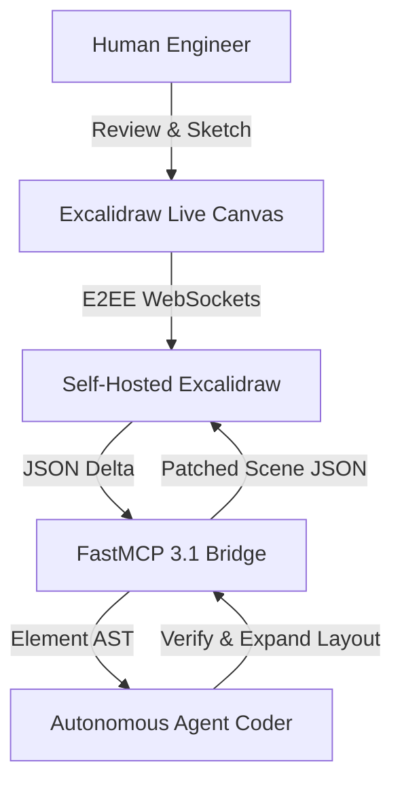

# Excalidraw

## What it is
Excalidraw is an open-source, lightweight virtual whiteboard and sketching ecosystem optimized for hand-drawn aesthetics, real-time collaboration, and structured visual reasoning in multi-agent AI networks. In modern developer environments in 2027, Excalidraw serves as both a human sketching tool and a machine-readable canvas where autonomous agents (e.g., [Claude Code](../tools/development_ops/claude-code.md), [Home Admin Agent](home-admin-tools.md)) externalize architectural ideas, sequence diagrams, and task dependency graphs.

Because Excalidraw scenes are stored as deterministic JSON documents containing precise coordinate, shape, arrow, and text bindings, AI models can inspect, generate, and edit visual layouts programmatically via [FastMCP 3.1](../tools/automation_orchestration/mcp.md) servers.

```
+--------------------------------------------------------------------------------------------------------------------+
|                                         EXCALIDRAW VISUAL REASONING STACK                                          |
+--------------------------------------------------------------------------------------------------------------------+
|                                                                                                                    |
|  +--------------------------------+      +---------------------------------+      +-----------------------------+  |
|  |   Human Whiteboard User        |      |   FastMCP 3.1 Tool Server       |      | Autonomous AI Agent         |  |
|  |   (Browser / Obsidian Canvas)  |      |   (Pydantic v2 Schema Engine)   |      | (Claude Code / Llama 4)     |  |
|  +---------------+----------------+      +----------------+----------------+      +--------------+--------------+  |
|                  |                                        |                                      |                 |
|                  +-------------------+--------------------+--------------------------------------+                 |
|                                      |                                                                             |
|                                      v                                                                             |
|                       +------------------------------+                                                             |
|                       |   Excalidraw JSON Data       |                                                             |
|                       |  (Elements, Bindings, x/y)   |                                                             |
|                       +--------------+---------------+                                                             |
|                                      |                                                                             |
|                                      v                                                                             |
|                       +------------------------------+                                                             |
|                       |  Self-Hosted Excalidraw App  |                                                             |
|                       |  (Docker Container / Node.js)|                                                             |
|                       +--------------+---------------+                                                             |
|                                      |                                                                             |
|                                      v                                                                             |
|                       +------------------------------+                                                             |
|                       | Exported SVG / PNG Artifacts |                                                             |
|                       | (Paperless / Git / Obsidian) |                                                             |
|                       +------------------------------+                                                             |
|                                                                                                                    |
+--------------------------------------------------------------------------------------------------------------------+
```

## What problem it solves
Formal diagramming suites (such as Visio or complex CAD applications) suffer from steep learning curves, rigid layout constraints, and proprietary binary formats that hinder automated LLM generation. Excalidraw solves these issues by offering:

1. **Human-Approachable Aesthetic**: Hand-drawn sketchy styling reduces "polish anxiety" during early-stage brainstorming.
2. **Structured Machine-Readable JSON**: Every rectangle, arrow, text block, and connector is represented as a structured object, allowing LLMs to manipulate elements with mathematical precision.
3. **E2EE Real-Time Collaboration**: End-to-end encrypted WebSocket relays enable concurrent live editing between human engineers and automated agent bots.
4. **Deep Knowledge Base Integration**: Integrates directly into [Obsidian](../tools/ai_knowledge/obsidian.md) for visual bi-directional linking.

## Mathematical Formulations: Element Graph Geometry & Collaborative Synchronization

### 1. Spatial Layout Collision & Bounding Box Intersection
When an autonomous agent generates multi-node architectural diagrams via FastMCP 3.1, element coordinates $(x_i, y_i)$ with dimensions $(w_i, h_i)$ must satisfy non-overlapping spatial packaging constraints. Two rectangular elements $\mathcal{E}_i$ and $\mathcal{E}_j$ intersect if and only if:

$$
\mathcal{I}(\mathcal{E}_i, \mathcal{E}_j) = \mathbb{I}\left( |x_i - x_j| < \frac{w_i + w_j}{2} + \delta_{\text{pad}} \quad \wedge \quad |y_i - y_j| < \frac{h_i + h_j}{2} + \delta_{\text{pad}} \right)
$$

Where $\delta_{\text{pad}} \ge 24\text{ px}$ represents the visual aesthetic padding margin. The agent's layout engine minimizes total layout energy $\mathcal{E}_{\text{layout}}$ over all $N$ elements:

$$
\min_{\mathbf{x}, \mathbf{y}} \mathcal{E}_{\text{layout}} = \sum_{i=1}^{N} \sum_{j \ne i}^{N} \frac{k_{\text{repulse}}}{\|\mathbf{p}_i - \mathbf{p}_j\|^2} + \sum_{(u, v) \in \mathcal{A}} k_{\text{spring}} \cdot (\|\mathbf{p}_u - \mathbf{p}_v\| - \ell_0)^2
$$

Where $\mathbf{p}_i = (x_i, y_i)$, $\mathcal{A}$ is the set of directed arrow bindings, and $\ell_0$ is the ideal connector span.

### 2. End-to-End Encrypted (E2EE) Sync Convergence
Excalidraw's real-time room synchronization executes over WebSocket channels using an append-only element reconciliation protocol. For a scene state vector $\mathcal{S}_t = \{e_1, e_2, \dots, e_M\}$, an incoming delta update $\Delta e_k$ with version nonce $v_{\text{new}}$ is merged according to deterministic last-write-wins (LWW) order:

$$
e_k^{(t+1)} = \begin{cases}
\Delta e_k & \text{if } v(\Delta e_k) > v(e_k^{(t)}) \vee (v(\Delta e_k) = v(e_k^{(t)}) \wedge \text{hash}(\Delta e_k) > \text{hash}(e_k^{(t)})) \\
e_k^{(t)} & \text{otherwise}
\end{cases}
$$

The network payload size for an E2EE encrypted sync transaction containing $K$ modified elements is bounded by:

$$
\mathcal{B}_{\text{sync}}(K) = \sum_{j=1}^{K} \left( |\text{AES-GCM-256}(\text{JSON}(e_j))| + |\text{IV}| + |\text{AuthTag}| \right) \approx K \cdot (s_{\text{json}} + 44\text{ bytes})
$$

### 3. Vector Canvas Rough.js Path Rendering Complexity
Excalidraw applies procedural roughness via the Rough.js rendering engine. A straight line segment from $(x_1, y_1)$ to $(x_2, y_2)$ is transformed into two overlapping bezier curves with randomized perturbation offsets $\epsilon \sim \mathcal{N}(0, \sigma^2_{\text{roughness}})$:

$$
\mathbf{C}_1(t) = (1-t)^3 \mathbf{p}_1 + 3(1-t)^2 t (\mathbf{p}_1 + \mathbf{\epsilon}_1) + 3(1-t) t^2 (\mathbf{p}_2 + \mathbf{\epsilon}_2) + t^3 \mathbf{p}_2
$$

Canvas rendering time $\tau_{\text{render}}$ for an agent-generated diagram containing $N_{\text{shapes}}$ and $N_{\text{connectors}}$ scales linearly:

$$
\tau_{\text{render}} \approx \mathcal{O}(N_{\text{shapes}} \cdot \kappa_{\text{roughness}} + N_{\text{connectors}} \cdot \kappa_{\text{arrow}})
$$

On modern browsers, canvases with $N \le 2,500$ elements maintain a fluid 60 FPS refresh rate.

## Where it fits in the stack
**Category**: Services / Visual Communication & Brainstorming.

```
+---------------------------------------------------------------------------------------+
|                                    EXCALIDRAW STACK                                    |
+---------------------------------------------------------------------------------------+
| Ingestion & Protocol: FastMCP 3.1, WebSocket E2EE Sync Engine                          |
| Rendering Layer     : React Web App, Canvas Engine, Export to SVG/PNG                 |
| Schema & Storage    : Pydantic v2 JSON Spec, Local Disk, Git, Obsidian Plugin          |
| Security & Auth     : Authentik SSO, Reverse Proxy (Cloudflare / Caddy)              |
+---------------------------------------------------------------------------------------+
```

## Technical Comparison Matrix

The following table evaluates Excalidraw against prominent diagramming suites:

| Feature / Dimension | Excalidraw | Draw.io (diagrams.net) | Mermaid.js | PlantUML | tldraw |
| :--- | :--- | :--- | :--- | :--- | :--- |
| **Visual Aesthetic** | **Hand-drawn / Sketchy** | Formal / Enterprise CAD | Code-rendered SVG | Formal UML / Plant | Minimalist Vector |
| **Agentic Manipulability** | **High (Direct JSON AST)** | Moderate (XML parsing) | High (Markdown text syntax) | High (Text DSL) | High (JSON AST) |
| **Real-time Co-Editing** | **Native E2EE WebSocket** | Cloud plugin dependent | None (Static render) | None (Static render) | Native Multi-user |
| **Self-Hosting Complexity** | **Single Docker Container** | Complex Java web server | Node CLI / Web JS | Java runtime server | Node.js container |
| **FastMCP 3.1 Native** | **Yes (JSON element tools)**| No | Yes (Markdown text) | No | Experimental |
| **Obsidian Integration** | **Deep 2-Way Plugin** | Community iframe | Core Markdown renderer | Community plugin | Community plugin |
| **Export Formats** | **JSON, SVG, PNG, Clipboard**| XML, PNG, SVG, PDF | SVG, PNG | PNG, SVG, EPS | SVG, PNG, JSON |

## Advanced Multi-Agent Visual Reasoning Pipelines

In autonomous agent architectures, visual reasoning operates as a continuous iterative loop where agents externalize their intermediate system states onto an Excalidraw canvas:

1. **State Ingestion**: The agent inspects existing element trees via FastMCP 3.1 `get_canvas_state` tool calls.
2. **Topological Analysis**: Nodes are mapped to internal dependency graphs, identifying disconnected services or cyclical dependencies.
3. **Automated Mutation**: New sub-graphs are generated, formatted with strict bounding boxes, and injected into the canvas without disrupting user-placed notes.
4. **Visual Diff Inspection**: Human operators review the rendered diff directly within Obsidian or the web UI, approving proposed infrastructure changes.



### Automated Canvas Layout Generator Script
The script below demonstrates programmatic automated layout calculation avoiding element collision:

```python
def arrange_horizontal_pipeline(stages: list[str], start_x: float = 100.0, start_y: float = 150.0) -> list[dict]:
    """Generates a sequentially connected horizontal block flow."""
    elements = []
    current_x = start_x
    for i, stage in enumerate(stages):
        box_id = f"box_{i}"
        elements.append({
            "id": box_id,
            "type": "rectangle",
            "x": current_x,
            "y": start_y,
            "width": 140.0,
            "height": 60.0,
            "strokeColor": "#1971c2",
            "backgroundColor": "#d0ebff",
            "fillStyle": "solid"
        })
        if i > 0:
            prev_x = current_x - 80.0
            elements.append({
                "id": f"arrow_{i}",
                "type": "arrow",
                "x": prev_x,
                "y": start_y + 30.0,
                "width": 80.0,
                "height": 0.0,
                "strokeColor": "#343a40"
            })
        current_x += 220.0
    return elements
```

## Typical use cases
- **Multi-Agent Architecture Whiteboarding**: Autonomous agents plotting multi-service integration diagrams for human approval.
- **UI/UX Wireframing**: Programmatically generating low-fidelity UI mockups for mobile and web applications.
- **Obsidian Visual Knowledge Mapping**: Connecting ideas and notes via spatial visual graphs using the Obsidian Excalidraw plugin.
- **System Sequence Mapping**: Translating complex execution traces into visual flowcharts during incident post-mortems.

## Strengths
- **Instant Usability**: Zero setup required for web sketching with intuitive keyboard shortcuts.
- **Bi-directional AI Co-creation**: Agents read Excalidraw JSON, make edits or add annotations, and output updated canvas files.
- **Zero Lock-in**: Raw JSON schema is open source and easy to convert into SVG, PNG, or Markdown.
- **Lightweight Footprint**: Consumes minimal system resources when running in self-hosted Docker environments.

## Limitations
- **Lacks Auto-Layout Engine**: Nodes and connectors require explicit x/y coordinates; no built-in auto-graph layouter like Graphviz or Mermaid.
- **Scale Bottlenecks**: Large canvases with tens of thousands of individual elements can suffer performance degradation in browser DOMs.
- **No Native Database Schemas**: Not designed for automated relational database schema generation without custom script adapters.

## When to use it
- When you need to quickly sketch a diagram during a meeting or brainstorming session.
- For creating approachable visuals for blog posts, documentation, or social media.
- When an agent needs a "scratchpad" to visualize its internal planning or state.
- If you use [Obsidian](../tools/ai_knowledge/obsidian.md) and want a powerful, integrated sketching solution.

## When not to use it
- For professional engineering diagrams that require strict adherence to industry standards (UML, SysML).
- When you need automatic layout of nodes and edges (use Mermaid or visual flows).
- If you require a deep hierarchy of objects or complex multi-page document management.

## FastMCP 3.1 Integration Pattern

The Python code below provides a **FastMCP 3.1** tool server capable of constructing and modifying Excalidraw scenes using strict Pydantic v2 validation:

```python
#!/usr/bin/env python3
"""
FastMCP 3.1 Tool Server for Excalidraw Diagram Generation
Enables AI agents to build hand-drawn canvas diagrams programmatically.
"""

import json
from typing import List, Optional
from pydantic import BaseModel, Field, ValidationError, ConfigDict
from mcp.server.fastmcp import FastMCP

mcp = FastMCP("excalidraw-canvas-server")

class ExcalidrawElement(BaseModel):
    model_config = ConfigDict(extra="forbid", frozen=True)
    id: str = Field(..., description="Unique element string identifier")
    type: str = Field(..., description="Shape type (rectangle, ellipse, arrow, text)")
    x: float = Field(..., description="X-axis coordinate on canvas")
    y: float = Field(..., description="Y-axis coordinate on canvas")
    width: float = Field(..., description="Width of the element box")
    height: float = Field(..., description="Height of the element box")
    strokeColor: str = Field("#1e1e1e", description="Border/line color hex")
    backgroundColor: str = Field("transparent", description="Fill color hex")
    fillStyle: str = Field("hachure", description="Texture (hachure, cross-hatch, solid)")
    strokeWidth: int = Field(1, ge=1, le=5, description="Line stroke thickness")
    roughness: int = Field(1, ge=0, le=3, description="Hand-drawn roughness index")
    opacity: int = Field(100, ge=0, le=100, description="Opacity percentage")
    text: Optional[str] = Field(None, description="Text string content if type == 'text'")

class ExcalidrawScene(BaseModel):
    model_config = ConfigDict(extra="forbid", frozen=True)
    type: str = Field("excalidraw", description="File type specifier")
    version: int = Field(2, description="Schema version")
    source: str = Field("https://excalidraw.com", description="App generator signature")
    elements: List[ExcalidrawElement] = Field(default_factory=list)

@mcp.tool()
async def create_architecture_box(
    label: str,
    x: float,
    y: float,
    width: float = 180.0,
    height: float = 70.0
) -> str:
    """
    Constructs a styled Excalidraw rectangle element with attached text label.
    """
    rect_id = f"rect_{abs(hash(label)) & 0xffffff}"
    text_id = f"text_{abs(hash(label)) & 0xffffff}"

    rect_element = ExcalidrawElement(
        id=rect_id,
        type="rectangle",
        x=x,
        y=y,
        width=width,
        height=height,
        strokeColor="#2b6cb0",
        backgroundColor="#ebf8ff",
        fillStyle="solid"
    )

    text_element = ExcalidrawElement(
        id=text_id,
        type="text",
        x=x + 15,
        y=y + 20,
        width=width - 30,
        height=30,
        strokeColor="#2d3748",
        text=label
    )

    scene = ExcalidrawScene(elements=[rect_element, text_element])
    return scene.model_dump_json(indent=2)

if __name__ == "__main__":
    mcp.run()
```

## Getting started

### Self-Hosting via Docker Compose
To host an isolated Excalidraw web instance locally alongside an automated export sidecar:

```yaml
version: "3.8"
services:
  excalidraw:
    image: excalidraw/excalidraw:latest
    container_name: excalidraw-app
    ports:
      - "3000:80"
    restart: unless-stopped
    security_opt:
      - no-new-privileges:true
    resources:
      limits:
        cpus: '0.50'
        memory: 256M

  excalidraw-storage:
    image: node:20-alpine
    container_name: excalidraw-storage
    working_dir: /app
    volumes:
      - ./scenes:/app/scenes
    command: sh -c "mkdir -p /app/scenes && tail -f /dev/null"
    restart: unless-stopped
```

Deploy using Docker Compose:
```bash
docker compose up -d
```

Access the UI at `http://localhost:3000`.

## Production Deployment & System Infrastructure

### Systemd Service Unit (`excalidraw-export.service`)
For Linux hosts running headlessly to export Excalidraw JSON scenes into PNG/SVG image artifacts via automated CLI pipeline:

```ini
[Unit]
Description=Excalidraw Automated SVG/PNG Export Service
After=network.target

[Service]
Type=simple
User=excalidraw
Group=excalidraw
WorkingDirectory=/opt/excalidraw-exporter
ExecStart=/usr/bin/node /opt/excalidraw-exporter/server.js --port 3080
Restart=always
RestartSec=5s
Environment="NODE_ENV=production"
Environment="PORT=3080"
LimitNOFILE=65536

# Security Hardening
ProtectSystem=full
ProtectHome=true
NoNewPrivileges=true
PrivateTmp=true

[Install]
WantedBy=multi-user.target
```

## CLI examples

### Validating Diagram JSON Files
```bash
# Validate an Excalidraw file structure using Python Pydantic CLI wrapper
python3 -c "
import json, sys
from pydantic import BaseModel, ConfigDict

class ExcalidrawCheck(BaseModel):
    model_config = ConfigDict(extra='ignore')
    type: str
    version: int
    elements: list

with open('diagram.excalidraw', 'r') as f:
    ExcalidrawCheck.model_validate(json.load(f))
print('Diagram structure valid!')
"
```

### Inspecting Docker Logs
```bash
docker logs -f excalidraw-app
```

## API examples

### Strict Pydantic v2 Diagram Validation Handler
```python
import json
from pydantic import BaseModel, Field, ValidationError, ConfigDict

class DiagramHeader(BaseModel):
    model_config = ConfigDict(extra="forbid", frozen=True)
    version: int = Field(..., ge=1)
    type: str = Field("excalidraw")
    elements_count: int = Field(..., ge=0)

def audit_excalidraw_file(file_path: str) -> None:
    try:
        with open(file_path, "r", encoding="utf-8") as f:
            raw_data = json.load(f)

        summary = {
            "version": raw_data.get("version", 0),
            "type": raw_data.get("type", ""),
            "elements_count": len(raw_data.get("elements", []))
        }

        header = DiagramHeader.model_validate(summary)
        print(f"Valid Excalidraw file: {header.elements_count} elements found.")
    except ValidationError as err:
        print(f"Invalid Excalidraw structure: {err.json()}")
    except FileNotFoundError:
        print("Diagram file not found on disk.")
```

## Diagnostic Troubleshooting Matrix

The following systematic matrix details failure modes, root causes, verification checks, and targeted remediations:

| Issue / Symptom | Root Cause | Verification Command | Remediation Strategy |
| :--- | :--- | :--- | :--- |
| **Canvas Load Failure / White Screen** | Corrupted JSON structure or unsupported element schema version | `audit_excalidraw_file("scene.json")` | Locate missing `version` or invalid type keys; re-serialize through Pydantic v2 model. |
| **Browser DOM Sluggishness** | Scene contains excessive individual elements (>5,000 objects) | Browser DevTools Performance profiler | Group related shapes, flatten static sub-diagrams into PNG images, or split into multiple canvas files. |
| **WebSocket E2EE Sync Failure** | Collaboration room relay server disconnected or blocked by reverse proxy | `wscat -c ws://localhost:3000/socket` | Ensure reverse proxy (Caddy/Nginx) supports WebSocket upgrading (`Upgrade $http_upgrade;`). |
| **FastMCP Tool Shape Overlap** | AI agent generating shapes at identical `x/y` coordinates without offset | Check FastMCP tool execution traces | Apply automated collision repellent algorithm or auto-incrementing offsets (`x += width + 40`). |
| **Export Server SVG Render Error** | Missing system canvas fonts (e.g., Virgil hand-drawn font) in container | `fc-list \| grep -i virgil` | Install `fonts-freefont-ttf` or mount custom TTF typography fonts into container filesystem. |
| **Obsidian Plugin Sync Conflict** | Concurrent edits between desktop Obsidian app and web browser session | `git status` inside vault | Enable auto-merge in Obsidian Excalidraw plugin settings and rely on Git versioning for scene backups. |
| **Pydantic ValidationError on Tool** | Agent passing unauthorized attributes to element creation schema | FastMCP server stdout/stderr | Enforce strict `extra="forbid"` compliance in client tool call dispatcher. |
| **Clipboard Paste Truncation** | Large image attachment exceeding local storage quota in browser | `chrome://settings/siteData` | Export heavy raster assets to external S3 storage and reference via external image URLs. |

### Security & Access Control Guardrails
- **Zero In-Transit Decryption**: End-to-end encryption keys are generated client-side via Web Crypto API (`window.crypto.subtle`) and never transmitted to the self-hosted relay container.
- **Reverse Proxy Protection**: Protect self-hosted instances with Authentik or Cloudflare Access SSO to prevent unauthorized room link generation.
- **Static Export Sanitization**: Strip internal metadata keys and private workspace IDs before committing exported SVG/PNG visual assets to public repositories.

## Related tools / concepts
- [Obsidian](../tools/ai_knowledge/obsidian.md) — Excellent visual canvas integration via community plugin.
- [Draw.io](drawio.md) — Enterprise diagramming solution for strict UML/ERD specs.
- [FastMCP 3.1](../tools/automation_orchestration/mcp.md) — Standardized tool execution framework.
- [Paperless-ngx](paperless-ngx.md) — Document repository for exported diagram assets.

## Sources / References
- [Excalidraw Official Web Application](https://excalidraw.com/)
- [Excalidraw GitHub Repository](https://github.com/excalidraw/excalidraw)
- [Obsidian Excalidraw Plugin Manual](https://github.com/zsviczian/obsidian-excalidraw-plugin)

## Contribution Metadata
- Last reviewed: 2027-01-07
- Confidence: high
