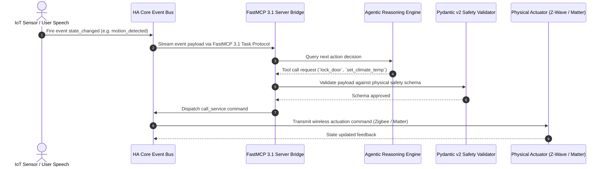

# Home Assistant

## What it is
Home Assistant is the world's leading open-source smart home automation platform, serving as the central nervous system for private internet-of-things (IoT) ecosystems. In early January 2027, version **2026.12/2027.1** has solidified its native "Agentic Core" architecture, incorporating **Model Context Protocol (MCP 3.1 / FastMCP 3.1)** endpoints for zero-latency tool calling, offline voice pipeline integration via Assist, and physical sensor/actuator control by frontier AI models like **Claude 5.1**, **GPT-5.5/5.6**, **Gemini 4.0 Pro/Ultra**, and **DeepSeek-V4**.

```
+-----------------------------------------------------------------------------------+
|                   HOME ASSISTANT AGENTIC PHYSICAL PIPELINE                        |
+-----------------------------------------------------------------------------------+
|  [Physical Sensors: Zigbee 3.0 / Matter 1.4 / Z-Wave LR / Wi-Fi / BLE]           |
|                │                                                                  |
|                ▼                                                                  |
|  [Home Assistant Core Event Bus & State Machine]                                  |
|                │                                                                  |
|                ▼                                                                  |
|  [FastMCP 3.1 Bridge & Local Assist Pipeline]                                     |
|        │                                               │                          |
|        ▼ (Offline Local Path)                          ▼ (Frontier Cloud Path)    |
|  [Ollama / Local Llama 4 Voice Models]          [Claude 5.1 / GPT-5.5 / Gemini 4.0] |
|        │                                               │                          |
|        └───────────────────────┬───────────────────────┘                          |
|                                ▼                                                  |
|  [Pydantic v2 Safety Guardrail Validation & Permission Check]                    |
|                │                                                                  |
|                ▼                                                                  |
|  [Hardware Actuation: Lights, HVAC, Smart Locks, Perimeter Security]             |
+-----------------------------------------------------------------------------------+
```

## Physical Actuation & Event Bus Sequence Flow



## What problem it solves
The consumer smart home market suffers from fragmented "walled gardens" and cloud provider lock-in that compromises user privacy and operational reliability during Internet outages. Home Assistant solves this by providing a unified, local-first interface integrating over 3,200 device standards (Matter 1.4+, Zigbee 3.0, Z-Wave Long Range, Wi-Fi, Bluetooth LE). It enables complex, cross-brand automations that run entirely within the user's private network, shielding physical hardware from cloud latency and data harvesting.

## Where it fits in the stack
**Category**: Service / Home Automation. It serves as the **Physical Orchestration Layer**, bridging hardware sensors and physical actuators to high-level autonomous agentic decision logic. It is the physical "Body" directed by LLM and agentic "Brains".

## Typical use cases
- **Multimodal Smart Home Operations**: Utilizing vision models (**Gemini 4.0 Ultra**, **Llama 4 Vision**) to inspect live security camera feeds, diagnose hardware states, or adjust lighting based on natural language spatial descriptions.
- **Predictive Energy Management**: Dynamically balancing solar generation, battery storage discharge, and EV charging based on real-time weather forecasts and dynamic grid pricing schedules.
- **Autonomous Agentic Home Security**: Continuous local monitoring where AI agents evaluate complex multi-sensor events (e.g., "The perimeter gate has remained unlatched for over 10 minutes while no resident is home") and trigger escalated notifications.
- **Unified Media & Lighting Orchestration**: Coordinating multi-room ambient audio, adaptive circadian lighting, and home theater scenes across disparate hardware ecosystems.
- **Automated Workflow Execution**: Triggering operational tasks in [Vikunja](vikunja.md) or multi-step webhooks in [n8n](n8n.md) based on local physical sensor events.

## Smart Home Platform Comparison Matrix

| Dimension / Platform | Home Assistant (2027) | OpenHAB 4 | Hubitat Elevation | Apple Home / HomeKit |
| :--- | :--- | :--- | :--- | :--- |
| **License Model** | Open Source (Apache 2.0) | Open Source (EPL) | Commercial Proprietary | Commercial Proprietary |
| **Local-First Architecture**| 100% Local Native | 100% Local Native | 100% Local Native | Cloud Hybrid |
| **Integration Count** | 3,200+ Integrations | 400+ Bindings | 1,000+ Community Drivers | Curated HomeKit Certified |
| **FastMCP 3.1 Endpoint**| Native Agentic Core | Third-Party Adapter | Custom Driver | No |
| **Offline Voice AI** | Assist (Ollama Local) | Basic Rule Voice | Basic Keyword | Siri Cloud |
| **Dashboard Complexity**| Lovelace Visual / YAML | Basic UI / Sitemaps | Dashboard Builder | iOS Home App |
| **Hardware Flexibility**| Any Linux / Pi / X86 | Any Java Host | Dedicated Hubitat Box | Apple Hub Required |

## Strengths
- **Native FastMCP 3.1 Integration**: Standardized, low-latency tool-calling interface allowing frontier models to query state and trigger entity actions directly.
- **Local-First Privacy Architecture**: All sensor telemetry and state data remains on local hardware; Home Assistant Assist enables fully offline voice and text control via local models in [Ollama](ollama.md).
- **Vast Device Ecosystem**: The largest open-source integration library globally, with active community drivers for thousands of IoT devices.
- **Dual Visual & Code Logic**: Supports visual drag-and-drop automation builders, Blueprints, and advanced YAML/Jinja2 logic scripts.
- **Lovelace 3D & Insight Dashboards**: Custom interactive floorplans and automated agent-generated cards highlighting system health and power usage.

## Limitations
- **Dedicated Hardware Requirement**: Requires continuous 24/7 host hardware (Raspberry Pi 5, Intel NUC/Mini-PC, or home server) for uninterrupted operation.
- **Configuration Depth**: Advanced customization and templating benefit from familiarity with YAML, Jinja2, and home networking concepts.
- **Entity Scaling Overhead**: Large installations with thousands of entities require structured dashboard organization to prevent UI clutter.

## When to use it
- When you demand complete, private local control over your smart home hardware and automation data.
- For integrating heterogenous multi-protocol hardware (Zigbee, Matter, Z-Wave, Wi-Fi) into a unified operational hub.
- When building an "Agentic Smart Home" where AI models need secure tool access to query sensors and actuate devices.
- To eliminate vendor subscription fees and cloud dependency for core home functionality.

## When not to use it
- If you prefer a completely managed, plug-and-play commercial experience and accept third-party cloud data collection.
- In environments where dedicated 24/7 local server hardware cannot be deployed.

## Getting started

### Docker Compose
Deploying Home Assistant via Docker Compose is recommended for advanced homelab environments:

```yaml
services:
  homeassistant:
    container_name: homeassistant
    image: "ghcr.io/home-assistant/home-assistant:stable"
    volumes:
      - ./config:/config
      - /etc/localtime:/etc/localtime:ro
    restart: unless-stopped
    privileged: true
    network_mode: host
    environment:
      - HA_MCP_ENABLED=true # Enable native FastMCP 3.1 endpoint
```

### Hello World
1. Navigate to `http://<your-server-ip>:8123`.
2. Complete the onboarding setup wizard to define your home location and auto-discover network devices.
3. Add the **Sun** integration to verify entity creation.
4. Create an initial automation: "Turn on Hallway Light when Sun sets" to test the internal automation engine.

## CLI examples
Interact with the Home Assistant core instance via the CLI wrapper:

```bash
# Validate Home Assistant configuration YAML files
docker exec homeassistant python3 -m homeassistant --config /config --script check_config

# View core release info and container status
docker exec homeassistant ha core info

# Restart the Home Assistant core service
docker exec homeassistant ha core restart

# Manage active system integrations and add-on instances
docker exec homeassistant ha addons list

# Trigger state update check via curl REST API
curl -X GET -H "Authorization: Bearer $HA_TOKEN" http://localhost:8123/api/states/light.living_room
```

## API examples

### FastMCP 3.1 Home Tool (TypeScript)
Exposing Home Assistant device actuation as a tool for FastMCP 3.1 agents.

```typescript
import { FastMCP } from 'fastmcp';

const mcp = new FastMCP({
  name: "home-assistant-control",
  version: "3.1.0"
});

mcp.addTool({
  name: "toggle_home_entity",
  description: "Toggle the state of a Home Assistant light, switch, or lock entity",
  parameters: {
    entityId: { type: "string", description: "Target entity_id (e.g. light.living_room)" }
  },
  execute: async ({ entityId }) => {
    const res = await fetch(`http://localhost:8123/api/services/homeassistant/toggle`, {
      method: "POST",
      headers: {
        "Authorization": `Bearer ${process.env.HA_TOKEN}`,
        "Content-Type": "application/json"
      },
      body: JSON.stringify({ entity_id: entityId })
    });
    return res.json();
  }
});

mcp.start();
```

### State Inspection (Python with Pydantic v2)
Programmatic Python script using **Pydantic v2** validation to query entity states and handle response payloads.

```python
import os
from datetime import datetime
from typing import Dict, Any, Optional
import requests
from pydantic import BaseModel, Field, field_validator, ConfigDict

class EntityAttributes(BaseModel):
    model_config = ConfigDict(populate_by_name=True, extra="forbid")

    friendly_name: Optional[str] = Field(None, alias="friendly_name")
    unit_of_measurement: Optional[str] = Field(None, alias="unit_of_measurement")
    battery_level: Optional[int] = Field(None, ge=0, le=100)

class EntityState(BaseModel):
    model_config = ConfigDict(populate_by_name=True, extra="forbid")

    entity_id: str = Field(..., alias="entity_id")
    state: str
    attributes: EntityAttributes
    last_changed: datetime = Field(..., alias="last_changed")
    last_updated: datetime = Field(..., alias="last_updated")

    @field_validator("state")
    @classmethod
    def validate_state_not_empty(cls, value: str) -> str:
        if not value.strip():
            raise ValueError("Entity state cannot be blank")
        return value

    @field_validator("entity_id")
    @classmethod
    def validate_entity_format(cls, value: str) -> str:
        if "." not in value:
            raise ValueError("entity_id must follow domain.object_id syntax (e.g., light.hallway)")
        return value

def get_entity_state(entity_id: str) -> EntityState:
    ha_url = os.getenv("HA_URL", "http://localhost:8123")
    ha_token = os.getenv("HA_TOKEN", "your_long_lived_access_token")

    url = f"{ha_url}/api/states/{entity_id}"
    headers = {
        "Authorization": f"Bearer {ha_token}",
        "Content-Type": "application/json"
    }

    response = requests.get(url, headers=headers, timeout=10)
    response.raise_for_status()

    # Parse and validate payload with Pydantic v2
    return EntityState.model_validate(response.json())

if __name__ == "__main__":
    try:
        lock_status = get_entity_state("lock.front_door")
        print(f"Device Name: {lock_status.attributes.friendly_name}")
        print(f"Current State: {lock_status.state}")
        print(f"Last Updated: {lock_status.last_updated}")
    except Exception as e:
        print(f"Failed to query Home Assistant state: {e}")
```

## Production Systemd Service Unit (`homeassistant.service`)

In bare-metal Linux deployment setups, manage Home Assistant Core via systemd:

```ini
[Unit]
Description=Home Assistant Core Service
After=network-online.target
Wants=network-online.target

[Service]
Type=simple
User=homeassistant
WorkingDirectory=/srv/homeassistant
ExecStart=/srv/homeassistant/bin/hass -c "/srv/homeassistant/config"
Restart=always
RestartSec=5s
Environment=PYTHONUNBUFFERED=1
StandardOutput=journal
StandardError=journal
LimitNOFILE=65536

[Install]
WantedBy=multi-user.target
```

## Operational Best Practices & Homelab Hardening

### 1. Multi-Factor Authentication & SSO Gateway
Do not expose the Home Assistant web portal directly to public port forwarding. Use [Tailscale](tailscale.md) zero-trust mesh networks or route traffic through a reverse proxy (e.g., Cloudflare Tunnel or Nginx Proxy Manager) protected by [Authentik](authentik.md) SSO.

### 2. Automated Configuration Backups
Configure the official **Google Drive Backup** or **S3 Storage** add-on to perform daily encrypted snapshots of the `/config` directory before core platform updates.

### 3. Database Maintenance & Recorder Tuning
In high-entity environments, exclude high-frequency sensor streams (such as CPU usage or energy watts updates) from the default SQLite/MariaDB recorder in `configuration.yaml` to prevent database bloat and disk wear:

```yaml
recorder:
  purge_keep_days: 14
  exclude:
    domains:
      - updater
    entity_globs:
      - sensor.processor_use*
```

## Operational Diagnostic Troubleshooting Matrix

| Symptom / Fault | Probable Underlying Cause | Diagnostic Command | Remediation Action |
| :--- | :--- | :--- | :--- |
| **Zigbee/Z-Wave Mesh Unresponsive** | USB serial coordinator interference or drop | `dmesg \| grep -i tty` | Relocate USB coordinator via extension cable away from 2.4GHz Wi-Fi routers. |
| **FastMCP Tool Response Timeout** | HA API Token expired or network firewalled | `curl -H "Authorization: Bearer $HA_TOKEN" http://localhost:8123/api/` | Regenerate long-lived access token and verify port 8123 binding. |
| **Database Bloat / High Disk I/O** | Recorder logging unneeded high-frequency entity states | `du -sh /config/home-assistant_v2.db` | Add noisy entities to `recorder.exclude` and run `recorder.purge` service. |
| **Voice Assist Pipeline Delay** | Local Whisper / Piper model lagging on host CPU | `docker logs homeassistant-whisper` | Offload speech recognition to GPU container or local [Ollama](ollama.md) endpoint. |

## Related tools / concepts
- [Ollama](ollama.md) — For hosting local LLMs driving Home Assistant Assist offline voice pipelines.
- [MCP](../tools/automation_orchestration/mcp-registry.md) — Protocol registry for connecting home IoT sensors to agentic workflows.
- [n8n](n8n.md) — For complex, multi-service automations extending outside local IoT networks.
- [Vikunja](vikunja.md) — For managing maintenance tasks triggered by hardware device events.
- [Tailscale](tailscale.md) — For secure zero-trust remote access to Home Assistant dashboards.
- [Authentik](authentik.md) — For SSO authentication management.
- [Immich](immich.md) — For serving private photo slide shows to smart home wall displays.
- [Paperless-ngx](paperless-ngx.md) — For linking home device documentation and maintenance manuals.

## Sources / references
- [Official Website](https://www.home-assistant.io/)
- [Home Assistant Integrations Catalog](https://www.home-assistant.io/integrations/)
- [FastMCP Framework](https://github.com/jlowin/fastmcp)
- [MCP 3.1 Specification](https://modelcontextprotocol.io/3.1)

## Contribution Metadata
- Last reviewed: 2027-01-07
- Confidence: high
