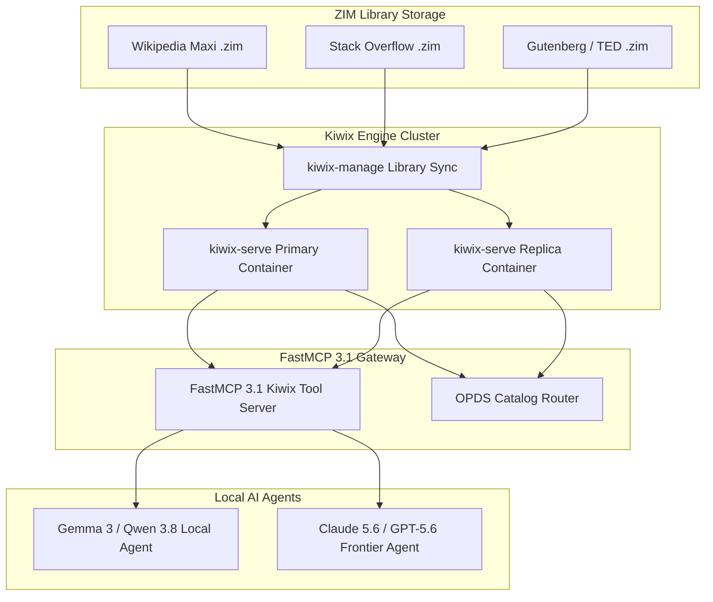

# Kiwix

## What it is

Kiwix is an offline content reader that allows you to download and access content like Wikipedia, Wiktionary, Stack Overflow, and TED talks without an internet connection. It uses the highly compressed ZIM format to store entire websites or databases in a single file. As of **early January 2027**, it serves as a critical retrieval layer for local agents using **Gemma 3**, **Qwen 3.8**, **DeepSeek-V4**, and **Llama 4** via the **FastMCP 3.1** / **MCP 3.1** Task Protocol.

## What problem it solves

Accessing reliable information usually requires an active internet connection. Kiwix solves this for environments with limited, censored, or no connectivity (e.g., remote schools, maritime vessels, disaster zones, or personal survival archives). It allows for high-speed, local searching of massive datasets without incurring data costs or relying on external infrastructure.

## High-Availability Kiwix Deployment Architecture



## Where it fits in the stack

**Category**: Service / Knowledge Management. It sits in the **offline knowledge and archival** layer, providing a fallback for critical information when the broader web is unavailable.

## Typical use cases

- **Remote Education**: Providing an entire encyclopedia to schools without internet.
- **Personal Archival**: Keeping a local copy of critical documentation (e.g., medical, survival, technical) for emergencies.
- **Privacy-First Research**: Browsing Wikipedia or Stack Overflow without being tracked by ISPs or site owners.
- **Low-Bandwidth Environments**: Accessing content at LAN speeds instead of waiting for slow satellite or cellular links.
- **Developer Documentation**: Using `devdocs2zim` to keep offline copies of programming docs (API reference, MDN, etc.).

## Offline Knowledge Solution Comparison

| Solution | Content Format | Search Capability | Memory Overhead | FastMCP 3.1 Integration | Primary Use Case |
| :--- | :--- | :--- | :--- | :--- | :--- |
| **Kiwix** | OpenZIM (.zim) | Built-in Xapian / FTS | Low ($\sim 200 \text{ MB}$) | Native Tool Server | Massive Static Libraries |
| **Internet-in-a-Box**| ZIM + Local Apps | Web Search & Apps | Medium ($\sim 2 \text{ GB}$) | External Wrapper | Turnkey School Deployments |
| **Xowa** | Custom XML/DB | Built-in Index | High ($\sim 4 \text{ GB}$) | No Native Support | Offline Wikipedia Rendering |
| **Local RAG Vector DB**| Parquet/Chroma | Vector Embedding | High ($\sim 8 \text{ GB}$) | Native FastMCP | Semantic Agent Search |

## ZIM Library Content Catalog Types

| ZIM Package Type | Description & Content Scope | Typical Disk Size | Recommended Search Mode |
| :--- | :--- | :--- | :--- |
| `wikipedia_en_all_maxi` | Complete English Wikipedia with full resolution images | ~110 GB - 130 GB | Xapian FTS / FastMCP 3.1 |
| `wikipedia_en_all_nopic` | Full English Wikipedia text excluding all images | ~22 GB - 25 GB | Fast In-Memory Text Search |
| `stackoverflow_en_all` | All Stack Overflow questions, accepted answers, & code | ~85 GB - 95 GB | Code Snippet & Error Lookup |
| `gutenberg_en_all` | Over 70,000 public domain ebooks in EPUB/HTML | ~65 GB | Title & Author Search |
| `devdocs_en_all` | Consolidated API documentation (Python, JS, Rust, Go) | ~8 GB - 12 GB | Developer Reference Search |

## Strengths

- **High Compression**: ZIM files can shrink a massive website into a relatively small, portable file.
- **Powerful Search**: Includes a fast, built-in search engine that works entirely offline.
- **Multi-Platform**: Available for Windows, macOS, Linux, Android, iOS, and as a server (kiwix-serve).
- **Portability**: Content is stored in a single `.zim` file, making it easy to share via USB drives or SD cards.
- **ZIM Ecosystem**: Vast library of content through the openZIM project, including Wikipedia, StackExchange, TED, and specialized medical/technical libraries.
- **libzim 10.x+ Performance**: Significant improvements in decompression speed and search indexing.
- **FastMCP 3.1 / MCP 3.1 Support**: Native Model Context Protocol support allows agents to query the Kiwix library directly for grounded offline research.

## Limitations

- **Snapshot Nature**: Content is only as current as the ZIM file; it does not receive real-time updates.
- **Read-Only**: You cannot edit the content within Kiwix; it is a reader, not a wiki engine.
- **Large Initial Downloads**: While compressed, full datasets like "Wikipedia with Images" can still be over 100GB.

## When to use it

- When you need to access large datasets (like Wikipedia) in offline, low-bandwidth, or censored environments.
- For local archival and fast searching of educational, medical, or historical content.
- When traveling or in locations where data costs are prohibitive.

## When not to use it

- When you need real-time updates and the latest content (ZIM files are snapshots).
- When you require editing capabilities for the content (it is a reader, not an editor).
- If you have very limited disk space, as full Wikipedia ZIM files can be very large (tens of GB).

## Getting started

### Docker Compose Setup
Deploy `kiwix-serve` alongside a library manager using Docker Compose:

```yaml
version: '3.8'

services:
  kiwix-serve:
    image: ghcr.io/kiwix/kiwix-serve:latest
    container_name: kiwix-serve
    restart: unless-stopped
    ports:
      - "8080:80"
    volumes:
      - /opt/kiwix/zims:/data:ro
      - /opt/kiwix/library.xml:/data/library.xml:ro
    command: kiwix-serve --library /data/library.xml --port 80
    healthcheck:
      test: ["CMD", "curl", "-f", "http://localhost:80/catalog.xml"]
      interval: 30s
      timeout: 5s
      retries: 3
    resources:
      limits:
        memory: 2G
        cpus: '2.0'
```

### Local Installation (Linux)
You can download pre-compiled binaries from the [releases page](https://download.kiwix.org/release/kiwix-tools/).

```bash
# Download and extract the tools
curl -L https://download.kiwix.org/release/kiwix-tools/kiwix-tools_linux-x86_64.tar.gz | tar xz
cd kiwix-tools_*

# Run the server directly
./kiwix-serve --port=8080 /path/to/your_content.zim
```

## CLI examples
The `kiwix-tools` package includes several utilities:

```bash
# Serve multiple ZIM files using a library file
kiwix-serve --port=8080 --library /data/library.xml

# Manage an XML-based library (add a new ZIM)
kiwix-manage /data/library.xml add /data/new_content.zim

# Search for a term across a ZIM file from the command line
kiwix-search /data/wikipedia.zim "Quantum Physics"
```

### Automated ZIM Updates
ZIM files are snapshots. To keep your library relatively fresh, you can use a script to download the latest versions from the Kiwix library.

```bash
#!/bin/bash
set -euo pipefail

ZIM_DIR="/opt/kiwix/zims"
LIBRARY_XML="/opt/kiwix/library.xml"
WIKI_URL="https://download.kiwix.org/zim/wikipedia/wikipedia_en_all_mini_latest.zim"

echo "Checking for Wikipedia ZIM updates..."
aria2c -d "$ZIM_DIR" -N "$WIKI_URL"

echo "Rebuilding Kiwix XML Library index..."
kiwix-manage "$LIBRARY_XML" purge
for zim in "$ZIM_DIR"/*.zim; do
    kiwix-manage "$LIBRARY_XML" add "$zim"
done

echo "Restarting Kiwix server container..."
systemctl restart kiwix-serve.service
```

## API examples

This complete implementation provides a FastMCP 3.1 tool server configured with Pydantic v2 schemas to parse, query, and validate offline search queries over `kiwix-serve`.

```python
import requests
import json
import logging
from typing import List, Optional, Dict, Any
from datetime import datetime
from pydantic import BaseModel, Field, ConfigDict, ValidationError
from fastmcp import FastMCP

# Setup logger for Kiwix FastMCP Server
logging.basicConfig(level=logging.INFO)
logger = logging.getLogger("Kiwix-FastMCP-Server")

# Initialize FastMCP 3.1 Server
mcp = FastMCP("KiwixSearchEngine", version="3.1.0")

class SearchQuerySchema(BaseModel):
    model_config = ConfigDict(extra="forbid")

    query: str = Field(..., description="The terms or topic to search for in the Kiwix library")
    max_results: int = Field(default=5, ge=1, le=50, description="Maximum number of offline results to return")
    content_source: str = Field(default="wikipedia", description="Specific ZIM content archive identifier")

class KiwixSearchResultItem(BaseModel):
    title: str = Field(..., description="Article or item title")
    path: str = Field(..., description="Relative path in ZIM archive")
    snippet: Optional[str] = Field(None, description="Text preview or excerpt")

class SearchResponseSchema(BaseModel):
    status: str = Field(..., description="Query status: success, error, or offline_mode")
    query: str = Field(...)
    total_matches: int = Field(default=0, ge=0)
    results: List[KiwixSearchResultItem] = Field(default_factory=list)
    timestamp: datetime = Field(default_factory=datetime.utcnow)

@mcp.tool(
    name="query_offline_kiwix",
    description="Executes an offline search query against the local kiwix-serve instance using Pydantic v2."
)
def query_offline_kiwix(query_json: str) -> str:
    """Parses search request, performs HTTP query against kiwix-serve, and returns structured response."""
    try:
        data = json.loads(query_json)
        req = SearchQuerySchema.model_validate(data)
        logger.info(f"Executing Kiwix offline query: '{req.query}' in source '{req.content_source}'")

        # Query kiwix-serve search endpoint
        url = "http://localhost:8080/search"
        params = {
            "content": req.content_source,
            "pattern": req.query
        }

        response = requests.get(url, params=params, timeout=5)
        if response.status_code != 200:
            err_res = SearchResponseSchema(
                status="error",
                query=req.query,
                results=[]
            )
            return err_res.model_dump_json(indent=2)

        raw_results = response.json()
        raw_list = raw_results.get("results", [])[:req.max_results]

        parsed_items = []
        for item in raw_list:
            parsed_items.append(
                KiwixSearchResultItem(
                    title=item.get("title", "Untitled"),
                    path=item.get("path", ""),
                    snippet=item.get("snippet", "")
                )
            )

        res = SearchResponseSchema(
            status="success",
            query=req.query,
            total_matches=len(raw_results.get("results", [])),
            results=parsed_items
        )
        return res.model_dump_json(indent=2)

    except requests.exceptions.RequestException as re:
        logger.warning(f"Kiwix server unreachable: {re}")
        err_res = SearchResponseSchema(
            status="offline_mode",
            query=data.get("query", "") if isinstance(data, dict) else "",
            results=[]
        )
        return err_res.model_dump_json(indent=2)

    except ValidationError as e:
        logger.error(f"Pydantic v2 Schema Error: {e}")
        return json.dumps({"error": "Validation failed", "details": e.errors()})

if __name__ == "__main__":
    sample_req = SearchQuerySchema(
        query="Quantum Entanglement",
        max_results=3,
        content_source="wikipedia"
    )
    print(query_offline_kiwix(sample_req.model_dump_json()))
```

## Production Systemd Service Unit (`kiwix-serve.service`)

Deploy the `kiwix-serve` engine as a dedicated systemd service unit for local offline knowledge serving:

```ini
[Unit]
Description=Kiwix Offline Knowledge Server Daemon
After=network.target local-fs.target
Documentation=https://github.com/kiwix/kiwix-tools

[Service]
Type=simple
User=kiwix
Group=kiwix
WorkingDirectory=/opt/kiwix
ExecStart=/usr/local/bin/kiwix-serve \
    --library=/opt/kiwix/library.xml \
    --port=8080 \
    --threads=4
ExecReload=/bin/kill -HUP $MAINPID
Restart=always
RestartSec=5s
LimitNOFILE=65536

# Security Hardening
NoNewPrivileges=true
ProtectSystem=strict
ProtectHome=true
ReadOnlyPaths=/opt/kiwix/zims /opt/kiwix/library.xml
ReadWritePaths=/var/log/kiwix

[Install]
WantedBy=multi-user.target
```

## Operational Best Practices & Troubleshooting

### Production Hardening Rules
1. **Resource Constraints**: Limit Docker CPU and RAM usage (`--memory="2g"`) to prevent kiwix-serve from exhausting host resources when indexing massive ZIMs.
2. **Read-Only Volume Mounts**: Always mount ZIM directories as read-only (`-v /opt/kiwix/zims:/data:ro`) to ensure ZIM file integrity during server execution.
3. **Search Latency Optimization**: Store ZIM files on NVMe SSD storage to ensure fast, sub-millisecond multi-threaded Xapian full-text search.

### Diagnostic Troubleshooting Matrix

| Symptom / Failure | Root Cause | Remediation Strategy |
| :--- | :--- | :--- |
| `Empty search results returned` | ZIM archive lacks pre-indexed Xapian search tables | Ensure ZIM file was built with `--ft-index` or check catalog XML flags. |
| `Port 8080 Address Already in Use` | Port conflict with existing web service | Bind `kiwix-serve` to alternate port (e.g., `--port=8089`) or update systemd unit. |
| `High CPU load during search` | Multi-threaded Xapian indexing on rotational HDD | Move ZIM library storage to NVMe SSD and restrict threads via `--threads=2`. |
| `Library XML Parse Failure` | Corrupted `library.xml` manifest file | Re-generate library XML using `kiwix-manage library.xml add /data/*.zim`. |
| `Kiwix FastMCP request timeout` | `kiwix-serve` container down or restarting | Check systemd logs via `journalctl -u kiwix-serve.service` and check port. |

## Related tools / concepts

- [Trilium](trilium.md) — For building your own personal knowledge base to complement Kiwix.
- [Audiobookshelf](audiobookshelf.md) — For a similar offline-first experience with audiobooks and podcasts.
- [Paperless-ngx](paperless-ngx.md) — For an offline-first archive of personal documents and receipts.
- [Home Assistant](home-assistant.md) — For integrating Kiwix status or content into a local dashboard.
- [Nextcloud](nextcloud.md) — For syncing ZIM files across devices for offline use.
- [Tika](tika.md) — Useful for processing and indexing the content within an offline knowledge base.
- [SearXNG](searXNG.md) — Can be configured to prioritize local Kiwix results.
- [Internet-in-a-Box](https://internet-in-a-box.org/) — A full hardware/software stack for offline knowledge.

## Sources / references

- [Official Website](https://www.kiwix.org/)
- [Kiwix Get (Downloads)](https://get.kiwix.org/)
- [GitHub Repository (Kiwix Tools)](https://github.com/kiwix/kiwix-tools)
- [Internet-in-a-Box](https://internet-in-a-box.org/)
- [Xowa](http://xowa.org/)
- [Aard 2](https://github.com/itkach/aard2-android)

## Contribution Metadata

- Last reviewed: 2027-01-07
- Confidence: high
