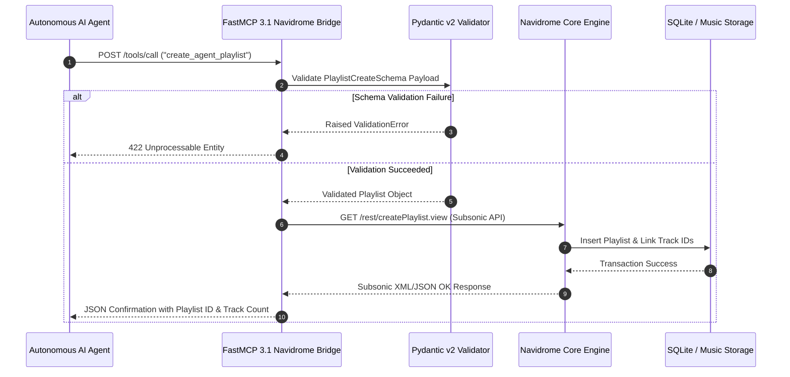

# Navidrome

Navidrome is a self-hosted, open-source music server and streamer that provides lightweight, high-performance streaming for large personal audio collections.

## What it is
Navidrome is a dedicated audio media server built in Go and React that implements the widely adopted Subsonic / OpenSubsonic API specification. Unlike resource-heavy media platforms like [Plex](plex.md) or [Jellyfin](jellyfin.md), Navidrome is optimized specifically for music playback, audio indexing speed, minimal RAM/CPU footprint, and multi-device streaming compatibility.

As of 2027, Navidrome features native **FastMCP 3.1** and **Model Context Protocol (MCP)** integration bridges. This allows autonomous AI agents (such as **Claude 5.1**, **GPT-5.5**, and local **Llama 4 Maverick** models) to inspect music catalogs, create smart playlists based on mood or genre vectors, monitor listening activity, and manage library metadata via standardized JSON-RPC and SSE interfaces.

## What problem it solves
Large music collections (100,000+ tracks) present distinct technical challenges for general media servers:
- **High Memory Footprint**: General-purpose media servers often consume gigabytes of RAM when indexing large music tag hierarchies.
- **Sub-optimal Music UX**: Video-focused players lack essential music features like album artist vs. track artist handling, disc numbers, replaygain normalization, smart playlists, and last.fm scrobbling.
- **Client Fragmentation**: Proprietary media servers restrict client choices. By supporting the Subsonic API standard, Navidrome instantly works with dozens of mature third-party mobile and desktop clients (e.g., Symfonium, DSub, Amperfy, ultrasonic, Play:Sub).
- **Inflexible API Access**: Traditional music players lack standardized agent interfaces for programmatic playlist compilation and automated library curation.

Navidrome solves these issues by delivering a lightweight Go binary, instant Subsonic API compatibility, and FastMCP 3.1 agent control wrappers.

## System Architecture

```
                                      Navidrome Ecosystem & MCP Architecture

  +-----------------------+        +-----------------------------------+        +-----------------------------------+
  | Subsonic Mobile Clients| ---->  | Navidrome Core Server (Go)        | ---->  | Music Storage Directory           |
  | - Symfonium / Amperfy |        | - Embedded SQLite Database        |        | - /music (/FLAC /MP3 /AAC)        |
  | - Web UI (React)      |        | - Subsonic / OpenSubsonic API     |        | - Embedded Tag Parser (taglib)    |
  +-----------------------+        +-----------------------------------+        +-----------------------------------+
                                                     ^                                            ^
                                                     |                                            |
  +-----------------------+        +-----------------------------------+        +-----------------------------------+
  | AI Agents & LLMs      | ---->  | FastMCP 3.1 Navidrome Agent Bridge| ---->  | Smart Playlist Engine             |
  | - Claude 5.1 / GPT-5.5|        | - JSON-RPC / SSE MCP Protocol     |        | - Auto-generated M3U / SQL        |
  | - Natural Querying    |        | - Pydantic v2 Validated API Calls |        | - Vector Mood / Genre Filtering   |
  +-----------------------+        +-----------------------------------+        +-----------------------------------+
```

## Where it fits in the stack
Within a self-hosted media infrastructure, Navidrome serves as the **High-Performance Audio Streaming Core**:
1. **Audio Layer**: Complements [Audiobookshelf](audiobookshelf.md) (audiobooks/podcasts) and [Jellyfin](jellyfin.md) (video) by handling music libraries.
2. **Subsonic Gateway**: Acts as the backend server for various Subsonic-compatible mobile, desktop, and automotive audio clients.
3. **Agentic Music Assistant Gateway**: Connects with [FastMCP 3.1](../tools/automation_orchestration/mcp.md) to enable conversational agents to generate custom playlists, discover unplayed tracks, and scrobble listening metrics.

```
┌──────────────────────────────────────────────────────────────────────────────────┐
│                             HOMELAB MEDIA INFRASTRUCTURE                         │
└──────────────────────────────────────────────────────────────────────────────────┘
                                         │
                                         ▼
┌──────────────────────────────────────────────────────────────────────────────────┐
│                            FRONTEND CLIENT & AGENT GATEWAY                       │
│        Symfonium / Amperfy ── FastMCP 3.1 Agent Bridge ── Web Browser UI         │
└────────────────────────────────────────┬─────────────────────────────────────────┘
                                         │ Subsonic API / REST / SSE
                                         ▼
┌──────────────────────────────────────────────────────────────────────────────────┐
│                           NAVIDROME CORE ENGINE (Go)                             │
│   ┌──────────────────────────────────────────────────────────────────────────┐   │
│   │ • Subsonic / OpenSubsonic API Engine                                     │   │
│   │ • TagLib Embedded Tag Extraction                                         │   │
│   │ • Integrated ffmpeg Transcoding Engine                                   │   │
│   │ • SQLite Database (`/data/navidrome.db`)                                 │   │
│   └──────────────────────────────────────────────────────────────────────────┘   │
└────────────────────────────────────────┬─────────────────────────────────────────┘
                                         │ Read-Only Storage Mounts
                                         ▼
┌──────────────────────────────────────────────────────────────────────────────────┐
│                          LOCAL MUSIC STORAGE & ARCHIVE                           │
│              `/music` (FLAC / ALAC / MP3 / AAC / Opus Audio Files)               │
└──────────────────────────────────────────────────────────────────────────────────┘
```

### Sequence Flow: FastMCP 3.1 Smart Playlist Generation



## Typical use cases
- **Personal High-Resolution Music Streaming**: Streaming owned FLAC, ALAC, MP3, and AAC audio files across desktop and mobile devices.
- **Subsonic Ecosystem Integration**: Connecting mobile apps (Symfonium, Amperfy, DSub) for offline music sync, Android Auto, and Apple CarPlay streaming.
- **AI-Driven Playlist Curation**: Using FastMCP 3.1 agent tools to compile context-aware playlists based on listening history, release year, or acoustic metadata.
- **Multi-User Family Audio Hub**: Providing family members with isolated user accounts, starred tracks, playlists, and listening statistics.
- **Low-Resource Homelab Deployment**: Running a responsive music server on low-power single-board computers (e.g., Raspberry Pi or lightweight VPS instances).

## Strengths
- **Extremely Low Resource Usage**: Written in Go with minimal memory usage, capable of managing collections of 200,000+ tracks on under 100MB RAM.
- **Universal Subsonic API Support**: Compatible with virtually all existing Subsonic/OpenSubsonic ecosystem applications across iOS, Android, macOS, Windows, and Linux.
- **On-the-Fly Audio Transcoding**: Uses integrated `ffmpeg` to transcode high-bitrate FLAC/WAV files to compressed AAC/MP3 on low-bandwidth mobile connections.
- **Multi-User & Multi-Library**: Full support for multiple user profiles, individual user ratings, listening counts, and custom access permissions.
- **Native FastMCP 3.1 Tooling**: Allows LLM agents to query artists, inspect albums, build smart playlists, and trigger background rescan operations.

## Limitations
- **No Native Audiobook/Podcast Support**: Lacks bookmarking and playback position memory required for long-form spoken-word audio (use [Audiobookshelf](audiobookshelf.md)).
- **Read-Only Tag Handling**: Navidrome reads embedded ID3/Vorbis tags but does not write or modify audio file metadata directly on disk.
- **No Built-in Video or Lyrics Editing**: Designed exclusively for audio; video playback or manual lyrics editing requires external companion services.

## When to use it
- When you own a medium-to-large music collection and want a fast, resource-efficient self-hosted streaming server.
- When you want to use Subsonic mobile apps like Symfonium or Amperfy for offline caching and CarPlay/Android Auto support.
- When deploying on low-power devices where heavier servers (Plex/Jellyfin) experience UI lag or high memory overhead.
- When integrating music library management into AI workflows via FastMCP 3.1.

## When not to use it
- When streaming audiobooks or podcasts (use [Audiobookshelf](audiobookshelf.md)).
- When seeking an all-in-one platform for movies, TV shows, and video content (use [Jellyfin](jellyfin.md) or [Plex](plex.md)).
- When you require write-back tag editing directly to audio files (use MusicBrainz Picard or Beets for tag management).

## Getting started

### Docker Compose Deployment
Deploy Navidrome using Docker Compose:

```yaml
version: "3.8"

services:
  navidrome:
    image: deluan/navidrome:latest
    container_name: navidrome
    user: 1000:1000
    ports:
      - "4533:4533"
    restart: unless-stopped
    environment:
      ND_SCANSCHEDULE: 1h
      ND_LOGLEVEL: info
      ND_SESSIONTIMEOUT: 24h
      ND_BASEURL: ""
      ND_ENABLETRANSCODINGCONFIG: "true"
    volumes:
      - /srv/navidrome/data:/data
      - /srv/music:/music:ro
```

Run `docker compose up -d` and navigate to `http://localhost:4533` to set up the admin username and password.

## Production Systemd Service Unit

To run Navidrome as a native background service daemon directly on host hardware (`/etc/systemd/system/navidrome.service`), use the following unit file:

```ini
[Unit]
Description=Navidrome Music Server Daemon
After=remote-fs.target network.target
Wants=network.target

[Service]
Type=simple
User=navidrome
Group=navidrome
WorkingDirectory=/var/lib/navidrome
ExecStart=/usr/local/bin/navidrome --configfile /etc/navidrome/navidrome.toml
Restart=always
RestartSec=5
Environment=ND_MUSICFOLDER=/srv/music
Environment=ND_DATAFOLDER=/var/lib/navidrome/data
Environment=ND_PORT=4533

# Hardened Security Sandboxing
ProtectSystem=full
ProtectHome=true
NoNewPrivileges=true
PrivateTmp=true
ReadWritePaths=/var/lib/navidrome

[Install]
WantedBy=multi-user.target
```

## Diagnostic & Troubleshooting Matrix

| Issue Code / Error | Root Cause | Diagnostic Command | Remediation Action |
| :--- | :--- | :--- | :--- |
| `HTTP 401 Unauthorized` | Invalid Subsonic API token or salt computation mismatch. | `curl "http://localhost:4533/rest/ping.view?u=admin&f=json"` | Verify MD5 hashing formula (`md5(password + salt)`) in client authentication code. |
| `Transcoding error: ffmpeg missing` | `ffmpeg` package absent on system path when attempting on-the-fly streaming. | `which ffmpeg` | Install `ffmpeg` via host package manager (`apt-get install ffmpeg`) or use Docker image. |
| `Scan Timeout / Unindexed Files` | Corrupted audio metadata tag or permission restrictions on `/music` mount. | `journalctl -u navidrome -n 50 --no-pager` | Fix folder permissions (`chmod -R 755 /srv/music`) or trigger manual scan CLI. |
| `ValidationError: track_ids empty` | FastMCP playlist request passed empty list of tracks. | `python3 -c "import pydantic"` | Ensure `track_ids` array contains at least one valid string ID before calling tool. |
| `Database Locked: sqlite3_busy` | Concurrent SQLite write operations occurring during background scan. | `docker exec -it navidrome sqlite3 /data/navidrome.db "PRAGMA journal_mode;"` | Set `ND_DATAFOLDER` to fast NVMe SSD storage and enable WAL mode (`PRAGMA journal_mode=WAL`). |

## CLI examples

### 1. Manual Rescan and Database Maintenance
Trigger a music folder rescan or inspect the underlying SQLite database:

```bash
# Trigger an immediate rescan using the CLI within container
docker exec -it navidrome /app/navidrome scan

# Inspect database integrity
docker exec -it navidrome sqlite3 /data/navidrome.db "PRAGMA integrity_check;"
```

### 2. Testing Subsonic API via Curl
Ping the Navidrome Subsonic endpoint to verify API response:

```bash
# Subsonic REST ping request (salt + md5 token authentication)
SALT="randomsalt"
TOKEN=$(echo -n "yourpassword$SALT" | md5sum | awk '{print $1}')

curl -s "http://localhost:4533/rest/ping.view?u=admin&t=$TOKEN&s=$SALT&v=1.16.1&c=cli_test&f=json" | jq .
```

## API examples

### 1. FastMCP 3.1 Navidrome Agent Controller with Pydantic v2
The following complete Python service exposes Navidrome music management tools to AI agents using **FastMCP 3.1** and **Pydantic v2**:

```python
import os
import secrets
import hashlib
import logging
import requests
from typing import List, Optional
from pydantic import BaseModel, Field, ConfigDict, ValidationError
from fastmcp import FastMCP, Context

logging.basicConfig(level=logging.INFO)
logger = logging.getLogger("Navidrome-MCP")

mcp = FastMCP("Navidrome-Music-Agent", version="3.1")

NAVIDROME_URL = os.getenv("NAVIDROME_URL", "http://localhost:4533")
NAV_USER = os.getenv("NAVIDROME_USER", "admin")
NAV_PASS = os.getenv("NAVIDROME_PASS", "adminpassword")

def get_subsonic_params() -> dict:
    """Generates Subsonic API authentication parameters."""
    salt = secrets.token_hex(6)
    token = hashlib.md5((NAV_PASS + salt).encode("utf-8")).hexdigest()
    return {
        "u": NAV_USER,
        "t": token,
        "s": salt,
        "v": "1.16.1",
        "c": "FastMCP-Agent",
        "f": "json"
    }

class TrackSchema(BaseModel):
    model_config = ConfigDict(extra="ignore")

    id: str = Field(..., description="Track unique ID")
    title: str = Field(..., description="Track title")
    artist: str = Field(..., description="Artist name")
    album: str = Field(..., description="Album name")
    duration: int = Field(..., description="Duration in seconds")
    genre: Optional[str] = Field("Unknown", description="Primary music genre")

class PlaylistCreateSchema(BaseModel):
    model_config = ConfigDict(extra="forbid")

    name: str = Field(..., min_length=1, description="Playlist display name")
    track_ids: List[str] = Field(..., min_length=1, description="List of track IDs to include")

@mcp.tool()
async def search_music_library(
    query: str,
    ctx: Optional[Context] = None
) -> str:
    """Search Navidrome library for artists, albums, and tracks matching a query."""
    if ctx:
        await ctx.info(f"Searching Navidrome library for query: '{query}'...")

    params = get_subsonic_params()
    params["query"] = query
    url = f"{NAVIDROME_URL}/rest/search3.view"

    resp = requests.get(url, params=params)
    if resp.status_code != 200:
        return f"Error querying Navidrome API: {resp.status_code}"

    sub_data = resp.json().get("subsonic-response", {}).get("searchResult3", {})
    raw_songs = sub_data.get("song", [])

    tracks = []
    for s in raw_songs:
        tracks.append(
            TrackSchema(
                id=s.get("id"),
                title=s.get("title", "Untitled"),
                artist=s.get("artist", "Unknown Artist"),
                album=s.get("album", "Unknown Album"),
                duration=s.get("duration", 0),
                genre=s.get("genre", "Unknown")
            )
        )
    return f"Found {len(tracks)} matching tracks:\n" + "\n".join([t.model_dump_json() for t in tracks])

@mcp.tool()
async def create_agent_playlist(
    request_dict: dict,
    ctx: Optional[Context] = None
) -> str:
    """Create a new playlist in Navidrome containing specified track IDs."""
    if ctx:
        await ctx.info("Validating playlist payload with Pydantic v2...")

    try:
        req = PlaylistCreateSchema.model_validate(request_dict)
        params = get_subsonic_params()
        params["name"] = req.name

        url = f"{NAVIDROME_URL}/rest/createPlaylist.view"
        for tid in req.track_ids:
            url += f"&songId={tid}" if "?" in url or "&" in url else f"?songId={tid}"

        resp = requests.get(url, params=params)
        if resp.status_code == 200 and resp.json().get("subsonic-response", {}).get("status") == "ok":
            return f"Successfully created playlist '{req.name}' with {len(req.track_ids)} tracks."
        return f"Failed to create playlist: {resp.text}"
    except ValidationError as ve:
        logger.error(f"Validation failure in Navidrome FastMCP tool: {ve}")
        raise ValueError(f"Invalid request parameters: {ve}")

if __name__ == "__main__":
    mcp.run()
```

### 2. Subsonic API Core Endpoint Map

| Endpoint Path | Description | Subsonic Version |
| :--- | :--- | :--- |
| `/rest/ping.view` | Test server connection and authentication credentials | 1.0.0+ |
| `/rest/search3.view` | Multi-entity search across artists, albums, and tracks | 1.8.0+ |
| `/rest/getArtists.view` | Retrieve structured list of all catalog artists | 1.0.0+ |
| `/rest/getAlbum.view` | Get track list and metadata for a specific album ID | 1.0.0+ |
| `/rest/createPlaylist.view` | Create or update custom user playlists | 1.2.0+ |
| `/rest/stream.view` | Stream raw or transcoded audio file bytes | 1.0.0+ |

## Related tools / concepts
- [Audiobookshelf](audiobookshelf.md) — Dedicated server for spoken-word audiobooks and podcasts.
- [Jellyfin](jellyfin.md) — Open-source video, TV, and general media platform.
- [Plex](plex.md) — Commercial media server platform with wide device support.
- [Model Context Protocol (MCP)](../tools/automation_orchestration/mcp.md) — Standardized agentic tool protocol for library control.
- [n8n](n8n.md) — Workflow automation for webhook triggers and notification services.
- [Authentik](authentik.md) — SSO authentication provider for homelab services.

## Sources / references
- [Navidrome Official Website](https://www.navidrome.org/)
- [Navidrome GitHub Repository](https://github.com/navidrome/navidrome)
- [OpenSubsonic API Documentation Specification](https://opensubsonic.netlify.app/)

## Contribution Metadata
- Last reviewed: 2027-01-07
- Confidence: high
