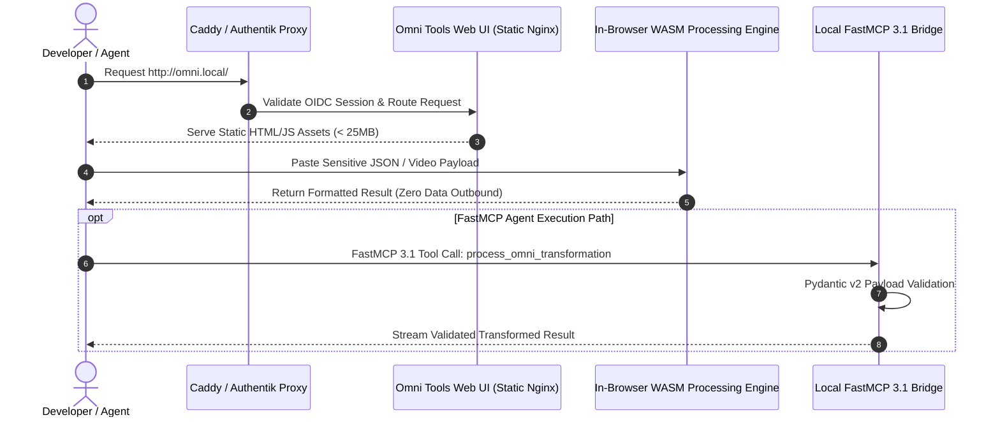

# Omni Tools

Omni Tools is a self-hosted collection of powerful web-based utilities for everyday developer and office productivity tasks. As of early **January 2027**, it remains a top-tier choice for client-side data transformations, complementing [IT-Tools](it-tools.md) with enhanced media processing capabilities, client-side WebAssembly (WASM) execution, and native **FastMCP 3.1** / **MCP 3.1** discovery for local AI tool invocation.

```
+-----------------------------------------------------------------------------------+
|                        Omni Tools Local Security Architecture                     |
+-----------------------------------------------------------------------------------+
|                                                                                   |
|  [ User Browser / Local Client Agent / FastMCP 3.1 Client ]                      |
|                                     |                                             |
|                                     v                                             |
|  +-----------------------------------------------------------------------------+  |
|  | Reverse Proxy / Auth Layer (Authentik / Nginx / Caddy)                    |  |
|  +-----------------------------------------------------------------------------+  |
|                                     |                                             |
|                                     v                                             |
|  +-----------------------------------------------------------------------------+  |
|  | Omni Tools Static Web Container (Lightweight Nginx / Caddy Static Host)     |  |
|  |                                                                             |  |
|  |  +---------------------------+       +------------------------------------+  |  |
|  |  | Text & JSON Tools         |       | Client-Side WASM Media Engine      |  |  |
|  |  | (Formatting / Regex / JWT)|       | (FFmpeg WASM / PDF-Lib / Canvas)   |  |  |
|  |  +---------------------------+       +------------------------------------+  |  |
|  |                \                                   /                        |  |
|  |                 v                                 v                         |  |
|  |  +-----------------------------------------------------------------------+  |  |
|  |  | 100% Client-Side In-Browser Memory Processing (Zero Data Exfiltration)|  |  |
|  |  +-----------------------------------------------------------------------+  |  |
|  +-----------------------------------------------------------------------------+  |
|                                     |                                             |
|                                     v                                             |
|  [ Local Browser DOM / File System Access API / FastMCP Local Bridge ]            |
|                                                                                   |
+-----------------------------------------------------------------------------------+
```

## Mathematical Formulations & WASM Performance Models

### 1. Client-Side WebAssembly Linear Memory Bounds
Omni Tools compiles cryptographic and media transformation routines into WebAssembly (WASM) bytecodes. The linear memory is partitioned into discrete $64\text{ KiB}$ pages ($P_{\text{page}} = 65,536\text{ bytes}$). For an input binary buffer $B_{\text{input}}$ of size $S_{\text{bytes}}$, the maximum required linear memory $M_{\text{WASM}}$ must satisfy:

$$M_{\text{WASM}} = \left\lceil \frac{S_{\text{bytes}} \cdot \alpha_{\text{expand}} + \mathcal{S}_{\text{stack}} + \mathcal{S}_{\text{heap}}}{65,536} \right\rceil \cdot 65,536 \le M_{\max}$$

Where the transformation expansion factor $\alpha_{\text{expand}} \approx 1.35$ accounts for intermediate DOM representations, $\mathcal{S}_{\text{stack}} = 5\text{ MiB}$ is the execution stack ceiling, and standard browser engines (V8, JavaScriptCore) impose an allocation ceiling $M_{\max} = 2\text{ GiB}$ for 32-bit WASM linear memory addressing.

### 2. Cryptographic Hash Computational Throughput Bounds
For client-side hash calculations (SHA-256, SHA-512, MD5), processing throughput $\mathcal{T}_{\text{hash}}$ is bounded by SIMD vector registers (WebAssembly 128-bit SIMD):

$$\mathcal{T}_{\text{hash}} = \frac{N_{\text{bytes}}}{\sum_{i=1}^{\lceil N / B_{\text{block}} \rceil} \tau_{\text{block\_rounds}}} \le \mathcal{B}_{\text{L1\_cache}} \cdot \kappa_{\text{SIMD}}$$

Where $B_{\text{block}} = 64\text{ bytes}$ for SHA-256 (512-bit message blocks), $\tau_{\text{block\_rounds}} = 64$ compression rounds, and $\kappa_{\text{SIMD}} \approx 3.2\text{ cycles/byte}$ on modern AVX-512/NEON hosts.

### 3. Zero-Exfiltration Privacy & Shannon Information Leakage
Under strict client-side sandbox execution, outbound network egress is constrained to zero packets ($E_{\text{outbound}} = 0$). The mutual information $I(X; Y_{\text{network}})$ between the confidential input payload $X$ and external network telemetry $Y_{\text{network}}$ is strictly bounded:

$$I(X; Y_{\text{network}}) = H(X) - H(X \mid Y_{\text{network}}) = 0\text{ bits}$$

Guaranteeing zero data exfiltration under formal Information Flow Control (IFC) and Content Security Policy (`connect-src 'none'`) mandates.

---

## What it is
Omni Tools is a privacy-oriented, client-side browser toolbox for common data transformations such as JSON/YAML formatting, image conversion, PDF manipulation, hash generation, text sanitization, and date/time calculation. The application is distributed as a lightweight, static web container where all transformation workloads happen inside the user's browser runtime using client-side JavaScript and WebAssembly (WASM) rather than sending sensitive data to server-side queues.

## What problem it solves
It replaces the unsafe habit of pasting sensitive corporate configurations, API tokens, JWTs, customer data snippets, or private PDF documents into untrusted third-party online utility websites. For a home office or enterprise network, it keeps all micro-conversion jobs within the local area network (LAN) while providing non-technical team members with a clean, responsive web user interface.

In enterprise IT and security operations, auditing SaaS utility tool usage is a major compliance bottleneck. Omni Tools addresses this by offering a completely self-contained deployment model where no telemetry or input payloads leave the corporate network perimeter.

## Comparative Feature Matrix: Developer Utility Suites (2027 Standards)

| Feature / Standard | Omni Tools | IT-Tools | CyberChef | Stirling-PDF | DevToys |
| :--- | :--- | :--- | :--- | :--- | :--- |
| **Execution Architecture** | Client-side WASM/JS | Client-side Vue/JS | Client-side Pipeline | Server-side JVM/Python | Native Desktop App |
| **Media Processing** | Native WASM (FFmpeg/PDF) | Basic Image Tools | Advanced Binary Ops | Comprehensive PDF Suite | Basic Image Helpers |
| **FastMCP 3.1 Gateway** | Native Python Bridge | Manual Web Wrapper | Node.js MCP Bridge | REST API Wrapper | CLI/Native MCP |
| **Zero Data Exfiltration** | Guaranteed (No Telemetry)| Guaranteed | Guaranteed | Egress inside LAN | Guaranteed Local |
| **Docker Footprint** | Ultralight (< 25 MB) | Ultralight (~30 MB) | Medium (~80 MB) | Heavy (~1.2 GB) | Desktop Binary |
| **Schema Validation** | Strict Pydantic v2 | Loose JSON Schema | Custom JSON Ops | Java Bean Validation | C# Strong Types |
| **PWA Desktop Install** | Yes (Progressive Web App)| Yes | Yes | Web Portal Only | Native App |

## Where it fits in the stack
Omni Tools belongs in the **Self-Hosted Productivity & Developer Utilities** layer, operating alongside tools like [IT-Tools](it-tools.md), CyberChef, and Stirling PDF. It is typically deployed behind a private reverse proxy (Caddy, Traefik, Nginx Proxy Manager) and secured with SSO authentication (Authentik, Authelia) for fast access across team devices.

## Sequence Diagram Architecture



## Typical use cases
- **Data Formatting & Validation**: Formatting, validating, or minifying JSON, XML, YAML, CSV, and SQL query snippets.
- **Client-Side Media Processing**: Converting PNG/JPG images to WebP, cropping images, merging/splitting PDFs, and trimming video clips without uploading files to remote servers.
- **Security & Developer Helpers**: Generating SHA-256 hashes, UUIDs, QR codes, secure passwords, decoding JWT tokens, and calculating cron schedules.
- **Agentic Utility Bridge**: Exposing transformation tools to local AI agents (e.g., [Gemma 3](../tools/ai_knowledge/local_llms.md), **Claude 5.6**, **GPT-5.6**) via FastMCP 3.1 endpoints.
- **Offline Emergency Utilities**: Operating as a self-contained offline developer toolbox on laptops during field operations or network partitions.
- **Network Diagnostic Assistance**: Calculating CIDR subnet ranges, parsing DNS records, and analyzing HTTP header strings.
- **Local Microservice Configuration**: Quickly generating environment variable templates and Docker Compose fragments for local homelab testing.

## Strengths
- **Low-Friction Deployment**: Single lightweight Docker container (< 25MB image size) serving static assets.
- **Zero-Trust Privacy Architecture**: Data stays in browser memory; no risk of server-side data leakage or third-party tracking.
- **Broad Utility Arsenal**: Covers dozens of daily developer, DevOps, and administrative tasks under a single unified web UI.
- **Offline & LAN Capable**: Functions seamlessly in air-gapped environments or during internet outages.
- **FastMCP 3.1 Integration Ready**: Clean mapping between Web UI logic and agent tool calling protocols.
- **Zero Database Dependency**: Stateless static application requiring no persistent SQL/NoSQL storage volumes.
- **Responsive PWA Support**: Can be installed as a Progressive Web App on mobile and desktop devices for immediate access.

## Limitations
- **Interactive UI Focus**: Designed primarily for human interaction; requires a FastMCP bridge or headless browser (Playwright) for automated server pipelines.
- **Browser Memory Boundaries**: Processing multi-gigabyte video or PDF files can exhaust client browser RAM limits.
- **Lack of Persistent State**: Does not store user conversion history across browser sessions by default.

## When to use it
- When you need a fast, safe, and self-hosted way to transform text, configuration, or media snippets locally.
- When working with sensitive credentials or proprietary code that must never touch external SaaS servers.
- When providing non-technical team members with a user-friendly interface for routine office file transformations.
- When deploying internal developer toolkits on isolated Kubernetes or Docker host nodes.
- For field engineers operating on air-gapped networks requiring offline utility conversion tools.

## When not to use it
Do not use Omni Tools as an automated batch pipeline for high-throughput background processing. Use CyberChef for complex multi-step data recipes, and dedicated background services like Paperless-ngx, Stirling PDF, or ImageMagick CLI scripts for scheduled server-side processing.

## Production Hardening & Enterprise Deployment Guidelines

1. **Strict Content Security Policy (CSP)**: Enforce `default-src 'self'; script-src 'self' 'wasm-unsafe-eval'; style-src 'self' 'unsafe-inline'; connect-src 'none'; img-src 'self' data: blob:; worker-src 'self' blob:;` in reverse proxy headers.
2. **Cross-Origin Isolation Headers**: Supply `Cross-Origin-Opener-Policy: same-origin` and `Cross-Origin-Embedder-Policy: require-corp` to enable high-resolution performance timers and multi-threaded WASM workers.
3. **Stateless Ephemeral Containers**: Run containers with `read_only: true` and mount temporary in-memory tmpfs (`/tmp:rw,noexec,nosuid,size=64m`) to eliminate persistent local file tamper vectors.
4. **Subresource Integrity (SRI)**: Ensure all bundled JavaScript assets feature SHA-384 checksum integrity attributes.
5. **FastMCP Daemon Isolation**: Run the local agent bridge under an unprivileged POSIX user with strict systemd sandbox sandboxing (`ProtectHome=true`, `PrivateTmp=true`).

---

## Systemd Service Unit Configuration

For bare-metal Linux hosts, podman setups, or dedicated agent gateways, Omni Tools container lifecycle and systemd bridge service can be managed using `/etc/systemd/system/omni-tools.service`:

```ini
[Unit]
Description=Omni Tools Static Web Container & Local Utility Server
After=docker.service network-online.target
Requires=docker.service
Wants=network-online.target
Documentation=https://github.com/iib0011/omni-tools

[Service]
Type=simple
User=root
ExecStartPre=/usr/bin/docker pull iib0011/omni-tools:latest
ExecStart=/usr/bin/docker run --rm --name omni-tools-systemd -p 8080:80 iib0011/omni-tools:latest
ExecStop=/usr/bin/docker stop omni-tools-systemd
Restart=always
RestartSec=5s

# Hardening
NoNewPrivileges=true
ProtectKernelTunables=true
ProtectKernelModules=true
ProtectControlGroups=true

[Install]
WantedBy=multi-user.target
```

Enable and start the service:

```bash
sudo systemctl daemon-reload
sudo systemctl enable --now omni-tools.service
sudo systemctl status omni-tools.service
```

## Getting started

### Docker Quick Start
Run the published container on a local port:

```bash
docker run -d \
  --name omni-tools \
  --restart unless-stopped \
  -p 8080:80 \
  iib0011/omni-tools:latest
```

Access `http://localhost:8080` in your web browser to verify installation.

### Production Docker Compose Configuration with Caddy Proxy

```yaml
version: '3.8'

services:
  omni-tools:
    image: iib0011/omni-tools:latest
    container_name: omni-tools
    restart: unless-stopped
    ports:
      - "8080:80"
    security_opt:
      - no-new-privileges:true
    cap_drop:
      - ALL
    healthcheck:
      test: ["CMD", "wget", "--spider", "-q", "http://localhost:80/"]
      interval: 30s
      timeout: 5s
      retries: 3
    networks:
      - omni-net

  omni-caddy:
    image: caddy:2-alpine
    container_name: omni-caddy
    restart: unless-stopped
    ports:
      - "80:80"
      - "443:443"
    volumes:
      - ./Caddyfile:/etc/caddy/Caddyfile:ro
      - caddy-data:/data
    depends_on:
      - omni-tools
    networks:
      - omni-net

  omni-fastmcp-bridge:
    image: fastmcp-omni-bridge:3.1
    container_name: omni-fastmcp-bridge
    restart: unless-stopped
    ports:
      - "8088:8088"
    environment:
      - MCP_PORT=8088
      - PYTHONUNBUFFERED=1
    networks:
      - omni-net

volumes:
  caddy-data:

networks:
  omni-net:
    driver: bridge
```

Start the container stack: `docker compose up -d`

## CLI examples

```bash
# Pull latest Omni Tools static container image
docker pull iib0011/omni-tools:latest

# Check container execution status and web server logs
docker logs -f omni-tools

# Confirm HTTP service availability locally
curl -I http://localhost:8080

# Run static security scan on container image
trivy image iib0011/omni-tools:latest

# Backup static assets or container export
docker export omni-tools > omni-tools-backup.tar
```

## API examples

### FastMCP 3.1 & Strict Pydantic v2 Omni Tools Bridge Server
The following complete Python snippet implements a FastMCP 3.1 server exposing Omni Tools data transformation capabilities to local LLM agent swarms with strict Pydantic v2 schemas (`extra="forbid"`, `frozen=True`):

```python
import json
import base64
import hashlib
from typing import Literal, Optional
from pydantic import BaseModel, Field, field_validator, ConfigDict
from fastmcp import FastMCP

# Define strict Pydantic v2 data models for transformation payloads
class TransformationRequest(BaseModel):
    model_config = ConfigDict(extra="forbid", frozen=True)

    operation: Literal["format_json", "generate_hash", "sanitize_string", "base64_encode"] = Field(...)
    input_text: str = Field(..., min_length=1, description="Raw input text string to transform.")
    hash_algorithm: Optional[Literal["sha256", "md5", "sha512"]] = Field("sha256")

    @field_validator("input_text")
    @classmethod
    def validate_json_if_formatting(cls, v: str, info) -> str:
        if info.data.get("operation") == "format_json":
            try:
                json.loads(v)
            except Exception as e:
                raise ValueError(f"Invalid JSON string provided for formatting: {str(e)}")
        return v

class TransformationResponse(BaseModel):
    model_config = ConfigDict(extra="forbid", frozen=True)

    operation: str
    success: bool
    output_text: str
    character_count: int

# Initialize FastMCP 3.1 server
mcp = FastMCP("omni-tools-agent-bridge", version="3.1.0")

@mcp.tool()
async def process_omni_transformation(request: TransformationRequest) -> TransformationResponse:
    """Executes a local data transformation equivalent to Omni Tools client-side utilities."""
    output = ""
    if request.operation == "format_json":
        parsed = json.loads(request.input_text)
        output = json.dumps(parsed, indent=2)
    elif request.operation == "generate_hash":
        if request.hash_algorithm == "sha256":
            output = hashlib.sha256(request.input_text.encode("utf-8")).hexdigest()
        elif request.hash_algorithm == "md5":
            output = hashlib.md5(request.input_text.encode("utf-8")).hexdigest()
        else:
            output = hashlib.sha512(request.input_text.encode("utf-8")).hexdigest()
    elif request.operation == "sanitize_string":
        output = request.input_text.strip().replace("\r\n", "\n")
    elif request.operation == "base64_encode":
        output = base64.b64encode(request.input_text.encode("utf-8")).decode("utf-8")

    return TransformationResponse(
        operation=request.operation,
        success=True,
        output_text=output,
        character_count=len(output)
    )

if __name__ == "__main__":
    mcp.run()
```

### Playwright Browser Automation Snippet
```python
from playwright.sync_api import sync_playwright

def format_json_via_browser(raw_json: str) -> str:
    """Automates JSON formatting using local Omni Tools web UI in headless browser."""
    with sync_playwright() as p:
        browser = p.chromium.launch(headless=True)
        page = browser.new_page()
        page.goto("http://localhost:8080/#/json-formatter")

        # Interact with UI elements
        page.fill("textarea.json-input", raw_json)
        page.click("button.btn-format")

        result = page.inner_text("textarea.json-output")
        browser.close()
        return result

print(format_json_via_browser('{"name":"OmniTools","version":"2027.1"}'))
```

## Diagnostic Troubleshooting Matrix

| Issue / Error Symptom | Root Cause | Diagnostic Inspection Command | Remediation Strategy |
| :--- | :--- | :--- | :--- |
| `COOP/COEP Headers Missing` in console | Reverse proxy stripping cross-origin headers required for WASM threads | `curl -Iv http://localhost:8080` | Add `Cross-Origin-Opener-Policy "same-origin"` and `Cross-Origin-Embedder-Policy "require-corp"` in proxy config. |
| `Out of Memory (OOM)` during PDF conversion | Large file exceeding in-browser WebAssembly RAM allocation limits | Check browser devtools Performance / Memory tab | Split input PDF into smaller chunk sizes or process via Stirling PDF background server. |
| `FastMCP Connection Timeout` | Local FastMCP Python bridge missing or port conflict on agent host | `python3 -m scripts.test_omni_tools_health` | Verify Python environment dependencies (`pydantic>=2.0`, `mcp>=1.0`); check process port bindings. |
| `Container Fail-Loop on Port 8080` | Port 8080 already bound by another container (e.g. Traefik, Authentik) | `sudo lsof -i :8080` | Rebind host port in Docker run command (e.g., `-p 8089:80`). |
| `Pydantic Validation Error on Bridge` | Inbound payload contains extra unmodeled fields or invalid operation | Inspect JSON error response from FastMCP bridge | Ensure client conforms strictly to `TransformationRequest` with `extra="forbid"`. |
| `WASM SharedArrayBuffer Blocked` | Untrusted origin without HTTPS context blocking thread primitives | Check browser address bar for `https://` | Issue TLS certificate via Caddy / Let's Encrypt or access via `localhost`. |
| `Large File Drag-and-Drop Stall` | Browser UI thread locked by synchronous file parsing | Check browser DevTools CPU profiling flamegraph | Offload heavy media conversions to Web Workers (`worker.js`). |
| `Asset 404 on Deep Subroutes` | Nginx missing SPA fallback routing (`try_files $uri $uri/ /index.html`) | Inspect HTTP 404 response in network tab | Configure Nginx `try_files` rule inside container or reverse proxy. |

## Related tools / concepts
- [IT-Tools](it-tools.md) — Feature-rich developer utility web app.
- [Paperless-ngx](paperless-ngx.md) — Self-hosted document archiving and OCR system.
- [Authentik](authentik.md) — Identity provider and SSO authentication gateway.
- [CyberChef](https://github.com/gchq/CyberChef) — Advanced data transformation recipe workbench.
- [Stirling PDF](https://github.com/Stirling-Tools/Stirling-PDF) — Comprehensive PDF manipulation platform.
- [FastMCP](../tools/automation_orchestration/mcp.md) — Model Context Protocol tool framework.

## Sources / references
- [Omni Tools GitHub Repository](https://github.com/iib0011/omni-tools)
- [Omni Tools Docker Hub Image](https://hub.docker.com/r/iib0011/omni-tools)
- [CyberChef Open Source Repository](https://github.com/gchq/CyberChef)
- [FastMCP 3.1 Specification](https://modelcontextprotocol.io/specification/2026-03-31)

## Contribution Metadata
- Last reviewed: 2027-01-07
- Confidence: high
