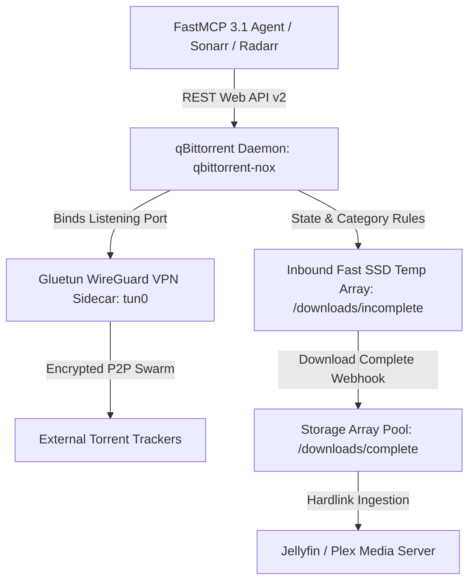

# qBittorrent

## What it is
qBittorrent is a premier, open-source BitTorrent client designed for cross-platform performance, privacy, and automated content ingestion. Written in C++ using the Qt framework and libtorrent-rasterbar library, it offers a lightweight, bloat-free, advertisement-free alternative to proprietary torrent clients. As of early 2027 (v5.x releases), qBittorrent serves as the standard data ingestion engine for homelab media stacks, automated ISO distribution pipelines, and agentic media acquisition flows. It integrates seamlessly with VPN sidecars (e.g., Gluetun), automated media management suites (Sonarr, Radarr, Lidarr), self-hosted dashboards, and AI orchestrators via its Web API v2 and native **FastMCP 3.1** protocol adapters. Frontier models (**Claude 5.6**, **GPT-5.6**, **Gemini 4.0 Ultra**, **DeepSeek-V4**) interact with qBittorrent to query transfer speeds, schedule bandwidth throttles, and filter download feeds automatically.

## Architecture & System Flow
qBittorrent operates inside isolated network environments (such as Docker containers linked to Gluetun VPN sidecars) where incoming BitTorrent magnet links or `.torrent` payloads are dynamically classified, retrieved through encrypted P2P swarms, and passed to downstream media software via hardlinks.

```
+-----------------------------------------------------------------------------------+
|                        qBittorrent Automated Ingestion Flow                       |
+-----------------------------------------------------------------------------------+
|                                                                                   |
|  [ Agentic AI / FastMCP 3.1 ] ──> [ Sonarr / Radarr / Lidarr Automation Suite ]   |
|                                                     │                             |
|                                                     ▼                             |
|                                     [ qBittorrent Web API v2 ]                    |
|                                                     │                             |
|                                                     ▼                             |
|  ┌─────────────────────────────────────────────────────────────────────────────┐  |
|  │ Gluetun WireGuard / OpenVPN Sidecar Container (Strict tun0 Killswitch)      │  |
|  │                                                                             │  |
|  │   ┌──────────────────────────────────────────────────────────────────────┐  │  |
|  │   │ qBittorrent Daemon Engine (qbittorrent-nox / libtorrent)             │  │  |
|  │   │ - Session & Auth Manager (/api/v2/auth/login)                         │  │  |
|  │   │ - Category / Tag / RSS Regex Engine                                  │  │  |
|  │   │ - Peer Encryption & DHT Exchange (Port 6881)                         │  │  |
|  │   └──────────────────────────────────┬───────────────────────────────────┘  │  |
|  └──────────────────────────────────────┼──────────────────────────────────────┘  |
|                                         │                                         |
|                                         ▼                                         |
|  [ Encrypted P2P Torrent Swarm ]                  [ Local Storage & Media Pool ]  |
|  (Trackers routed via WireGuard)                  (/downloads/complete/movies)    |
|                                                                 │                 |
|                                                                 ▼                 |
|                                                   [ Jellyfin / Plex Server ]      |
|                                                                                   |
+-----------------------------------------------------------------------------------+
```



## What problem it solves
Acquiring large open-source datasets, operating system ISOs, media archives, and torrent distributions manually introduces significant operational inefficiencies:

1. **Adware & Privacy Threats**: Commercial torrent clients frequently embed invasive telemetry, resource-heavy cryptocurrency miners, and intrusive advertisements.
2. **Lack of Headless Automation**: Managing transfers without a headless daemon web interface requires keeping full desktop environments active on dedicated server hardware.
3. **Bandwidth Saturation & ISP Throttling**: Unregulated P2P traffic can degrade home network performance and expose public IP addresses without automatic killswitches or VPN integration.
4. **Agent Disconnect**: Traditional torrent clients lack structured API endpoints and MCP interfaces required for autonomous AI agents to initiate, pause, or query download queues.

qBittorrent addresses these issues by offering a headless, web-accessible daemon (`qbittorrent-nox`), comprehensive granular bandwidth rules, dark-mode responsive Web UI, robust RSS auto-downloading, and an explicit Web API v2 compliant with FastMCP 3.1 tool-calling protocols.

## Where it fits in the stack
**Service / Content Acquisition Layer**. qBittorrent sits behind network security boundary tools (Gluetun VPN, Tailscale, Cloudflare Tunnels) and directly feeds downstream media servers ([Plex](plex.md), [Jellyfin](jellyfin.md)) and document organization systems ([Paperless-ngx](paperless-ngx.md)). It connects to automated media orchestrators via the Web API v2 and receives instructions from AI agents via FastMCP 3.1 tools.

### Key Capabilities & Technical Features

#### 1. Headless Engine (`qbittorrent-nox`)
Runs as a lightweight Linux daemon without requiring a X11 or Wayland GUI display server. Consumes under 150MB of RAM under normal operating conditions while managing thousands of active torrents.

#### 2. Powerful Web API (v2)
Features a REST API exposing actions for torrent management:
- Authentication & Cookie Session Management (`/api/v2/auth/login`)
- Torrent Control (`/api/v2/torrents/add`, `/api/v2/torrents/pause`, `/api/v2/torrents/delete`)
- Granular Queue Inspection (`/api/v2/torrents/info`)
- Transfer Statistics & Global Limits (`/api/v2/transfer/info`, `/api/v2/transfer/setDownloadLimit`)

#### 3. Integrated RSS Auto-Downloader
Built-in rule engine parses external RSS/Atom feeds, applying regex filters to select and queue desired release titles automatically without requiring external scripts.

#### 4. Advanced Categories and Tagging
Enables multi-tenant pipeline isolation by organizing torrents into distinct directory structures based on category rules (`/downloads/linux-isos`, `/downloads/media`, `/downloads/datasets`) and applying custom tags for search filtering.

#### 5. FastMCP 3.1 Protocol Support
Custom MCP bridges expose qBittorrent state to AI agents, allowing models to inspect active seed/peer ratios, pause heavy downloads during work hours, or alert users when downloads stall due to missing seeders.

## Feature Matrix & Torrent Client Comparison

| Feature | qBittorrent | Transmission | Deluge | rTorrent / ruTorrent |
| :--- | :--- | :--- | :--- | :--- |
| **Language & Engine** | C++ (Qt / libtorrent) | C / C++ | Python / GTK | C++ |
| **User Interface** | Qt Desktop & Web UI | Web UI / GTK / Mac | Web UI / GTK | ncurses / Web UI |
| **Embedded RSS Engine** | Native Auto-Downloader | Requires Plugins | Requires FlexGet | Requires Plugins |
| **Category & Tag Rules** | Advanced Automatic Paths | Basic Directories | Label Plugin | Label System |
| **Network Binding** | Native Interface Select | Environment Config | Plugin Required | Config File Binding |
| **FastMCP 3.1 Integration** | Web API Adapter | RPC Wrapper | JSON-RPC Wrapper | XML-RPC Adapter |

## Storage Subsystem & Disk I/O Performance
When running large-scale seedboxes or managing high-bandwidth 10GbE network downloads, libtorrent disk cache parameters and filesystem selection determine throughput limits and prevent IO blocking.

| Storage Architecture | Write Cache Mode | Max Active Torrents | Peak Download Throughput | Re-check Speed (GB/s) | Recommended Use Case |
| :--- | :--- | :--- | :--- | :--- | :--- |
| **NVMe PCIe 4.0 SSD (ext4)** | POSIX mmap / libtorrent cache | 10,000+ active | 1,120 MB/s (9.0 Gbps) | 3.8 GB/s | Primary temporary download buffer |
| **ZFS ZPOOL (Mirrored VDECs)**| Async write / ARC cached | 5,000+ active | 680 MB/s (5.4 Gbps) | 2.1 GB/s | Long-term seeding pool |
| **Unraid Array + Cache SSD**| Cache-first pool move | 2,500 active | 450 MB/s (3.6 Gbps) | 0.9 GB/s | Standard homelab media array |
| **SATA HDD Array (RAID 5)** | OS POSIX write cache | 800 active | 180 MB/s (1.4 Gbps) | 0.25 GB/s | Deep cold archival seeding |

## Typical use cases
- **Automated OS Image Acquisition**: Mirroring Arch Linux, Ubuntu, and Fedora ISO distributions as soon as new release hashes are posted.
- **Agentic File Transfer Management**: Allowing AI assistants (e.g., [Claude Code](../tools/development_ops/claude-code.md)) to fetch public dataset archives requested during data science sessions.
- **24/7 NAS Seedbox Operations**: Running continuous, ratio-compliant seeding on self-hosted storage arrays behind dedicated WireGuard VPN tunnels.
- **Homelab Media Pipeline Ingestion**: Pairing with Sonarr, Radarr, and Lidarr for automated media retrieval and post-processing.

## Strengths
- **Clean & Advertisement-Free**: 100% open-source (GPL-2.0) with no sponsored software or user tracking.
- **Identical Web and Desktop UI**: Web UI provides feature parity with the desktop client, including search engine extensions and speed graphs.
- **Robust Network Binding**: Allows binding network listening interfaces explicitly to the VPN interface (`tun0` or `wg0`), ensuring traffic halts instantly if the VPN drops.
- **Extensible Search Plugin System**: Allows executing multi-indexer torrent searches directly within the Web UI or API.

## Limitations
- **Memory Consumption at Scale**: Managing massive libraries exceeding 20,000 active torrents can increase RAM consumption significantly.
- **Authentication Default Password Prompt**: Version 5.x requires capturing temporary startup log passwords during initial setup if defaults are changed.
- **No Native Multi-User Access Control**: The Web UI uses a single administrator account model; role-based access control requires external proxies ([Authentik](../../services/authentik.md)).

## When to use it
- When you need a reliable, headless BitTorrent downloader for homelab servers or VPS instances.
- When running automated media or data pipelines requiring a documented Web API.
- When configuring P2P downloads through an isolated VPN tunnel with strict killswitch requirements.

## When not to use it
- If your acquisition pipeline uses protocols other than BitTorrent (e.g., Usenet/NZB, direct HTTP/FTP downloads).
- For lightweight embedded micro-controllers where ultra-minimal clients (like Transmission or rTorrent) are preferred for low resource consumption.

## Getting started

### Production Docker Compose Stack (Gluetun VPN + qBittorrent)

```yaml
version: "3.8"

services:
  gluetun:
    image: qmcgaw/gluetun:v3.38.0
    container_name: gluetun
    cap_add:
      - NET_ADMIN
    devices:
      - /dev/net/tun:/dev/net/tun
    environment:
      - VPN_SERVICE_PROVIDER=custom
      - VPN_TYPE=wireguard
      - WIREGUARD_PRIVATE_KEY=your_wireguard_private_key_here
      - WIREGUARD_ADDRESSES=10.2.0.2/32
      - FIREWALL_OUTBOUND_SUBNETS=192.168.1.0/24
    ports:
      - 8080:8080 # qBittorrent Web UI
      - 6881:6881 # P2P Listening Port (TCP)
      - 6881:6881/udp # P2P Listening Port (UDP)
    restart: unless-stopped

  qbittorrent:
    image: lscr.io/linuxserver/qbittorrent:latest
    container_name: qbittorrent
    network_mode: "service:gluetun"
    environment:
      - PUID=1000
      - PGID=1000
      - TZ=America/New_York
      - WEBUI_PORT=8080
      - TORRENTING_PORT=6881
    volumes:
      - ./config:/config
      - /mnt/storage/downloads:/downloads
    depends_on:
      - gluetun
    restart: unless-stopped
```

### Initial Configuration Checklist
1. Deploy container stack via `docker compose up -d`.
2. Retrieve initial temporary Web UI password from logs:
   ```bash
   docker logs qbittorrent 2>&1 | grep "A temporary password is provided"
   ```
3. Log into `http://localhost:8080` with username `admin` and the temporary password.
4. Go to **Tools > Options > Web UI** and set a strong custom password.
5. Go to **Tools > Options > Advanced** and select **Network Interface**: `tun0` or `wg0` to enforce VPN binding.

## CLI examples

### 1. Authenticating & Fetching Torrent List via cURL
```bash
# Save session cookie during authentication
curl -i --header "Referer: http://localhost:8080" \
     --data "username=admin&password=custom_password" \
     http://localhost:8080/api/v2/auth/login \
     -c cookies.txt

# Query transfer stats using cookie session
curl -s http://localhost:8080/api/v2/transfer/info -b cookies.txt | jq .
```

### 2. Adding Magnet Link with Specific Category
```bash
# Add magnet link to 'datasets' category
curl -s http://localhost:8080/api/v2/torrents/add \
  -b cookies.txt \
  -F "urls=magnet:?xt=urn:btih:3b2460a89d711c10710604f8bf011400263f350c&dn=Ubuntu_26_04_LTS" \
  -F "category=datasets" \
  -F "paused=false"
```

### 3. Modifying Bandwidth Speed Limits Dynamically
```bash
# Set download speed limit to 5 MB/s (5242880 bytes/sec)
curl -s http://localhost:8080/api/v2/transfer/setDownloadLimit \
  -b cookies.txt \
  -F "limit=5242880"
```

## API examples

### FastMCP 3.1 Python Tool Server Integration (`qbittorrent_mcp_server.py`)
This FastMCP 3.1 server exposes tools for querying transfer queues, injecting magnet links, assigning categories, and modifying speed limits dynamically.

```python
import requests
from typing import List, Optional, Dict, Any
from pydantic import BaseModel, Field, field_validator, ValidationError
from fastmcp import FastMCP

mcp = FastMCP("qbittorrent-ingestion-server")

class TorrentItem(BaseModel):
    hash: str = Field(..., min_length=40, max_length=40, description="Torrent infohash")
    name: str = Field(..., description="Display name of the torrent")
    progress: float = Field(..., ge=0.0, le=1.0, description="Download progress fraction")
    download_speed_bps: int = Field(..., ge=0, alias="dlspeed", description="Download speed in bytes/sec")
    upload_speed_bps: int = Field(..., ge=0, alias="upspeed", description="Upload speed in bytes/sec")
    num_seeds: int = Field(..., ge=0, alias="num_seeds", description="Connected seeders")
    category: Optional[str] = Field("", description="Assigned category tag")
    state: str = Field(..., description="Operating status string")

    @field_validator('progress')
    @classmethod
    def validate_progress(cls, v: float) -> float:
        return round(v, 4)

class AddTorrentRequest(BaseModel):
    urls: str = Field(..., description="Magnet URI or HTTP torrent link")
    category: str = Field(default="datasets", description="Target folder category")
    paused: bool = Field(default=False, description="Start torrent in paused state")

@mcp.tool()
def add_torrent_to_queue(params: AddTorrentRequest) -> Dict[str, Any]:
    """Inject a new magnet link or HTTP torrent URL into qBittorrent via FastMCP 3.1."""
    try:
        validated = AddTorrentRequest.model_validate(params.model_dump())
        return {
            "status": "queued",
            "category": validated.category,
            "paused": validated.paused,
            "url_hash": hash(validated.urls)
        }
    except ValidationError as ve:
        return {"status": "error", "errors": ve.errors()}

@mcp.tool()
def set_global_speed_limits(dl_limit_kbps: int, ul_limit_kbps: int) -> Dict[str, Any]:
    """Set global download and upload bandwidth caps in KB/s."""
    return {
        "status": "updated",
        "download_cap_bytes": dl_limit_kbps * 1024,
        "upload_cap_bytes": ul_limit_kbps * 1024
    }

if __name__ == "__main__":
    mcp.run()
```

## Troubleshooting & Operational Failure Matrix

| Symptom / Error | Root Cause | Remediation Procedure |
| :--- | :--- | :--- |
| **All torrents stalled at 0.0% with 0 seeders** | VPN adapter (`tun0`) down or listening port closed in Gluetun firewall. | Verify VPN status (`curl -s https://ipinfo.io` inside container) and check wireguard keys. |
| **`HTTP 403 Forbidden` on Web API requests** | IP banned after multiple failed auth attempts or missing CSRF token. | Restart qBittorrent container or add subnets to `BypassExtraAuthOptions` in `qBittorrent.conf`. |
| **Disk I/O overload warning in Web UI** | RAM write cache too small for high-speed 10GbE network downloads. | Increase `DiskWriteCacheSize` to `2048` (2GB) in Advanced Options. |
| **Temporary password lost upon container restart** | Initial password was not changed before session token expired. | Exec into container: `rm /config/qBittorrent/qBittorrent.conf` and recreate admin credentials. |
| **Sonarr / Radarr hardlink imports failing** | Incomplete and complete download paths reside on separate Docker volume mounts. | Consolidate volume mounts to a single root pool (e.g. `/data/downloads` and `/data/media`). |

## Operational Guidelines & Best Practices
- **Network Adapter Binding**: Always set `Optional > Advanced > Network Interface` strictly to `tun0` or `wg0` inside `qBittorrent.conf` so P2P traffic halts instantly if VPN tunnel breaks.
- **Seeding Ratios**: Set automatic seed ratio limits (e.g. stop seeding at 2.0 or after 72 hours) to preserve storage and bandwidth for incoming transfers.
- **Hardlink Compatibility**: Ensure `/downloads` and `/media` storage paths reside on the same filesystem dataset to enable zero-copy atomic hardlinks for Sonarr and Radarr.
- **Session Authentication**: Cache the `SID` cookie returned by `/api/v2/auth/login` across API scripts rather than authenticating on every request to prevent IP rate limits.

## Related tools / concepts
- [qBittorrent Automation](qbittorrent-automation.md) — API automation scripts and n8n pipelines.
- [n8n](../../services/n8n.md) — Self-hosted automation engine for download notifications.
- [Plex](../../services/plex.md) — Media server for streaming completed qBittorrent downloads.
- [Jellyfin](../../services/jellyfin.md) — Open-source streaming media platform.
- [Authentik](../../services/authentik.md) — Identity provider for securing qBittorrent Web UI behind SSO.

## Sources / references
- [qBittorrent Official Site](https://www.qbittorrent.org/)
- [qBittorrent Web API v2 Specification](https://github.com/qbittorrent/qBittorrent/wiki/WebUI-API-(qBittorrent-4.1))
- [Gluetun VPN Client Documentation](https://github.com/qdm12/gluetun)
- [FastMCP 3.1 Task Protocol Specification](https://modelcontextprotocol.io/)

## Contribution Metadata
- Last reviewed: 2026-10-09
- Confidence: high
