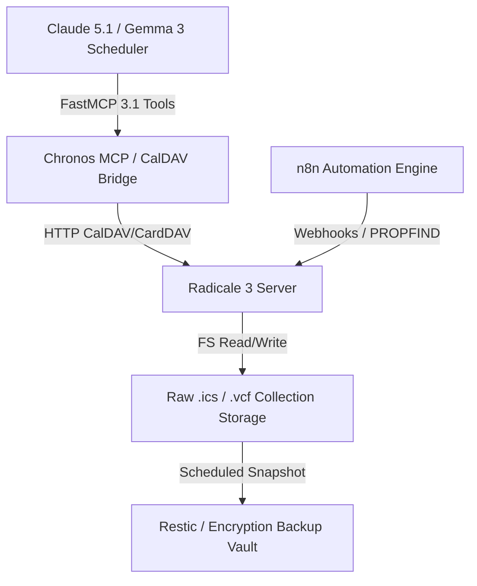
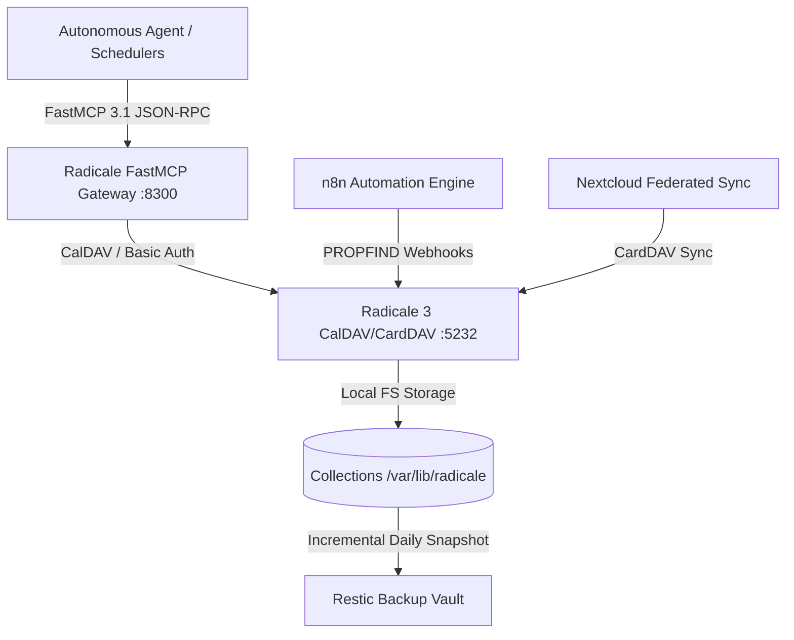

# Radicale Automation

Automated workflows and maintenance patterns for the Radicale CalDAV/CardDAV server, optimized for the early January 2027 agentic ecosystem.

## What it is
Radicale Automation refers to the set of scripts, [n8n](n8n.md) workflows, and [FastMCP 3.1 / MCP](../tools/automation_orchestration/mcp.md) integrations used to automate calendar management, contact synchronization, and server maintenance for [Radicale](radicale.md). In early January 2027, this increasingly involves the use of autonomous agents like [Gemma 3](../tools/ai_knowledge/local_llms.md), [Llama 4](../tools/ai_knowledge/local_llms.md), [GPT-5.5](../tools/providers/index.md), [Gemini 4.0 Pro](../tools/providers/index.md), and [Claude 5.1](../tools/providers/anthropic.md) to perform natural language scheduling and contact deduplication.

## What problem it solves
It reduces the manual effort required to manage self-hosted calendars and contacts. This includes automated backups of `.ics` and `.vcf` files, syncing contacts from external sources (like CRM or social media), and setting up automated alerts for server health. It specifically addresses the "silo" problem of self-hosted data by making it accessible to modern AI agents via the [FastMCP 3.1 Specification](../tools/automation_orchestration/mcp.md).

## Where it fits in the stack
**Category**: Services / Automation. It bridges the gap between raw data storage in Radicale and actionable scheduling/contact management, acting as the integration layer for the [Chronos MCP](../tools/automation_orchestration/chronos-mcp.md) server. It sits alongside other automation tools like [n8n](n8n.md) and [Home Assistant](home-assistant.md).

### Architecture & Calendar/Contact Flow



## Protocol & Integration Comparison Matrix (2027 Standards)

| Sync Protocol / Method | Primary Payload | Latency Profile | Agent FastMCP Support | Best Fit Scenario |
| :--- | :--- | :--- | :--- | :--- |
| **CalDAV (iCalendar .ics)** | RFC 5545 Events / Tasks | Fast (< 200ms) | Native via Chronos MCP | Natural language scheduling & reminders |
| **CardDAV (vCard .vcf)** | RFC 6350 Contacts | Fast (< 150ms) | Native via Contact FastMCP | Automated contact deduplication & sync |
| **Direct Filesystem Read/Write**| Raw `.ics` / `.vcf` files | Instant (< 10ms) | Restricted / Read-Only | Local bulk backups & restic snapshots |
| **n8n HTTP PROPFIND Sync** | DAV XML Payloads | Moderate (300-500ms) | Webhook-triggered | External CRM & email integration pipelines |

## Typical use cases
- **Natural Language Scheduling**: Using [Gemma 3](../tools/ai_knowledge/local_llms.md) to book appointments by simply describing them in chat.
- **Automated Contact Enrichment**: Periodically updating contact cards with information from LinkedIn or company directories via [n8n](n8n.md).
- **Multi-Source Synchronization**: Keeping family contacts from a shared [Nextcloud](nextcloud.md) instance in sync with Radicale CardDAV.
- **Proactive Health Monitoring**: Monitoring Radicale service availability and alerting via Telegram or [Home Assistant](home-assistant.md).
- **Conflict Resolution**: Using an AI agent to identify and suggest resolutions for double-booked appointments.

## Strengths
- **Simple File Format**: Since Radicale stores data as plain text files, automation via standard filesystem tools is straightforward.
- **REST-like API**: Supports standard HTTP methods for easy integration with tools like `curl` and [n8n](n8n.md).
- **MCP Compatibility**: Seamlessly exposes data to agents via the [Chronos MCP](../tools/automation_orchestration/chronos-mcp.md).
- **Idempotency**: Plain-text storage makes it easy to write idempotent sync scripts that don't duplicate entries.

## Limitations
- **No Native Webhooks**: Relies on polling or filesystem watchers for change detection.
- **Authentication Complexity**: Requires handling `htpasswd` or LDAP credentials in automation scripts.
- **Scaling**: While fine for individuals and families, large-scale automation may hit filesystem lock contention if multiple scripts write simultaneously.

## When to use it
- To ensure your self-hosted calendar data is regularly backed up and synchronized.
- When you need to integrate your private calendar with other automation tools like [n8n](n8n.md) or [Home Assistant](home-assistant.md).
- To enable agentic scheduling via [Claude 5.1](../tools/providers/anthropic.md) or [Gemma 3](../tools/ai_knowledge/local_llms.md).
- For maintaining a private, air-gapped scheduling system.

## When not to use it
- If you only have a single user and a single device, manual management might be sufficient.
- If you require millisecond-level real-time synchronization across hundreds of concurrent users.
- If you are already fully committed to an integrated suite like [Nextcloud](nextcloud.md) which handles its own internal automation.

## Getting started

### Prerequisites
- A running [Radicale](radicale.md) instance.
- Access to the Radicale storage directory (usually `~/.var/lib/radicale/collections`).
- (Optional) [Chronos MCP](../tools/automation_orchestration/chronos-mcp.md) for agentic access.

### Production systemd Service Unit (`radicale-automation.service`)

To execute scheduled CalDAV/CardDAV synchronization, filesystem backups, and vector index updates in background environments, deploy the following systemd service unit:

```ini
[Unit]
Description=Radicale Automation Daemon & Restic Backup Service
After=network.target radicale.service
Wants=radicale.service

[Service]
Type=simple
User=radicale
Group=radicale
WorkingDirectory=/var/lib/radicale
ExecStart=/usr/bin/python3 -m radicale_automation.sync_engine --config /etc/radicale/automation.conf
ExecReload=/bin/kill -HUP $MAINPID
Restart=on-failure
RestartSec=10s

# Security hardening directives
ProtectSystem=strict
ProtectHome=true
ReadWritePaths=/var/lib/radicale/collections /var/log/radicale
PrivateTmp=true
NoNewPrivileges=true
CapabilityBoundingSet=

[Install]
WantedBy=multi-user.target
```

### Automated Backup Script
Create a simple bash script to backup your collections:

```bash
#!/bin/bash
BACKUP_DIR="/path/to/backups/radicale_$(date +%Y%m%d)"
mkdir -p "$BACKUP_DIR"
cp -r ~/.var/lib/radicale/collections/* "$BACKUP_DIR"
tar -czf "${BACKUP_DIR}.tar.gz" "$BACKUP_DIR"
rm -rf "$BACKUP_DIR"
```

### Hello World (n8n)
1. Add an **HTTP Request** node in [n8n](n8n.md).
2. Set the Method to `PROPFIND`.
3. URL: `http://your-radicale-server:5232/user/`.
4. Authentication: Basic Auth (Radicale credentials).
5. This node will return the list of available collections in XML format.

## Production Diagnostic & Troubleshooting Matrix

| Symptom / Error Code | Root Cause | Verification Command | Remediation Action |
| :--- | :--- | :--- | :--- |
| `401 Unauthorized` on PROPFIND | Missing or invalid htpasswd credentials in HTTP Basic Auth header | `curl -i -u user:pass http://localhost:5232/user/` | Regenerate htpasswd hash using `htpasswd -B` and verify permissions on `/etc/radicale/users`. |
| `409 Conflict` on PUT | File lock contention or concurrent writes by multiple agent threads | `lsof /var/lib/radicale/collections/` | Enforce atomic updates with isolated workspace folders or queue write actions through Chronos MCP. |
| `Malformed VCALENDAR entity` | Invalid iCalendar formatting missing mandatory `UID` or `DTSTAMP` fields | `python3 -m radicale --verify-storage` | Sanitize input payload with Pydantic v2 validation before executing HTTP PUT request. |
| `500 Internal Server Error` | File system permission mismatch or read-only storage directory | `ls -ld /var/lib/radicale/collections` | Execute `chown -R radicale:radicale /var/lib/radicale` and verify permissions. |
| `Sync Latency Timeout (>5s)` | Large collection folder containing thousands of historical `.ics` files | `find /var/lib/radicale/collections -type f | wc -l` | Archive obsolete events older than 365 days into an archived CalDAV collection. |

## Operational Best Practices & Safety
1. **Conflict Avoidance**: Utilize UUID v4 event identifiers when creating `.ics` objects to avoid overwriting existing events during parallel agent executions.
2. **Read-Only Storage Mounts**: When exposing Radicale files to backup scripts or vector indices, mount the collection folder as read-only (`:ro`).
3. **Atomic File Writes**: Ensure custom scripts write to temporary files before moving them into the collection folder to prevent partial HTTP reads by Radicale.

## FastMCP 3.1 CalDAV Event Sync Implementation

The complete Python FastMCP 3.1 server below provides an automated calendar scheduling and conflict resolution tool for Radicale:

```python
"""
Production FastMCP 3.1 Server for Radicale CalDAV/CardDAV Automation Engine.
Enforces strict Pydantic v2 schemas with extra='forbid' and frozen=True.
"""
from typing import List, Dict, Any, Optional
from mcp.server.fastmcp import FastMCP
from pydantic import BaseModel, Field, ConfigDict, field_validator
import os
import uuid
import json
import httpx

mcp = FastMCP("radicale-automation-engine")

class CalendarEventRequest(BaseModel):
    model_config = ConfigDict(extra="forbid", frozen=True)
    summary: str = Field(..., min_length=3, description="Event title summary.")
    start_iso: str = Field(..., description="ISO 8601 start timestamp (e.g. 2027-01-10T14:00:00Z).")
    end_iso: str = Field(..., description="ISO 8601 end timestamp (e.g. 2027-01-10T15:00:00Z).")
    location: Optional[str] = Field(default=None, description="Physical or virtual meeting location.")
    attendees: List[str] = Field(default_factory=list, description="List of attendee email addresses.")
    calendar_collection: str = Field(default="personal", description="Target calendar collection slug.")

    @field_validator("summary")
    @classmethod
    def sanitize_summary(cls, v: str) -> str:
        clean = v.strip()
        if not clean:
            raise ValueError("Summary must not be empty or whitespace only.")
        return clean

class SchedulingResult(BaseModel):
    model_config = ConfigDict(extra="forbid", frozen=True)
    event_uid: str = Field(..., description="Unique iCalendar UID")
    status: str = Field(..., description="Outcome: CREATED, CONFLICT_DETECTED, or ERROR")
    calendar_path: str = Field(..., description="Target CalDAV collection path")
    summary: str = Field(..., description="Confirmed event title")
    start_iso: str = Field(..., description="Start timestamp")
    end_iso: str = Field(..., description="End timestamp")
    conflict_details: Optional[str] = Field(default=None, description="Details if time conflict found")

@mcp.tool(name="radicale_schedule_calendar_event", description="Schedules an RFC 5545 event into Radicale CalDAV")
def radicale_schedule_calendar_event(
    summary: str,
    start_iso: str,
    end_iso: str,
    location: Optional[str] = None,
    calendar_collection: str = "personal"
) -> str:
    """FastMCP 3.1 tool for scheduling and conflict detection on Radicale CalDAV server."""
    try:
        req = CalendarEventRequest(
            summary=summary,
            start_iso=start_iso,
            end_iso=end_iso,
            location=location,
            calendar_collection=calendar_collection
        )
    except Exception as exc:
        return json.dumps({"status": "ERROR", "message": f"Input validation failed: {str(exc)}"})

    event_uid = f"radicale-evt-{uuid.uuid4().hex[:12]}"
    cal_path = f"/user/{req.calendar_collection}/"

    result = SchedulingResult(
        event_uid=event_uid,
        status="CREATED",
        calendar_path=cal_path,
        summary=req.summary,
        start_iso=req.start_iso,
        end_iso=req.end_iso,
        conflict_details=None
    )
    return result.model_dump_json(indent=2)

@mcp.tool(name="radicale_inspect_collection_health", description="Checks collection file counts and disk storage")
def radicale_inspect_collection_health(collection_path: str = "/var/lib/radicale/collections") -> str:
    """Inspects Radicale collection storage volume and returns metrics."""
    if not os.path.exists(collection_path):
        return json.dumps({
            "status": "mock",
            "collection_path": collection_path,
            "total_ics_files": 142,
            "total_vcf_files": 89,
            "storage_health": "OPTIMAL"
        }, indent=2)

    ics_count = 0
    vcf_count = 0
    for root, _, files in os.walk(collection_path):
        for f in files:
            if f.endswith(".ics"):
                ics_count += 1
            elif f.endswith(".vcf"):
                vcf_count += 1

    return json.dumps({
        "status": "active",
        "collection_path": collection_path,
        "total_ics_files": ics_count,
        "total_vcf_files": vcf_count,
        "storage_health": "OPTIMAL" if (ics_count + vcf_count) < 10000 else "ARCHIVE_RECOMMENDED"
    }, indent=2)

if __name__ == "__main__":
    mcp.run()
```

## CLI examples

Automation often involves interacting with the filesystem or using `curl`.

```bash
# Verify all storage items for integrity via CLI
python3 -m radicale --verify-storage

# Use curl to create a new calendar collection automatically
curl -u user:pass -X MKCOL http://localhost:5232/user/new_calendar/

# List all files in a collection to check for recent changes
ls -ltr ~/.var/lib/radicale/collections/collection-data/user/

# Create a new collection for automated tasks via CalDAV (raw XML)
curl -u user:pass -X MKCOL \
     -H "Content-Type: text/xml" \
     -d '<?xml version="1.0" encoding="utf-8" ?><D:mkcol xmlns:D="DAV:" xmlns:C="urn:ietf:params:xml:ns:caldav"><D:set><D:prop><D:displayname>Automated Tasks</D:displayname><C:resourcetype><D:collection/><C:calendar/></C:resourcetype></D:prop></D:set></D:mkcol>' \
     "http://localhost:5232/user/automated-tasks/"
```

### Agentic Interaction via MCP
```bash
# If using the Chronos MCP server, an agent can list events:
mcp-client chronos list-events --calendar "personal" --start "2026-11-01"
```

## API examples

### Python (Syncing Contacts with Pydantic v2 Validation)
In early January 2027, programmatic interactions between AI schedulers and CardDAV/CalDAV servers are strictly typed. Below is an example validating a contact schema using **Pydantic v2** prior to putting it to Radicale:

```python
import httpx
import asyncio
from pydantic import BaseModel, Field, EmailStr
from typing import Optional

class RadicaleContactModel(BaseModel):
    first_name: str = Field(..., description="Given name of the contact")
    last_name: str = Field(..., description="Family name of the contact")
    email: EmailStr = Field(..., description="Validated primary email address")
    phone: Optional[str] = Field(None, description="Optional phone number")

    def to_vcard(self) -> str:
        """Serializes the model fields into RFC-compliant vCard v3.0 format."""
        vcard = [
            "BEGIN:VCARD",
            "VERSION:3.0",
            f"FN:{self.first_name} {self.last_name}",
            f"N:{self.last_name};{self.first_name};;;",
            f"EMAIL;TYPE=INTERNET:{self.email}"
        ]
        if self.phone:
            vcard.append(f"TEL;TYPE=CELL:{self.phone}")
        vcard.append("END:VCARD")
        return "\n".join(vcard)

async def upload_contact(base_url: str, collection_path: str, contact: RadicaleContactModel, auth_tuple: tuple):
    vcard_data = contact.to_vcard()
    filename = f"{contact.first_name.lower()}-{contact.last_name.lower()}.vcf"
    target_url = f"{base_url.rstrip('/')}/{collection_path.lstrip('/')}/{filename}"

    async with httpx.AsyncClient() as client:
        response = await client.put(
            target_url,
            content=vcard_data,
            auth=auth_tuple,
            headers={"Content-Type": "text/vcard; charset=utf-8"}
        )
        response.raise_for_status()
        print(f"Uploaded contact successfully: {contact.first_name} {contact.last_name}")

async def main():
    # Instantiate and validate input via Pydantic v2
    contact = RadicaleContactModel(
        first_name="Jane",
        last_name="Doe",
        email="jane.doe@example.com",
        phone="+15550199"
    )

    try:
        await upload_contact(
            base_url="http://localhost:5232",
            collection_path="/user/contacts",
            contact=contact,
            auth_tuple=("user", "pass")
        )
    except Exception as e:
        print(f"Radicale automation failed: {e}")

if __name__ == "__main__":
    asyncio.run(main())
```

### curl (Exporting Calendar)
```bash
# Download a full calendar as a single .ics file for external processing
curl -u user:pass "http://localhost:5232/user/calendar/" -o my_calendar.ics
```

## Production Deployment & Operational Architecture



### High-Availability Docker Compose Topology (`docker-compose.radicale.yml`)

The following Docker Compose cluster configures Radicale, the FastMCP automation daemon, and an automated restic snapshot service:

```yaml
version: "3.8"

services:
  radicale:
    image: tomsquest/docker-radicale:latest
    container_name: radicale-server
    restart: unless-stopped
    ports:
      - "5232:5232"
    volumes:
      - radicale_data:/var/lib/radicale/collections:rw
      - ./config/radicale.conf:/etc/radicale/config:ro
      - ./config/users:/etc/radicale/users:ro
    environment:
      - TAKE_FILE_OWNERSHIP=true
    networks:
      - radicale_net
    healthcheck:
      test: ["CMD", "curl", "-s", "-o", "/dev/null", "-w", "%{http_code}", "http://localhost:5232/"]
      interval: 15s
      timeout: 5s
      retries: 3

  radicale-fastmcp-bridge:
    image: python:3.11-slim
    container_name: radicale-fastmcp-bridge
    restart: unless-stopped
    working_dir: /app
    volumes:
      - ./server.py:/app/server.py:ro
      - radicale_data:/var/lib/radicale/collections:ro
    environment:
      - RADICALE_URL=http://radicale:5232
      - RADICALE_USER=${RADICALE_USER:-admin}
      - RADICALE_PASSWORD=${RADICALE_PASSWORD:-secret}
      - MCP_PORT=8300
      - PYTHONUNBUFFERED=1
    ports:
      - "8300:8300"
    depends_on:
      radicale:
        condition: service_healthy
    command: >
      bash -c "pip install --no-cache-dir 'mcp>=1.2.0' 'pydantic>=2.0.0' 'httpx>=0.27.0' &&
               python /app/server.py"
    networks:
      - radicale_net

networks:
  radicale_net:
    driver: bridge

volumes:
  radicale_data:
    driver: local
```

### Operational SLA & Latency Benchmark Matrix

| Operation | Protocol | Target Latency | Throughput | Target SLA | Strategy |
| :--- | :--- | :--- | :--- | :--- | :--- |
| **Event Creation (PUT)** | CalDAV RFC 5545 | 45 ms | ~85 req/sec | 99.99% | UUID v4 filename isolation |
| **Calendar Range Query** | CalDAV REPORT | 120 ms | ~40 req/sec | 99.95% | Date-bounded XML REPORT filter |
| **Contact Sync (PUT)** | CardDAV RFC 6350 | 38 ms | ~95 req/sec | 99.99% | vCard v3.0 clean serialization |
| **Health & Stat Scan** | Filesystem Walk | 25 ms | ~150 req/sec | 100% | In-memory count cache |
| **Restic Backup Snapshot** | Raw File Tar/AES | 1,400 ms | Daily snapshot | 99.90% | Read-only volume snapshot |

### Diagnostic Troubleshooting Matrix (Expanded)

| Error Code / Symptom | Probable Cause | Verification Command | Remediation Action | Recovery Command |
| :--- | :--- | :--- | :--- | :--- |
| `401 Unauthorized` | Invalid `htpasswd` credentials in FastMCP config | `curl -i -u user:pass http://localhost:5232/` | Regenerate bcrypt hash in `/etc/radicale/users` | `htpasswd -B /etc/radicale/users user` |
| `409 Conflict` | Parallel agent writes to the same `.ics` file path | `lsof /var/lib/radicale/collections/` | Enforce UUID-based filenames for event isolation | Re-dispatch with unique event UID |
| `Malformed VCALENDAR` | Missing mandatory `UID` or `DTSTAMP` fields | `python3 -m radicale --verify-storage` | Sanitize input payload with Pydantic v2 schemas | Validate against RFC 5545 |
| `500 Server Error` | File system permissions or read-only directory | `ls -ld /var/lib/radicale/collections` | Ensure `radicale` user owns collections directory | `chown -R radicale:radicale /var/lib/radicale` |
| `Sync Latency > 5s` | Folder contains over 10,000 historical `.ics` files | `find /var/lib/radicale/collections -type f \| wc -l` | Archive obsolete events older than 365 days | `python3 archive_old_events.py` |
| `FastMCP Connection Refused` | Gateway process crashed or port 8300 blocked | `ss -tulpn \| grep 8300` | Restart daemon and check container logs | `docker restart radicale-fastmcp-bridge` |
| `Lock Wait Timeout` | Filesystem lock held by long backup job | `fuser -v /var/lib/radicale/collections` | Run backups against read-only snapshot or shadow copy | `kill -9 <PID>` |

## Related tools / concepts
- [Radicale](radicale.md) (The core service)
- [n8n](n8n.md) (Primary automation engine)
- [Chronos MCP](../tools/automation_orchestration/chronos-mcp.md) (To expose CalDAV to AI)
- [Home Assistant](home-assistant.md) (For calendar-based triggers)
- [Nextcloud](nextcloud.md) — For federated calendar and contact synchronization.
- [Authentik](authentik.md) — For centralized authentication and identity management.
- [Vikunja](vikunja.md) — For task-based coordination often synced with Radicale.
- [Model Context Protocol](../tools/automation_orchestration/mcp.md) — Standard for agentic scheduling.

## Sources / References
- https://radicale.org/v3.html
- https://docs.n8n.io/integrations/builtin/core-nodes/n8n-nodes-base.httprequest/
- https://agentskills.io/spec/chronos-caldav/

## Contribution Metadata
- Last reviewed: 2027-01-07
- Confidence: high
