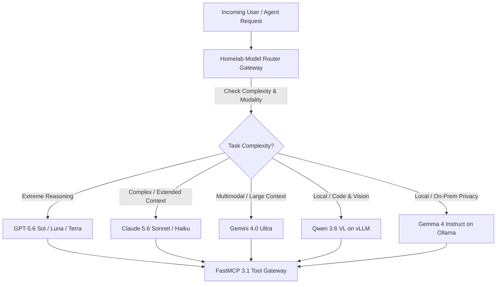

# Model Routing Guide Implementation Plan (March 2026 - January 2027 Evolution)

## What it is
This document outlines the implementation strategy and historical evolution of the [Model Routing Guide](../../knowledge_base/model_routing_guide.md). Originally drafted in March 2026, it traces how the repository's model selection logic shifted from legacy GPT-4o/Claude 3.5 patterns to the SOTA early January 2027 standard of [Claude 5.6](../../tools/ai_knowledge/claude.md), [GPT-5.6](../../tools/ai_knowledge/openai.md), [Gemini 4.0 Ultra](../../tools/ai_knowledge/gemini.md), [Gemma 4](../../tools/ai_knowledge/gemma-4-31b-antihal.md), [DeepSeek-V4](../../tools/providers/deepseek.md), [Qwen 3.6 VL](../../tools/ai_knowledge/qwen.md), and [Model Context Protocol (MCP)](../../tools/automation_orchestration/mcp.md) FastMCP 3.1 Task Protocol.



## What problem it solves
It ensures architectural traceability and continuity for [Autonomous Agents](../../tools/agents/index.md) navigating the repository's decision pathways. By explaining the migration from static routing to highly granular "Reasoning Effort" routing (GPT-5.6 Sol/Luna/Terra) and tool-aware tier routing (Claude 5.6 and FastMCP 3.1 Task Protocol), it prevents regression to obsolete single-model architectures.

As homelab compute topologies evolved from single-GPU setups to multi-node clusters serving FP8 quantized open-weights models alongside cloud APIs, automated routing requires strict latency, token cost, and privacy boundaries.

## Where it fits in the stack
**Meta-Documentation & Implementation Blueprint**. It provides the long-term plan linking historical milestones with the current active [Model Routing Guide](../../knowledge_base/model_routing_guide.md) in the `knowledge_base` layer of the repository.

```
+-----------------------------------------------------------------------------------+
|                        CLIENT & AGENT ORCHESTRATION LAYER                         |
|             (FastMCP 3.1 Clients / Claude Code / LangGraph / Agents)             |
+-----------------------------------------------------------------------------------+
                                          |
                                          v
+-----------------------------------------------------------------------------------+
|                        DYNAMIC DUAL-PLANE ROUTER GATEWAY                          |
|             - Pydantic v2 Complexity & Context Evaluator                          |
|             - FastMCP 3.1 Protocol Sharding & Fallback Router                     |
+-----------------------------------------------------------------------------------+
                                          |
                +-------------------------+-------------------------+
                |                                                   |
                v                                                   v
+-----------------------------------+               +-------------------------------+
|    CLOUD FRONTIER ENDPOINTS       |               |    LOCAL HOMELAB ENDPOINTS    |
| (Claude 5.6 / GPT-5.6 / Gemini)   |               | (vLLM / Ollama / TGI / MLX)   |
+-----------------------------------+               +-------------------------------+
```

## Architectural Topology & Routing Matrix

```
+----------------------------------------------------------------------------------------------------+
|                                MODEL ROUTING SELECTION MATRIX                                      |
+-------------------+-----------------------------------+--------------------------------------------+
| Routing Class     | Candidate Models                  | Target Operational Workload                |
+-------------------+-----------------------------------+--------------------------------------------+
| Extreme Reasoning | GPT-5.6 Sol / Luna / Terra        | Deep mathematical / code synthesis         |
| Complex Agentic   | Claude 5.6 Sonnet / Opus          | Multi-tool MCP agentic workflows           |
| High Context      | Gemini 4.0 Ultra (2M+ context)    | Multimodal video / audio / huge repos      |
| Local Vision/Code | Qwen 3.6 VL (vLLM tensor-parallel)| Private document / code OCR & reasoning    |
| Local Fast Edge   | Gemma 4 31B / Llama 4 (Ollama)    | Sub-second local response & summarization  |
+-------------------+-----------------------------------+--------------------------------------------+
```

## Typical use cases
- **Architectural Reviews**: Tracing why specific local routing boundaries were established for Qwen 3.6 VL or Gemma 4.
- **Agent Self-Calibration**: Helping newly provisioned agents (e.g., Claude 5.6 Sonnet) align their task routing decisions with the structural design.
- **Validation Verification**: Ensuring that routing schemas conform to Pydantic v2 structures during high-volume testing.
- **Fallback Circuit Breaking**: Automatically redirecting requests to local vLLM nodes when cloud endpoints rate-limit or fail.

## Strengths
- **Comprehensive Lineage**: Documents the complete transition of capabilities from early 2026 to SOTA early 2027.
- **Traceability**: Outlines clear phases of integration for local vs. external model hosting.
- **FastMCP 3.1 Task Protocol Ready**: Directly models the integration of task protocols with server schemas.
- **Cost & Latency Optimization**: Minimizes cloud token expenditure by prioritizing high-performance homelab inferences.

## Limitations
- **Chronological Scope**: Highly focused on the 2026 to early 2027 evolutionary timeline.
- **Non-executable Blueprint**: This is a strategic planning file; active routing logic resides in the respective gateway tools and the live [Model Routing Guide](../../knowledge_base/model_routing_guide.md).

## When to use it
- When analyzing the migration path of the homelab AI router.
- When investigating how fallback strategies were coordinated with Model Context Protocol upgrades.

## When not to use it
- For live API integrations or runtime model routing selections (refer to [Model Routing Guide](../../knowledge_base/model_routing_guide.md) instead).
- If only seeking standard API schemas for a single provider.

## Getting started
To align a newly deployed agentic workflow with this implementation plan:
1. Verify that all dependencies are updated to support Pydantic v2 validation.
2. Review the model tier mappings defined in the [Model Routing Guide](../../knowledge_base/model_routing_guide.md).
3. Validate candidate endpoints using the schema tools shown below.

## CLI examples

### Verifying Plan Alignment
Check the status of the live guide and confirm all local-first models are reachable:
```bash
# Verify the live model routing guide exists
ls -lh docs/knowledge_base/model_routing_guide.md

# Run contract tests on the live routing guide
python3 scripts/check_docs_contract.py docs/knowledge_base/model_routing_guide.md
```

### Simulating Schema Evaluation
Run a mock validation command to inspect the routing output:
```bash
python3 -c "import pydantic; print('Pydantic version:', pydantic.__version__)"
```

### Health Check for Local Model Nodes
```bash
# Query local vLLM router endpoint
curl -s http://localhost:8000/v1/models | grep "qwen"
```

## API examples

### FastMCP 3.1 Model Router Gateway Tool

The following FastMCP 3.1 Python server exposes a dynamic routing engine tool to MCP clients:

```python
"""
FastMCP 3.1 Router Gateway for Model Routing Implementation Plan.
Provides runtime model selection based on task complexity and locality constraints.
"""

from typing import Literal, Optional, Dict, Any
from pydantic import BaseModel, Field, conint, field_validator
from mcp.server.fastmcp import FastMCP

mcp = FastMCP("model-router-gateway", version="3.1.0")

class RouterSpec(BaseModel):
    task_complexity: Literal["low", "medium", "high", "extreme"] = Field(
        ..., description="Computational and logical difficulty of the task"
    )
    expected_input_tokens: conint(ge=0) = Field(
        default=1000, description="The length of the system prompts and context payload"
    )
    reasoning_effort: Optional[Literal["none", "low", "medium", "high", "max"]] = Field(
        default=None, description="Granular reasoning effort, primary for GPT-5.6 Sol/Luna/Terra"
    )
    local_first_preference: bool = Field(
        default=True, description="Whether to prioritize hosting models locally on homelab hardware"
    )

    @field_validator("reasoning_effort")
    @classmethod
    def validate_reasoning_effort_dependency(cls, v: Optional[str], info) -> Optional[str]:
        if info.data.get("task_complexity") == "extreme" and not v:
            return "high"
        return v

class RouteOutcome(BaseModel):
    selected_model: str = Field(..., description="Canonical ID of the routed model")
    provider_endpoint: str = Field(..., description="Target server hosting the model")
    mcp_protocol_version: str = Field(default="3.1", description="FastMCP 3.1 Task Protocol compliance tag")
    relative_compute_cost: float = Field(..., description="Relative cost rating from 0.0 to 1.0")

@mcp.tool(
    name="evaluate_model_route",
    description="Evaluates request requirements and selects optimal LLM endpoint per 2027 Routing Guide."
)
def evaluate_model_route(spec: RouterSpec) -> RouteOutcome:
    """Routes an incoming request to the optimal cloud or homelab model."""
    if spec.task_complexity == "extreme":
        return RouteOutcome(
            selected_model="gpt-5.6-sol",
            provider_endpoint="https://api.openai.com/v1",
            relative_compute_cost=1.0
        )

    if spec.task_complexity == "high":
        if spec.expected_input_tokens > 200000:
            return RouteOutcome(
                selected_model="gemini-4.0-ultra",
                provider_endpoint="https://api.google.com/gemini/v4",
                relative_compute_cost=0.5
            )
        return RouteOutcome(
            selected_model="claude-5.6-sonnet",
            provider_endpoint="https://api.anthropic.com/v1",
            relative_compute_cost=0.4
        )

    if spec.local_first_preference:
        if spec.task_complexity == "medium":
            return RouteOutcome(
                selected_model="qwen-3.6-vl",
                provider_endpoint="http://homelab-vllm:8000/v1",
                relative_compute_cost=0.1
            )
        return RouteOutcome(
            selected_model="gemma-4-instruct",
            provider_endpoint="http://homelab-ollama:11434/v1",
            relative_compute_cost=0.0
        )

    return RouteOutcome(
        selected_model="claude-5.6-haiku",
        provider_endpoint="https://api.anthropic.com/v1",
        relative_compute_cost=0.15
    )

if __name__ == "__main__":
    mcp.run()
```

### Python: Routing Blueprint and Schema Validation (Pydantic v2)
The following code implements the early January 2027 standard for evaluating model routing parameters utilizing Pydantic v2.

```python
from typing import Literal, Optional
from pydantic import BaseModel, Field, conint, field_validator

class RouterSpec(BaseModel):
    task_complexity: Literal["low", "medium", "high", "extreme"] = Field(
        ..., description="Computational and logical difficulty of the task"
    )
    expected_input_tokens: conint(ge=0) = Field(
        default=1000, description="The length of the system prompts and context payload"
    )
    reasoning_effort: Optional[Literal["none", "low", "medium", "high", "max"]] = Field(
        default=None, description="Granular reasoning effort, primary for GPT-5.6 Sol/Luna/Terra"
    )
    local_first_preference: bool = Field(
        default=True, description="Whether to prioritize hosting models locally on homelab hardware"
    )

    @field_validator("reasoning_effort")
    @classmethod
    def validate_reasoning_effort_dependency(cls, v: Optional[str], info) -> Optional[str]:
        if info.data.get("task_complexity") == "extreme" and not v:
            return "high"
        return v

class RouteOutcome(BaseModel):
    selected_model: str = Field(..., description="Canonical ID of the routed model")
    provider_endpoint: str = Field(..., description="Target server hosting the model")
    mcp_protocol_version: str = Field(default="3.1", description="FastMCP 3.1 Task Protocol compliance tag")
    relative_compute_cost: float = Field(..., description="Relative cost rating from 0.0 to 1.0")

def route_request(spec: RouterSpec) -> RouteOutcome:
    if spec.task_complexity == "extreme":
        return RouteOutcome(
            selected_model="gpt-5.6-sol",
            provider_endpoint="https://api.openai.com/v1",
            relative_compute_cost=1.0
        )

    if spec.task_complexity == "high":
        if spec.expected_input_tokens > 200000:
            return RouteOutcome(
                selected_model="gemini-4.0-ultra",
                provider_endpoint="https://api.google.com/gemini/v4",
                relative_compute_cost=0.5
            )
        return RouteOutcome(
            selected_model="claude-5.6-sonnet",
            provider_endpoint="https://api.anthropic.com/v1",
            relative_compute_cost=0.4
        )

    if spec.local_first_preference:
        if spec.task_complexity == "medium":
            return RouteOutcome(
                selected_model="qwen-3.6-vl",
                provider_endpoint="http://homelab-vllm:8000/v1",
                relative_compute_cost=0.1
            )
        return RouteOutcome(
            selected_model="gemma-4-instruct",
            provider_endpoint="http://homelab-ollama:11434/v1",
            relative_compute_cost=0.0
        )

    return RouteOutcome(
        selected_model="claude-5.6-haiku",
        provider_endpoint="https://api.anthropic.com/v1",
        relative_compute_cost=0.15
    )

if __name__ == "__main__":
    high_complexity_input = {
        "task_complexity": "high",
        "expected_input_tokens": 250000,
        "local_first_preference": False
    }
    spec = RouterSpec.model_validate(high_complexity_input)
    outcome = route_request(spec)
    print(f"Routed high-complexity task to: {outcome.selected_model} (Cost: {outcome.relative_compute_cost})")

    local_input = {
        "task_complexity": "medium",
        "expected_input_tokens": 500,
        "local_first_preference": True
    }
    spec_local = RouterSpec.model_validate(local_input)
    outcome_local = route_request(spec_local)
    print(f"Routed local-first task to: {outcome_local.selected_model} (Cost: {outcome_local.relative_compute_cost})")
```

## Diagnostic & Troubleshooting Guide

```
+----------------------------------------------------------------------------------------------------+
|                         MODEL ROUTER DIAGNOSTIC TROUBLESHOOTING MATRIX                             |
+-----------------------+----------------------------------+-----------------------------------------+
| Failure Symptom       | Root Cause                       | Remediation Procedure                   |
+-----------------------+----------------------------------+-----------------------------------------+
| Local vLLM 500 Error  | GPU VRAM Out-of-Memory (OOM)     | Reduce batch size or adjust KV cache    |
| Cloud Rate-Limit 429  | Provider API rate limit hit      | Trigger fallback to secondary provider  |
| Validation Exception  | Missing reasoning_effort in spec | Pass default reasoning_effort="high"    |
| MCP Gateway Disconnect| FastMCP 3.1 daemon down          | Restart MCP server process              |
+-----------------------+----------------------------------+-----------------------------------------+
```

## Operational Guardrails & Safety Protocols

1. **Local Priority Enforcement**: Always attempt local vLLM or Ollama routing for `low` and `medium` complexity tasks to prevent token bill spikes.
2. **Context Threshold Warnings**: When `expected_input_tokens` exceeds 150,000, enforce Gemini 4.0 Ultra or Claude 5.6 extended context tiering.
3. **Fallback Resiliency**: If cloud provider endpoints return HTTP 5xx or timeouts (> 10s), automatically reroute request payloads to local homelab fallback endpoints.

## Related tools / concepts
- [Model Routing Guide](../../knowledge_base/model_routing_guide.md)
- [Model Comparison and Evaluation](../../knowledge_base/model_comparison_and_evaluation.md)
- [Claude](../../tools/ai_knowledge/claude.md)
- [OpenAI](../../tools/ai_knowledge/openai.md)
- [Gemini](../../tools/ai_knowledge/gemini.md)
- [Agentic Workflows](../../knowledge_base/patterns/agentic-workflows.md)
- [Fallback Patterns](../../knowledge_base/patterns/fallback-patterns.md)
- [Home Admin Agent Architecture](../../knowledge_base/home-admin-agent-architecture.md)
- [Model Context Protocol (MCP)](../../tools/automation_orchestration/mcp.md)

## Sources / references
- [Anthropic Developer Roadmap - Claude 5.6 & FastMCP 3.1 Task Protocol Spec](https://docs.anthropic.com/claude/docs/fastmcp-specification)
- [OpenAI Technical Guides - GPT-5.6 Dynamic Sol/Luna/Terra Reasoning Routing](https://platform.openai.com/docs/guides/reasoning)
- [Google DeepMind Blog - Gemini 4.0 Ultra Multimodal Routing](https://deepmind.google/technologies/gemini)
- [Home Admin Agent Architecture - Multi-Model Orchestration Standards Q1 2027](../../reports/task-decomposition-batch-518.md)

---
## Contribution Metadata
- Last reviewed: 2027-01-07
- Confidence: high
