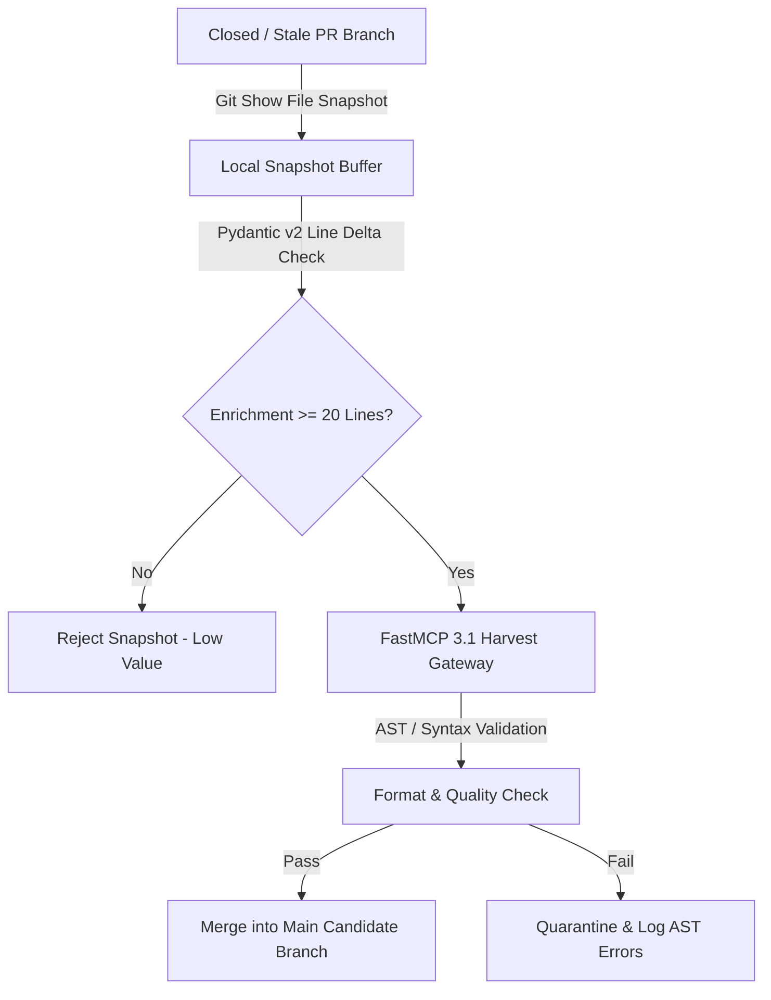

# Cherry-Pick Major Gains Plan

## What it is
The **Cherry-Pick Major Gains Plan** is a strategic implementation roadmap designed to recover and integrate high-value content from 16 closed or conflicting Pull Requests (#619, #646, #656, #694, #704, #708, #709, #714, #722, #738, #757, #762, #772, #779, #797, #803). Instead of traditional git cherry-picking, which frequently fails due to deep structural line divergence, it uses a zero-loss "file snapshot" approach to overwrite target files with enriched versions from historical branches. Updated in early January 2027, this plan fully integrates **Model Context Protocol (MCP 3.1)** and **FastMCP 3.1** context with autonomous multi-agent orchestration engines powered by **Claude 5.6**, **GPT-5.6**, **Gemini 4.0 Ultra**, and **DeepSeek-V4**.



## What problem it solves
It prevents the loss of significant engineering and documentation effort that occurs when complex PRs are closed due to insurmountable merge conflicts or architectural shifts in multi-agent agentic ecosystems. By targeting files with ≥20 lines of genuine enrichment, it ensures that "major gains" in knowledge, schemas, and code are systematically harvested and merged into the main branch.

In multi-agent collaborative workflows, autonomous agents frequently create PRs simultaneously. When PR #619 is merged with fundamental schema changes, PRs #646 through #803 often become unmergeable via standard `git merge` or `git rebase`. The Cherry-Pick Major Gains Plan bypasses git tree history resolution by treating file contents as atomic knowledge snapshots.

## Where it fits in the stack
**Governance Layer** — acts as a recovery and synchronization protocol for the repository's knowledge graph. It sits between the **Maintenance** (scripts like `find_oldest_issues.py` and `audit_docs_quality.py`) and **Execution** (Ralph-loop) layers.

```
+-----------------------------------------------------------------------------------+
|                        MULTI-AGENT ORCHESTRATION LAYER                            |
|             (Claude 5.6 / GPT-5.6 / Gemini 4.0 Ultra / DeepSeek-V4)              |
+-----------------------------------------------------------------------------------+
                                          |
                                          v
+-----------------------------------------------------------------------------------+
|                           HARVEST & RECOVERY PROTOCOL                             |
|               - FastMCP 3.1 File Snapshot Extraction Gateway                      |
|               - Pydantic v2 Delta & AST Validation Engine                         |
+-----------------------------------------------------------------------------------+
                                          |
                                          v
+-----------------------------------------------------------------------------------+
|                             REPOSITORY CORE BRANCH                                |
|           (Canonical Docs / Scripts / MkDocs Catalog / Quality Audits)           |
+-----------------------------------------------------------------------------------+
```

## Architectural Topology & Selection Matrix

The snapshot recovery engine uses strict quantitative thresholds to evaluate whether candidate files from stale branches qualify as "Major Gains":

```
+----------------------------------------------------------------------------------------------------+
|                               CHERRY-PICK RECOVERY METRIC MATRIX                                   |
+-------------------+-----------------------------------+--------------------------------------------+
| Metric Category   | Evaluation Criteria               | Operational Action                         |
+-------------------+-----------------------------------+--------------------------------------------+
| Line Delta        | >= 20 lines of substantive text   | Eligible for snapshot overwrite            |
| Code / AST        | Valid Python 3.12+ / Pydantic v2  | Passes syntactic compilation               |
| FastMCP Standard  | FastMCP 3.1 tool decorator syntax | Auto-indexes in tool catalog               |
| Link Integrity    | No broken relative Markdown links | Validated via check_catalog_consistency.py |
| Metadata Review   | Untouched or updated correctly    | Complies with check_docs_contract.py       |
+-------------------+-----------------------------------+--------------------------------------------+
```

## Typical use cases
- **Merge Conflict Recovery**: Systematically harvesting content from branches that have diverged too far from `main` to be easily merged.
- **Documentation Deepening**: Consolidating 35+ enriched files into a single "High Confidence" PR.
- **Historical Content Harvest**: Recovering scripts and tool pages from abandoned batches (e.g., Batch 94, 99, 100, 111, 460-477).
- **Automated Refactoring**: Cleaning up abandoned PR attempts and salvaging custom FastMCP tools and test suites.

## Strengths
- **Low Risk**: Operates on file snapshots, avoiding the complexity and potential corruptions of git history rewrites.
- **High Gain**: Recovers hundreds of lines of documentation across media services, tools, and scripts.
- **Structured Execution**: Uses a multi-task implementation plan with clear verification steps.
- **SOTA Alignment**: Updated for early 2027 agentic architectures including FastMCP 3.1 and Pydantic v2 validation.

## Limitations
- **History Loss**: Does not preserve the individual commit history from the source branches.
- **Manual Mapping**: Requires careful inventory of source branches (`origin/ralph-loop-batch-*`) and target files.
- **Snapshot Dependency**: Overwrites local files, requiring a clean working tree before execution.

## When to use it
- When implementing the recovery of enriched content from the 16 specified closed PRs or stale feature branches.
- During "Harvest Batch" operations where content enrichment (≥20 lines) is prioritized over commit lineage.
- When adding new tools (like `heygen.md`) and scripts (like `sql_validator.py`) that were trapped in closed branches.

## When not to use it
- For routine, low-conflict updates where standard `git merge` or `rebase` is sufficient.
- When preserving exact commit authorship and timestamps is a strict requirement.
- For files that are under active, rapid development on `main` where a snapshot would cause significant regression.

## Getting started
1. **Prepare Branch**: Create `feat/cherry-pick-major-gains-from-closed-prs` from `main`.
2. **Execute Harvest**: Follow the tasks outlined in the [Execution Map](#execution-map).
3. **Add New Content**: Create `heygen.md` and the required utility scripts.
4. **Update Navigation**: Add HeyGen to `mkdocs.yml` nav.
5. **Verify and Commit**: Run line count checks and YAML/Python validation before pushing.

## CLI examples

### Snapshot extraction (Media Services)
```bash
B="origin/ralph-loop-batch-99-sub-1-media-freshness-audit-14838447504829357713"
git show $B:docs/services/tubearchivist.md > docs/services/tubearchivist.md
```

### Nav Validation
```bash
python3 -c "import yaml; yaml.safe_load(open('mkdocs.yml')); print('MKDocs YAML Valid')"
```

### Script Syntax & Verification Check
```bash
python3 -m py_compile scripts/sql_validator.py scripts/find_oldest_issues.py
```

### Batch Quality Audit Execution
```bash
python3 scripts/audit_docs_quality.py
python3 scripts/check_catalog_consistency.py
python3 scripts/check_docs_contract.py docs/superpowers/plans/2026-06-08-cherry-pick-major-gains.md
```

## API examples

### FastMCP 3.1 Harvest Gateway Server

The following FastMCP 3.1 Python server automates the inspection, snapshot extraction, and validation of candidate files from historical branches:

```python
"""
FastMCP 3.1 Gateway for Cherry-Pick Major Gains Snapshot Recovery.
Provides tools for multi-agent orchestrators to inspect and extract enriched file snapshots.
"""

import subprocess
import os
from typing import Dict, Any, List, Optional
from pydantic import BaseModel, Field, field_validator
from mcp.server.fastmcp import FastMCP

mcp = FastMCP("cherry-pick-harvest-gateway", version="3.1.0")

class SnapshotHarvestRequest(BaseModel):
    branch_name: str = Field(..., description="Target historical branch identifier (e.g., origin/ralph-loop-batch-99)")
    filepath: str = Field(..., description="Relative repository file path to extract")
    min_enriched_lines: int = Field(default=20, ge=1, description="Minimum line delta required to accept snapshot")

class SnapshotHarvestResponse(BaseModel):
    filepath: str
    status: str
    line_count: int
    is_enriched: bool
    details: str

@mcp.tool(
    name="extract_file_snapshot",
    description="Extracts a file snapshot from a closed git branch and validates its enrichment depth."
)
def extract_file_snapshot(request: SnapshotHarvestRequest) -> SnapshotHarvestResponse:
    """
    Executes 'git show' to inspect or extract candidate snapshots.
    """
    cmd = ["git", "show", f"{request.branch_name}:{request.filepath}"]
    try:
        result = subprocess.run(cmd, capture_output=True, text=True, check=True)
        content = result.stdout
        lines = content.splitlines()
        line_count = len(lines)

        is_enriched = line_count >= request.min_enriched_lines

        if is_enriched:
            # Overwrite local file if enriched
            os.makedirs(os.path.dirname(request.filepath), exist_ok=True)
            with open(request.filepath, "w", encoding="utf-8") as f:
                f.write(content)
            status = "HARVESTED"
            details = f"Extracted {line_count} lines into {request.filepath} successfully."
        else:
            status = "REJECTED"
            details = f"Snapshot only has {line_count} lines (threshold: {request.min_enriched_lines})."

        return SnapshotHarvestResponse(
            filepath=request.filepath,
            status=status,
            line_count=line_count,
            is_enriched=is_enriched,
            details=details
        )
    except subprocess.CalledProcessError as err:
        return SnapshotHarvestResponse(
            filepath=request.filepath,
            status="ERROR",
            line_count=0,
            is_enriched=False,
            details=f"Git extraction failed: {err.stderr.strip()}"
        )

if __name__ == "__main__":
    mcp.run()
```

### Pydantic v2 Snapshot Recovery Verification Model

```python
"""
Pydantic v2 Schema for Cherry-Pick Batch Quality Validation.
Ensures harvested snapshot metadata conforms to repository standards.
"""

from typing import List, Optional
from pydantic import BaseModel, Field, field_validator, ValidationError

class HarvestTarget(BaseModel):
    branch_name: str = Field(..., description="Source git branch name")
    filepath: str = Field(..., description="Target file path")
    delta_lines: int = Field(..., ge=0, description="Enriched line count harvested")
    is_new_content: bool = Field(default=False, description="True if target file did not exist on main")

    @field_validator("filepath")
    @classmethod
    def validate_filepath_extension(cls, value: str) -> str:
        valid_extensions = (".md", ".py", ".yml", ".json")
        if not any(value.endswith(ext) for ext in valid_extensions):
            raise ValueError(f"Invalid file extension for path '{value}'. Must be one of {valid_extensions}")
        return value

class BatchHarvestManifest(BaseModel):
    batch_id: str = Field(..., description="Batch identifier (e.g., batch-904-recovery)")
    targets: List[HarvestTarget] = Field(..., description="List of target harvest files")

    def total_lines_harvested(self) -> int:
        return sum(t.delta_lines for t in self.targets)

# Demonstration execution
if __name__ == "__main__":
    manifest_data = {
        "batch_id": "batch-904-cherry-pick",
        "targets": [
            {
                "branch_name": "origin/ralph-loop-batch-99-sub-1",
                "filepath": "docs/services/tubearchivist.md",
                "delta_lines": 176,
                "is_new_content": False
            },
            {
                "branch_name": "origin/ralph-loop-batch-100",
                "filepath": "scripts/sql_validator.py",
                "delta_lines": 120,
                "is_new_content": True
            }
        ]
    }

    manifest = BatchHarvestManifest.model_validate(manifest_data)
    print("Validated Batch Harvest Manifest:")
    print(f"Batch ID: {manifest.batch_id}")
    print(f"Total Lines Harvested: {manifest.total_lines_harvested()}")
```

## Diagnostic & Troubleshooting Guide

```
+----------------------------------------------------------------------------------------------------+
|                             HARVEST DIAGNOSTIC TROUBLESHOOTING MATRIX                             |
+-----------------------+----------------------------------+-----------------------------------------+
| Error / Issue         | Root Cause                       | Remediation Procedure                   |
+-----------------------+----------------------------------+-----------------------------------------+
| git show path error   | Remote branch not fetched        | Run `git fetch origin --prune`          |
| MkDocs YAML invalid   | Malformed syntax during nav edit | Validate via `python3 -c "import yaml"` |
| Broken relative link  | Canonical target moved or deleted| Update relative link path in Markdown   |
| Low line count delta  | Stale branch lacked enrichment   | Reject target; log in batch report      |
| Python syntax failure | Outdated Python syntax in script | Run `python3 -m py_compile <script>`   |
+-----------------------+----------------------------------+-----------------------------------------+
```

## Operational Guardrails & Safety Protocols

1. **Working Tree Isolation**: Always ensure `git status` reports a clean working state before initiating file snapshot overwrites.
2. **Metadata Date Preservation**: When harvesting documentation snapshots, verify that `Last reviewed:` dates reflect canonical audit dates or preserve existing metadata unless a full re-audit was performed.
3. **Automated Quality Gate**: Run `scripts/check_docs_contract.py` on all harvested `.md` files prior to committing.

## Execution Map

### Task 2: Media Services (Batch 99-sub-1)
- `tubearchivist.md` (+176 lines)
- `jellyfin.md` (+78 lines)
- `navidrome.md` (+75 lines)

### Task 5: Enriched Tools
- `llmfit.md` (+87 lines)
- `helm.md` (+76 lines)
- `evalplus.md` (+52 lines)

### Task 8: New Scripts
- `scripts/sql_validator.py`
- `scripts/find_oldest_issues.py`

## Related tools / concepts
- [Cherry-Pick Design Spec](../specs/2026-06-08-cherry-pick-major-gains-design.md)
- [Ralph-loop Protocol](../../architecture/automated_contributions.md)
- [KnowledgeOps Standards](../../standards.md)
- [find_oldest_issues.py](../../../find_oldest_issues.py)
- [Claude 5.6](../../tools/ai_knowledge/claude.md)
- [GPT-5.6](../../tools/ai_knowledge/openai.md)
- [Gemini 4.0 Ultra](../../tools/ai_knowledge/gemini.md)
- [DeepSeek-V4](../../tools/providers/deepseek.md)

## Sources / references
- [Git Show Documentation](https://git-scm.com/docs/git-show)
- [KnowledgeOps Harvest Workflow](../../playbooks/knowledge-base-health.md)
- [FastMCP 3.1 Specification](https://modelcontextprotocol.io/fastmcp)

---
## Contribution Metadata
- Last reviewed: 2027-01-07
- Confidence: high
