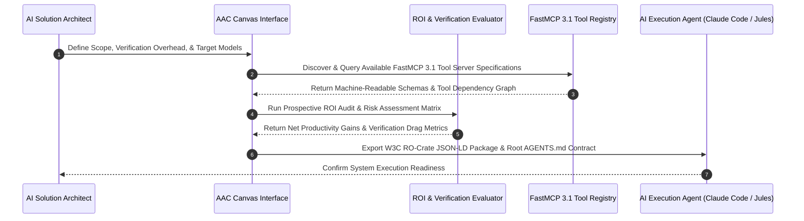

# Agentic Automation Canvas (AAC)

## What it is
The Agentic Automation Canvas (AAC) is a comprehensive visual engineering framework and open-source specification designed for the prospective design, risk modeling, governance, and return-on-investment (ROI) evaluation of agentic AI systems. It provides a machine-readable "project contract" bridging high-level strategic expectations with low-level execution mechanics. As of early 2027, AAC represents the industry standard (v1.3+) for structuring autonomous reasoning workflows targeting advanced models including **Claude 5.6**, **GPT-5.6**, **Gemini 4.0 Ultra**, and **Gemma 4**, integrating Model Context Protocol (FastMCP 3.1) visual topologies and multi-agent coordination topologies.

## System Architecture

The diagram below details the operational design pipeline of the Agentic Automation Canvas, illustrating how prospective design inputs transform into machine-interoperable project contracts and executable FastMCP 3.1 configurations:

```
┌─────────────────────────────────────────────────────────────────────────────┐
│                    Agentic Automation Canvas (AAC v1.3)                     │
│ ┌───────────────────┐ ┌───────────────────┐ ┌──────────────────────────┐ │
│ │  Scope & Intent   │ │ User Expectations │ │    Feasibility & ROI     │ │
│ └─────────┬─────────┘ └─────────┬─────────┘ └────────────┬─────────────┘ │
└───────────┼─────────────────────┼────────────────────────┼───────────────┘
            │                     │                        │
            ▼                     ▼                        ▼
┌─────────────────────────────────────────────────────────────────────────────┐
│                        Visual Project Contract                              │
│ ┌───────────────────┐ ┌───────────────────┐ ┌──────────────────────────┐ │
│ │  Data & Privacy   │ │ FastMCP 3.1 Graph │ │  Governance & Oversight  │ │
│ └───────────────────┘ └───────────────────┘ └──────────────────────────┘ │
└─────────────────────────────────┬───────────────────────────────────────────┘
                                  │
             ┌────────────────────┴────────────────────┐
             ▼                                         ▼
┌──────────────────────────┐              ┌──────────────────────────┐
│        AGENTS.md         │              │    RO-Crate JSON-LD      │
│ (AI Assistant Directives)│              │  (W3C Interoperability)  │
└──────────────────────────┘              └──────────────────────────┘
```



## What problem it solves
It resolves the systemic **Expectation-Realisation Gap** in enterprise AI automation. While organizations frequently anticipate massive productivity multipliers (e.g., 25–40% efficiency improvements) from deploying autonomous AI agents, actual implementations often experience unexpected productivity drag due to unquantified human verification burdens, hallucination auditing overhead, and brittle workflow integration friction. AAC mandates explicit prospective quantification of these factors during the planning phase:
- **Quantifying Verification Overhead**: Standardizing metrics for the exact hours required by human domain experts to review and validate agent outputs before production commitment.
- **Eliminating Tool Integration Friction**: Standardizing visual representation of Model Context Protocol (FastMCP 3.1) servers, dynamic tool graphs, and multi-agent delegation contracts.
- **Machine Interoperable Export**: Guaranteeing seamless conversion from visual node graphs directly into project-level `AGENTS.md` instruction files and W3C-compliant RO-Crate JSON-LD metadata packages.

## Where it fits in the stack
**Category**: Agents & Orchestration / Governance Framework. It resides at the **Prospective Design and Governance Layer**, preceding and guiding runtime orchestrators like [Symphony](symphony.md), [Temporal](../orchestration/temporal.md), and autonomous coding engines ([Claude Code](../development_ops/claude-code.md), [Jules](../ai_knowledge/jules.md), and [Cursor](../development_ops/cursor.md)).

## Typical use cases
- **Multi-Model Swarm Architecture**: Designing complex agent swarms with model-tier assignment (e.g., GPT-5.6 for orchestration, Claude 5.6 for code synthesis, and local Gemma 4 / Qwen 3.6 for privacy-sensitive parsing).
- **Institutional Governance & Compliance**: Establishing verifiable data access guardrails, security boundaries, and human-in-the-loop review checkpoints for healthcare, legal, or financial AI tasks.
- **Automated AGENTS.md Generation**: Translating high-level executive requirements into machine-executable prompt instruction files consumed by automated IDE coding assistants.
- **FastMCP 3.1 Visual Discovery**: Mapping out complex FastMCP server connections, resource endpoints, and prompt tool dependencies visually.

## Detailed Comparison Matrix

| Feature / Dimension | Agentic Automation Canvas (AAC) | Traditional PRD / Spec | LangSmith / PromptFlow |
| :--- | :--- | :--- | :--- |
| **Primary Focus** | Prospective Design & ROI Quantification | System Requirements & Scope | Runtime Execution & Telemetry |
| **Verification Overhead Model**| Explicitly Quantified (RO-Crate) | Qualitative / Unmeasured | Post-hoc Latency / Cost Logs |
| **FastMCP 3.1 Visual Mapping** | Native Visual Nodes & Connectors | Static Architecture Diagrams | Dynamic Trace Call Graphs |
| **Machine Interoperability** | `AGENTS.md` & W3C RO-Crate JSON-LD | Freeform Markdown / Confluence | API Traces & Datasets |
| **Execution Phase** | Pre-Implementation Design | Pre-Implementation Design | Runtime Observability |
| **Security Guardrail Audit** | Native Security Checkpoint Nodes | Manual Compliance Review | Policy Validation Logs |

## Strengths
- **Rigorous Six-Dimensional Specification**: Enforces systematic review across Scope, Expectations, Feasibility, Governance, Data Access, and Outcomes.
- **FastMCP 3.1 Protocol Native**: Direct visual support for FastMCP task servers, resource subscriptions, and prompt templates.
- **W3C RO-Crate Compliance**: Exports fully valid, machine-readable Research Object Crate (RO-Crate) packages using Schema.org semantics.
- **Zero-Trust Client-Side Privacy**: Fully client-side web application running in-browser; sensitive architecture and security parameters remain local.

## Limitations
- **Human Input Sensitivity**: Prospective ROI metrics rely on accurate initial estimates for human review times and domain expert costs.
- **Visual Graph Complexity**: Multi-tier enterprise swarms with dozens of tools require modular sub-canvas breakdown to maintain visual readability.

## When to use it
- Before starting development on new agentic workflows to align stakeholders on ROI and verification costs.
- When designing multi-model agent swarms with FastMCP 3.1 tool dependencies.
- When preparing machine-readable AGENTS.md instruction contracts for AI coding assistants.

## When not to use it
- For single-prompt basic completion tasks that do not involve tools or multi-step reasoning.
- When project scope and verification metrics are already formalized in W3C RO-Crate packages.

## Getting started

Access AAC online via [aac.slolab.ai](https://aac.slolab.ai/) or deploy locally in isolated environment.

### Local Self-Hosted Setup
Deploy local web interface using Node.js 22+:

```bash
# Clone the repository
git clone https://github.com/slolab/agentic-automation-canvas.git
cd agentic-automation-canvas

# Install dependencies and build production application
npm install
npm run build

# Preview production build locally
npm run preview -- --port 3000
```

## CLI examples

```bash
# Validate exported RO-Crate project package
rocrate validate ./exported-crate/

# Inspect exported AGENTS.md contract
head -n 25 ./exported-crate/AGENTS.md
```

## API examples

### FastMCP 3.1 AAC Audit Server & Pydantic v2 Contract Schema

Below is a complete, production FastMCP 3.1 Python server designed to receive visual AAC contract JSON payloads, validate them against strict Pydantic v2 schemas (`extra="forbid"`), and emit prospective ROI metrics:

```python
import json
from datetime import datetime
from typing import List, Dict, Optional, Literal
from pydantic import BaseModel, Field, ConfigDict, field_validator, ValidationError
from mcp.server.fastmcp import FastMCP

mcp = FastMCP("AAC-Governance-Audit-Server", version="3.1.0")

class FastMCPToolNode(BaseModel):
    model_config = ConfigDict(extra="forbid", frozen=True)
    server_url: str = Field(..., description="Target FastMCP server endpoint")
    tool_name: str = Field(..., description="Tool function identifier")
    permission_level: Literal["read_only", "user_approval_required", "autonomous_write"] = Field(
        ..., description="Access control security level"
    )

class AACContractSpec(BaseModel):
    model_config = ConfigDict(extra="forbid", frozen=True)
    project_id: str = Field(..., min_length=3, description="Unique canvas project identifier")
    project_title: str = Field(..., description="Human-readable project title")
    target_models: List[str] = Field(..., min_length=1, description="List of LLM backends planned e.g. Claude 5.6")
    estimated_speedup_pct: float = Field(..., ge=0.0, le=1000.0, description="Projected task completion efficiency gain %")
    human_verification_hours_per_week: float = Field(..., ge=0.0, le=168.0, description="Required expert verification hours")
    hourly_expert_cost_usd: float = Field(default=125.0, ge=15.0, le=1000.0, description="Domain expert hourly rate")
    connected_tools: List[FastMCPToolNode] = Field(default_factory=list, description="Mapped FastMCP 3.1 tool nodes")

class AACAuditReport(BaseModel):
    model_config = ConfigDict(extra="forbid", frozen=True)
    project_id: str
    net_productivity_score: float
    weekly_verification_cost_usd: float
    status: Literal["APPROVED", "REVISION_REQUIRED", "REJECTED"]
    recommendation: str
    audit_timestamp: str

@mcp.tool(name="audit_aac_project_contract", description="Audits an AAC canvas project spec and evaluates prospective net ROI vs verification costs.")
def audit_aac_project_contract(contract_json: str) -> str:
    """Parses AAC project contract, evaluates human verification drag, and emits structured audit decision."""
    try:
        raw_data = json.loads(contract_json)
        spec = AACContractSpec.model_validate(raw_data)

        # Weekly verification cost drag calculation
        weekly_verification_cost = spec.human_verification_hours_per_week * spec.hourly_expert_cost_usd

        # Net productivity score calculation: estimated gain minus verification drag penalty
        verification_drag_penalty = (spec.human_verification_hours_per_week / 40.0) * 100.0
        net_score = spec.estimated_speedup_pct - verification_drag_penalty

        if net_score >= 20.0 and spec.human_verification_hours_per_week <= 15.0:
            status = "APPROVED"
            rec = "Project presents strong prospective ROI with manageable human verification overhead."
        elif net_score > 0.0:
            status = "REVISION_REQUIRED"
            rec = "High human verification overhead reduces projected gains. Automate intermediate validation checks."
        else:
            status = "REJECTED"
            rec = "Human verification drag outweighs prospective productivity efficiency. Redesign agent workflow."

        report = AACAuditReport(
            project_id=spec.project_id,
            net_productivity_score=round(net_score, 2),
            weekly_verification_cost_usd=round(weekly_verification_cost, 2),
            status=status,
            recommendation=rec,
            audit_timestamp=datetime.utcnow().isoformat() + "Z"
        )
        return json.dumps(report.model_dump(), indent=2)
    except json.JSONDecodeError as err:
        return json.dumps({"status": "ERROR", "message": f"Malformed JSON payload: {str(err)}"})
    except ValidationError as err:
        return json.dumps({"status": "VALIDATION_FAILED", "errors": err.errors()})

if __name__ == "__main__":
    mcp.run()
```

## Production Deployment & Systemd Service Architecture

### Container Orchestration with Docker Compose

To deploy a self-hosted AAC web environment and contract audit microservice in production, use the Docker Compose configuration below:

```yaml
version: "3.8"

services:
  aac-web-ui:
    image: node:22-alpine
    container_name: aac-web-ui
    restart: unless-stopped
    working_dir: /app
    command: sh -c "npm install && npm run build && npm run preview -- --host 0.0.0.0 --port 3000"
    ports:
      - "3000:3000"
    volumes:
      - ./app:/app:ro
    deploy:
      resources:
        limits:
          cpus: "1.0"
          memory: 512M
    healthcheck:
      test: ["CMD", "wget", "--no-verbose", "--tries=1", "--spider", "http://localhost:3000/"]
      interval: 30s
      timeout: 5s
      retries: 3
    security_opt:
      - no-new-privileges:true

  aac-audit-server:
    image: python:3.11-slim
    container_name: aac-audit-server
    restart: unless-stopped
    working_dir: /app
    command: python3 aac_audit_server.py
    environment:
      - PYTHONUNBUFFERED=1
    volumes:
      - ./aac_audit_server.py:/app/aac_audit_server.py:ro
    ports:
      - "8000:8000"
    security_opt:
      - no-new-privileges:true
```

### Systemd Service Unit Specification

For host-level Linux deployments managing the AAC contract audit daemon, install the following systemd service unit:

```ini
[Unit]
Description=Agentic Automation Canvas (AAC) Audit Server
After=network.target

[Service]
Type=simple
User=aac-agent
Group=aac-agent
WorkingDirectory=/opt/aac-service
ExecStart=/usr/bin/python3 -m mcp.server.fastmcp run aac_audit_server.py
Restart=always
RestartSec=5s
Environment=PYTHONUNBUFFERED=1

# Security Hardening
ProtectSystem=strict
ProtectHome=true
NoNewPrivileges=true
PrivateTmp=true
ProtectKernelTunables=true
ProtectControlGroups=true
ReadOnlyPaths=/opt/aac-service

[Install]
WantedBy=multi-user.target
```

## Operational Best Practices

1. **Version-Controlled AGENTS.md Contracts**: Store exported `AGENTS.md` contracts in root project directories and trigger automated CI re-audits whenever canvas node relationships or FastMCP dependencies change.
2. **Continuous Verification Auditing**: Regularly log actual expert verification hours during production agent runs and compare against prospective AAC estimates to refine system prompts.
3. **Modular Sub-Canvas Decomposition**: For enterprise swarms spanning multiple departments, decompose large canvases into modular sub-canvases linked via RO-Crate JSON-LD references.

## Diagnostic Troubleshooting Matrix

| Symptom / Error | Probable Cause | Diagnostic Command | Remediation Action |
| :--- | :--- | :--- | :--- |
| **RO-Crate Validation Failure** | Missing mandatory `@id` or `@type` property in JSON-LD graph | `rocrate validate ./exported-crate/` | Re-export canvas package from AAC web interface ensuring required fields are populated. |
| **Verification Drag Exceeds Gains** | Domain expert review requirements set too high in canvas | `python3 aac_audit_server.py --test` | Add automated unit/integration checks into tool chain to reduce required manual review hours. |
| **FastMCP Tool Node Unresolvable** | FastMCP server URL offline or endpoint schema changed | `curl -s http://<server_url>/mcp.json` | Verify target FastMCP server availability and update tool node definition in canvas interface. |

## Related tools / concepts
- [AGENTS.md Pattern](../../knowledge_base/patterns/index.md) — Standard machine prompt directives for coding agents.
- [Claude Code](../development_ops/claude-code.md) — Autonomous terminal coding agent executing AAC contracts.
- [Jules](../ai_knowledge/jules.md) — Automated issue resolution agent guided by canvas specifications.
- [Symphony](symphony.md) — Multi-agent workflow execution engine.
- [Model Context Protocol (FastMCP 3.1)](../../knowledge_base/patterns/tool-calling-and-mcp.md) — Protocol for agentic tool discovery.
- [RO-Crate Standard](https://www.researchobject.org/ro-crate/) — W3C Research Object metadata standard.

## Sources / references
- [Official Web Application](https://aac.slolab.ai/)
- [Agentic Automation Canvas GitHub Repository](https://github.com/slolab/agentic-automation-canvas)
- [The Agentic Automation Canvas: a structured framework for agentic AI project design (arXiv:2602.15090)](https://arxiv.org/abs/2602.15090)
- [Quantifying the Expectation-Realisation Gap for Agentic AI Systems (arXiv:2602.20292)](https://arxiv.org/abs/2602.20292)

## Contribution Metadata
- Last reviewed: 2027-01-07
- Confidence: high
