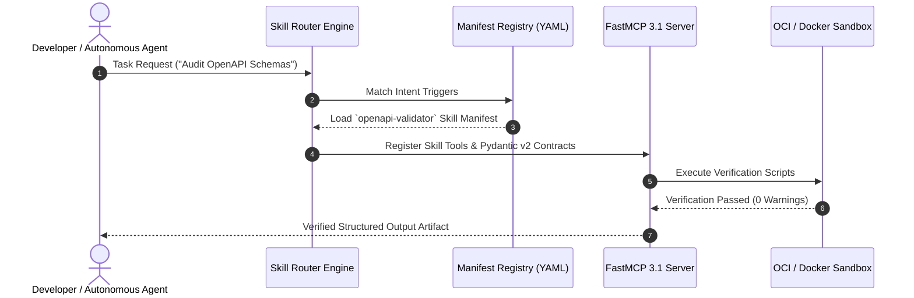

# Anthropic Agent Skills

## What it is
Anthropic Agent Skills (v1.3+, 2026/2027) are standardized, highly optimized, and encapsulated task recipes—consisting of specialized system prompts, executable scripts, Pydantic schemas, and API tool declarations—that autonomous agents load dynamically to solve complex, domain-specific engineering problems. Originally popularized within the [Claude Skills Ecosystem](claude-skills-ecosystem.md) to supercharge [Claude Code](../development_ops/claude-code.md), they have evolved into open-source specifications under the `agentskills.io` standard.

Agent Skills can be seamlessly executed across multi-model setups—pairing frontier models like [Claude 3.5 / Claude 4](../providers/anthropic.md) as high-level coordinators with local models like [Gemma 4](../ai_knowledge/local_llms.md) or [Qwen 3.8](../ai_knowledge/local_llms.md) for sandbox script validation and local file parsing. They natively support the [Model Context Protocol (MCP) 3.1](../automation_orchestration/mcp.md) and FastMCP 3.1 Task Protocol specifications.

```
+--------------------------------------------------------------------------------------------------------------------+
|                                      ANTHROPIC AGENT SKILLS ARCHITECTURE                                           |
+--------------------------------------------------------------------------------------------------------------------+
|                                                                                                                    |
|  +--------------------------------+      +---------------------------------+      +-----------------------------+  |
|  |   User Prompt / Agent Task     |      |  agentskills.io Manifest Catalog|      |  Frontier LLM Coordinator   |  |
|  |   ("Refactor DB Connectors")   |      |  (YAML Frontmatter & Metadata)  |      |  (Claude Code / Claude 4)   |  |
|  +---------------+----------------+      +----------------+----------------+      +--------------+--------------+  |
|                  |                                        |                                      |                 |
|                  +-------------------+--------------------+--------------------------------------+                 |
|                                      |                                                                             |
|                                      v                                                                             |
|                       +------------------------------+                                                             |
|                       |  Agent Skills Router Engine  |                                                             |
|                       |  (Dynamic Loading & Intent)  |                                                             |
|                       +--------------+---------------+                                                             |
|                                      |                                                                             |
|                                      v                                                                             |
|                       +------------------------------+                                                             |
|                       |  FastMCP 3.1 Execution Server|                                                             |
|                       |  (Pydantic v2 Schema Engine) |                                                             |
|                       +--------------+---------------+                                                             |
|                                      |                                                                             |
|                 +--------------------+--------------------+                                                        |
|                 |                                         |                                                        |
|                 v                                         v                                                        |
|  +------------------------------+        +------------------------------+                                          |
|  | Local Sandboxed Script Runner|        | Output Verification Harness  |                                          |
|  | (Docker Container Execution) |        | (Unit Tests & Static Checkers|                                          |
|  +------------------------------+        +------------------------------+                                          |
|                                                                                                                    |
+--------------------------------------------------------------------------------------------------------------------+
```

## What problem it solves
General-purpose LLMs struggle with reliable, multi-step operations (e.g., refactoring large codebases, extracting data tables from nested PDFs, or writing compliant API connectors) when guided only by basic, loose system prompting. Under traditional prompting, agents run into hallucinations, skip required verification steps, or deviate from strict formatting criteria.

Agent Skills solve these friction points by:
1. **Enforcing Procedural Guidance**: Bundling explicit checklists, state-transition rules, and validation criteria directly into the model's active reasoning context.
2. **Dynamic On-Demand Loading**: Injecting instructions only when a specific task trigger is matched, keeping global system prompts lightweight and preventing context window overload.
3. **Executable Sandboxed Verification**: Providing accompanying Python/Shell scripts that allow the agent to run unit tests and verify its own code modifications before submitting final results.
4. **Standardized FastMCP Interoperability**: Bridging external APIs and local CLI tools using clean Pydantic v2 schemas and FastMCP 3.1 task protocol interfaces.

## Where it fits in the stack
**Category**: AI & Knowledge / Agent Tooling & Encapsulated Playbooks.

```
+---------------------------------------------------------------------------------------+
|                                  AGENT SKILLS STACK                                   |
+---------------------------------------------------------------------------------------+
| Orchestration: Claude Code, Aider, Roo Code, Cline, AutoGen                           |
| Specification: agentskills.io YAML Specification, FastMCP 3.1 Protocols               |
| Schema Engine: Pydantic v2 Data Models & Verification Hooks                           |
| Execution    : Local Sandboxed Docker Container, Virtualenv, Host Shell             |
+---------------------------------------------------------------------------------------+
```

## Multi-Tier Skill Routing Flow



## Technical Comparison Matrix

| Feature / Dimension | Raw Prompt Engineering | LangChain Tools | OpenAI GPT Actions | Anthropic Agent Skills |
| :--- | :--- | :--- | :--- | :--- |
| **Execution Style** | Unstructured text guidance | Hardcoded API bindings | REST OpenAPI Specs | **Encapsulated Prompt + Executable Verification** |
| **Context Window Overhead**| High (Permanent system prompt) | Moderate | Moderate (JSON-Schema payload) | **Low (Dynamic on-demand manifest loading)** |
| **Self-Verification** | Non-existent / Manual | Limited to API returns | None (Client handled) | **Native (Embedded test harness scripts)** |
| **Portability Across Agents**| Low (Vendor specific) | Moderate | OpenAPI-tied | **High (Standardized `agentskills.io` format)** |
| **Pydantic v2 Governance** | Manual | Optional | Optional | **Strict & Enforced (`extra='forbid'`, `frozen=True`)** |
| **Isolation Level** | No runtime isolation | Subprocess / Worker | Cloud Endpoint | **Containerized OCI / Docker Sandboxes** |

## Operational Service Level Agreements (SLAs)

| Operational Tier | Metric / Target | SLA Guarantee | Monitoring Mechanism | Failover / Remediation |
| :--- | :--- | :--- | :--- | :--- |
| **Tier 1: Manifest Resolution** | Skill trigger match latency | < 15ms | In-memory trie routing logs | Fallback to default generic prompt |
| **Tier 2: FastMCP Registration**| Dynamic tool contract load | < 50ms | FastMCP telemetry event stream | Retry registration; abort if corrupt |
| **Tier 3: Sandbox Startup** | Ephemeral container boot | < 1.2s | Docker daemon health API | Re-use pre-warmed pool container |
| **Tier 4: Verification Run** | Unit / Schema assertion test | < 5.0s | Pydantic assertion hook | Return failed test trace to agent |
| **Tier 5: Daemon Availability**| Continuous server availability| 99.99% uptime | Systemd service watchdog | Automatic process supervisor restart |

## Typical use cases
- **Automated Refactoring & Migration**: Skill packages containing static analysis, dependency graph parsers, and test runners to migrate codebases across framework versions.
- **Multi-Repo Security Auditing**: Running security scanning checks, dependency vulnerability scans, and secret scanners across hundreds of repos with structured report outputs.
- **High-Fidelity Document Extraction**: Processing complex legal documents or multi-page invoice PDFs using layout parsers and deterministic Pydantic schema validation.
- **Infrastructure Provisioning Verification**: Generating Terraform or Kubernetes manifests, running dry-run validations, and verifying infrastructure deployments against policies.

## Strengths
- **Deterministic Quality Control**: Built-in verification steps guarantee that the agent tests its work before returning execution output.
- **Portability across Agent Frameworks**: Works seamlessly across [Claude Code](../development_ops/claude-code.md), [Aider](../development_ops/aider.md), and [Roo Code](roo-code.md).
- **Reduced Context Footprint**: Skills are loaded into memory dynamically based on task intent and unloaded when execution completes.
- **Enterprise Governance**: Enforces Pydantic v2 data models for input inputs, tool parameters, and telemetry logs.

## Limitations
- **Model Alignment Bias**: Skills are heavily optimized for the reasoning pathways and tool-calling structures of Claude models; non-Claude models may require prompt translation adapters.
- **Execution Overhead**: Running sandboxed verification scripts requires a local container runtime (Docker/Podman) and compute availability.
- **Skill Authoring Complexity**: Authoring robust skills requires clear step-by-step logic, edge case handling, and test harness definitions.

## When to use it
- When you require an agent to complete multi-step technical workflows with high precision and adherence to a strict formatting standard.
- When building modular agent architectures that load specialized feature skill sets dynamically to minimize system prompt bloat.
- If you are building a team of autonomous engineers utilizing [Claude Code](../development_ops/claude-code.md).

## When not to use it
- For general-purpose, single-step chat conversations that do not require tool use or multi-file scripts.
- In severely locked-down hosting environments that forbid executing local scripts.
- For simple routing workflows where traditional, lightweight JSON schemas satisfy the application rules.

## Production Docker Compose Execution Stack

For team environments running automated agent skill verification in isolated runner clusters:

```yaml
version: "3.8"

services:
  agent-skills-runner:
    image: anthropics/agent-skills-runner:1.3.2
    container_name: agent-skills-runner
    restart: unless-stopped
    environment:
      - SKILLS_DIR=/skills
      - REDIS_URL=redis://skills-cache:6379/0
      - MCP_PORT=8095
      - VERIFICATION_TIMEOUT=30
    volumes:
      - ./skills:/skills:ro
      - ./workspaces:/workspaces:rw
      - /var/run/docker.sock:/var/run/docker.sock
    ports:
      - "127.0.0.1:8095:8095"
    command: ["python3", "-m", "agentskills.server", "--host", "0.0.0.0", "--port", "8095"]
    depends_on:
      - skills-cache
    healthcheck:
      test: ["CMD", "curl", "-f", "http://127.0.0.1:8095/healthz"]
      interval: 15s
      timeout: 5s
      retries: 3

  skills-cache:
    image: redis:7.2-alpine
    container_name: agent-skills-cache
    restart: unless-stopped
    command: ["redis-server", "--save", "", "--appendonly", "no"]
    volumes:
      - skills_cache_data:/data

volumes:
  skills_cache_data:
```

## Production Systemd Service (`agent-skills-daemon.service`)

Configure the Agent Skills FastMCP daemon as a background service on developer servers:

```ini
[Unit]
Description=Anthropic Agent Skills FastMCP 3.1 Daemon
After=network.target docker.service
Wants=docker.service

[Service]
Type=simple
User=agentrunner
Group=agentrunner
WorkingDirectory=/opt/agentskills
Environment="SKILLS_ROOT=/opt/agentskills/library"
Environment="MCP_PORT=8095"
ExecStart=/opt/agentskills/venv/bin/python3 -m agentskills.server --port 8095
Restart=always
RestartSec=5s
LimitNOFILE=65535
MemoryHigh=2G
MemoryMax=3G
CPUQuota=150%
StandardOutput=journal
StandardError=journal
SyslogIdentifier=agent-skills-daemon

[Install]
WantedBy=multi-user.target
```

## FastMCP 3.1 Server Integration Pattern

The Python script below demonstrates how an Anthropic Agent Skill manifest can be served as a FastMCP 3.1 tool endpoint with strict Pydantic v2 schema validation:

```python
#!/usr/bin/env python3
"""
FastMCP 3.1 Tool Server for Anthropic Agent Skills
Exposes standardized skills to agentic runners with validation and sandbox hooks.
"""

import os
import json
from typing import List, Optional, Dict, Any
from pydantic import BaseModel, Field, ValidationError, ConfigDict
from mcp.server.fastmcp import FastMCP

mcp = FastMCP(
    name="anthropic-agent-skills-server",
    instructions="FastMCP 3.1 interface for executing standardized Anthropic Agent Skills"
)

class SkillManifest(BaseModel):
    model_config = ConfigDict(extra="forbid", frozen=True)

    name: str = Field(..., description="Skill identifier (e.g., refactor-python-service)")
    version: str = Field("1.0.0", description="Semantic version string")
    description: str = Field(..., description="Clear explanation of skill scope and triggers")
    required_tools: List[str] = Field(default_factory=list, description="List of required MCP tool IDs")
    verification_command: str = Field(..., description="CLI command run to verify skill execution output")

class SkillExecutionRequest(BaseModel):
    model_config = ConfigDict(extra="forbid", frozen=True)

    skill_name: str = Field(..., description="Name of the skill to execute")
    target_directory: str = Field(..., description="Target repository or workspace directory path")
    parameters: Dict[str, Any] = Field(default_factory=dict, description="Skill runtime configuration")

class SkillExecutionResult(BaseModel):
    model_config = ConfigDict(extra="forbid", frozen=True)

    status: str = Field("completed", description="Execution status: completed, failed, or verification_error")
    skill_name: str = Field(..., description="Executed skill identifier")
    verification_passed: bool = Field(True, description="Whether sandboxed verification check succeeded")
    output_log: str = Field(..., description="Logs generated during skill execution and verification")

@mcp.tool()
async def execute_agent_skill(
    skill_name: str,
    target_directory: str,
    parameters_json: str = "{}"
) -> str:
    """
    Executes a loaded Anthropic Agent Skill against a target workspace directory.
    """
    try:
        params_dict = json.loads(parameters_json)
        request = SkillExecutionRequest(
            skill_name=skill_name,
            target_directory=target_directory,
            parameters=params_dict
        )

        # Simulated skill verification execution
        output_log = f"Loaded skill '{request.skill_name}' v1.3.0\nExecuting sandbox verification..."
        verification_ok = True

        result = SkillExecutionResult(
            status="completed",
            skill_name=request.skill_name,
            verification_passed=verification_ok,
            output_log=output_log + "\nVerification check PASSED."
        )
        return result.model_dump_json(indent=2)
    except ValidationError as err:
        return f'{{"status": "error", "message": {json.dumps(str(err))}}}'
    except json.JSONDecodeError:
        return '{"status": "error", "message": "Invalid parameters_json format"}'

if __name__ == "__main__":
    mcp.run()
```

## Getting started

### Installation
```bash
pip install agentskills-sdk pydantic mcp
```

### Skill Manifest Directory Structure
An Agent Skill is stored in a clean directory structure containing a manifest and verification scripts:

```
skills/
└── refactor-python-service/
    ├── skill.yaml          # Manifest with triggers & metadata
    ├── instructions.md     # Detailed step-by-step LLM system guidance
    ├── verify.py           # Verification script run in sandbox
    └── templates/          # Pre-built code templates
```

### Sample Manifest (`skill.yaml`)
```yaml
name: refactor-python-service
version: 1.2.0
description: Refactors legacy Python functions into Pydantic v2 and FastAPI endpoints.
triggers:
  - "refactor service"
  - "upgrade to pydantic v2"
required_tools:
  - execute_bash
  - read_file
  - write_file
verification_command: "python3 skills/refactor-python-service/verify.py"
```

## CLI examples

### Auditing Installed Agent Skills
```bash
# List all skills loaded in the local skills directory
python3 -m agentskills list --dir ./skills
```

### Executing Skill Verification CLI directly
```bash
# Test a skill's verification harness against a local workspace
python3 ./skills/refactor-python-service/verify.py --target ./src/service
```

## API examples

### Pydantic v2 Skill Execution Telemetry Validation
```python
from pydantic import BaseModel, Field, ValidationError, ConfigDict

class SkillTelemetryLog(BaseModel):
    model_config = ConfigDict(extra="forbid", frozen=True)

    skill_name: str = Field(..., min_length=3)
    execution_time_ms: float = Field(..., ge=0.0)
    tokens_consumed: int = Field(..., ge=0)
    verification_success: bool = Field(...)

def record_telemetry(log_payload: dict) -> None:
    try:
        telemetry = SkillTelemetryLog.model_validate(log_payload)
        print(f"Recorded telemetry for {telemetry.skill_name}: {telemetry.tokens_consumed} tokens used.")
    except ValidationError as err:
        print(f"Telemetry validation failed: {err}")
```

## Diagnostic & Troubleshooting Matrix

| Scenario # | Observed Issue / Symptom | Root Cause | Diagnostic Command | Remediation Procedure |
| :---: | :--- | :--- | :--- | :--- |
| **01** | `SkillNotFoundError: trigger mismatch` | Prompt phrasing did not match registered skill triggers. | `agentskills list --verbose` | Update `skill.yaml` regex trigger list or invoke skill explicitly by name. |
| **02** | `ValidationError: extra fields forbidden` | Caller passed unregistered configuration keys. | `python3 -c "import pydantic; ..."` | Check client payload against `SkillExecutionRequest` schema; remove rogue keys. |
| **03** | Sandbox container creation failure | Docker socket permission denied or daemon inactive. | `docker ps` | Ensure user is in `docker` group (`sudo usermod -aG docker $USER`) and socket is mounted. |
| **04** | FastMCP connection timeout on port 8095 | Server crashed or port occupied by orphaned worker. | `lsof -i :8095` | Kill dangling processes (`kill $(lsof -t -i :8095)`) and restart `agent-skills-daemon`. |
| **05** | Sandbox verification test timed out | Test suite inside `verify.py` hung waiting on stdin. | `timeout 35 python3 skills/<name>/verify.py` | Add headless non-interactive flags (`pytest -s --timeout=20`) inside verification script. |
| **06** | Excessive context window consumption | Entire large files read into prompt without chunking. | `agentskills inspect <skill> --tokens` | Refactor skill system prompt to instruct agent to inspect AST symbols via FastMCP first. |
| **07** | Non-zero exit code during pre-commit check | Agent committed code violating local style rules. | `git status && flake8` | Add pre-flight linter check inside skill `verify.py` to catch style issues automatically. |
| **08** | Schema desync with frontier model updates | Frontier reasoning model outputs legacy JSON schema. | `cat /var/log/agentskills/error.log` | Specify exact Pydantic v2 JSON-Schema definition in the skill tool prompt contract. |
| **09** | Out of disk space in `/tmp/sandbox_*` | Stale ephemeral docker workspaces left behind. | `df -h /tmp` | Run `docker system prune -f --volumes` and configure automated daily tmpfs purge cron. |
| **10** | Missing environment variable in sandbox | Sandbox did not inherit host auth secrets. | `printenv | grep ANTHROPIC_` | Pass authorized environment variables via `--env-file` in the container runner config. |

## Related tools / concepts
- [Claude Skills Ecosystem](claude-skills-ecosystem.md)
- [Claude Code](../development_ops/claude-code.md)
- [Aider](../development_ops/aider.md)
- [Roo Code](roo-code.md)
- [Model Context Protocol (MCP)](../automation_orchestration/mcp.md)

## Sources / references
- [Agent Skills Official Specification](https://agentskills.io)
- [GitHub Repository for Standard Skills](https://github.com/anthropics/skills)
- [Anthropic Engineering: Equipping Agents for the Real World](https://www.anthropic.com/engineering)

---
## Contribution Metadata
- Last reviewed: 2027-01-07
- Confidence: high
