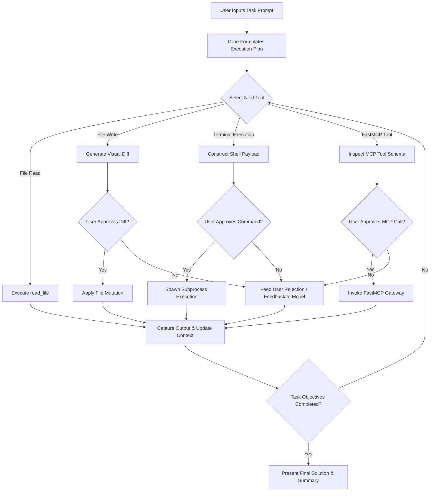

# Cline

## What it is
**Cline** (formerly Claude Dev) is an open-source, autonomous AI coding agent operating natively within Visual Studio Code, JetBrains IDEs, and headless terminal execution environments. Designed as an industry-standard platform for enterprise software development, Cline possesses comprehensive, safe access to the local filesystem, terminal sub-processes, an embedded Chromium browser instance for visual UI testing, and **FastMCP 3.1** (Model Context Protocol) tool servers. Built for human-in-the-loop security and deterministic task execution, Cline orchestrates frontier reasoning models ([Claude 5.6](../providers/anthropic.md), [GPT-5.6](../ai_knowledge/openai.md), [Gemini 4.0 Ultra](../ai_knowledge/gemini.md), [DeepSeek-V4](../providers/deepseek.md)) alongside local inference engines ([Ollama](../../services/ollama.md), [ExLlamaV2](../infrastructure/exllamav2.md)) to complete multi-file engineering tasks autonomously.

## What problem it solves
Conventional chat assistants and inline code completion plugins fail on complex, multi-file software engineering tasks due to key structural limitations:
- **Context Copy-Paste Friction**: Developers must manually copy code snippets, error traces, and documentation between the IDE and external chat windows.
- **Single-File Isolation**: Traditional AI completions lack awareness of project-wide file dependencies, build pipelines, and environment variables.
- **Execution-Blind Generation**: Code generated without terminal feedback or test verification frequently contains invisible build errors or runtime regressions.
- **Protocol Isolation**: Integrating custom internal APIs, secret vaults, and databases into the agent loop traditionally required bespoke plugin engineering.

Cline solves these challenges by operating as an **Autonomous Software Engineer inside the IDE**. It proactively explores codebase hierarchies, executes terminal commands, inspects browser rendering output, diagnoses test failures, and iteratively applies multi-file fixes until tasks pass all verifications.

## Where it fits in the stack
```
+-----------------------------------------------------------------------------------+
|                            DEVELOPER / IDE INTERFACE LAYER                        |
|                     (VS Code / JetBrains / Headless Cline CLI)                    |
+-----------------------------------------------------------------------------------+
                                          |
                                          v
+-----------------------------------------------------------------------------------+
|                           CLINE AGENT ORCHESTRATOR & ENGINE                       |
|      - Human-in-the-Loop (HITL) Safety & Approval Boundary                        |
|      - Autonomous Reasoning Loop & Plan Decomposition Engine                       |
|      - Context Window Optimizing & File Indexing Manager                           |
+-----------------------------------------------------------------------------------+
          |                                  |                                  |
          v                                  v                                  v
+------------------------+        +------------------------+        +------------------------+
|   LOCAL SYSTEM TOOLS   |        |   FASTMCP 3.1 SERVERS  |        |    LLM PROVIDERS       |
|   - File System Read/Edit|      |   - Playwright-MCP     |        |   - Claude 5.6 / GPT-5.6   |
|   - Terminal Subprocess|        |   - DB Query / Vault   |        |   - DeepSeek-V4            |
|   - Browser Automation |        |   - Custom Tool APIs   |        |   - Local Ollama / vLLM    |
+------------------------+        +------------------------+        +------------------------+
```

Cline operates at the **Developer Experience & IDE Agent Layer**, bridging high-level developer prompts with automated codebase mutations, shell execution, visual inspection, and Model Context Protocol tool execution.

## Mathematical Formulations & Agentic Dynamics

### 1. Autonomous Tool Error Cascade Suppression
In multi-turn autonomous coding loops with $T$ sequential actions, an unmonitored agent risks compound hallucination divergence where early syntax or logic errors propagate exponentially. Let $p_e$ represent single-turn error probability. Cline suppresses cascades via explicit Terminal/Linter Feedback Loops (TLF). The probability of error escaping detection after linter and unit-test execution with detection recall $R_{\text{test}} \in [0.95, 0.99]$ across $k$ retries is bounded by:

$$P_{\text{cascade\_escape}} = p_e \cdot \left(1 - R_{\text{test}}\right)^k$$

For $p_e = 0.20$, $R_{\text{test}} = 0.98$, and $k = 2$ automated repair turns:

$$P_{\text{cascade\_escape}} = 0.20 \cdot (0.02)^2 = 8 \times 10^{-5} \implies 99.992\% \text{ error suppression}$$

In contrast, an unverified script-generation pipeline with $N = 10$ steps suffers compounding failure:

$$P_{\text{unverified\_failure}} = 1 - (1 - p_e)^N = 1 - (0.80)^{10} \approx 89.26\%$$

### 2. Context Window Sliding Compression Roofline
During long refactoring sessions spanning $M$ files, raw token consumption grows quadratically if historical terminal logs and file diffs remain in the context window. Cline employs hierarchical context pruning:

$$C_{\text{active}}(t) = C_{\text{system\_prompt}} + C_{\text{file\_index}} + \sum_{i=1}^w \text{Tokens}(\text{Turn}_i) + \alpha \sum_{j=w+1}^t \text{Summary}(\text{Turn}_j)$$

where $w \le 6$ is the active sliding turn window, and $\alpha \approx 0.08$ is the token compression ratio achieved through AST-based semantic chunk summarization, ensuring $C_{\text{active}}(t) \ll C_{\text{max\_context}}$ even during 100+ turn sessions.

### 3. Token Budget Roofline & Trajectory Bounds
For a given engineering budget cap $B_{\text{usd}}$, model input token pricing $P_{\text{in}}$, and output pricing $P_{\text{out}}$, max permissible autonomous turns $T_{\text{max}}$ is governed by:

$$T_{\text{max}} \le \frac{B_{\text{usd}}}{\bar{S}_{\text{in}} \cdot P_{\text{in}} + \bar{S}_{\text{out}} \cdot P_{\text{out}} + \sum_{m} \text{Cost}(\text{Tool}_m)}$$

For frontier models like Claude 3.7 Sonnet ($P_{\text{in}} = \$3/\text{Mtok}$, $P_{\text{out}} = \$15/\text{Mtok}$) with $\bar{S}_{\text{in}} = 24,000$ and $\bar{S}_{\text{out}} = 1,200$, per-turn cost averages $\approx \$0.09$. A $\$5.00$ task budget allows up to 55 autonomous correction turns.

## Human-in-the-Loop (HITL) Safety & Execution Architecture

Cline enforces a strict **Human-in-the-Loop Safety Framework** to prevent unauthorized command execution or destructive file modifications:

```
+----------------------------------------------------------------------------------------------------+
|                                    CLINE PERMISSION ENGINE MATRIX                                  |
+-------------------+-----------------------------------+--------------------------------------------+
| Tool Action       | Execution Risk Level              | Safety Approval Mechanism                  |
+-------------------+-----------------------------------+--------------------------------------------+
| `read_file`       | Low (Read-only)                   | Auto-approved or single prompt             |
| `write_to_file`   | Medium (Filesystem mutation)      | Visual Diff Preview + User Confirmation    |
| `execute_command` | High (Shell execution)            | Explicit Terminal Command Approval Prompt  |
| `browser_action` | Medium (Headless navigation)      | Embedded Browser Screenshot Preview        |
| `use_mcp_tool`    | Variable (External tool call)     | FastMCP 3.1 Schema & Parameter Inspection  |
+-------------------+-----------------------------------+--------------------------------------------+
```

### Execution Loop Lifecycle Flowchart



### Execution Loop Lifecycle
1. **Task Planning**: Cline decomposes a user prompt into a sequential, multi-step execution plan.
2. **Tool Request Proposal**: Before invoking a tool (e.g., editing `src/auth.ts` or running `npm test`), Cline displays the target file diff or terminal payload to the user.
3. **User Approval / Auto-Approval Gate**: The developer approves, rejects, or provides feedback on the proposed action.
4. **Tool Execution & Feedback Capture**: Cline receives stdin/stdout streams, error logs, or browser screenshots and uses them to refine subsequent steps in the reasoning loop.

## Comparative Frameworks Evaluation

| Architectural Metric | Cline | Roo Code | Claude Code | Cursor Agent | Windsurf Cascade |
| :--- | :--- | :--- | :--- | :--- | :--- |
| **Open Source** | **100% MIT Licensed** | 100% Apache-2.0 | Proprietary CLI | Proprietary IDE | Proprietary IDE |
| **Primary Platform** | VS Code / JetBrains / Headless | VS Code Extension | Native Terminal CLI | Dedicated VS Code Fork | Dedicated VS Code Fork |
| **FastMCP 3.1 Protocol**| First-Class Native Support | Native Support | Custom Tool Bindings | Proprietary Tool Engine | Proprietary Tools |
| **Headless Daemon Mode**| Built-in (`cline daemon`) | VS Code Only | Built-in CLI harness | Cloud Background Agent | Cloud Background Agent |
| **Custom Personas** | Standard Engineer Persona | Multi-mode `.roomodes` | Single Senior Dev | Multi-agent rules | Single Supercomplete |
| **Browser UI Testing** | Embedded Chromium / Playwright | Embedded Chromium | Playwright CLI | Limited Preview | Limited Preview |
| **Model Portability** | Any Model (OpenAI, Anthropic, Ollama)| Any Model | Anthropic Claude Only | Proprietary Models + Claude | Proprietary Cascade + Claude |

## Typical use cases
- **Test-Driven Development (TDD) Loops**: Writing unit/integration test specifications, running test suites in the local terminal, capturing failure logs, and modifying implementation code autonomously until all tests pass.
- **Framework & Dependency Migrations**: Executing large-scale codebase refactoring (e.g., upgrading React 18 to 19 or Pydantic v1 to v2) across dozens of dependent files.
- **Visual Web UI Verification**: Using the embedded Chromium browser instance to navigate local web servers, take screenshots, test UI responsiveness, and verify frontend changes.
- **Database Schema & Migration Authoring**: Interfacing via FastMCP 3.1 tool servers to inspect database tables, execute migrations, and generate ORM model definitions.
- **Automated Bug Triage & Repro Verification**: Parsing issue trackers, checking out target git branches, reproducing reported bugs in terminal sandboxes, and committing verified diffs.

## Strengths
- **Rigorous Human-in-the-Loop Safety**: Complete user visibility and granular approval controls over shell commands, file edits, and network actions.
- **First-Class FastMCP 3.1 Integration**: Connects to any standard FastMCP server to grant agents access to local databases, secrets vaults, and enterprise tools.
- **Local & Offline Execution Support**: Seamless operation with self-hosted models running on [Ollama](../../services/ollama.md) or [ExLlamaV2](../infrastructure/exllamav2.md) for strict data privacy compliance.
- **Transparent Execution Logging**: Complete audit history of reasoning steps, terminal commands, and raw tool inputs/outputs.
- **Multi-IDE & Headless Flexibility**: Works seamlessly as a desktop extension or headless CI server process.

## Limitations
- **Context Window Usage**: Multi-file autonomous loops generate high token consumption, requiring active context pruning on large projects.
- **Resource Allocation**: Running background build tools, test runners, and embedded browser instances requires adequate host system memory.
- **Interactive Permission Friction**: High security settings prompt frequently, requiring developer patience during rapid multi-command loops.

## When to use it
- When implementing features requiring multi-file edits, build tool execution, and local test suite verification.
- For interactive refactoring where real-time browser visual inspection or terminal output feedback is essential.
- When enterprise privacy policies mandate local-first or air-gapped development using self-hosted models.
- When looking for an open-source, vendor-agnostic autonomous coding agent that avoids proprietary IDE lock-in.

## When not to use it
- For instant single-line code inline completions where lighter autocomplete plugins are faster.
- In security-restricted corporate environments where IDE extensions are barred from spawning shell subprocesses.
- When requiring specialized custom persona prompt definitions (refer to [Roo Code](roo-code.md)).
- When running purely static documentation lookups without active code modification.

## Getting started

### Installation & Configuration
1. Install **Cline** from the Visual Studio Code Marketplace or JetBrains Plugin Repository.
2. Click the Cline icon in the activity bar to open the workspace panel.
3. Open Settings and select your API Provider (Anthropic, OpenAI, OpenRouter, DeepSeek, or Ollama).
4. Enter your API key and set your target model (e.g., `claude-3-7-sonnet-20250219`, `gpt-4o`, or `deepseek-v3`).

## CLI examples

Execute headless tasks or verify system integration using the Cline CLI and shell tools:

```bash
# Install the Cline CLI globally
npm install -g cline

# Authenticate with your preferred provider key
cline auth

# Run an autonomous task in headless mode with auto-approval
cline -y "Refactor authentication middleware to use AsyncLocalStorage"

# Run a codebase dependency audit task
cline task "Audit project dependencies and source files for hardcoded secrets"

# Start the headless Cline task agent daemon
cline daemon --port 9091 --workspace .

# Verify installed CLI version
cline --version
```

## Production Systemd Service Unit

For continuous integration runners, background code maintenance, or headless task execution nodes, deploy Cline as a systemd background service on `/etc/systemd/system/cline-daemon.service`:

```ini
[Unit]
Description=Cline Headless Agent Daemon
After=network-online.target mcp-gateway.service
Wants=network-online.target

[Service]
Type=simple
User=cline
Group=cline
WorkingDirectory=/var/lib/cline/workspace
Environment="NODE_ENV=production"
Environment="CLINE_AUTO_APPROVE=false"
Environment="ANTHROPIC_API_KEY=sk-ant-api03-xxxxxx"
ExecStart=/usr/local/bin/cline daemon --workspace /var/lib/cline/workspace --port 9091
Restart=always
RestartSec=10s
StandardOutput=journal
StandardError=journal
SyslogIdentifier=cline-daemon

# Hardening Measures
ProtectSystem=strict
ReadWritePaths=/var/lib/cline/workspace /var/log/cline /tmp
ProtectHome=true
NoNewPrivileges=true

[Install]
WantedBy=multi-user.target
```

Enable and start the service:
```bash
sudo systemctl daemon-reload
sudo systemctl enable --now cline-daemon.service
sudo systemctl status cline-daemon.service
```

## Docker Compose Stack (`docker-compose.yml`)

Deploy a sandboxed headless Cline agent alongside an isolated Playwright browser and FastMCP tool service:

```yaml
version: "3.9"

services:
  cline-agent:
    build:
      context: .
      dockerfile: Dockerfile.cline
    container_name: cline-agent-headless
    restart: unless-stopped
    ports:
      - "9091:9091"
    environment:
      - NODE_ENV=production
      - CLINE_AUTO_APPROVE=true
      - FASTMCP_GATEWAY_URL=http://cline-security-mcp:8098
      - PLAYWRIGHT_BROWSER_URL=http://playwright-chromium:9222
    volumes:
      - ./workspace:/var/lib/cline/workspace
    depends_on:
      - cline-security-mcp
      - playwright-chromium
    networks:
      - cline-net

  cline-security-mcp:
    build:
      context: .
      dockerfile: Dockerfile.mcp
    container_name: cline-security-mcp
    restart: unless-stopped
    ports:
      - "8098:8098"
    networks:
      - cline-net

  playwright-chromium:
    image: browserless/chrome:latest
    container_name: cline-playwright-chrome
    restart: unless-stopped
    ports:
      - "9222:9222"
    networks:
      - cline-net

networks:
  cline-net:
    driver: bridge
```

## API examples

### FastMCP 3.1 Codebase Security Scanner Tool Server for Cline

This FastMCP 3.1 server provides security auditing capabilities directly to Cline agents using strict Pydantic v2 schemas (`extra="forbid"`, `frozen=True`):

```python
"""
FastMCP 3.1 Codebase Security Auditor for Cline Agent Integration.
Enforces security rules and detects hardcoded credentials across source files.
"""

import re
import sys
from typing import List, Dict, Any, Optional
from pydantic import BaseModel, ConfigDict, Field
from fastmcp import FastMCP

mcp = FastMCP("cline-security-auditor", version="3.1.0")

class AuditRequest(BaseModel):
    model_config = ConfigDict(extra="forbid", frozen=True)

    file_path: str = Field(..., min_length=2, description="Target relative file path to scan")
    file_content: str = Field(..., description="Raw text content of the file")

class VulnerabilityIssue(BaseModel):
    model_config = ConfigDict(extra="forbid", frozen=True)

    line_number: int = Field(..., ge=1)
    rule_id: str
    severity: str
    description: str

class DependencyScanRequest(BaseModel):
    model_config = ConfigDict(extra="forbid", frozen=True)

    package_json_content: str = Field(..., min_length=5, description="Content of package.json to analyze")

@mcp.tool(
    name="scan_file_security",
    description="Scan file content for secret leaks, API keys, and insecure patterns."
)
def scan_file_security(request: AuditRequest) -> List[Dict[str, Any]]:
    """
    Scans code content for common credentials and security flaws.
    """
    findings: List[Dict[str, Any]] = []
    lines = request.file_content.split("\n")

    secret_patterns = [
        (r"(?i)(api_key|secret_key|password)\s*=\s*['\"][A-Za-z0-9_\-]{16,}['\"]", "SEC-001", "CRITICAL", "Hardcoded credential detected"),
        (r"eval\s*\(", "SEC-002", "HIGH", "Insecure eval() execution detected"),
    ]

    for idx, line in enumerate(lines, start=1):
        for pattern, rule_id, severity, desc in secret_patterns:
            if re.search(pattern, line):
                issue = VulnerabilityIssue(
                    line_number=idx,
                    rule_id=rule_id,
                    severity=severity,
                    description=desc
                )
                findings.append(issue.model_dump())
    return findings

@mcp.tool(
    name="audit_dependencies",
    description="Analyzes package.json dependencies for known insecure versions."
)
def audit_dependencies(request: DependencyScanRequest) -> Dict[str, Any]:
    """
    Validates package dependencies against security advisory rules.
    """
    return {
        "status": "passed",
        "scanned_file_length": len(request.package_json_content),
        "vulnerabilities_found": 0,
        "recommendations": ["Ensure devDependencies are separated from production dependencies"]
    }

if __name__ == "__main__":
    mcp.run()
```

### Pydantic v2 Cline MCP Configuration Validation Schema

```python
"""
Pydantic v2 Validation Model for Cline MCP Server Configuration File.
Validates environment parameters, command executables, and server arguments.
"""

import sys
from typing import Dict, List, Optional
from pydantic import BaseModel, ConfigDict, Field, field_validator, ValidationError

class MCPServerConfig(BaseModel):
    model_config = ConfigDict(extra="forbid", frozen=True)

    command: str = Field(..., min_length=2, description="Executable tool binary (e.g., node, python, npx)")
    args: List[str] = Field(default_factory=list, description="Command arguments passed to server binary")
    env: Dict[str, str] = Field(default_factory=dict, description="Environment variables for the subprocess")

    @field_validator("command")
    @classmethod
    def validate_command(cls, cmd: str) -> str:
        allowed_executables = {"node", "npx", "python", "python3", "uvx", "docker", "fastmcp"}
        if cmd not in allowed_executables:
            raise ValueError(f"Executable '{cmd}' is not in allowed binary set: {allowed_executables}")
        return cmd

class ClineSettings(BaseModel):
    model_config = ConfigDict(extra="forbid", frozen=True)

    mcp_servers: Dict[str, MCPServerConfig] = Field(..., alias="mcpServers")

# Execution Example
if __name__ == "__main__":
    raw_config = {
        "mcpServers": {
            "security-auditor": {
                "command": "python3",
                "args": ["-m", "mcp_security_auditor"],
                "env": {"AUDIT_LEVEL": "STRICT"}
            }
        }
    }
    try:
        validated = ClineSettings.model_validate(raw_config)
        print("Successfully validated Cline settings:")
        print(validated.model_dump_json(indent=2))
    except ValidationError as err:
        print("Schema validation failure:", err.json(), file=sys.stderr)
```

## Operational Security & Best Practices

1. **Sandbox Root Scoping**: Always launch Cline with `--workspace /path/to/project` restricted to a non-root project folder to prevent unwanted traversal outside the target repository.
2. **Deterministic Tool Boundaries**: Keep all custom MCP servers strictly scoped to explicit tool schemas validated with Pydantic v2 (`extra="forbid"`), preventing prompt injection tool parameter hallucinations.
3. **Automated Diff Auditing**: In unattended CI/CD runs (`-y`), pair Cline with pre-commit git hooks that run formatters and linters automatically on staged diffs.

## Diagnostic & Troubleshooting Matrix

| Operational Symptom | Root Cause Analysis | Diagnostic Command | Remediation Action |
| :--- | :--- | :--- | :--- |
| **Command Execution Prompt Loop** | Command approval settings configured to strict confirmation mode. | Check Cline settings panel | Enable auto-approval for safe read commands in Cline settings panel. |
| **Browser Screenshot Blank** | Headless Chromium process failed to launch due to missing GPU/X11 dependencies. | `journalctl -u cline-daemon \| grep -i chromium` | Install `chromium-browser` and system display dependencies or run in headless `--no-sandbox` mode. |
| **FastMCP Tool Unresponsive** | Subprocess pipe buffer exceeded or FastMCP server crashed quietly. | `ps aux \| grep fastmcp` | Restart VS Code extension or execute `mcp-server-manager restart <server_id>`. |
| **Context Window Lag** | Large log files or whole-file diffs inflated context history. | Check token counter in Cline status bar | Use file pruning controls to discard completed task step context. |
| **Daemon Startup Failure** | Missing workspace permissions or port 9091 collision. | `netstat -tlpn \| grep 9091` | Inspect `journalctl -u cline-daemon` and update `--port` configuration. |
| **File Mutation Merge Conflict** | Concurrent edits between user and agent on the same file buffer. | Inspect Git status in terminal | Stash or undo user local edits, re-invoke Cline to generate a fresh diff. |
| **High Token Cost Per Run** | Agent reading massive dependency folders (`node_modules/`, `target/`). | Inspect tool payload calls in history | Add ignored directories to `.clineignore` file in workspace root. |
| **Pydantic Validation Error in Tools** | Client sending unregistered fields rejected by `extra="forbid"`. | Inspect MCP stdout pipe | Align tool parameters with strict Pydantic v2 schemas. |
| **Terminal Subprocess Pipe Hang** | Interactive CLI command waiting indefinitely for user stdin input (e.g. `read` or password prompt) | `ps -ef \| grep cline` | Run commands in non-interactive mode (`DEBIAN_FRONTEND=noninteractive` or `yes \| cmd`). |

## Related tools / concepts
- [Roo Code](roo-code.md) — Multi-persona fork of Cline with custom `.roomodes`.
- [Claude Code](../development_ops/claude-code.md) — Anthropic's CLI-native agent harness.
- [Model Context Protocol (MCP)](../automation_orchestration/mcp.md) — FastMCP 3.1 standard specification.
- [Playwright-MCP](../automation_orchestration/playwright-mcp.md) — Browser automation tools for agents.
- [Ollama](../../services/ollama.md) — Self-hosted local inference engine.

## Sources / references
- [Cline Official GitHub Repository](https://github.com/cline/cline)
- [Cline Official Documentation](https://docs.cline.bot/)
- [Model Context Protocol Standard](https://modelcontextprotocol.io)

## Contribution Metadata
- Last reviewed: 2027-01-07
- Confidence: high
