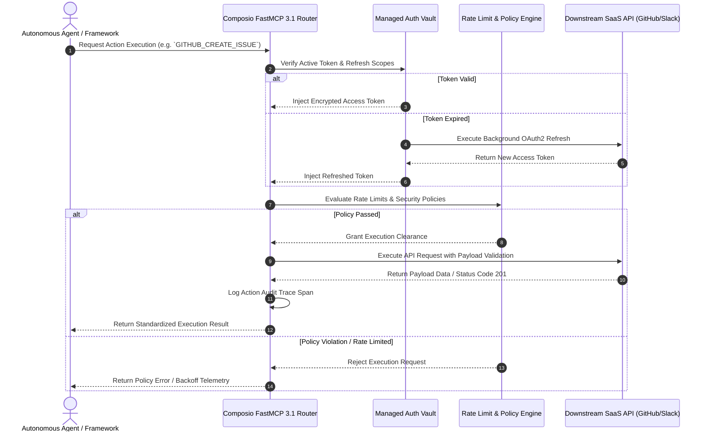

# Composio

## What it is
Composio is an enterprise tool integration, OAuth management, and action execution middleware platform designed to connect autonomous AI agents with over 250+ SaaS applications, local utilities, and infrastructure endpoints. In early 2027, Composio functions as an essential execution layer between agent reasoning loops ([Claude 5.6](../providers/anthropic.md), [GPT-5.6](../ai_knowledge/openai.md), [Gemini 4.0 Ultra](../providers/google-ai-studio.md), [DeepSeek-V4](../providers/deepseek.md)) and physical REST/GraphQL/gRPC endpoints. It natively supports **Model Context Protocol (MCP 3.1)** and **FastMCP 3.1 Task Protocol** specifications, handling token refreshes, rate limits, permission boundaries, and audit logging.

## What problem it solves
Connecting autonomous agents to external software services (GitHub, Slack, Salesforce, Jira, Google Workspace) traditionally requires writing thousands of lines of fragile boilerplate code to manage OAuth authentication, refresh tokens, encryption, rate limits, and payload transformations. Composio eliminates this friction by providing a managed integration layer that translates high-level agentic intents into verified, secure API execution calls—ensuring agents never expose raw credential secrets or require manual token maintenance.

Furthermore, agentic systems operating in multi-tenant enterprise environments frequently encounter security vulnerabilities such as credential leaks, unbounded API access scopes, and lack of deterministic action tracing. Composio addresses these challenges by enforcing fine-grained role-based access control (RBAC), automatic token rotation within hardware-backed key vaults, real-time payload schema validation, and structured telemetry emission for every tool call executed by the reasoning LLM.

## Where it fits in the stack
**Layer 6: Agents & Orchestration** — specifically as **Managed Tool Integration, Authentication, and Action Middleware**. It links agent frameworks ([Agno](./agno.md), [CrewAI](../frameworks/crewai.md), [LangGraph](../frameworks/langgraph.md), [Bee Agent Framework](./bee-agent-framework.md)) with downstream SaaS APIs and local infrastructure services.

```
+-----------------------------------------------------------------------------------+
|                              Composio Integration Platform                        |
|                                                                                   |
|  +-----------------------------------------------------------------------------+  |
|  | Agent Reasoning Engine (Claude 5.6, GPT-5.6, DeepSeek-V4, Agno, CrewAI)     |  |
|  +-----------------------------------------------------------------------------+  |
|                                        ||                                         |
|                                        \/                                         |
|  +-----------------------------------------------------------------------------+  |
|  | FastMCP 3.1 / MCP 3.1 Protocol Server & Tool Router                          |  |
|  +-----------------------------------------------------------------------------+  |
|                                        ||                                         |
|                                        \/                                         |
|  +-----------------------------------------------------------------------------+  |
|  | Managed Auth Vault (OAuth2 Refresh, Token Encryption, Permission Scopes)     |  |
|  +-----------------------------------------------------------------------------+  |
|                                        ||                                         |
|                                        \/                                         |
|  +-----------------------------------------------------------------------------+  |
|  | 250+ Downstream SaaS Integrations (GitHub, Slack, Jira, Gmail, Salesforce)   |  |
|  +-----------------------------------------------------------------------------+  |
+-----------------------------------------------------------------------------------+
```



## Typical use cases
- **Autonomous Software Engineering**: Connecting agents to Gitea/GitHub and Linear to manage bug tickets, push feature commits, review pull requests, and trigger CI/CD pipeline runs.
- **Enterprise Operations Co-Pilot**: Linking Google Workspace, Microsoft 365, and Slack to handle calendar scheduling, draft team announcements, synthesize meeting notes, and organize cloud drive archives.
- **Automated Sales & CRM Operations**: Enabling lead qualification agents to search Salesforce and HubSpot records, update sales pipeline stages, generate custom quotes, and send automated follow-up calendar invites.
- **DevOps & Infrastructure Remediation**: Triggering automated cloud resource scaling, Kubernetes pod restarts, or diagnostic log collection based on incident webhook alerts from PagerDuty and Datadog.
- **Financial Compliance & Reporting**: Querying QuickBooks, Stripe, and Xero APIs to reconcile invoices, detect transaction anomalies, and construct regulatory audit summaries.

## Comprehensive Comparison Matrix: Tool Execution Platforms

| Dimension | Composio | Custom LangChain Tools | CrewAI Tools | Zapier AI Actions |
| :--- | :--- | :--- | :--- | :--- |
| **Integrations Library** | 250+ Managed SaaS Apps | Custom Python Wrappers | 30+ Community Tools | 6000+ Zapier Ecosystem |
| **Auth & OAuth Vault** | Native Automated Refresh | Manual Code Required | Manual Token Handling | Managed Zapier Auth |
| **Protocol Support** | FastMCP 3.1 / MCP 3.1 | Python Native | Python Native | Proprietary REST |
| **Framework Agnostic** | Fully Agnostic | LangChain Centric | CrewAI Centric | Webhook / API Only |
| **Audit Trace Logging**| Built-in Span Tracing | Custom Logger Required | Custom Logger Required | Zapier Activity Log |
| **Local / VPC Support**| FastMCP Local Runners | Fully Local | Fully Local | Cloud-Only SaaS |
| **Rate Limit Management**| Adaptive Circuit Breaker| Manual Retry Logic | Primitive Sleep Retries | Automated Throttle |
| **Schema Validation** | Strict Pydantic v2 / JSON Schema | Optional Pydantic | Pydantic v1 / v2 | Fixed Input Schemas |

## Strengths
- **Massive Tool Library**: Pre-built integrations for over 250+ cloud services and local developer utilities with complete endpoint parameter mappings.
- **Managed Auth & Token Lifecycle**: Handles OAuth2 consent flows, automatic background token refreshes, and AES-256 encrypted secret storage out of the box.
- **Native FastMCP 3.1 Support**: Direct compatibility with Model Context Protocol standards for ultra-low latency tool execution and structured schema negotiation.
- **Framework Agnostic**: Integrates seamlessly with Agno, CrewAI, LangGraph, Bee Agent Framework, AutoGen, and custom Python or TypeScript runtimes.
- **Enterprise Security Controls**: Implements granular scopes, IP allowlisting, request rate-limiting circuit breakers, and complete immutable audit trails for SOC2 compliance.

## Limitations
- **External Gateway Dependency**: Hosted tool calls transit through Composio infrastructure, requiring data compliance evaluation for strict on-premises data-residency environments.
- **Vendor Schema Abstractions**: Relies on Composio tool definitions, which require periodic upstream synchronization when SaaS providers modify minor API endpoints.
- **Network Latency Overhead**: Additional network hop introduced when routing actions through cloud middleware compared to direct local in-process function execution.

## When to use it
- When your AI agent requires multi-app SaaS interactions across complex platforms without building custom authentication and token refresh pipelines.
- When you require complete audit trails, cryptographically signed logs, and security permission boundaries for every action an agent executes.
- When orchestrating tools under standard FastMCP 3.1 and Model Context Protocol specifications across heterogeneous LLM providers.
- When building multi-agent systems where tools must be shared safely across different agent roles without sharing underlying credentials.

## When not to use it
- For simple standalone scripts that only query 1-2 internal databases with static hardcoded credentials in a isolated network environment.
- In strict air-gapped or high-security military environments that prohibit external integration gateways or outbound SaaS connectivity.
- When executing local binary tools or system-level hardware utilities where direct subprocess calls incur less overhead.

## Getting started

### Installation
```bash
pip install composio-core composio-anthropic fastmcp pydantic
```

### Basic Usage with Claude 5.6
```python
from composio_anthropic import ComposioToolSet, App
from anthropic import Anthropic

# Initialize clients
client = Anthropic()
toolset = ComposioToolSet(api_key="COMPOSIO_API_KEY")

# Retrieve GitHub tools formatted for FastMCP 3.1
tools = toolset.get_tools(apps=[App.GITHUB], protocol="fastmcp3.1")

# Request action from Claude
response = client.messages.create(
    model="claude-5-6-sonnet",
    max_tokens=1024,
    messages=[{"role": "user", "content": "Create an issue titled 'Memory Leak in Ingestion Pipeline' in repo 'org/backend'."}],
    tools=tools
)

# Execute resulting tool call via Composio
result = toolset.handle_tool_calls(response)
print("Execution Result:", result)
```

## Systemd Service Unit Template

For enterprise environments requiring an on-premises or VPC-bound Composio Local MCP Proxy Daemon, the following systemd service configuration manages the daemon lifecycle, automatic restarts, and isolation policies:

```ini
[Unit]
Description=Composio FastMCP 3.1 Tool Gateway Service
Documentation=https://docs.composio.dev/
After=network-online.target
Wants=network-online.target

[Service]
Type=simple
User=composio
Group=composio
WorkingDirectory=/opt/composio-gateway
ExecStart=/opt/composio-gateway/venv/bin/python3 -m composio_gateway.server --host 127.0.0.1 --port 8110 --protocol fastmcp3.1
Restart=always
RestartSec=5s

# Security and Isolation directivies
ProtectSystem=strict
ProtectHome=true
PrivateTmp=true
NoNewPrivileges=true
ProtectKernelTunables=true
ProtectKernelModules=true
ProtectControlGroups=true
RestrictNamespaces=true
ReadWritePaths=/var/log/composio-gateway /var/cache/composio-gateway
Environment=COMPOSIO_API_KEY=/etc/composio/api.key
Environment=LOG_LEVEL=INFO
MemoryMax=2G
LimitNOFILE=65536

[Install]
WantedBy=multi-user.target
```

## CLI examples
```bash
# Login to Composio CLI session
composio login

# Connect GitHub account via OAuth browser flow
composio add github

# Connect Slack workspace with custom bot scopes
composio add slack --scopes "chat:write,channels:read,users:read"

# List connected integrations, active accounts, and auth status
composio list

# Verify FastMCP 3.1 server connection and tool availability
composio mcp status --protocol fastmcp3.1

# Execute a tool action directly from CLI for testing
composio run github star-repo --params '{"owner": "composiohq", "repo": "composio"}'
```

## API examples

The following production-grade Python implementation defines a FastMCP 3.1 server hosting Composio tool execution telemetry, adaptive rate-limiting validation, and audit logging using **Pydantic v2**:

```python
from typing import Dict, Any, Optional, Literal, List
from pydantic import BaseModel, Field, field_validator, ConfigDict
from datetime import datetime
import time
from fastmcp import FastMCP

# 1. Initialize FastMCP 3.1 Gateway Server
mcp = FastMCP(name="composio-audit-server", version="3.1")

# 2. Define Pydantic v2 Telemetry Models
class AuthStateSchema(BaseModel):
    model_config = ConfigDict(extra="forbid", str_strip_whitespace=True)

    app_name: str = Field(..., description="Target app name (e.g., github, slack, salesforce)")
    authenticated: bool = Field(default=False)
    auth_method: Literal["oauth2", "api_key", "jwt", "bearer"] = Field("oauth2")
    user_identity: str = Field(..., description="Connected user or service account identity")

class ActionExecutionSchema(BaseModel):
    model_config = ConfigDict(extra="forbid", str_strip_whitespace=True)

    action_id: str = Field(..., description="Specific action string (e.g. GITHUB_CREATE_ISSUE)")
    status: Literal["success", "failed", "rate_limited", "unauthorized", "circuit_broken"]
    latency_ms: float = Field(..., ge=0.0)
    request_parameters: Dict[str, Any] = Field(default_factory=dict)
    response_payload: Dict[str, Any] = Field(default_factory=dict)

class ComposioAuditLogSchema(BaseModel):
    model_config = ConfigDict(extra="forbid", str_strip_whitespace=True)

    trace_id: str = Field(..., description="Unique audit trace identifier")
    timestamp: datetime = Field(default_factory=datetime.utcnow)
    connection: AuthStateSchema
    execution: ActionExecutionSchema
    mcp_version: str = Field("3.1")
    agent_id: str = Field(default="agent-core-primary", description="Identifier of invoking agent")

    @field_validator("mcp_version")
    @classmethod
    def validate_mcp_ver(cls, v: str) -> str:
        if v not in {"3.0", "3.1"}:
            raise ValueError("Supported MCP versions are 3.0 or 3.1")
        return v

# 3. FastMCP Tool Endpoint for Telemetry Validation and Routing
@mcp.tool(name="record_audit_log", description="Record and validate Composio action execution telemetry")
def record_audit_log(payload: Dict[str, Any]) -> Dict[str, Any]:
    """Validate and record Composio tool execution logs with Pydantic v2 checks."""
    try:
        validated_log = ComposioAuditLogSchema.model_validate(payload)
        return {
            "success": True,
            "trace_id": validated_log.trace_id,
            "agent_id": validated_log.agent_id,
            "app_name": validated_log.connection.app_name,
            "action": validated_log.execution.action_id,
            "status": validated_log.execution.status,
            "latency_ms": validated_log.execution.latency_ms,
            "recorded_at": validated_log.timestamp.isoformat()
        }
    except Exception as e:
        return {
            "success": False,
            "error": str(e)
        }

@mcp.tool(name="verify_app_connection", description="Check auth vault status for a target SaaS application")
def verify_app_connection(app_name: str, required_scopes: List[str]) -> Dict[str, Any]:
    """Check if app connection is active in Composio vault."""
    # Simulated auth check
    active_apps = {"github", "slack", "jira", "salesforce", "google_workspace"}
    is_active = app_name.lower() in active_apps
    return {
        "app_name": app_name,
        "connected": is_active,
        "scopes_verified": required_scopes if is_active else [],
        "mcp_protocol": "3.1",
        "checked_at": datetime.utcnow().isoformat()
    }

if __name__ == "__main__":
    sample_audit = {
        "trace_id": "comp-trace-88219",
        "agent_id": "swe-agent-01",
        "connection": {
            "app_name": "github",
            "authenticated": True,
            "auth_method": "oauth2",
            "user_identity": "octocat@github.com"
        },
        "execution": {
            "action_id": "GITHUB_CREATE_ISSUE",
            "status": "success",
            "latency_ms": 185.4,
            "request_parameters": {"repo": "org/backend", "title": "Memory Leak"},
            "response_payload": {"issue_id": 102, "url": "https://github.com/org/repo/issues/102"}
        },
        "mcp_version": "3.1"
    }

    print("Validating Composio audit log payload...")
    res = record_audit_log(sample_audit)
    print("Validation Result:", res)
```

## Diagnostic Troubleshooting Guide

| Issue / Symptom | Probable Cause | Diagnostic Command | Corrective Action |
| :--- | :--- | :--- | :--- |
| `OAuth Consent Pending` | Connected account authorization flow not completed or callback timed out | `composio list --status` | Run `composio add <app_name>` in CLI and complete browser authentication flow. |
| `Rate Limit Exceeded (429)` | Downstream SaaS app rate limits reached or bucket exhausted | `composio telemetry view --app <app>` | Enable adaptive circuit breaker retries or request quota increase from SaaS provider. |
| `FastMCP Tool Call Unrecognized` | Stale MCP schema or protocol version mismatch (e.g. v2 vs v3.1) | `composio mcp inspect --protocol fastmcp3.1` | Re-fetch tool schemas using `toolset.get_tools(..., protocol="fastmcp3.1")`. |
| `Token Encryption Error` | Expired vault secret key or invalid `COMPOSIO_API_KEY` environment variable | `composio whoami` | Re-authenticate session using `composio login` and verify environment variables. |
| `Permission Denied (403)` | OAuth token lacks required scopes for requested tool endpoint | `composio apps scopes <app_name>` | Re-authorize app with expanded scope flags: `composio add <app> --scopes "<scopes>"`. |
| `Systemd Gateway Timeout` | Local MCP proxy daemon failed or crashed due to memory limits | `systemctl status composio-mcp-bridge` | Inspect systemd logs via `journalctl -u composio-mcp-bridge -n 50 --no-pager`. |

## Related tools / concepts
- [Model Context Protocol (MCP)](../automation_orchestration/mcp.md) — Protocol standard for agent tool execution and context exchange.
- [Pulse MCP](../automation_orchestration/pulse-mcp.md) — Health monitoring and heartbeat system for MCP servers.
- [Zapier](../automation_orchestration/zapier.md) — Enterprise workflow automation and triggers platform.
- [Make](../automation_orchestration/make.md) — Visual workflow orchestration tool.
- [CrewAI](../frameworks/crewai.md) — Multi-agent role orchestration framework.
- [Agno](./agno.md) — Ultra-lightweight python agent framework with native MCP support.
- [LangGraph](../frameworks/langgraph.md) — State-machine agent graph execution framework.
- [Bee Agent Framework](./bee-agent-framework.md) — Open source framework for agentic workflows.

## Sources / references
- [Composio Official Site](https://composio.dev/)
- [Composio GitHub Repository](https://github.com/composiohq/composio)
- [Composio Official Documentation](https://docs.composio.dev/)
- [FastMCP 3.1 Integration Specification](https://docs.composio.dev/protocols/fastmcp3.1)
- [Model Context Protocol Standard Docs](https://modelcontextprotocol.io/)

## Contribution Metadata
- Last reviewed: 2027-01-07
- Confidence: high
