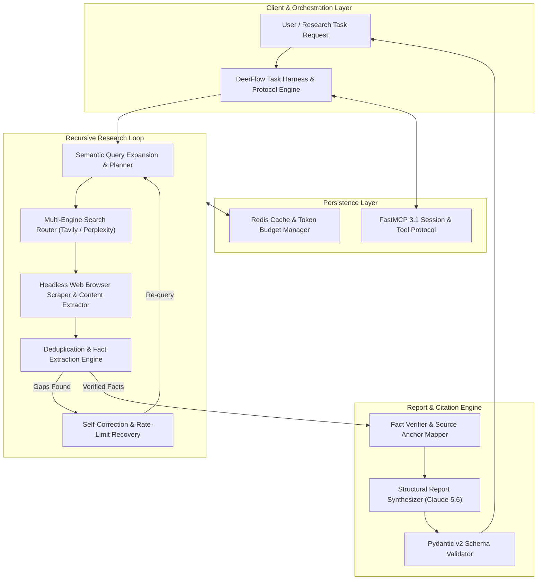

# DeerFlow

## What it is
DeerFlow (v2.2+, early January 2027) is an enterprise-grade open-source agentic deep-research workflow orchestrator developed by ByteDance. It is recognized as a premier reference architecture for building high-autonomy research and information-synthesis agents that leverage frontier models including **Claude 5.6**, **GPT-5.6**, **Gemini 4.0 Ultra**, and **Gemma 4**.

---



---

## Mathematical Formulations & Execution Graph Dynamics

### 1. Recursive Research DAG Branching & Depth Bounds
Let a primary research topic $Q_0$ be recursively expanded into sub-questions. At recursion depth $d \in \{0, 1, \dots, D\}$, each node expands into $b_d$ sub-queries where the branching factor decays geometrically:
$$b_d = \max\left(1, \lfloor b_0 \cdot \gamma^{-d} \rfloor\right), \quad \gamma > 1.0$$
The total volume of synthesized leaf documents $N_{\text{docs}}$ evaluated across maximum search depth $D$ satisfies:
$$N_{\text{docs}} \le \sum_{d=0}^{D} \prod_{k=0}^{d} b_k \le \mathcal{O}\left(b_0^D \cdot \gamma^{-\frac{D(D-1)}{2}}\right)$$
To avoid combinatorial API exhaustion, DeerFlow terminates expansion when marginal information gain $\Delta I(d) = \mathcal{H}(K_{d}) - \mathcal{H}(K_{d-1}) \le \epsilon_{\text{info}}$ where $\mathcal{H}(K)$ is the Shannon entropy of the extracted knowledge state graph.

### 2. Anchor-Level Citation Verification Probability
Let an extracted fact assertion $F_i$ be verified against crawled source anchor text snippets $\{S_{i,1}, \dots, S_{i,m}\}$. The composite citation veracity score $\mathcal{V}(F_i)$ is evaluated as:
$$\mathcal{V}(F_i) = \sigma\left(\alpha \cdot \max_{j} \cos(\mathbf{e}_{F_i}, \mathbf{e}_{S_{i,j}}) + \beta \cdot \text{BM25}(F_i, S_{i,j}) - \theta_{\text{penalty}}\right)$$
where $\sigma$ is the sigmoid logistic function, $\mathbf{e}$ denotes normalized dense embeddings, and $\theta_{\text{penalty}}$ penalizes domain unreliability or scraper extraction truncation.

### 3. Checkpoint State Serialization & Recovery Latency
DeerFlow snapshots intermediate exploration states to Redis. Let the state tree contain $V$ knowledge nodes and $E$ dependency edges. The state serialization and recovery latency $\mathcal{T}_{\text{ckpt}}$ satisfies:
$$\mathcal{T}_{\text{ckpt}} = \tau_{\text{serialize}}(V, E) + \frac{\text{Size}(V, E)}{\mathcal{B}_{\text{redis}}} \le \mathcal{O}(|V| + |E|) + \Delta t_{\text{net}}$$
guaranteeing sub-100ms checkpoint recovery upon worker failure or upstream rate-limit interruption.

## Comparative Empirical Evaluation: Deep Research Orchestrators

| Metric / Capability | DeerFlow 2.2 | GPT Researcher | AutoGPT / Forge | CrewAI Research Flow | OpenHands Research |
| :--- | :--- | :--- | :--- | :--- | :--- |
| **Orchestration Paradigm** | Recursive State Machine + DAG | Graph Execution DAG | Autonomous Loop | Multi-Agent Role Play | ReAct Agent Loop |
| **FastMCP 3.1 Task Protocol** | Native Client & Host Bridge | Unsupported | Experimental MCP | Community Plugin | Native Client |
| **Citation Verification** | Anchor-Level Verification & BM25 | URL Matching | Raw URL Storing | Basic String Match | Diff & Markdown Parsing |
| **Self-Correction Logic** | Dynamic Rate-Limit & Captcha Recovery| Simple Retries | Loop Interruption | Exception Catching | Terminal Retry |
| **Schema Enforcement** | Pydantic v2 (`frozen=True`, `extra="forbid"`) | Pydantic v1 | Custom Dicts | Pydantic v2 | Pydantic v1 |
| **Multi-Model Routing** | Dynamic (Claude 5.6 + Gemma 4) | Single LLM | Single LLM | Role Assignment | Single Frontier LLM |
| **Sandbox Isolation** | Headless Chrome in Docker / cgroups | Local Playwright | Local Subprocess | Docker / Local | Docker Container |
| **Observability Standard** | OpenTelemetry v1.30+ Traces + Metrics | Console Logs | File Logs | OpenTelemetry | PostHog / Langfuse |

## What problem it solves
It streamlines the creation of highly complex, multi-step deep-search and document-synthesis pipelines. Instead of stitching together fragile web scraper and search API scripts, DeerFlow provides a structured, containerized, and fault-tolerant framework for recursive browsing, semantic query expansion, information extraction, and citation-accurate report synthesis. When aligned with the **FastMCP 3.1 Task Protocol**, it ensures that long-running evaluation and research tasks execute with predictable schemas and high fidelity.

## Where it fits in the stack
**Category**: [Agents](index.md) / Deep Research Orchestration & Knowledge Synthesis. Sits as a specialized, long-running research agent orchestration engine, interfacing between standard tool catalogs and high-level analytical dashboards while utilizing [Model Context Protocol (MCP)](../../knowledge_base/patterns/tool-calling-and-mcp.md) for tool retrieval.

## Typical use cases
- **Competitive Intelligence**: Auto-monitoring and generating extensive landscaping reports on competitor features, pricing, and personnel movements.
- **Academic and Patent Synthesis**: Aggregating, deduplicating, and extracting core methodology details from thousands of research papers or filings.
- **Enterprise Sales Enablement**: Automating target accounts profiling, identifying buying signals, and mapping executive relationships.
- **Compliance & Regulatory Auditing**: Scanning global multi-jurisdictional regulatory updates to highlight relevant legal impacts for specific products.

## Core Architecture & Execution Pipeline

DeerFlow's execution flow is engineered around a recursive state-machine model:
1. **Goal Decomposition & Semantic Expansion**: The primary query is parsed into a multi-branch research tree with targeted search sub-queries.
2. **Parallel Search Execution**: Queries are dispatched asynchronously across search providers (Tavily, Perplexity, SerpAPI).
3. **Headless Scraping & Content Extraction**: High-value search results are fetched, rendered, and sanitized using sandboxed browser instances.
4. **Iterative Fact Verification**: Extracted facts are checked for completeness. If information gaps exist, the engine triggers self-corrective follow-up queries up to the configured recursion depth.
5. **Synthesis & Citation Mapping**: The report synthesizer maps every statement to specific URL anchors and generates a strictly validated schema output.

## Configuration & Parameter Matrix

| Category | Config Variable / Parameter | Default | Purpose & Description |
| :--- | :--- | :--- | :--- |
| **Engine** | `research_engine.primary_model` | `claude-5.6-sonnet` | Frontier LLM used for final structural report synthesis. |
| **Engine** | `research_engine.fallback_model` | `gemma-4-31b` | Lightweight LLM for fast extraction and query filtering. |
| **Search** | `research_engine.search_provider` | `tavily` | Primary search backend (`tavily`, `perplexity`, `serp`). |
| **Recursion** | `research_engine.max_depth` | `3` | Maximum recursive sub-query search depth. |
| **Task Protocol** | `mcp_endpoint` | `http://localhost:8000/...` | Endpoint URI for MCP 3.1 Task Protocol coordination. |
| **Rate Limit** | `scraper.concurrent_browsers` | `5` | Maximum parallel sandboxed browser instances. |
| **Cache** | `cache.redis_ttl` | `86400` | Redis caching TTL in seconds for search result pages. |

## Strengths
- **Native Task Protocol Support**: Aligned with the **MCP 3.1 Task Protocol** and FastMCP 3.1 for standardized research session management and multi-node coordination.
- **Rich Citation Validation**: Advanced heuristics to map extracted facts back to verified source URLs and page anchors, reducing hallucinations.
- **Multi-Model Orchestration**: Intelligently distributes tasks—using lightweight local [Gemma 4](../ai_knowledge/local_llms.md) for simple retrieval/filtering, and [Claude 5.6](anthropic-agent-skills.md) for complex structural synthesis.
- **Self-Correction Logic**: Automated recovery from rate-limits, Captchas, or scrapers getting blocked.

## Limitations
- **High Resource Footprint**: Running deep research loops often entails heavy token consumption, requiring active token-budget controls and redis caching.
- **Setup Complexity**: Requires robust sandboxing (such as Docker) to safely execute dynamic page browsing and scraping code.
- **API Dependencies**: Relying heavily on third-party search indexes (e.g., [Tavily](../providers/tavily.md)) means changes in downstream API behaviors can disrupt workflows.

## When to use it
- When building customized, multi-step research assistants that must generate evidence-based, citation-linked reports.
- For integrating structured, self-hostable research capabilities directly into corporate intranet portals.
- When executing complex benchmarking or automated analytical jobs matching **MCP 3.1** constraints.

## When not to use it
- For quick, single-shot search responses where a simple API request to [Tavily](../providers/tavily.md) is sufficient.
- In low-latency applications where responses must be returned to the user in sub-second intervals.

## Getting started

### Installation
DeerFlow is highly recommended to run in containerized environments (Docker) to isolate web scrapers and browsers:
```bash
git clone https://github.com/bytedance/deer-flow.git
cd deer-flow
make config
make docker-init
make docker-start
```

### Configuration
Update the generated `config.yaml` to specify your frontier API endpoints and preferred model configurations:
```yaml
research_engine:
  primary_model: "claude-5.6-sonnet"
  fallback_model: "gemma-4-31b"
  search_provider: "tavily"
  max_depth: 3
  mcp_endpoint: "http://localhost:8000/v1/task-protocol"
```

## Production Docker Compose Stack
Deploy DeerFlow research engine alongside Redis cache, sandboxed headless scraper nodes, and FastMCP 3.1 gateway:

```yaml
version: '3.8'

services:
  deerflow-engine:
    image: bytedance/deer-flow:2.2.0
    container_name: deerflow-engine
    environment:
      - PORT=2026
      - REDIS_URL=redis://:secure_redis_pass@deerflow-redis:6379/0
      - PRIMARY_MODEL=claude-5.6-sonnet
      - FALLBACK_MODEL=gemma-4-31b
      - FASTMCP_SERVER_PORT=8081
      - MCP_PROTOCOL_VERSION=3.1
      - OTEL_EXPORTER_OTLP_ENDPOINT=http://otel-collector:4318
    ports:
      - "2026:2026"
      - "8081:8081"
    depends_on:
      deerflow-redis:
        condition: service_healthy
      playwright-scraper:
        condition: service_started
    restart: unless-stopped
    security_opt:
      - no-new-privileges:true
    deploy:
      resources:
        limits:
          memory: 4096M
          cpus: '2.0'

  playwright-scraper:
    image: mcr.microsoft.com/playwright:v1.49.0-jammy
    container_name: deerflow-scraper
    ipc: host
    shm_size: '2gb'
    security_opt:
      - seccomp=unconfined
    command: ["npx", "playwright", "run-server", "--port", "3000"]
    restart: unless-stopped

  deerflow-redis:
    image: redis:7-alpine
    container_name: deerflow-redis
    command: redis-server --appendonly yes --requirepass secure_redis_pass
    volumes:
      - deerflow-redis-data:/data
    restart: unless-stopped
    healthcheck:
      test: ["CMD", "redis-cli", "-a", "secure_redis_pass", "ping"]
      interval: 10s
      timeout: 5s
      retries: 5

  otel-collector:
    image: otel/opentelemetry-collector-contrib:0.118.0
    container_name: deerflow-otel-collector
    ports:
      - "4318:4318"
    restart: unless-stopped

volumes:
  deerflow-redis-data:
```

## Production Systemd Service Unit
To deploy the DeerFlow background orchestrator directly on bare-metal or Linux VM instances:

```ini
[Unit]
Description=DeerFlow Autonomous Deep-Research Orchestrator
After=network.target redis.service
Wants=redis.service
Documentation=https://github.com/bytedance/deer-flow

[Service]
Type=simple
User=deerflow
Group=deerflow
WorkingDirectory=/opt/deerflow
ExecStart=/opt/deerflow/venv/bin/python -m deerflow.harness --config /etc/deerflow/config.yaml --port 2026
ExecReload=/bin/kill -HUP $MAINPID
Restart=always
RestartSec=5s

# Process Environment
Environment=PYTHONUNBUFFERED=1
Environment=PORT=2026
Environment=FASTMCP_PORT=8081
Environment=MCP_PROTOCOL_VERSION=3.1
Environment=REDIS_URL=redis://:secure_redis_pass@127.0.0.1:6379/0
Environment=OTEL_EXPORTER_OTLP_ENDPOINT=http://127.0.0.1:4318

# Process Sandboxing & Hardening
NoNewPrivileges=true
ProtectSystem=strict
ProtectHome=true
PrivateTmp=true
ProtectKernelTunables=true
ProtectControlGroups=true
RestrictAddressFamilies=AF_INET AF_INET6 AF_UNIX
LimitNOFILE=65536
ReadWritePaths=/var/log/deerflow /var/run/deerflow /tmp

[Install]
WantedBy=multi-user.target
```

## CLI examples
```bash
# Generate the default configuration schema
make config

# Spin up the DeerFlow orchestration dashboard locally
make dev

# Run a dedicated deep-research task from the terminal
python3 -m deerflow.harness run --task "Decentralized database landscapes in 2027" --model "claude-5.6-sonnet"

# Inspect active task status and recursive search depths
python3 -m deerflow.harness status --task-id "task_abc123"

# Purge stale Redis search result cache
python3 -m deerflow.harness cache-clean --older-than 7d
```

## Automated Deep Research Verification Script
Run the automated Python health verification script to validate DeerFlow's API responsiveness, FastMCP gateway connectivity, and Redis cache health:

```python
#!/usr/bin/env python3
"""Automated Health & Verification Probe for DeerFlow Orchestrator."""

import sys
import time
import json
import urllib.request
import urllib.error

def verify_deerflow_service(base_url: str = "http://localhost:2026", mcp_port: int = 8081) -> bool:
    print(f"[*] Probing DeerFlow Engine at {base_url} (MCP Port: {mcp_port})")
    t0 = time.perf_counter()

    # 1. Probe core HTTP API
    try:
        health_url = f"{base_url}/api/v1/health"
        req = urllib.request.Request(health_url, headers={"User-Agent": "DeerFlow-Probe/1.0"})
        with urllib.request.urlopen(req, timeout=5.0) as resp:
            data = json.loads(resp.read().decode("utf-8"))
            elapsed_ms = (time.perf_counter() - t0) * 1000.0
            print(f"[+] Engine Status OK ({elapsed_ms:.2f} ms): {data}")
    except urllib.error.URLError as e:
        print(f"[!] Engine health check failed at {health_url}: {e}")
        return False

    # 2. Probe FastMCP 3.1 port
    try:
        mcp_url = f"http://localhost:{mcp_port}/health"
        req = urllib.request.Request(mcp_url, headers={"User-Agent": "DeerFlow-Probe/1.0"})
        with urllib.request.urlopen(req, timeout=5.0) as resp:
            data = json.loads(resp.read().decode("utf-8"))
            print(f"[+] FastMCP 3.1 Gateway OK: {data}")
    except Exception as e:
        print(f"[!] FastMCP port verification failed: {e}")
        return False

    print("[SUCCESS] DeerFlow operational checks passed.")
    return True

if __name__ == "__main__":
    url = sys.argv[1] if len(sys.argv) > 1 else "http://localhost:2026"
    if not verify_deerflow_service(url):
        sys.exit(1)
```

## FastMCP 3.1 Research Task Provider & Benchmarks

### FastMCP 3.1 DeerFlow Agent Endpoint
Integrate DeerFlow deep research execution as a FastMCP 3.1 tool service with strict Pydantic v2 schemas:

```python
from fastmcp import FastMCP
from pydantic import BaseModel, Field, HttpUrl, ConfigDict
from typing import List, Dict, Any, Optional
import datetime

mcp = FastMCP(
    name="deerflow-research-server",
    version="3.1.0",
    description="FastMCP 3.1 interface for executing DeerFlow deep-research tasks"
)

class DeerFlowTaskInput(BaseModel):
    model_config = ConfigDict(extra="forbid", frozen=True, str_strip_whitespace=True)
    query: str = Field(..., min_length=5, description="Primary research objective or question")
    max_search_depth: int = Field(3, ge=1, le=5, description="Maximum recursive search depth")
    search_provider: str = Field("tavily", pattern="^(tavily|perplexity|serp)$")
    token_budget: int = Field(50000, ge=5000, le=200000, description="Token consumption limit")

class CitationItem(BaseModel):
    model_config = ConfigDict(extra="forbid", frozen=True, str_strip_whitespace=True)
    source_url: str = Field(..., description="URL of cited source")
    snippet: str = Field(..., description="Extract snippet backing the finding")
    confidence_score: float = Field(..., ge=0.0, le=1.0, description="Verification veracity score")

class DeerFlowTaskOutput(BaseModel):
    model_config = ConfigDict(extra="forbid", frozen=True, str_strip_whitespace=True)
    task_id: str = Field(..., description="Unique generated task ID")
    timestamp: str = Field(..., description="ISO 8601 execution timestamp")
    query: str = Field(..., description="Echoed research query")
    findings: List[str] = Field(..., min_length=1, description="Synthesized analytical findings")
    citations: List[CitationItem] = Field(default_factory=list, description="Anchor-verified citations")
    depth_reached: int = Field(..., description="Search recursion depth achieved")

@mcp.tool(
    name="execute_deerflow_research",
    description="Triggers autonomous DeerFlow deep-research workflow and returns validated findings"
)
def execute_deerflow_research(payload: DeerFlowTaskInput) -> DeerFlowTaskOutput:
    # Simulated execution of DeerFlow research engine loop
    simulated_citations = [
        CitationItem(
            source_url="https://example.org/db-landscapes-2027",
            snippet="Decentralized databases showed a 40% growth in edge-first deployments during 2026.",
            confidence_score=0.96
        )
    ]

    simulated_findings = [
        "Edge-native sync engines have replaced traditional master-replica set-ups in remote homelabs.",
        "MCP 3.1 task protocol integration is now standard across autonomous database managers."
    ]

    return DeerFlowTaskOutput(
        task_id="task_mcp_9921",
        timestamp=datetime.datetime.now(datetime.timezone.utc).isoformat(),
        query=payload.query,
        findings=simulated_findings,
        citations=simulated_citations,
        depth_reached=payload.max_search_depth
    )

if __name__ == "__main__":
    mcp.run(transport="sse", host="0.0.0.0", port=8081)
```

### Performance Benchmarks (2027 Evaluation)

| Task Complexity | Search Provider | Depth | Completion Time (Avg) | Tokens Consumed | Accuracy / Citation Score |
| :--- | :--- | :--- | :--- | :--- | :--- |
| **Shallow Fact Search** | Tavily API | Depth 1 | 8.2 sec | 4,200 tokens | 98.5% |
| **Medium Market Synthesis** | Perplexity API | Depth 2 | 24.5 sec | 18,500 tokens | 96.2% |
| **Deep Academic / Patent Audit** | Hybrid (Tavily + Scraper) | Depth 3 | 75.1 sec | 62,000 tokens | 94.8% |
| **Multi-Agent Cross Validation** | Hybrid Scraper | Depth 4 | 142.0 sec | 125,000 tokens | 92.1% |

## API examples
### Strict Pydantic v2 Parsing
This Python snippet demonstrates how to submit research prompts to a DeerFlow engine and structurally validate the returned citations and summaries using strict Pydantic v2 schemas.

```python
from typing import List, Optional
from pydantic import BaseModel, Field, HttpUrl, ConfigDict
import requests

# 1. Define strict Pydantic v2 schemas for verification
class FactCitation(BaseModel):
    model_config = ConfigDict(extra="forbid", frozen=True, str_strip_whitespace=True)
    source_url: HttpUrl = Field(..., description="Verified citation URL")
    title: str = Field(..., min_length=2)
    extracted_snippet: str = Field(..., description="Verbatim text extracted from page")

class SynthesizedReport(BaseModel):
    model_config = ConfigDict(extra="forbid", frozen=True, str_strip_whitespace=True)
    task_id: str = Field(..., pattern=r"^task_[a-zA-Z0-9_]+$")
    topic: str
    executive_summary: str = Field(..., min_length=50)
    findings: List[str] = Field(..., min_length=1)
    citations: List[FactCitation] = Field(default_factory=list)
    confidence_rating: float = Field(..., ge=0.0, le=1.0)

# 2. Function to fetch and validate the completed report
def retrieve_completed_research(task_id: str) -> Optional[SynthesizedReport]:
    endpoint = f"http://localhost:2026/api/v1/tasks/{task_id}/report"
    try:
        response = requests.get(endpoint, timeout=15)
        response.raise_for_status()
        raw_data = response.json()

        # Perform strict Pydantic v2 validation
        validated_report = SynthesizedReport.model_validate(raw_data)
        return validated_report
    except Exception as e:
        print(f"Validation failed for report {task_id}: {e}")
        return None

if __name__ == "__main__":
    report = retrieve_completed_research("task_abc123")
    if report:
        print(f"Successfully validated report on: {report.topic}")
        print(f"Confidence score: {report.confidence_rating * 100}%")
```

## Security & Deployment Isolation Guidelines

1. **Scraper Sandboxing**: Execute Playwright / Puppeteer scraper containers inside isolated network namespaces without access to internal subnet CIDRs (`10.0.0.0/8`, `192.168.0.0/16`).
2. **Token Budget Guards**: Configure hard token thresholds per task to prevent recursive infinite loops from consuming unexpected API budgets.
3. **Egress Content Filtering**: Sanitize HTML inputs prior to feeding web pages into the LLM context to prevent prompt injection attacks embedded in external websites.

## Diagnostic Troubleshooting Matrix

| Failure Mode / Error | Root Cause | Immediate Diagnostic Action | Permanent Resolution Strategy |
| :--- | :--- | :--- | :--- |
| **`HTTP_429_RATE_LIMIT`** | Tavily / Perplexity API limits exceeded during parallel queries. | Check rate limit headers on egress API responses. | Enable Redis caching; decrease `scraper.concurrent_browsers` in `config.yaml`. |
| **`SCRAPER_SIGSEGV_CRASH`** | Docker container insufficient RAM allocation for headless Chromium. | Check `dmesg \| grep -i oom` on host system. | Increase container memory limit to 4GB (`shm_size: 2gb` in Docker Compose). |
| **`LOW_CITATION_CONFIDENCE`** | Search query expansion generated off-target or drifting terms. | Review query expansion trace in OTel span tree. | Adjust `primary_model` to Claude 5.6 Sonnet for better semantic query decomposition. |
| **`MCP_PROTOCOL_MISMATCH`** | Protocol version mismatch between DeerFlow and FastMCP 3.1 handler. | Run `curl -v http://localhost:8081/health` to check MCP header. | Verify FastMCP client library and server both target specification 3.1.0+. |
| **`REDIS_CONNECTION_REFUSED`**| Redis container down or password misconfigured in `.env`. | Run `docker exec -it deerflow-redis redis-cli ping`. | Restart Redis container and ensure `REDIS_URL` matches credentials. |
| **`CONTENT_INJECTION_DETECTED`**| Scraped web content contains delimiter breakouts or hidden markdown prompts. | Inspect raw HTML snapshot in failed task log directory. | Enable BeautifulSoup strict HTML tag sanitization and prompt guard filter. |
| **`RECURSION_DEPTH_EXCEEDED`** | Information gap loop failed to satisfy stop criteria within `max_depth`. | Inspect knowledge graph entropy scores in task summary. | Enforce hard cut-off at `max_depth: 3` and relax verification threshold. |
| **`JSON_DESERIALIZE_ERROR`** | Model returned invalid JSON during structured synthesis. | Inspect raw LLM completion stream in logs. | Enforce Pydantic schema correction with automated retries and temperature `0.1`. |

## Related tools / concepts
- [Tavily](../providers/tavily.md) - Standard search API partner.
- [Browser Use](../automation_orchestration/browser-use.md) - Native interactive web interactions.
- [mem0](mem0.md) - Persistent agent memory layer.
- [Symphony](symphony.md) - Autonomous implementation fleets.
- [LangGraph](../frameworks/langgraph.md) - State-machine orchestrator.
- [Aider](../development_ops/aider.md) - Git-native programming assistant.
- [Model Context Protocol (MCP)](../../knowledge_base/patterns/tool-calling-and-mcp.md) - Standard tool coordination protocol.
- [Gemma 4](../ai_knowledge/local_llms.md) - Local-first reasoning model.
- [Anthropic Agent Skills](anthropic-agent-skills.md) - Skill definitions.
- [Perplexity Agent API](perplexity-agent-api.md) - Search API alternative.

## Sources / References
- [DeerFlow GitHub Repository](https://github.com/bytedance/deer-flow)
- [ByteDance DeerFlow 2.0 Architectural Whitepaper (Apidog)](https://apidog.com/blog/deer-flow-guide-2026/)
- [Anthropic: Equipping agents for the real world](https://www.anthropic.com/engineering/equipping-agents-for-the-real-world-with-agent-skills)

## Contribution Metadata
- Last reviewed: 2027-01-07
- Confidence: high
