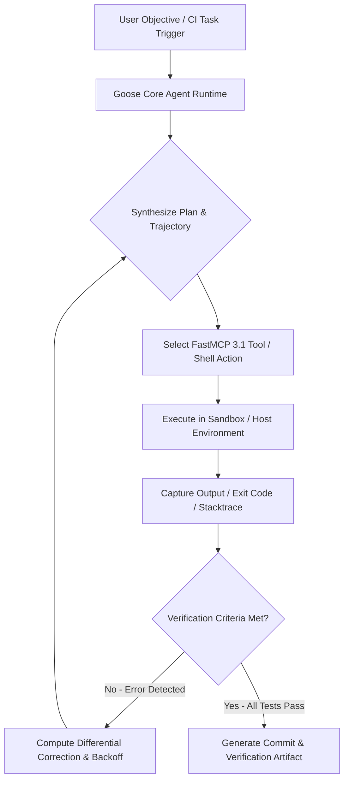
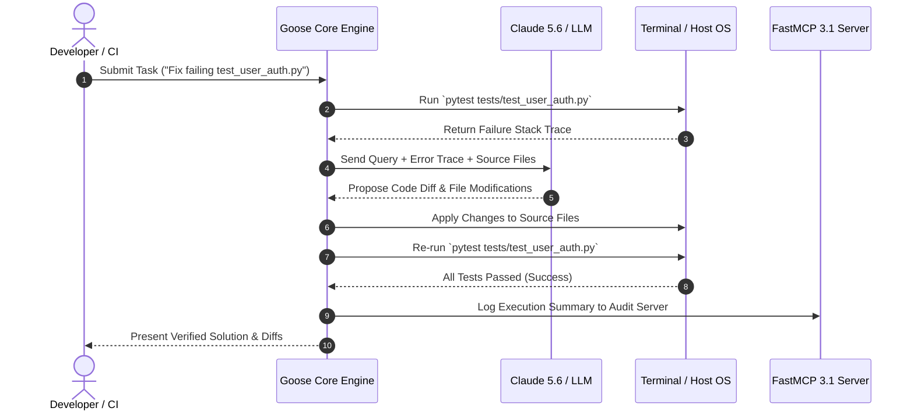

# Goose

## What it is
Goose is an open-source, fully autonomous, extensible AI developer agent designed to execute, edit, test, debug, and verify software engineering tasks directly in local shells or remote containerized environments. Hosted by the Agentic AI Foundation (AAIF), Goose bridges the gap between passive code-generation assistants and active, verified software engineering execution by implementing an autonomous plan-execute-verify-repair feedback loop.

By early 2027, Goose features native implementation of the [Model Context Protocol (MCP 3.1 / FastMCP 3.1)](../../knowledge_base/patterns/tool-calling-and-mcp.md) Task Protocol. This enables Goose to act both as an autonomous consumer of external MCP tool servers and as an agentic service provider that can be controlled remotely by frontier models—including [Claude 5.6](../ai_knowledge/claude.md), [GPT-5.6](../ai_knowledge/openai.md), [Gemini 4.0 Ultra](../ai_knowledge/gemini.md), DeepSeek V3, and local [Qwen 3.6 VL](../ai_knowledge/qwen.md).

```
+-------------------------------------------------------------------------------------------------------------------+
|                                            GOOSE AGENT ARCHITECTURE                                               |
+-------------------------------------------------------------------------------------------------------------------+
|                                                                                                                   |
|   +--------------------------+      +---------------------------+      +--------------------------+               |
|   | Goose CLI Interactive    |      | FastMCP 3.1 Client / Agent|      | GitHub Actions / CI Loop |               |
|   | Session (`goose session`)|      | (`goose run` Automation) |      | Automated PR Remediation |               |
|   +------------+-------------+      +-------------+-------------+      +------------+-------------+               |
|                |                                  |                                 |                             |
|                +----------------------------------+---------------------------------+                             |
|                                                   |                                                               |
|                                                   v                                                               |
|                                 +-----------------------------------+                                             |
|                                 |    Goose Core Agentic Runtime     |                                             |
|                                 |   (Session & Context Manager)     |                                             |
|                                 +-----------------+-----------------+                                             |
|                                                   | Protocol / API Calls                                          |
|                                                   v                                                               |
|       +-------------------------------------------+-------------------------------------------+                   |
|       |                                           |                                           |                   |
|       v                                           v                                           v                   |
| +---------------------------+             +---------------------------+             +---------------------------+ |
| | External Toolkits         |             | LLM Inference Provider    |             | Environment Sandbox       | |
| | (FastMCP 3.1 / Plugins)   |             | (Claude 5.6, LiteLLM)     |             | (Docker / Host Shell)     | |
| +---------------------------+             +---------------------------+             +---------------------------+ |
|                                                                                                                   |
+-------------------------------------------------------------------------------------------------------------------+
```



## System Architecture

Goose decomposes autonomous engineering into four decoupled architectural subsystems:

1. **Autonomous Runtime Core**: Governs multi-turn state machines, prompt assembly, and token budget management. It coordinates session checkpoints, persistence, and audit logging.
2. **Context & Execution Sandbox**: Interfaces with the local host shell, DevContainer, or isolated Docker instance. Tool invocations execute with process-level quotas, stdout/stderr streaming buffers, and signal handlers.
3. **Model Abstraction & Reasoning Interface**: Employs LiteLLM or native Anthropic/OpenAI SDK clients to route prompts to frontier reasoning models, dynamically switching between high-capability reasoning models (for planning) and smaller, lower-latency models (for targeted unit edits).
4. **FastMCP 3.1 Protocol Integration**: Natively exposes and consumes Model Context Protocol tools. Goose connects to arbitrary FastMCP servers via stdio or HTTP SSE, validating all parameters against strict Pydantic v2 schemas (`extra="forbid"`, `frozen=True`).

## Mathematical Formulations of Agentic Verification & Convergence

### Autonomous Plan-Execute-Verify Convergence Probability
Let a software engineering mission require satisfying $M$ independent verification criteria (e.g., unit test suites, type checking with `mypy`, linting with `ruff`). At step $k$, let the probability of correctly satisfying criterion $j$ be $p_j(k)$. Assuming error correction yields monotonically non-decreasing success probability:

$$p_j(k) = 1 - (1 - p_j(0)) \cdot e^{-\alpha k}$$

Where $\alpha > 0$ represents the agent learning rate over error tracebacks. The joint convergence probability $P_{\text{success}}(K)$ within $K$ turns is:

$$P_{\text{success}}(K) = \prod_{j=1}^{M} \left[ 1 - (1 - p_j(0)) \cdot e^{-\alpha K} \right]$$

### Exponential Backoff & Jitter Model for Tool Retries
When tool invocations encounter transient filesystem locks, network timeouts, or rate limits, Goose computes backoff delay $T_{\text{wait}}(k)$ at retry attempt $k$:

$$T_{\text{wait}}(k) = \min\left( T_{\max}, T_0 \cdot 2^k \right) + \mathcal{U}(0, \delta)$$

Where $T_0$ is the base delay ($500\text{ ms}$), $T_{\max} = 30.0\text{ s}$, and $\mathcal{U}(0, \delta)$ is uniform pseudorandom jitter with $\delta = 0.2 \cdot T_0 \cdot 2^k$ to eliminate thundering herd synchronization.

### Execution Sandbox Memory & Throughput Roofline
The maximum sustained execution throughput $R_{\text{exec}}$ (actions per second) under memory ceiling $\mathcal{M}_{\text{avail}}$ and per-process memory footprint $\mu_{\text{proc}}$ is bounded by Little's Law:

$$R_{\text{exec}} \le \min\left( \frac{\mathcal{M}_{\text{avail}}}{\mu_{\text{proc}} \cdot \bar{t}_{\text{proc}}}, \frac{N_{\text{cores}}}{\bar{t}_{\text{cpu}}} \right)$$

Where $\bar{t}_{\text{proc}}$ is mean process lifespan and $\bar{t}_{\text{cpu}}$ is CPU core service time.

## What problem it solves

Conventional LLM coding assistants suffer from the "execution gap": they generate code suggestions without inspecting real-time runtime environments, running unit test suites, or checking dependency compatibility. When generated code contains bugs or missing imports, developers must manually copy errors back into the prompt, leading to high context-switching overhead.

Goose eliminates this gap by operating in an autonomous "write-run-debug-verify" loop. It writes code directly to files, executes tests in the host terminal, reads traceback errors, applies corrections, and iterates until all verification criteria pass.

- **Eliminates Manual Copy-Paste Cycles**: Directly executes terminal commands and modifies workspace source files.
- **Automates Test-Driven Remediation**: Iterates against test suites (`pytest`, `vitest`, `cargo test`) until zero errors remain.
- **Standardizes Tool Integration**: Employs FastMCP 3.1 to expose custom tools, databases, and internal APIs without custom SDK boilerplate.
- **Ensures Session Traceability**: Records full telemetry, diffs, and execution logs for compliance and debugging.

## Where it fits in the stack

**Category**: [Agents / Autonomous Software Engineering](index.md).

Goose operates at the **execution and developer automation layer**:
1. **Foundation Models**: Interfaces with [Claude 5.6](../ai_knowledge/claude.md), [GPT-5.6](../ai_knowledge/openai.md), or local models via [LiteLLM](../../services/litellm.md) or [Ollama](../../services/ollama.md).
2. **Tool Infrastructure**: [MCP 3.1 / FastMCP 3.1](../../knowledge_base/patterns/tool-calling-and-mcp.md) toolkits.
3. **Execution Runtime**: Host OS shell, Docker containers, or Kubernetes dev pods.
4. **Peer Alternatives**: Direct open-source alternative to [Aider](../development_ops/aider.md), [OpenHands](../development_ops/openhands.md), and [Claude Code](../development_ops/claude-code.md).



## Comparative Empirical Matrix: Autonomous Developer Agents

| Dimension / Metric | Goose (AAIF) | Claude Code | OpenHands | Aider | Cursor Agent |
| :--- | :--- | :--- | :--- | :--- | :--- |
| **Governance & Licensing** | Apache 2.0 (AAIF Foundation) | Proprietary (Anthropic) | MIT License (Open-Source) | Apache 2.0 (Open-Source) | Proprietary (Anysphere) |
| **Model Portability** | Any model (LiteLLM, Ollama, API) | Claude models only | Any model (LiteLLM, vLLM) | Any model (OpenAI, Anthropic, Ollama) | Claude / OpenAI / Cursor models |
| **FastMCP 3.1 Protocol** | Native First-Class (Consumer & Server) | Native MCP Consumer | Native MCP Client | None (Direct script tooling) | Proprietary IDE Tooling |
| **Execution Environment** | Local Host, DevContainer, Docker | Local Terminal Shell | Docker Sandbox Container | Local Terminal Shell | Cloud Container / Local VSCode |
| **Session Persistence** | SQLite / JSON Event Log | Local History Log | SQLite Database & Event Stream | Git History / Chat Log | Cloud Account Workspace |
| **Multi-File Git Refactor** | Autonomous multi-turn graph editing | Autonomous multi-turn editing | Autonomous container agent | Git repo map & architect mode | Background composer agent |
| **Verification Loop** | Test-driven write-run-verify cycle | Interactive feedback loop | Multi-turn agent bash loop | Git diff confirmation loop | Interactive diff acceptance |
| **Headless CI/CD Support** | Native `goose run` CLI mode | Native headless flags | Headless evaluation harness | Scriptable CLI mode | Web / Cloud Agent only |

## Typical use cases

- **Automated Test-Driven Bug Remediation**: Feeding pytest/vitest tracebacks into Goose and letting it locate relevant modules, write regression tests, and implement code fixes autonomously.
- **Large-Scale Repo Migrations**: Executing structural updates across hundreds of files (e.g., updating Pydantic v1 codebases to Pydantic v2 schemas).
- **Environment Bootstrapping**: Generating full project scaffolding, configuring CI/CD workflows, installing dependencies, and verifying build success.
- **Headless CI/CD Self-Healing**: Running Goose as a step in GitHub Actions pipelines to automatically analyze failed test runs, construct bug-fix commits, and open pull requests.

## Strengths

- **AAIF Vendor Neutrality**: Governance under the Agentic AI Foundation ensures long-term open-source freedom without proprietary lock-in.
- **Model Agnostic**: Native integration with LiteLLM allows instant switching across Anthropic, OpenAI, Google, DeepSeek, and local hardware backends.
- **Extensible FastMCP 3.1 Architecture**: Effortlessly connects to custom FastMCP 3.1 servers for specialized database or infrastructure tools.
- **Persistent Session State**: Maintains full session history, enabling long-running agent missions with pause, resume, and audit capabilities.

## Limitations

- **Sandboxing Requirements**: Direct shell and filesystem access mandates execution within isolated environments (e.g., Docker, DevContainers, or disposable VMs) when running untrusted prompts.
- **Token Expenditure**: Autonomous iteration loops on complex codebases can consume substantial token quotas if not constrained by turn limits.
- **Potential Multi-File Regression Risk**: Without comprehensive unit test coverage, autonomous edits across deeply nested dependencies can introduce subtle logic bugs.

## When to use it

- When you require an autonomous software engineering agent that can execute terminal commands and run test suites.
- When creating customized developer agents connected to internal enterprise toolkits via FastMCP 3.1.
- When automating multi-file refactoring or dependency upgrades across large repositories.
- When running headless CI/CD self-healing workflows triggered by failed test pipelines.

## When not to use it

- For simple inline code completions (where lightweight Copilot/Codeium extensions are faster).
- In lock-down security environments that strictly prohibit automated code execution on local filesystems.
- When codebases lack automated test suites or linters to verify generated diffs.

## Getting started

### Installation & System Setup

```bash
# Official installer script
curl -fsSL https://goose.run/install.sh | sh

# Verify installation and view version
goose --version
```

### Basic Interactive Session

```bash
# Launch interactive agent session
goose session

# Launch session with custom model and max turn constraints
goose session --model claude-5-6-sonnet --max-turns 20
```

## CLI examples

### 1. Autonomous One-Off Mission
```bash
goose run "Audit the codebase for unused imports using ruff, fix them, and run pytest" \
          --model claude-5-6-sonnet \
          --max-turns 10
```

### 2. Launch Session with Specific FastMCP Tool Server
```bash
goose session --mcp-server http://localhost:8000/mcp --toolkit developer
```

### 3. Session Auditing & Inspection
```bash
# List active agent sessions
goose session list

# Export session logs for security audit
goose session export --session-id "s_9841ab2" --output /tmp/goose_audit.json
```

### 4. Headless Execution in CI Pipelines
```bash
# Execute headless verification task in containerized CI runner
goose run "Verify all Pydantic schemas in src/models/ pass strict validation" \
          --headless \
          --output-format json > goose_ci_result.json
```

## Production Deployment & Daemon Orchestration

For automated engineering environments and headless server nodes, Goose operates as a background worker daemon or containerized agent worker.

### Hardened Systemd Service Unit (`/etc/systemd/system/goose-agent-daemon.service`)

```ini
[Unit]
Description=Goose Autonomous AI Developer Agent Worker Daemon
After=network.target docker.service
Requires=docker.service
Documentation=https://goose.run/docs

[Service]
Type=simple
User=goose
Group=goose
WorkingDirectory=/var/lib/goose
ExecStart=/usr/local/bin/goose session --mcp-server http://localhost:8000/mcp --headless
Restart=always
RestartSec=10s

# Security Sandboxing & Hardening
ProtectSystem=strict
ProtectHome=read-only
ReadWritePaths=/var/lib/goose /tmp
PrivateTmp=true
NoNewPrivileges=true
CapabilityBoundingSet=CAP_NET_BIND_SERVICE
ProtectKernelTunables=true
ProtectControlGroups=true
RestrictAddressFamilies=AF_INET AF_INET6 AF_UNIX

# Environment Configuration
Environment=GOOSE_PROVIDER=litellm
Environment=LITELLM_KEY=sk-proxy-goose-production-key
Environment=GOOSE_MAX_TURNS=30
LimitNOFILE=65536

# Resource Quotas
CPUQuota=200%
MemoryMax=4096M

[Install]
WantedBy=multi-user.target
```

### Multi-Container Docker Compose Stack (`docker-compose.goose.yml`)

```yaml
version: "3.8"

services:
  goose-agent:
    build:
      context: .
      dockerfile: Dockerfile.goose
    container_name: goose-agent-worker
    restart: unless-stopped
    environment:
      - GOOSE_PROVIDER=openai
      - OPENAI_API_BASE=http://litellm-proxy:4000/v1
      - OPENAI_API_KEY=sk-litellm-master-key
      - GOOSE_MAX_TURNS=25
    volumes:
      - ./workspace:/workspace
      - ./goose_config:/root/.config/goose
    depends_on:
      - litellm-proxy
    networks:
      - goose-sandbox-net

  litellm-proxy:
    image: ghcr.io/berriai/litellm:main-v1.30.0
    container_name: goose-litellm-proxy
    restart: unless-stopped
    ports:
      - "4000:4000"
    environment:
      - PORT=4000
    volumes:
      - ./litellm_config.yaml:/app/config.yaml
    command: ["--config", "/app/config.yaml", "--port", "4000"]
    networks:
      - goose-sandbox-net

networks:
  goose-sandbox-net:
    driver: bridge
```

## API examples

### Production FastMCP 3.1 Developer Toolkit Server
The following complete Python application implements a **FastMCP 3.1** server exposing database inspection and testing tools to Goose with strict **Pydantic v2** validation (`extra="forbid"`, `frozen=True`):

```python
"""
FastMCP 3.1 Server for Goose Autonomous Developer Agent Integration.
Exposes database schema inspection, test execution, and AST linting tools.
"""

import logging
import subprocess
from typing import Any, Dict, List, Optional
from pydantic import BaseModel, ConfigDict, Field
from fastmcp import FastMCP

logging.basicConfig(level=logging.INFO, format="%(asctime)s [%(levelname)s] %(message)s")
logger = logging.getLogger("goose-mcp-server")

# Define Strict Pydantic v2 Contract Schemas
class SchemaInspectionQuery(BaseModel):
    model_config = ConfigDict(extra="forbid", frozen=True)

    table_name: str = Field(..., min_length=1, max_length=64, description="Name of database table to inspect.")
    include_indexes: bool = Field(default=True, description="Whether to include index definitions.")

class TestExecutionQuery(BaseModel):
    model_config = ConfigDict(extra="forbid", frozen=True)

    test_path: str = Field(..., min_length=1, description="Path to pytest module or directory.")
    max_failures: int = Field(default=1, ge=1, le=10, description="Stop after N failures (-x).")
    verbose: bool = Field(default=True, description="Enable verbose test runner output.")

class ExecutionResponse(BaseModel):
    model_config = ConfigDict(extra="forbid", frozen=True)

    success: bool = Field(..., description="Execution outcome status.")
    exit_code: int = Field(..., description="Process exit code.")
    output: str = Field(..., description="Captured stdout / stderr buffer.")
    details: Dict[str, Any] = Field(default_factory=dict, description="Metadata key-value pairs.")

# Initialize FastMCP 3.1 Server Instance
mcp = FastMCP(
    name="GooseDeveloperToolkit",
    instructions="FastMCP 3.1 server exposing verified test runner and schema inspection tools for Goose."
)

@mcp.tool()
def inspect_database_schema(query: SchemaInspectionQuery) -> Dict[str, Any]:
    """Inspects database schema definitions and returns strict column metadata to Goose."""
    mock_db: Dict[str, Dict[str, Any]] = {
        "users": {
            "columns": ["id (UUID PRIMARY KEY)", "email (VARCHAR UNIQUE)", "created_at (TIMESTAMPTZ)"],
            "indexes": ["idx_users_email_btree"]
        },
        "orders": {
            "columns": ["id (UUID PRIMARY KEY)", "user_id (UUID REFERENCES users)", "amount (NUMERIC(10,2))"],
            "indexes": ["idx_orders_user_id"]
        }
    }

    table = query.table_name.lower().strip()
    if table in mock_db:
        data = mock_db[table]
        result = {
            "success": True,
            "table": table,
            "columns": data["columns"],
            "indexes": data["indexes"] if query.include_indexes else []
        }
        return result
    return {"success": False, "error": f"Table '{table}' does not exist in schema catalog."}

@mcp.tool()
def run_pytest_suite(query: TestExecutionQuery) -> Dict[str, Any]:
    """Executes a sandboxed pytest invocation and returns structured exit code and output."""
    cmd = ["pytest", query.test_path, f"--maxfail={query.max_failures}"]
    if query.verbose:
        cmd.append("-v")

    try:
        proc = subprocess.run(cmd, capture_output=True, text=True, timeout=60)
        res = ExecutionResponse(
            success=proc.returncode == 0,
            exit_code=proc.returncode,
            output=proc.stdout + proc.stderr,
            details={"command": " ".join(cmd)}
        )
        return res.model_dump()
    except subprocess.TimeoutExpired:
        return ExecutionResponse(
            success=False,
            exit_code=-1,
            output="Pytest execution timed out after 60 seconds.",
            details={"command": " ".join(cmd)}
        ).model_dump()
    except Exception as exc:
        return ExecutionResponse(
            success=False,
            exit_code=-2,
            output=str(exc),
            details={"command": " ".join(cmd)}
        ).model_dump()

if __name__ == "__main__":
    mcp.run()
```

## Operational Hardening & Troubleshooting

| Diagnostic Symptom / Error | Root Cause Analysis | Remediation & Diagnostic Action Plan |
| :--- | :--- | :--- |
| `Tool execution permission denied` | Goose attempting host shell modifications without required privileges | Grant execute rights or run Goose inside an unprivileged Docker devcontainer. |
| `Context window token limit exceeded` | Long multi-turn agent iterations filling prompt history buffer | Lower `--max-turns` parameter or enable session context compaction and summarization. |
| `LiteLLM proxy connection refused` | Network routing misconfiguration between container nodes | Verify LiteLLM service availability on port 4000: `curl http://localhost:4000/health`. |
| `FastMCP tool timeout (>60s)` | Subprocess execution in custom tool exceeding execution timeout | Increase MCP tool execution timeout parameter in `config.yaml` or optimize command. |
| `Git Working Tree Conflict` | Goose modifying files concurrently edited by developer | Run `git stash` prior to agent dispatch or isolate agent in a dedicated worktree branch. |
| `Model Hallucinating Non-Existent Flags` | Small LLM lacking parameter familiarity for underlying CLI tools | Pin agent model to frontier reasoning engines (Claude 5.6 Sonnet or GPT-5.6). |
| `FastMCP Schema Validation Error` | Agent payload violating strict Pydantic v2 contract | Ensure all fields match schema types and no extraneous properties are supplied. |
| `Zombie Subprocess Accumulation` | Child processes spawned by agent failing to respond to SIGTERM | Implement container process supervisory init (`tini` or `systemd`) to reap orphans. |

## Production Best Practices
1. **Enforce Ephemeral Worktree Isolation**: Always dispatch Goose missions on clean git branches (`git checkout -b goose-fix/issue-123`) to prevent accidental commits to main.
2. **Constrain Execution Max Turns**: Set `--max-turns 15` to limit token consumption on non-converging debugging loops.
3. **Mandate Automated Verification Scripts**: Supply Goose with executable verification commands (e.g. `pytest` or `cargo test`) to ground the agent in concrete feedback.

## Related tools / concepts

- [Aider](../development_ops/aider.md): Pair-programming CLI tool.
- [OpenHands](../development_ops/openhands.md): Autonomous software agent platform.
- [Claude Code](../development_ops/claude-code.md): Terminal developer assistant.
- [FastMCP 3.1 Pattern](../../knowledge_base/patterns/tool-calling-and-mcp.md): Protocol for agent tool execution.
- [LiteLLM](../../services/litellm.md): Universal LLM proxy for multi-provider routing.

## Sources / references

- [Goose Official Site](https://goose.run)
- [Goose GitHub Repository](https://github.com/aaif-goose/goose)
- [Agentic AI Foundation (AAIF) Website](https://agentic-ai-foundation.org)

## Contribution Metadata

- Last reviewed: 2027-01-07
- Confidence: high
