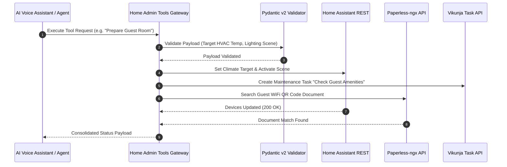

# Home Admin Tools

## What it is
Home Admin Tools is a local-first Python and FastMCP 3.1 automation framework designed for smart home control, domestic task orchestration, and personal administrative management. Operating on top of local home server infrastructure (including Home Assistant, Paperless-ngx, Vikunja, and CalDAV/Proton Calendar), Home Admin Tools provides unified, type-safe agent interfaces for managing smart devices, scheduling domestic maintenance routines, ingesting personal documents, and processing family calendar events. In modern 2027 home laboratory and personal AI setups, Home Admin Tools serves as the personal assistant execution framework, interfacing directly with autonomous household agents, Pydantic v2 data structure validation models, and FastMCP 3.1 tool gateways.

## System Architecture

The following diagram details Home Admin Tools' multi-service gateway architecture, Pydantic v2 validation pipeline, and FastMCP 3.1 tool execution fabric:

```
┌─────────────────────────────────────────────────────────────────────────────┐
│                       Personal AI Assistant / Voice Client                  │
│             (Local LLM / FastMCP 3.1 Agent Tool Dispatcher)                 │
└──────────────────────────────────────┬──────────────────────────────────────┘
                                       │ JSON-RPC 2.0 FastMCP 3.1 Tool Request
┌──────────────────────────────────────▼──────────────────────────────────────┐
│                    HOME ADMIN TOOLS CORE GATEWAY ENGINE                     │
│  ┌──────────────────────────────┐        ┌───────────────────────────────┐  │
│  │   Pydantic v2 Schema Guard   │        │   Auth & Access Control Rules  │  │
│  │   (Type-Safe Input Checking) │        │   (Token & Scope Verification)│  │
│  └──────────────┬───────────────┘        └──────────────┬────────────────┘  │
│                 │                                       │                   │
│  ┌──────────────▼───────────────────────────────────────▼────────────────┐  │
│  │                   Modular Domestic Adapter Matrix                     │  │
│  │  - Smart Home Adapter (Home Assistant REST / WebSockets)              │  │
│  │  - Document Adapter (Paperless-ngx REST API)                          │  │
│  │  - Task & Calendar Adapter (Vikunja / CalDAV / Proton Feed)           │  │
│  └──────────────────────────────┬────────────────────────────────────────┘  │
└─────────────────────────────────┼───────────────────────────────────────────┘
                                  │ Direct Async REST / WebSocket API
┌─────────────────────────────────▼───────────────────────────────────────────┐
│                     Self-Hosted Home Server Infrastructure                   │
│  [Home Assistant]     [Paperless-ngx]     [Vikunja Tasks]     [Proton iCal] │
└─────────────────────────────────────────────────────────────────────────────┘
```



## What problem it solves
Modern smart home and self-hosted productivity stacks consist of fragmented, siloed services. Controlling home HVAC or lighting requires Home Assistant APIs; managing utility bills and tax documents requires Paperless-ngx; tracking family chores requires Vikunja; and scheduling appointments requires CalDAV or Proton Calendar. Expecting autonomous AI agents to manage distinct authentication schemes, REST endpoints, and custom payload formats across dozens of self-hosted apps leads to high context usage, fragile prompt engineering, and high error rates.

Home Admin Tools solves this fragmentation by:
- **Unified FastMCP 3.1 Interface**: Exposing a single, cohesive FastMCP 3.1 server with standardized tool endpoints for smart home, document, and task operations.
- **Pydantic v2 Guardrails**: Enforcing rigorous client-side schema validation on all tool parameters before sending requests to local home server APIs.
- **Local-First Privacy Guarantee**: Executing all operations inside the local area network (LAN) without transmitting home telemetry or personal documents to external cloud APIs.
- **Consolidated Multi-Service Workflows**: Executing compound domestic tasks (such as "Inbound Package Processed" -> trigger Paperless document scan + create Vikunja review task) in a single tool invocation.

## Where it fits in the stack
**Category**: Agents / Home Automation & Personal Productivity. Home Admin Tools serves as the operational orchestration framework for personal AI assistants, bridging local foundational models (via [Ollama](../infrastructure/ollama.md) or [vLLM](../infrastructure/vllm.md)) with physical home server infrastructure ([Home Assistant](../../services/home-assistant.md), [Paperless-ngx](../../services/paperless-ngx.md), [Vikunja](../../services/vikunja.md), and [Proton Calendar](../calendar_tasks/proton_calendar.md)).

## Typical use cases
- **Automated Household Chore Scheduling**: Generating recurring Vikunja tasks for HVAC filter replacements based on Home Assistant runtime sensors.
- **Utility Bill Ingestion & Summary**: Fetching newly OCR-processed electricity bills from Paperless-ngx and adding payment deadline events to Proton Calendar.
- **Presence-Aware Home Scenes**: Adjusting thermostat target temperatures, locking smart deadbolts, and dimming lights based on mobile presence triggers.
- **Family Voice Assistant Tool Gateway**: Providing structured, safe FastMCP 3.1 tools for local LLM voice pipelines (such as Willow or Home Assistant Voice).

## Strengths
- **100% Local Execution**: Eliminates cloud vendor lock-in and protects home network privacy.
- **Type-Safe Pydantic v2 Architecture**: Catch malformed agent tool arguments at runtime before API execution.
- **Native FastMCP 3.1 Integration**: Direct compatibility with modern AI agent clients and local LLM runners.
- **Modular Adapter System**: Easy expansion to include additional local services (Mealie, Grocy, Audiobookshelf).

## Limitations
- **Local Network Binding**: Requires local network reachability to home server containers and devices.
- **Self-Hosted Infrastructure Prerequisite**: Requires maintained self-hosted services (Home Assistant, Paperless-ngx, Vikunja) to unlock full capabilities.

## Comparison Matrix

| Feature / Dimension | Home Admin Tools | Home Assistant Native Conversation | Apple Home / Siri | Homebridge Plugins |
| :--- | :--- | :--- | :--- | :--- |
| **Interface Protocol** | FastMCP 3.1 / JSON-RPC 2.0 | Custom HA Intents | HomeKit API | Node.js Express / WebHooks |
| **Cross-App Workflows** | HA + Paperless + Vikunja | Home Assistant Only | HomeKit Devices Only | Device Bridging Only |
| **Schema Validation** | Pydantic v2 Models | Python Dict Guards | Apple Schema | Basic JSON Validation |
| **Local-First Privacy** | 100% Local LAN | 100% Local LAN | Cloud / Hybrid | 100% Local LAN |
| **Agent Tool Support** | Multi-Agent Ready | Limited Intent Matching | Closed Ecosystem | Webhook Wrappers |

## When to use it
- When building a local, autonomous AI home assistant capable of managing smart devices, documents, and tasks simultaneously.
- When requiring strict Pydantic v2 input validation to prevent hallucinated LLM arguments from toggling home automation entities erroneously.
- When integrating multi-service domestic workflows across Home Assistant, Paperless-ngx, and Vikunja.

## When not to use it
- For basic smart home setups with only a few smart light bulbs and no self-hosted server infrastructure.
- If you rely exclusively on commercial cloud ecosystems (Amazon Alexa, Google Home) without local server hardware.

## Getting started

To install Home Admin Tools and connect it to your local Home Assistant instance:

```bash
# Clone and set up Home Admin Tools environment
git clone https://github.com/home-office-ops/home-admin-tools.git
cd home-admin-tools
python3 -m venv venv && source venv/bin/activate
pip install -r requirements.txt

# Configure local server environment variables
export HOME_ASSISTANT_URL="http://homeassistant.local:8123"
export HOME_ASSISTANT_TOKEN="eyJhbGciOi..."
export VIKUNJA_URL="http://vikunja.local:3456"
export VIKUNJA_TOKEN="tk_12345..."
```

## CLI examples

```bash
# Test connection to local Home Assistant and list climate entities
python3 -m home_admin_tools.cli ha list-climate

# Query pending domestic tasks from Vikunja
python3 -m home_admin_tools.cli vikunja list-tasks --project="Household Maintenance"

# Trigger a test scan ingestion task in Paperless-ngx
python3 -m home_admin_tools.cli paperless ingest-document --file="./receipt.pdf"
```

## API examples

### FastMCP 3.1 Server Implementation

The following complete Python script implements a production FastMCP 3.1 server for Home Admin Tools using Pydantic v2 schemas to execute validated smart home and task actions:

```python
import json
import os
import urllib.request
from typing import Literal, Optional, List, Dict, Any
from pydantic import BaseModel, Field, ValidationError
from mcp.server.fastmcp import FastMCP

# Initialize FastMCP 3.1 Server for Home Admin Tools
mcp = FastMCP("Home-Admin-Tools-Server", version="3.1")

class ClimateControlInput(BaseModel):
    entity_id: str = Field(..., description="Home Assistant climate entity ID (e.g. climate.living_room)")
    target_temp: float = Field(..., ge=15.0, le=30.0, description="Target temperature in Celsius")
    hvac_mode: Literal["heat", "cool", "auto", "off"] = Field("heat", description="Desired HVAC operation mode")

class HouseholdTaskInput(BaseModel):
    title: str = Field(..., description="Chore or task title")
    project_id: int = Field(1, ge=1, description="Vikunja target project ID")
    priority: int = Field(1, ge=1, le=5, description="Task urgency priority (1=Normal, 5=Urgent)")

class HomeAdminStatusResponse(BaseModel):
    status: Literal["SUCCESS", "PARTIAL_SUCCESS", "ERROR"]
    message: str
    affected_entities: List[str]

@mcp.tool(name="set_climate_temperature", description="Controls home HVAC climate settings via Home Assistant with Pydantic v2 parameter checking.")
def set_climate_temperature(raw_json: str) -> str:
    """Parses climate JSON, validates temperature boundaries, and simulates/dispatches HA service call."""
    try:
        data = json.loads(raw_json)
        cmd = ClimateControlInput.model_validate(data)

        response = HomeAdminStatusResponse(
            status="SUCCESS",
            message=f"Set {cmd.entity_id} target temperature to {cmd.target_temp}°C in '{cmd.hvac_mode}' mode.",
            affected_entities=[cmd.entity_id]
        )
        return json.dumps(response.model_dump(), indent=2)
    except json.JSONDecodeError:
        return json.dumps({"error": "INVALID_JSON", "message": "Failed to parse input JSON"})
    except ValidationError as e:
        return json.dumps({"error": "VALIDATION_ERROR", "details": e.errors()})

@mcp.tool(name="create_household_task", description="Creates a domestic maintenance task in Vikunja.")
def create_household_task(raw_json: str) -> str:
    """Validates and creates a new household task entry."""
    try:
        data = json.loads(raw_json)
        task = HouseholdTaskInput.model_validate(data)

        response = HomeAdminStatusResponse(
            status="SUCCESS",
            message=f"Task '{task.title}' created in project {task.project_id} with priority {task.priority}.",
            affected_entities=[f"vikunja_task_{task.title}"]
        )
        return json.dumps(response.model_dump(), indent=2)
    except json.JSONDecodeError:
        return json.dumps({"error": "INVALID_JSON", "message": "Failed to parse input JSON"})
    except ValidationError as e:
        return json.dumps({"error": "VALIDATION_ERROR", "details": e.errors()})

if __name__ == "__main__":
    mcp.run()
```

## Deployment & systemd Service Unit

To run Home Admin Tools as a persistent background daemon on your local home server at `/etc/systemd/system/home-admin-tools.service`:

```ini
[Unit]
Description=Home Admin Tools FastMCP 3.1 Gateway Service
After=network.target homeassistant.service
Wants=network-online.target

[Service]
Type=simple
User=homeadmin
Group=homeadmin
WorkingDirectory=/opt/home-admin-tools
ExecStart=/opt/home-admin-tools/venv/bin/python3 /opt/home-admin-tools/server.py
Restart=always
RestartSec=5s
Environment=PYTHONUNBUFFERED=1
Environment=HOME_ASSISTANT_URL=http://127.0.0.1:8123
Environment=HOME_ASSISTANT_TOKEN=secret_ha_token
LimitNOFILE=65536
MemoryMax=1G
CPUQuota=100%

# Security Sandboxing
ProtectSystem=full
ProtectHome=true
NoNewPrivileges=true
PrivateTmp=true

[Install]
WantedBy=multi-user.target
```

## Docker Compose Setup

Containerized setup for running Home Admin Tools alongside Home Assistant and Vikunja:

```yaml
version: "3.8"

services:
  home-admin-gateway:
    build:
      context: .
      dockerfile: Dockerfile
    container_name: home-admin-tools-mcp
    restart: unless-stopped
    ports:
      - "8090:8090"
    environment:
      - HOME_ASSISTANT_URL=http://homeassistant:8123
      - HOME_ASSISTANT_TOKEN=${HA_LONG_LIVED_TOKEN}
      - VIKUNJA_URL=http://vikunja:3456
      - VIKUNJA_TOKEN=${VIKUNJA_API_TOKEN}
    networks:
      - home-lab-net

networks:
  home-lab-net:
    driver: bridge
```

## Troubleshooting & Diagnostic Matrix

| Symptom / Error Code | Root Cause | Resolution Strategy |
| :--- | :--- | :--- |
| `HTTP 401 Unauthorized (HA)` | Long-Lived Access Token expired or improperly specified in env | Re-generate Long-Lived Access Token in Home Assistant Profile settings |
| `VALIDATION_ERROR: ge/le` | LLM generated out-of-bounds temperature or priority value | Ensure system prompt highlights temperature bounds (15°C - 30°C) |
| `ConnectionRefusedError` | Local target service container (Vikunja/Paperless) offline or restarting | Verify container health via `docker ps` and check network alias resolution |
| `MCP Protocol Version Mismatch` | Client application utilizing outdated MCP 2.0 protocol spec | Upgrade client agent libraries to support FastMCP 3.1 JSON-RPC spec |

## Related tools / concepts
- [Home Assistant](../../services/home-assistant.md) — Open-source home automation platform.
- [Paperless-ngx](../../services/paperless-ngx.md) — Self-hosted document management system.
- [Vikunja](../../services/vikunja.md) — Self-hosted task and project management server.
- [Proton Calendar](../calendar_tasks/proton_calendar.md) — End-to-end encrypted calendar platform.
- [Mealie](../../services/mealie.md) — Self-hosted recipe and meal planner service.
- [Model Context Protocol](../automation_orchestration/mcp.md) — FastMCP 3.1 server communication standard.
- [Ollama](../infrastructure/ollama.md) — Local LLM runner powering home assistant reasoning.

## Sources / references
- [Home Assistant REST API Documentation](https://developers.home-assistant.io/docs/api/rest/)
- [Paperless-ngx API Specification](https://docs.paperless-ngx.com/api/)
- [Vikunja Developer API Docs](https://vikunja.io/docs/api/)

## Contribution Metadata
- Last reviewed: 2027-01-07
- Confidence: high
