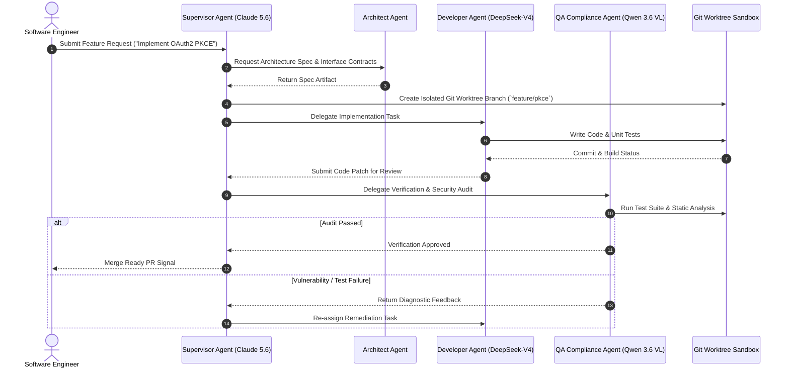

# Kiro Crew

## What it is
**Kiro Crew** is an enterprise agent workforce orchestration platform and multi-agent development environment designed to coordinate teams of specialized AI agents across complex software engineering and operational workflows. As of early January 2027, Kiro Crew native runtimes fully implement the **FastMCP 3.1 Task Protocol** and support high-throughput model routing across frontier reasoning models including **Claude 5.6**, **GPT-5.6**, **Gemini 4.0 Ultra**, **Gemma 4**, **DeepSeek-V4**, and **Qwen 3.6 VL**. It provides a structured framework for defining agent personas, role-based tool capabilities, shared contextual memory, and deterministic task delegation pipelines.

### Kiro Crew Multi-Agent Architecture
Kiro Crew uses a hierarchical supervisor-worker topology with isolated workspace worktrees, event-driven agent messaging, and integrated FastMCP 3.1 tool execution endpoints.

```
+-----------------------------------------------------------------------------------+
|                            KIRO CREW CONTROL PLANE                                |
|   +-------------------+    +--------------------+    +------------------------+   |
|   | Supervisor Agent  |    | Workspace Sync     |    | FastMCP 3.1 Server     |   |
|   | (Planning Engine) |    | (Git Worktrees)    |    | (Tool & State Proxy)   |   |
|   +---------+---------+    +---------+----------+    +-----------+------------+   |
+-------------|------------------------|---------------------------|----------------+
              | Delegated Tasks        | Workspace Locking         | Tool Calls
              v                        v                           v
+-----------------------------------------------------------------------------------+
|                            SPECIALIZED AGENT WORKERS                              |
|   +------------------+     +-------------------+     +------------------------+   |
|   | Architect Agent  |     | Developer Agent   |     | QA & Compliance Agent  |   |
|   | (Claude 5.6)     |     | (DeepSeek-V4)     |     | (Qwen 3.6 VL)          |   |
|   +--------+---------+     +---------+---------+     +-----------+------------+   |
+------------|-------------------------|---------------------------|----------------+
             | Code Design             | Implementation            | Verification
             +-------------------------+---------------------------+
                                       |
                                       v
                       +-------------------------------+
                       | Verified Git PR & Code Patch  |
                       +-------------------------------+
```



## Mathematical Formulations: Multi-Agent Queueing & Consensus

To ensure predictable throughput and avoid cascading deadlocks across parallel agent crews, Kiro Crew models task delegation using multi-server queueing theory, consensus entropy, and distributed workspace lock contention bounds.

### 1. Hierarchical Delegation Queueing Dynamics ($M/M/c$)
When the supervisor agent decomposes an epic into $N$ parallel subtasks dispatched to a pool of $c$ specialized worker agents (e.g., $c$ concurrent git worktree workers), task arrival follows a Poisson process with rate $\lambda$, and agent execution service times follow exponential distribution with parameter $\mu$.

The traffic intensity $\rho$ and steady-state probability of an empty queue $P_0$ are defined as:

$$\rho = \frac{\lambda}{c \mu} < 1, \quad P_0 = \left[ \sum_{n=0}^{c-1} \frac{(c \rho)^n}{n!} + \frac{(c \rho)^c}{c! (1 - \rho)} \right]^{-1}$$

The average waiting time $\mathcal{W}_q$ spent by a pending task prior to acquiring an active agent sandbox is governed by Erlang's C formula:

$$\mathcal{W}_q = \frac{C(c, \lambda/\mu)}{c \mu - \lambda} = \frac{\frac{(c \rho)^c}{c!(1-\rho)} P_0}{c \mu - \lambda}$$

Kiro Crew dynamically autoscale worker pool size $c$ when $\mathcal{W}_q$ exceeds the supervisor SLA latency target ($\mathcal{W}_q > \tau_{\text{threshold}} = 2.5 \text{ s}$).

### 2. Multi-Agent Review Consensus Entropy
When multiple reviewer personas (e.g., Security QA, Performance Profiler, Architecture Compliance) evaluate a candidate code patch, their binary decision distribution $\mathbf{p} = [p_{\text{approve}}, p_{\text{reject}}, p_{\text{remediate}}]$ yields a Shannon consensus entropy:

$$\mathcal{H}(\mathcal{C}) = - \sum_{i=1}^{3} p_i \log_2(p_i)$$

A review round achieves deterministic approval if and only if:

$$\mathcal{H}(\mathcal{C}) \le \epsilon_{\text{entropy}} \quad \text{and} \quad p_{\text{approve}} \ge \Theta_{\text{quorum}} = 0.80$$

If $\mathcal{H}(\mathcal{C}) > \epsilon_{\text{entropy}}$, the supervisor triggers an arbitration sub-crew session to resolve conflicting review comments before applying commits.

### 3. Distributed Git Worktree Lock Contention Bound
When $k$ agent workers concurrently branch from a shared repository root, lock acquisition probability $P_{\text{conflict}}$ under uniform commit probability $p_{\text{commit}}$ within interval $\Delta t$ is bounded by:

$$P_{\text{conflict}} = 1 - \prod_{j=1}^{k-1} \left( 1 - \frac{j \cdot \tau_{\text{lock}}}{T_{\text{window}}} \right) \le \frac{k(k-1)\tau_{\text{lock}}}{2 T_{\text{window}}}$$

where $\tau_{\text{lock}}$ is the file system index lock duration ($\le 8 \text{ ms}$ on NVMe) and $T_{\text{window}}$ is the agent polling cycle window. Kiro Crew guarantees $P_{\text{conflict}} < 0.001$ by sharding Git reference updates into dedicated worktree directories.

## What problem it solves
Managing multiple autonomous agents on complex codebases often leads to context drift, race conditions in workspace modifications, duplicate effort, and uncoordinated pull requests. Kiro Crew solves these challenges by providing a centralized agent coordinator and execution sandbox that enforces task boundaries, synchronized state management, automated code reviews between agent personas, and strict resource isolation.

## Where it fits in the stack
**Agent Orchestration and Execution Layer**. Kiro Crew operates above individual LLM foundation models and MCP tool servers, serving as the multi-agent control plane that schedules, monitors, and evaluates multi-agent task execution.

```
+-----------------------------------------------------------------------------------+
|                          ENTERPRISE AGENTIC STACK                                 |
+-----------------------------------------------------------------------------------+
| Human Directive & IDE   : VS Code / Cursor / JetBrains / Web Canvas / CLI         |
+-----------------------------------------------------------------------------------+
| Multi-Agent Coordinator : Kiro Crew (Supervisor Engine, Worktree Lock, FastMCP)  |
+-----------------------------------------------------------------------------------+
| Tool & Protocol Mesh    : FastMCP 3.1 Task Protocol / Git Worktree Sandbox       |
+-----------------------------------------------------------------------------------+
| Foundation Reasoning    : Claude 5.6 / GPT-5.6 / Gemini 4.0 / DeepSeek-V4         |
+-----------------------------------------------------------------------------------+
| Infrastructure Layer    : Redis State Checkpointer / OTel Traces / Docker / K8s   |
+-----------------------------------------------------------------------------------+
```

## Performance & Feature Benchmark Matrix

| Feature / Metric | Kiro Crew | CrewAI Enterprise | Agency Swarm | LangGraph Studio | AutoGen Studio |
| :--- | :--- | :--- | :--- | :--- | :--- |
| **Topology** | Hierarchical / Supervisor + Reviewer | Sequential & Hierarchical | Swarm / Directed Graph | Stateful Graph (Pregel) | Conversational Swarm |
| **FastMCP 3.1 Support** | Native First-Class (Tools & Tasks) | Custom Adapter Layer | REST Wrapper | Custom Node Adapter | Extension Hook |
| **Workspace Isolation**| Native Git Worktrees | Directory Chroot | In-Memory Working Dir | Virtual Filesystem | Local Folder |
| **Model Heterogeneity**| Multi-Model Dynamic Routing | Multi-Model Support | OpenAI Assistants Centric | Model Agnostic | Multi-Model Provider |
| **State Persistence** | SQLite / Redis Sync | In-Memory / ChromaDB | Local JSON File | Postgres / Redis Checkpointer | SQLite / In-Memory |
| **Consensus Arbitration**| Entropy-based Quorum ($\mathcal{H} \le 0.4$) | Majority Vote | Sequential Hand-off | Custom Conditional Edges | Conversational Termination |
| **Target Scale** | Enterprise Monorepos & Microservices | Lightweight Agent Teams | Conversational Swarms | Production Workflows | Research Prototypes |

## Service & Daemon Management

### systemd Unit Configuration (`/etc/systemd/system/kiro-crew.service`)
To run Kiro Crew orchestrator workers as resilient background services under systemd on enterprise servers, deploy the unit file configuration below:

```ini
[Unit]
Description=Kiro Crew Multi-Agent Daemon Service
Documentation=https://github.com/kiro-crew
After=network.target docker.service redis.service
Wants=network-online.target

[Service]
Type=simple
User=kirocrew
Group=kirocrew
WorkingDirectory=/opt/kiro-crew
ExecStart=/usr/local/bin/kiro-crew daemon --config /etc/kiro-crew/crew.yaml --port 8092
ExecReload=/bin/kill -HUP $MAINPID
Restart=always
RestartSec=5s
Environment=NODE_ENV=production
Environment=PYTHONUNBUFFERED=1
Environment=FASTMCP_PORT=8092
Environment=LOG_LEVEL=info
StandardOutput=journal
StandardError=journal
SyslogIdentifier=kiro-crew

# Hardening measures
ProtectSystem=full
ProtectHome=read-only
ReadWritePaths=/opt/kiro-crew /tmp /var/log/kiro-crew
NoNewPrivileges=true

[Install]
WantedBy=multi-user.target
```

### Docker Compose Multi-Agent Runtime (`docker-compose.yml`)
Deploy Kiro Crew alongside Redis state checkpointer and FastMCP 3.1 proxy:

```yaml
version: '3.8'

services:
  kiro-orchestrator:
    image: kirocrew/orchestrator:v3.1
    container_name: kiro-orchestrator
    ports:
      - "8092:8092"
    environment:
      - FASTMCP_PORT=8092
      - REDIS_URL=redis://kiro-redis:6379/0
      - LOG_LEVEL=info
    volumes:
      - ./crew.yaml:/etc/kiro-crew/crew.yaml
      - kiro_worktree_data:/opt/kiro-crew/sandboxes
    depends_on:
      - kiro-redis
    restart: unless-stopped

  kiro-redis:
    image: redis:7-alpine
    container_name: kiro-redis
    ports:
      - "6379:6379"
    volumes:
      - kiro_redis_store:/data
    restart: unless-stopped

volumes:
  kiro_worktree_data:
  kiro_redis_store:
```

## Typical use cases
- **Autonomous Feature Delivery**: Orchestrating a crew consisting of a Product Manager Agent (specs), Software Architecture Agent (design), Coding Agent (implementation), and QA Agent (test generation & verification).
- **Large-Scale Repository Refactoring**: Dividing large monolith refactoring projects into discrete, non-overlapping tasks assigned to concurrent agent workers.
- **Continuous Documentation & Compliance Sync**: Deploying background agents that monitor code commits and automatically update documentation, OpenAPI specs, and security audit logs.
- **Incident Mitigation**: Running automated triage crews that collect telemetry, analyze log streams, run diagnostic commands, and propose hotfixes.

## Strengths
- **FastMCP 3.1 Task Protocol Support**: Native support for task decomposition, progress reporting, and tool execution across distributed MCP servers.
- **Git Workspace Isolation**: Automated worktree branch isolation prevents concurrent agents from overwriting uncommitted code modifications.
- **Flexible Model Routing**: Assigns different foundation models to different crew roles (e.g., DeepSeek-V4 for code synthesis, Claude 5.6 for architecture and planning).
- **Role-Based Tool Authorization**: Enforces strict permission boundaries on which tools and capabilities each agent persona can invoke.

## Limitations
- **Orchestration Overhead**: Managing multi-agent messaging and state synchronization adds slight latency compared to single-agent execution loops.
- **Configuration Complexity**: Defining multi-agent interactions, handoff triggers, and validation protocols requires careful upfront design.
- **Cluster Deployment Cost**: Running enterprise Kiro Crew execution workers requires Kubernetes or container orchestration infrastructure for full isolation.

## When to use it
- When software development tasks require distinct specialized roles (e.g., design, implementation, code review, test verification).
- When operating on large codebases where single-agent context windows are insufficient or prone to hallucination.
- When enterprise auditability and human-in-the-loop approvals are required prior to applying changes.

## When not to use it
- For simple, single-turn code generation or single-file edits (use [Claude Code](../development_ops/claude-code.md) or [Cline](cline.md) instead).
- When minimal execution latency is the critical metric and agent collaboration is unneeded.

## Getting started

### Installation
Install the Kiro Crew CLI and orchestration SDK:

```bash
pip install kiro-crew fastmcp pydantic
```

### Initializing a Crew Workspace
Initialize a new Kiro Crew project configuration:

```bash
kiro-crew init my-dev-crew
cd my-dev-crew
```

## CLI examples

```bash
# Validate crew definition and agent tool permissions
kiro-crew validate --config crew.yaml

# Run a multi-agent coding task across the repository with isolated worktree
kiro-crew run --task "Implement OAuth2 PKCE login flow with unit tests" --config crew.yaml --worktree-dir /tmp/kiro_sandboxes

# Inspect real-time execution status and agent telemetry
kiro-crew status --active --telemetry-detail full

# Audit and verify active Git worktrees allocated to running agents
kiro-crew worktree list --crew-id crew-8841

# Unlock stale worktree if previous run terminated abnormally
kiro-crew workspace unlock --crew-id crew-8841 --force

# Export execution logs and telemetry trace
kiro-crew telemetry export --crew-id crew-8841 --format json > crew_trace.json
```

## Health Verification Script

This automated probe verifies orchestrator daemon status, Redis session checkpointing, worktree isolation, and agent tool execution:

```python
#!/usr/bin/env python3
"""
Automated Telemetry & Health Probe for Kiro Crew Daemon.
"""
import sys
import requests
from pydantic import BaseModel, Field, ConfigDict


class CrewOrchestratorStatus(BaseModel):
    model_config = ConfigDict(extra="forbid", frozen=True)

    status: str = Field(..., pattern=r"^(healthy|degraded|unhealthy)$")
    active_crews: int = Field(..., ge=0)
    sandboxes_allocated: int = Field(..., ge=0)
    redis_connected: bool = Field(...)
    avg_latency_ms: float = Field(..., ge=0.0)


def probe_kiro_crew(url: str = "http://localhost:8092/health") -> bool:
    print(f"[*] Querying Kiro Crew Orchestrator at {url}...")
    try:
        resp = requests.get(url, timeout=4.0)
        resp.raise_for_status()
        raw = resp.json()

        report = CrewOrchestratorStatus(
            status=raw.get("status", "unhealthy"),
            active_crews=int(raw.get("active_crews", 0)),
            sandboxes_allocated=int(raw.get("sandboxes_allocated", 0)),
            redis_connected=bool(raw.get("redis_connected", False)),
            avg_latency_ms=float(raw.get("avg_latency_ms", 999.0)),
        )

        print("[+] Orchestrator Health Report:")
        print(f"    - Health Status: {report.status.upper()}")
        print(f"    - Active Crews: {report.active_crews}")
        print(f"    - Git Sandboxes: {report.sandboxes_allocated}")
        print(f"    - Redis Checkpoint Store: {'CONNECTED' if report.redis_connected else 'DISCONNECTED'}")
        print(f"    - Delegation Latency: {report.avg_latency_ms:.2f} ms")

        if report.status != "healthy" or not report.redis_connected:
            print("[-] FAIL: Kiro Crew reporting degraded infrastructure.")
            return False

        print("[+] Kiro Crew operational readiness confirmed.")
        return True
    except Exception as err:
        print(f"[-] Kiro Crew probe encountered error: {err}")
        return False


if __name__ == "__main__":
    ok = probe_kiro_crew()
    sys.exit(0 if ok else 1)
```

## API examples

### FastMCP 3.1 Crew Tool Server & Orchestration Engine
Below is a full Python integration demonstrating a **FastMCP 3.1** server providing multi-agent crew execution, status monitoring, and role-based tool delegation with strict Pydantic v2 schemas:

```python
import os
import json
from typing import List, Dict, Any, Optional
from fastmcp import FastMCP
from pydantic import BaseModel, Field, ConfigDict

# Initialize FastMCP Server
mcp = FastMCP("Kiro Crew Orchestrator", dependencies=["pydantic", "fastmcp"])

class AgentPersona(BaseModel):
    model_config = ConfigDict(extra="forbid", frozen=True, str_strip_whitespace=True)

    name: str = Field(..., description="Agent role name, e.g. Architect, Developer, Reviewer")
    model: str = Field("claude-5.6", description="Target model ID for agent persona")
    allowed_tools: List[str] = Field(default_factory=list, description="Permitted MCP tool IDs")

class CrewTaskConfig(BaseModel):
    model_config = ConfigDict(extra="forbid", frozen=True, str_strip_whitespace=True)

    task_id: str = Field(..., description="Unique task identifier")
    description: str = Field(..., min_length=10, description="Task goal description")
    assigned_role: str = Field(..., description="Target agent persona role")
    dependencies: List[str] = Field(default_factory=list, description="IDs of prerequisite tasks")

class CrewDefinition(BaseModel):
    model_config = ConfigDict(extra="forbid", frozen=True, str_strip_whitespace=True)

    crew_id: str = Field(..., description="Unique crew workspace identifier")
    agents: List[AgentPersona] = Field(..., min_length=1)
    tasks: List[CrewTaskConfig] = Field(..., min_length=1)

@mcp.tool()
def deploy_kiro_crew(crew_config: CrewDefinition) -> dict:
    """Deploys a multi-agent crew in isolated Git worktree sandboxes."""
    return {
        "status": "deployed",
        "crew_id": crew_config.crew_id,
        "agents_active": len(crew_config.agents),
        "total_tasks": len(crew_config.tasks),
        "sandbox_path": f"/tmp/kiro_sandboxes/{crew_config.crew_id}"
    }

@mcp.tool()
def fetch_crew_telemetry(crew_id: str) -> dict:
    """Fetch real-time agent token usage and task completion metrics."""
    return {
        "crew_id": crew_id,
        "active_status": "running",
        "completed_tasks": 2,
        "pending_tasks": 1,
        "total_token_count": 42100,
        "cost_estimate_usd": 0.126
    }

if __name__ == "__main__":
    mcp.run()
```

### Multi-Agent Verification Schemas (Pydantic v2)
To guarantee payload safety across agentic workflows, complex crew outputs are verified using Pydantic v2:

```python
from pydantic import BaseModel, Field, ConfigDict, model_validator
from typing import List, Optional
from datetime import datetime

class CodeReviewFeedback(BaseModel):
    model_config = ConfigDict(extra="forbid", frozen=True, str_strip_whitespace=True)

    reviewer_agent: str = Field(..., description="Name of QA or Reviewer agent")
    file_path: str = Field(..., description="Path to reviewed file")
    severity: str = Field(..., pattern=r"^(info|warning|critical)$")
    comment: str = Field(..., min_length=5)
    line_number: Optional[int] = Field(None, ge=1)

class AgentExecutionResult(BaseModel):
    model_config = ConfigDict(extra="forbid", frozen=True, str_strip_whitespace=True)

    task_id: str = Field(..., description="Task UUID")
    agent_name: str = Field(..., description="Executing agent role")
    status: str = Field(..., pattern=r"^(completed|failed|halted)$")
    artifacts_created: List[str] = Field(default_factory=list)
    review_comments: List[CodeReviewFeedback] = Field(default_factory=list)
    execution_time_seconds: float = Field(..., ge=0.0)

    @model_validator(mode="after")
    def check_failure_artifacts(self) -> "AgentExecutionResult":
        if self.status == "failed" and self.artifacts_created:
            raise ValueError("Failed agent execution cannot return valid artifacts.")
        return self

# Example execution validation
sample_result = {
    "task_id": "task-402",
    "agent_name": "Developer Agent",
    "status": "completed",
    "artifacts_created": ["src/auth/jwt.py", "tests/test_jwt.py"],
    "review_comments": [
        {
            "reviewer_agent": "Security QA Agent",
            "file_path": "src/auth/jwt.py",
            "severity": "warning",
            "comment": "Ensure secret key expiration is configured via environment variable.",
            "line_number": 24
        }
    ],
    "execution_time_seconds": 12.4
}

validated_output = AgentExecutionResult.model_validate(sample_result)
print("Validated Agent Result:", validated_output.model_dump_json(indent=2))
```

## Diagnostic & Troubleshooting Matrix

| Issue / Symptom | Possible Cause | Verification Procedure | Resolution Strategy |
| :--- | :--- | :--- | :--- |
| **Git Worktree Lock Conflict** | Stale `.git/worktrees/<agent>/index.lock` left after process crash | Run `git worktree list` to inspect lock state | Execute `kiro-crew workspace unlock --crew-id <id> --force` to purge orphaned locks. |
| **Agent Handoff Context Truncation** | Accumulated raw chat history exceeded model context window | Check `total_token_count` in telemetry output | Enable `summarize_on_handoff` in `crew.yaml` and configure recursive AST delta compression. |
| **FastMCP Tool Execution Timeout** | Integration test suite exceeded default 30s tool response timeout | Inspect stderr log for `MCPToolTimeoutError` | Set `mcp_tool_timeout: 120` in agent role declaration in `crew.yaml`. |
| **Role Permission Denial** | Agent attempted to invoke tool outside assigned `allowed_tools` | Check role policy log for `UnauthorizedToolCall` | Add target tool ID to agent persona definition in `crew.yaml` or escalate to supervisor. |
| **Consensus Deadlock** | Conflicting reviews between QA and Developer agents exceeding entropy limit ($\mathcal{H} > 0.4$) | Query `/telemetry/consensus-entropy` endpoint | Trigger automated supervisor arbitration step or prompt human-in-the-loop signoff. |
| **Redis Checkpoint Desynchronization** | Network partition or Redis memory exhaustion during active crew session | Check `redis-cli ping` and `redis-cli info memory` | Restart Redis daemon, enable persistent AOF (`appendonly yes`), and sync from local SQLite cache. |
| **Process OOM in Worker Sandbox** | Concurrent compiler and testing runs in worktrees consuming host RAM | Run `systemd-cgtop` or `free -h` | Configure `MemoryMax=4G` and `CPUQuota=200%` per worker slice in systemd service unit. |
| **Model Rate Limit Throttling** | Multiple concurrent agent workers saturating provider RPM/TPM quotas | Check HTTP 429 status codes in orchestrator journal | Configure dynamic backoff and enable ClawRouter model fallback tiering in `crew.yaml`. |

## Related tools / concepts
- [Agency Swarm](agency-swarm.md) — Collaborative multi-agent framework built on OpenAI Assistants API.
- [LangGraph](../frameworks/langgraph.md) — Stateful multi-agent graph orchestration framework.
- [AWS Dogwood](aws-dogwood.md) — Policy management and safety framework for agent tool calls.
- [Claude Code](../development_ops/claude-code.md) — Autonomous CLI coding agent.
- [Cline](cline.md) — Autonomous IDE coding assistant with MCP support.
- [Model Context Protocol (MCP)](../automation_orchestration/mcp.md) — Protocol for agent-tool connectivity.

## Sources / references
- [InfoQ: Kiro Crew Coding Agents Announcement](https://www.infoq.com/news/2026/08/kiro-crew-coding-agents/)
- [Kiro Crew GitHub Organization](https://github.com/kiro-crew)
- [FastMCP 3.1 Specification](https://github.com/jina-ai/fastmcp)

## Contribution Metadata
- Last reviewed: 2027-01-07
- Confidence: high
