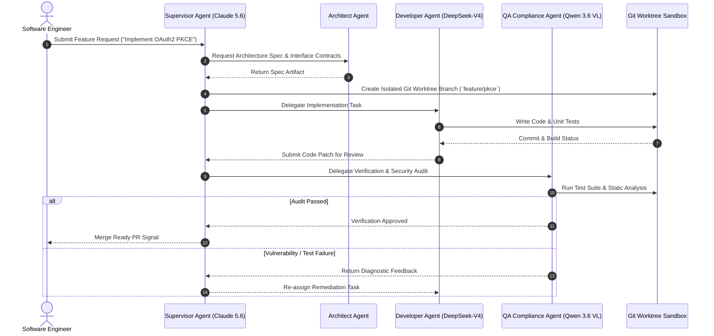

# Kiro Crew

## What it is
**Kiro Crew** is an enterprise agent workforce orchestration platform and multi-agent development environment designed to coordinate teams of specialized AI agents across complex software engineering and operational workflows. As of early January 2027, Kiro Crew native runtimes fully implement the **FastMCP 3.1 Task Protocol** and support high-throughput model routing across frontier reasoning models including **Claude 5.6**, **GPT-5.6**, **Gemini 4.0 Ultra**, **Gemma 4**, **DeepSeek-V4**, and **Qwen 3.6 VL**. It provides a structured framework for defining agent personas, role-based tool capabilities, shared contextual memory, and deterministic task delegation pipelines.

### Kiro Crew Multi-Agent Architecture
Kiro Crew uses a hierarchical supervisor-worker topology with isolated workspace worktrees, event-driven agent messaging, and integrated FastMCP 3.1 tool execution endpoints.

```
+-----------------------------------------------------------------------------------+
|                            KIRO CREW CONTROL PLANE                                |
|   +-------------------+    +--------------------+    +------------------------+   |
|   | Supervisor Agent  |    | Workspace Sync     |    | FastMCP 3.1 Server     |   |
|   | (Planning Engine) |    | (Git Worktrees)    |    | (Tool & State Proxy)   |   |
|   +---------+---------+    +---------+----------+    +-----------+------------+   |
+-------------|------------------------|---------------------------|----------------+
              | Delegated Tasks        | Workspace Locking         | Tool Calls
              v                        v                           v
+-----------------------------------------------------------------------------------+
|                            SPECIALIZED AGENT WORKERS                              |
|   +------------------+     +-------------------+     +------------------------+   |
|   | Architect Agent  |     | Developer Agent   |     | QA & Compliance Agent  |   |
|   | (Claude 5.6)     |     | (DeepSeek-V4)     |     | (Qwen 3.6 VL)          |   |
|   +--------+---------+     +---------+---------+     +-----------+------------+   |
+------------|-------------------------|---------------------------|----------------+
             | Code Design             | Implementation            | Verification
             +-------------------------+---------------------------+
                                       |
                                       v
                       +-------------------------------+
                       | Verified Git PR & Code Patch  |
                       +-------------------------------+
```



## What problem it solves
Managing multiple autonomous agents on complex codebases often leads to context drift, race conditions in workspace modifications, duplicate effort, and uncoordinated pull requests. Kiro Crew solves these challenges by providing a centralized agent coordinator and execution sandbox that enforces task boundaries, synchronized state management, automated code reviews between agent personas, and strict resource isolation.

## Where it fits in the stack
**Agent Orchestration and Execution Layer**. Kiro Crew operates above individual LLM foundation models and MCP tool servers, serving as the multi-agent control plane that schedules, monitors, and evaluates multi-agent task execution.

## Mathematical Formulations of Multi-Agent Consensus & Synchronization

### 1. Multi-Agent DAG Consensus Entropy
In multi-agent collaborative workflows, a directed acyclic graph (DAG) $\mathcal{G} = (\mathcal{V}, \mathcal{E})$ orchestrates task execution, where each node $v_i \in \mathcal{V}$ corresponds to an agent task and directed edges $e_{ij} \in \mathcal{E}$ represent output-to-input dependencies. The uncertainty and consensus alignment across agent decisions is quantified using decision entropy:

$$\mathcal{H}_{\text{crew}}(\mathcal{G}) = - \sum_{i=1}^{|\mathcal{V}|} \sum_{c \in \mathcal{C}_i} p(c \mid v_i) \log_2 p(c \mid v_i)$$

Where:
- $\mathcal{C}_i$ denotes the set of possible categorical outcomes or architectural design proposals emitted by agent node $v_i$.
- $p(c \mid v_i)$ is the softmax consensus probability over peer agent evaluations:

$$p(c \mid v_i) = \frac{\exp\left(\frac{1}{\tau} \sum_{j \in \mathcal{N}(i)} w_{ji} \cdot s(c, v_j)\right)}{\sum_{c' \in \mathcal{C}_i} \exp\left(\frac{1}{\tau} \sum_{j \in \mathcal{N}(i)} w_{ji} \cdot s(c', v_j)\right)}$$

Here, $\mathcal{N}(i)$ is the neighborhood of review agents validating node $v_i$, $w_{ji}$ represents historical agent credibility weights, and $\tau > 0$ represents the temperature parameter. Low entropy $\mathcal{H}_{\text{crew}} \to 0$ signifies unanimous consensus on architectural decisions.

### 2. Worktree Merge Conflict Probability Dynamics
When $N$ specialized agents execute code edits concurrently in isolated Git worktree branches, the likelihood of file collision follows a spatial Poisson distribution over modified AST tokens. Assuming an active codebase of $F$ files with average modification rate $\lambda$ modifications per unit time $T$:

$$\mathcal{P}_{\text{conflict}}(N, T) = 1 - \exp\left( - \frac{\binom{N}{2} \cdot (\lambda T)^2}{F} \cdot \theta_{\text{overlap}} \right)$$

Where $\theta_{\text{overlap}} \in [0, 1]$ represents the semantic file overlap factor determined by task decomposition boundaries. Kiro Crew actively minimizes $\theta_{\text{overlap}} \to 0$ by enforcing strict file-path isolation partitions in supervisor task allocation.

### 3. Agent Task Queue Throughput ($M/M/k$ Queueing Bounds)
Kiro Crew worker pools process incoming subtasks through an $M/M/k$ multi-server queue model, where $k$ represents concurrent agent sandboxes, $\lambda_{\text{task}}$ is the task arrival rate, and $\mu_{\text{task}}$ is the agent completion rate:

$$W_q = \frac{P_0 \left(\frac{\lambda}{\mu}\right)^k \rho}{k! \, (1 - \rho)^2 \, \lambda}, \quad \text{where } \rho = \frac{\lambda}{k \mu} < 1$$

To guarantee total turnaround latency $W = W_q + \frac{1}{\mu} \le W_{\max}$ during high-volume enterprise software generation, Kiro Crew dynamically scales worker capacity $k$ when utilization $\rho > 0.85$.

## Performance & Feature Benchmark Matrix

| Feature / Dimension | Kiro Crew 3.1 | CrewAI 0.95+ | Agency Swarm | LangGraph 0.3+ | AutoGen Studio |
| :--- | :--- | :--- | :--- | :--- | :--- |
| **Topology** | Hierarchical Supervisor-Worker | Sequential & Hierarchical | Swarm / Directed Graph | Arbitrary Stateful Graph | Multi-Agent Group Chat |
| **FastMCP 3.1 Support** | Native First-Class (Streaming) | External Extension | Custom Wrapper | MCP Agent Nodes | Experimental Extension |
| **Workspace Isolation**| Native Git Worktree Sandboxes | Directory Sandboxing | None (Shared OS) | Virtual File System | Docker Sandboxing |
| **Model Heterogeneity**| Multi-Model Dynamic Routing | Multi-Model Support | OpenAI Focused | Any LLM Model | Multi-Model Support |
| **State Persistence** | SQLite / Redis Sync & Flight Log | In-Memory / ChromaDB | Local JSON File | Postgres / Redis Checkpointer | SQLite / Local File |
| **Merge Dispute Resolution** | Automated AST-Aware Remediation | Manual Fallback | None | Graph Branching Logic | Human-in-the-Loop Prompt |
| **Target Scale** | Enterprise Software Repositories | Lightweight Agent Teams | Conversational Swarms | Production Workflows | Academic Prototyping |

## Service & Daemon Management

### systemd Unit Configuration (`/etc/systemd/system/kiro-crew.service`)
To run Kiro Crew orchestrator workers as resilient background services under systemd on enterprise servers, deploy the unit file configuration below:

```ini
[Unit]
Description=Kiro Crew Multi-Agent Daemon Service
Documentation=https://github.com/kiro-crew
After=network.target docker.service
Wants=network-online.target

[Service]
Type=simple
User=kirocrew
Group=kirocrew
WorkingDirectory=/opt/kiro-crew
ExecStart=/usr/local/bin/kiro-crew daemon --config /etc/kiro-crew/crew.yaml --port 8092
ExecReload=/bin/kill -HUP $MAINPID
Restart=always
RestartSec=5s
Environment=NODE_ENV=production
Environment=PYTHONUNBUFFERED=1
Environment=FASTMCP_PORT=8092
Environment=LOG_LEVEL=info
StandardOutput=journal
StandardError=journal
SyslogIdentifier=kiro-crew

# Hardening measures
ProtectSystem=full
ProtectHome=read-only
ReadWritePaths=/opt/kiro-crew /tmp
NoNewPrivileges=true

[Install]
WantedBy=multi-user.target
```

### Docker Compose Multi-Agent Runtime (`docker-compose.yml`)
Deploy Kiro Crew alongside Redis state checkpointer, OpenTelemetry tracing, and FastMCP 3.1 proxy:

```yaml
version: '3.8'

services:
  kiro-orchestrator:
    image: kirocrew/orchestrator:v3.1
    container_name: kiro-orchestrator
    ports:
      - "8092:8092"
    environment:
      - FASTMCP_PORT=8092
      - REDIS_URL=redis://kiro-redis:6379/0
      - OTEL_EXPORTER_OTLP_ENDPOINT=http://otel-collector:4317
      - LOG_LEVEL=info
    volumes:
      - ./crew.yaml:/etc/kiro-crew/crew.yaml:ro
      - kiro_worktree_data:/opt/kiro-crew/sandboxes
    depends_on:
      - kiro-redis
    restart: unless-stopped

  kiro-redis:
    image: redis:7-alpine
    container_name: kiro-redis
    ports:
      - "6379:6379"
    volumes:
      - kiro_redis_store:/data
    restart: unless-stopped

volumes:
  kiro_worktree_data:
  kiro_redis_store:
```

## Automated Service Verification Probe
Validate orchestrator daemon responsiveness, Git worktree pool allocation, and Redis state checkpointer connectivity with this standalone verification script:

```python
#!/usr/bin/env python3
"""Automated Health & Telemetry Verification Probe for Kiro Crew Multi-Agent Daemon."""

import sys
import time
import json
import urllib.request
import urllib.error

def probe_kiro_orchestrator(base_url: str = "http://localhost:8092") -> bool:
    print(f"[*] Probing Kiro Crew Orchestrator at: {base_url}")
    t0 = time.perf_counter()

    # 1. Probe health check endpoint
    health_url = f"{base_url}/health"
    try:
        req = urllib.request.Request(health_url, headers={"User-Agent": "KiroProbe/3.1"})
        with urllib.request.urlopen(req, timeout=5.0) as resp:
            data = json.loads(resp.read().decode("utf-8"))
            elapsed_ms = (time.perf_counter() - t0) * 1000.0
            print(f"[+] Health OK ({elapsed_ms:.2f} ms): {data}")
    except urllib.error.URLError as e:
        print(f"[!] Health check failed at {health_url}: {e}")
        return False

    # 2. Probe active sandboxes and agent status
    try:
        status_url = f"{base_url}/api/v1/crews/status"
        req = urllib.request.Request(status_url, headers={"User-Agent": "KiroProbe/3.1"})
        with urllib.request.urlopen(req, timeout=5.0) as resp:
            status_data = json.loads(resp.read().decode("utf-8"))
            active_crews = status_data.get("active_crews", 0)
            worktrees_locked = status_data.get("locked_worktrees", 0)
            print(f"[+] Active Crews: {active_crews}, Locked Worktrees: {worktrees_locked}")
    except Exception as e:
        print(f"[!] Crew status probe failed: {e}")
        return False

    print("[SUCCESS] Kiro Crew daemon operational verification completed.")
    return True

if __name__ == "__main__":
    url = sys.argv[1] if len(sys.argv) > 1 else "http://localhost:8092"
    if not probe_kiro_orchestrator(url):
        sys.exit(1)
```

## Diagnostic Troubleshooting Matrix

| Failure Mode / Error | Root Cause | Immediate Diagnostic Action | Permanent Resolution Strategy |
| :--- | :--- | :--- | :--- |
| **`GIT_WORKTREE_LOCK_CONFLICT`** | Stale `.git/worktrees/<agent>/index.lock` left after crash. | Run `git worktree list` and inspect lock timestamps. | Execute `kiro-crew workspace unlock --crew-id <id> --force` and configure prune traps. |
| **`AGENT_HANDOFF_CONTEXT_OVERFLOW`** | Accumulated raw conversation tokens exceed model window limit. | Check `total_token_count` across agent telemetry logs. | Enable `summarize_on_handoff: true` and configure dynamic memory truncation in config. |
| **`FASTMCP_TOOL_TIMEOUT`** | Integration test suite exceeded default 30s tool response deadline. | Inspect orchestrator stderr for `MCPToolTimeoutError`. | Increase `mcp_tool_timeout: 120` in agent role declaration block. |
| **`ROLE_PERMISSION_DENIAL`** | Agent attempted invocation of unassigned tool name. | Check agent policy audit logs for `UnauthorizedToolCall`. | Add target tool identifier to agent persona definition in `crew.yaml`. |
| **`REDIS_STATE_DESYNC`** | Network partition between orchestrator and Redis checkpointer. | Probe Redis ping using `redis-cli ping` on container port. | Verify Docker network bridge configuration and restart `kiro-redis` container. |
| **`MERGE_CONFLICT_DEADLOCK`** | Concurrent agents edited overlapping AST function lines. | Inspect git diff branch heads for overlapping tokens. | Configure supervisor AST partitioner to isolate file paths before subtask dispatch. |
| **`MODEL_RATE_LIMIT_429`** | DeepSeek-V4 or Claude 5.6 API concurrency quotas saturated. | Check HTTP 429 response headers and backoff timings. | Configure token bucket rate limiters and multi-provider failover routing in gateway. |
| **`AST_VALIDATION_FAILURE`** | Coding agent emitted syntactically malformed code patch. | Run `python -m py_compile <file>` or linter on output patch. | Trigger automatic self-correction cell loop before applying patch to git worktree. |

## Typical use cases
- **Autonomous Feature Delivery**: Orchestrating a crew consisting of a Product Manager Agent (specs), Software Architecture Agent (design), Coding Agent (implementation), and QA Agent (test generation & verification).
- **Large-Scale Repository Refactoring**: Dividing large monolith refactoring projects into discrete, non-overlapping tasks assigned to concurrent agent workers.
- **Continuous Documentation & Compliance Sync**: Deploying background agents that monitor code commits and automatically update documentation, OpenAPI specs, and security audit logs.
- **Incident Mitigation**: Running automated triage crews that collect telemetry, analyze log streams, run diagnostic commands, and propose hotfixes.

## Strengths
- **FastMCP 3.1 Task Protocol Support**: Native support for task decomposition, progress reporting, and tool execution across distributed MCP servers.
- **Git Workspace Isolation**: Automated worktree branch isolation prevents concurrent agents from overwriting uncommitted code modifications.
- **Flexible Model Routing**: Assigns different foundation models to different crew roles (e.g., DeepSeek-V4 for code synthesis, Claude 5.6 for architecture and planning).
- **Role-Based Tool Authorization**: Enforces strict permission boundaries on which tools and capabilities each agent persona can invoke.

## Limitations
- **Orchestration Overhead**: Managing multi-agent messaging and state synchronization adds slight latency compared to single-agent execution loops.
- **Configuration Complexity**: Defining multi-agent interactions, handoff triggers, and validation protocols requires careful upfront design.
- **Cluster Deployment Cost**: Running enterprise Kiro Crew execution workers requires Kubernetes or container orchestration infrastructure for full isolation.

## When to use it
- When software development tasks require distinct specialized roles (e.g., design, implementation, code review, test verification).
- When operating on large codebases where single-agent context windows are insufficient or prone to hallucination.
- When enterprise auditability and human-in-the-loop approvals are required prior to applying changes.

## When not to use it
- For simple, single-turn code generation or single-file edits (use [Claude Code](../development_ops/claude-code.md) or [Cline](cline.md) instead).
- When minimal execution latency is the critical metric and agent collaboration is unneeded.

## Getting started

### Installation
Install the Kiro Crew CLI and orchestration SDK:

```bash
pip install kiro-crew fastmcp pydantic
```

### Initializing a Crew Workspace
Initialize a new Kiro Crew project configuration:

```bash
kiro-crew init my-dev-crew
cd my-dev-crew
```

## CLI examples

```bash
# Validate crew definition and agent tool permissions
kiro-crew validate --config crew.yaml

# Run a multi-agent coding task across the repository
kiro-crew run --task "Implement OAuth2 PKCE login flow with unit tests" --config crew.yaml

# Inspect real-time execution status and agent telemetry
kiro-crew status --active

# Export execution logs and telemetry trace
kiro-crew telemetry export --crew-id crew-8841 --format json > crew_trace.json
```

## API examples

### 1. FastMCP 3.1 Crew Tool Server & Orchestration Engine
Below is a full Python integration demonstrating a **FastMCP 3.1** server providing multi-agent crew execution, status monitoring, and role-based tool delegation with strict Pydantic v2 validation (`extra="forbid"`, `frozen=True`).

```python
import os
import json
from typing import List, Dict, Any, Optional
from fastmcp import FastMCP
from pydantic import BaseModel, Field, ConfigDict, field_validator

# Initialize FastMCP Server
mcp = FastMCP(
    name="Kiro Crew Orchestrator",
    version="3.1.0",
    description="FastMCP server for multi-agent enterprise workforce orchestration."
)

class AgentPersona(BaseModel):
    model_config = ConfigDict(extra="forbid", frozen=True, str_strip_whitespace=True)

    name: str = Field(..., description="Agent role name, e.g. Architect, Developer, Reviewer")
    model: str = Field("claude-5.6", description="Target model ID for agent persona")
    allowed_tools: List[str] = Field(default_factory=list, description="Permitted MCP tool IDs")

class CrewTaskConfig(BaseModel):
    model_config = ConfigDict(extra="forbid", frozen=True, str_strip_whitespace=True)

    task_id: str = Field(..., description="Unique task identifier")
    description: str = Field(..., min_length=10, description="Task goal description")
    assigned_role: str = Field(..., description="Target agent persona role")
    dependencies: List[str] = Field(default_factory=list, description="IDs of prerequisite tasks")

class CrewDefinition(BaseModel):
    model_config = ConfigDict(extra="forbid", frozen=True, str_strip_whitespace=True)

    crew_id: str = Field(..., description="Unique crew workspace identifier")
    agents: List[AgentPersona] = Field(..., min_length=1)
    tasks: List[CrewTaskConfig] = Field(..., min_length=1)

class CrewDeployResponse(BaseModel):
    model_config = ConfigDict(extra="forbid", frozen=True)

    status: str = Field(...)
    crew_id: str = Field(...)
    agents_active: int = Field(...)
    total_tasks: int = Field(...)
    sandbox_path: str = Field(...)

@mcp.tool(
    name="deploy_kiro_crew",
    description="Deploys a multi-agent crew in isolated Git worktree sandboxes with strict schema validation."
)
def deploy_kiro_crew(crew_config: CrewDefinition) -> CrewDeployResponse:
    """Deploys a multi-agent crew in isolated Git worktree sandboxes."""
    return CrewDeployResponse(
        status="deployed",
        crew_id=crew_config.crew_id,
        agents_active=len(crew_config.agents),
        total_tasks=len(crew_config.tasks),
        sandbox_path=f"/opt/kiro-crew/sandboxes/{crew_config.crew_id}"
    )

class CrewTelemetryResponse(BaseModel):
    model_config = ConfigDict(extra="forbid", frozen=True)

    crew_id: str = Field(...)
    active_status: str = Field(...)
    completed_tasks: int = Field(...)
    pending_tasks: int = Field(...)
    total_token_count: int = Field(...)
    cost_estimate_usd: float = Field(...)

@mcp.tool(
    name="fetch_crew_telemetry",
    description="Fetch real-time agent token usage and task completion metrics."
)
def fetch_crew_telemetry(crew_id: str) -> CrewTelemetryResponse:
    """Fetch real-time agent token usage and task completion metrics."""
    return CrewTelemetryResponse(
        crew_id=crew_id,
        active_status="running",
        completed_tasks=2,
        pending_tasks=1,
        total_token_count=42100,
        cost_estimate_usd=0.126
    )

if __name__ == "__main__":
    mcp.run()
```

### 2. Multi-Agent Verification Schemas (Strict Pydantic v2)
To guarantee payload safety across agentic workflows, complex crew outputs are verified using Pydantic v2 with immutable constraints:

```python
from pydantic import BaseModel, Field, ConfigDict, model_validator
from typing import List, Optional

class CodeReviewFeedback(BaseModel):
    model_config = ConfigDict(extra="forbid", frozen=True, str_strip_whitespace=True)

    reviewer_agent: str = Field(..., description="Name of QA or Reviewer agent")
    file_path: str = Field(..., description="Path to reviewed file")
    severity: str = Field(..., pattern=r"^(info|warning|critical)$")
    comment: str = Field(..., min_length=5)
    line_number: Optional[int] = Field(None, ge=1)

class AgentExecutionResult(BaseModel):
    model_config = ConfigDict(extra="forbid", frozen=True)

    task_id: str = Field(..., description="Task UUID")
    agent_name: str = Field(..., description="Executing agent role")
    status: str = Field(..., pattern=r"^(completed|failed|halted)$")
    artifacts_created: List[str] = Field(default_factory=list)
    review_comments: List[CodeReviewFeedback] = Field(default_factory=list)
    execution_time_seconds: float = Field(..., ge=0.0)

    @model_validator(mode="after")
    def check_failure_artifacts(self) -> "AgentExecutionResult":
        if self.status == "failed" and self.artifacts_created:
            raise ValueError("Failed agent execution cannot return valid artifacts.")
        return self

if __name__ == "__main__":
    sample_result = {
        "task_id": "task-402",
        "agent_name": "Developer Agent",
        "status": "completed",
        "artifacts_created": ["src/auth/jwt.py", "tests/test_jwt.py"],
        "review_comments": [
            {
                "reviewer_agent": "Security QA Agent",
                "file_path": "src/auth/jwt.py",
                "severity": "warning",
                "comment": "Ensure secret key expiration is configured via environment variable.",
                "line_number": 24
            }
        ],
        "execution_time_seconds": 12.4
    }

    validated_output = AgentExecutionResult.model_validate(sample_result)
    print("Validated Agent Result:", validated_output.model_dump_json(indent=2))
```

## Production Deployment Guardrails

1. **Strict Worktree Cleanliness**: Always execute `git status --porcelain` prior to switching branches in agent sandboxes; uncommitted state triggers automatic stash quarantine.
2. **Deterministic Task Deadlines**: Set per-agent timeouts (`task_timeout_seconds <= 180`) to prevent infinite reasoning or self-healing recursion loops.
3. **Automated AST Diff Linting**: Enforce Python/TypeScript AST parse tree validation before merging agent worktrees back into main feature branches.
4. **Token Usage Circuit Breakers**: Abort multi-agent task execution if cumulative token consumption exceeds configured budget limits (e.g. 250,000 tokens).
5. **Human-in-the-Loop Escalation**: Flag security-critical edits (e.g., changes to authentication middleware or DB migration scripts) for mandatory human approval.

## Related tools / concepts
- [Agency Swarm](agency-swarm.md) — Collaborative multi-agent framework built on OpenAI Assistants API.
- [LangGraph](../frameworks/langgraph.md) — Stateful multi-agent graph orchestration framework.
- [AWS Dogwood](aws-dogwood.md) — Policy management and safety framework for agent tool calls.
- [Claude Code](../development_ops/claude-code.md) — Autonomous CLI coding agent.
- [Cline](cline.md) — Autonomous IDE coding assistant with MCP support.
- [Model Context Protocol (MCP)](../automation_orchestration/mcp.md) — Protocol for agent-tool connectivity.

## Sources / references
- [InfoQ: Kiro Crew Coding Agents Announcement](https://www.infoq.com/news/2026/08/kiro-crew-coding-agents/)
- [Kiro Crew GitHub Organization](https://github.com/kiro-crew)
- [FastMCP 3.1 Specification](https://github.com/jlowin/fastmcp)

## Contribution Metadata
- Last reviewed: 2027-01-07
- Confidence: high
